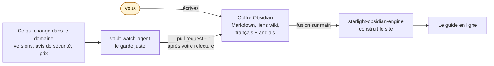
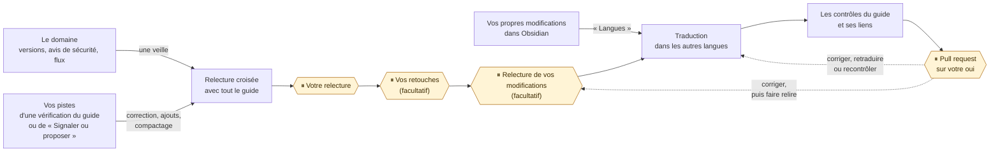
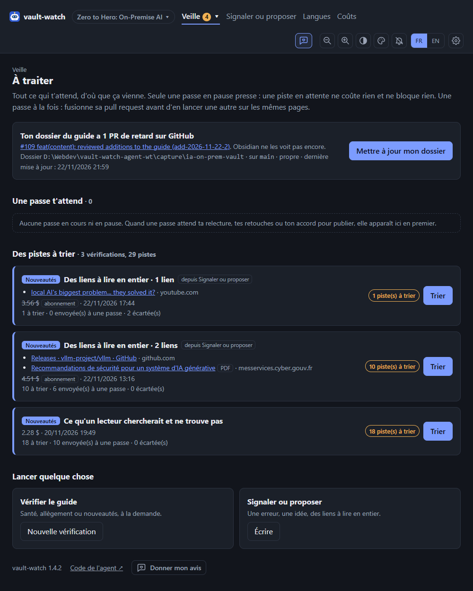
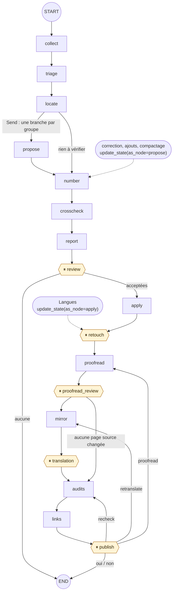

<div align="center">


# vault-watch-agent

**Garder un guide Markdown juste, complet et léger : un agent LangGraph suit son domaine, propose des corrections et des ajouts sourcés, et relit les vôtres ; vous décidez, il ouvre la pull request.**

[](https://www.python.org)
[](https://langchain-ai.github.io/langgraph/)
[](docs/fr/choose-a-model.md)
[](#linterface-web)
[](#principes)
[](LICENSE)

[English](README.md) · **Français**

**[Toute la documentation](docs/fr/README.md)** · [Brancher son guide](docs/fr/connect-your-guide.md) · [Une veille étape par étape](docs/fr/run.md) · [Vérifier le guide](docs/fr/check.md) · [Coûts](docs/fr/costs.md) · [Sécurité](docs/fr/security.md)

</div>

---

Un guide technique se périme une version à la fois. vault-watch-agent vous épaule pour l'entretien, dans les deux
sens : il propose et vous relisez ; vous écrivez et il relit.

- **Veiller** : toutes les deux semaines, les notes de version, les avis de sécurité et les flux du domaine ; les
  phrases devenues fausses, avec une correction sourcée.
- **Vérifier** : à la demande, le guide entier : contrôles, liens, fraîcheur, cohérence entre les pages, traductions.
- **Compléter** : ce qu'un lecteur chercherait sans le trouver, ou une piste à vous (une idée, un article, un PDF,
  une vidéo, ce que vous savez déjà), vérifiée sur le web et écrite là où elle a sa place.
- **Alléger** : ce qui se répète, s'empile ou est plus long que nécessaire.
- **Corriger** : les erreurs signalées par vous ou par un lecteur.
- **Relire et traduire vos modifications** : ce que vous écrivez dans Obsidian, relu (orthographe, faits vérifiés sur
  le web, cohérence avec le reste du guide), puis traduit dans les autres langues, passage par passage.

Chaque proposition passe par votre relecture, où vous pouvez la retoucher, puis par les contrôles du guide et la
pull request, sur votre oui. Une page, « À traiter », montre ce qui vous attend.

**En service** sur un guide d'environ 400 k tokens : plus de vingt pull requests fusionnées après relecture, et une
veille passée, rejouée, a retrouvé les 11 corrections faites par l'éditeur, aucune fausse
([le guide de référence](#le-guide-de-référence)).


*L'écran de relecture sur une veille de test (`watch.json`) : une version de vLLM qui change une phrase et sa note, cochées ensemble.*

## L'idée de départ

Trois pièces, chacune dans son dépôt. Vous écrivez un guide technique dans [Obsidian](https://obsidian.md), en
simples notes Markdown dans un dépôt git. Un moteur,
[starlight-obsidian-engine](https://github.com/DamienBecherini/starlight-obsidian-engine), publie le coffre sur le web
en site [Astro Starlight](https://starlight.astro.build) (liens wiki, diagrammes Mermaid, les deux langues),
reconstruit par la CI du guide à chaque fusion. Et cet agent le garde juste : un guide sur un domaine qui bouge vite
vieillit plus vite qu'une personne seule ne peut le suivre.



## Votre guide, votre modèle, votre décision

- **Votre guide** : n'importe quel guide Markdown dans un dépôt git, sur GitHub, sur Gitea ou gardé en local, décrit
  par un petit manifeste (`vault-watch.toml`) : ses pages, ses langues, sa veille, ses propres contrôles. L'agent
  s'arrête à la pull request ; c'est la chaîne du guide qui reconstruit son site après la fusion.
- **Votre modèle** : Claude par Claude Code sur un abonnement (rien de facturé à l'appel) ou par l'API ; ou tout
  serveur compatible OpenAI, local ou hébergé. Mesuré sur Claude Opus 5.5 et Sonnet 5.5 seulement
  ([Choisir un modèle](docs/fr/choose-a-model.md)).
- **Votre décision** : le modèle n'écrit jamais un fichier. Rien n'est appliqué avant votre relecture, rien n'est
  poussé avant votre feu vert, et c'est vous qui fusionnez la pull request.

## Démarrage rapide

```bash
pipx install git+https://github.com/DamienBecherini/vault-watch-agent@v1.4.3

cd mon-guide                # la racine du dépôt git du guide
vault-watch init            # écrit vault-watch.toml d'après ce que montre le dossier ; relisez-le, ajustez-le
vault-watch doctor          # ce qui est prêt, ce qui manque avant une première passe
vault-watch collect         # facultatif : ce que disent les flux listés par le manifeste, sans modèle
vault-watch serve           # http://127.0.0.1:4430/ : À traiter, relecture, publication, réglages
```

`pipx` installe la commande `vault-watch` pour votre compte, dans un environnement à part, quel que soit le dossier
d'où vous le lancez ; si la commande n'est pas trouvée ensuite, `pipx ensurepath` puis un nouveau terminal. Les
commandes agissent sur le guide du dossier courant (ou celui de `--guide`). Testé sous Windows et Linux ; macOS
devrait fonctionner, sans être testé.

`init` devine la langue, les copies traduites, le dépôt GitHub du remote `origin` (un dépôt Gitea, c'est trois
lignes à ajouter) et les scripts du guide ; chaque clé du manifeste, et ce que débloque chaque partie facultative,
sont dans [Brancher son guide](docs/fr/connect-your-guide.md). Un guide d'exemple dans [`examples/`](examples/)
montre le minimum.

Ce qu'il faut :

| Pour | Quoi |
| :-- | :-- |
| tout guide | Python 3.11+, git, [pipx](https://pipx.pypa.io) (`python -m pip install --user pipx`) |
| le modèle | un moteur : Claude Code connecté avec un abonnement Claude, une clé d'API Claude, ou un serveur compatible OpenAI ([réglages](#le-modèle)) |
| un guide sur GitHub | la CLI GitHub `gh`, connectée (`gh auth login`) |
| un guide sur Gitea | un jeton Gitea, donné par référence ([Brancher son guide](docs/fr/connect-your-guide.md), [Sécurité](docs/fr/security.md)) |
| les contrôles du guide | ce qu'ils lancent (Node.js pour un `npm test`, par exemple) |
| les notifications du bureau (facultatif) | rien sous Windows et macOS ; `notify-send` sous Linux (`libnotify-bin` sur Debian et Ubuntu). Testées sous Windows seulement : sous macOS ou Linux, dites-nous ce qu'il en est par « Donner mon avis » dans l'interface |

## Déroulé d'une passe



Toutes les passes suivent ce chemin ; seul leur point de départ change. Une veille part du domaine : l'agent trie ses
éléments, trouve les pages concernées et rédige les corrections. Une passe de correction, d'ajouts ou de compactage
part des pistes que vous avez gardées (une vérification du guide ne fait que donner des pistes), ses propositions
déjà rédigées. Une passe « Langues » part de vos modifications, relues d'abord si vous le voulez (orthographe,
faits, cohérence), et s'arrête à côté de chaque traduction. Ce que vous écrivez pendant une passe, aux retouches ou
à la publication, peut être relu de la même façon avant de continuer : la passe s'arrête sur les corrections
trouvées, et vous choisissez. Chaque étape, ce qui y décide et les écrans où vous
décidez : [Une veille étape par étape](docs/fr/run.md) ; les autres passes :
[Vérifier le guide](docs/fr/check.md), [Compactage](docs/fr/compact.md), [Nouveautés](docs/fr/news.md),
[Synchroniser les langues](docs/fr/run.md#synchroniser-les-langues).

## Principes

- **Le modèle propose, le code décide.** Chaque correction cite le texte actuel ; un contrôle déterministe la refuse
  si la citation n'apparaît pas exactement une fois dans la page. Les pages déclarées en lecture seule ne sont
  jamais modifiées.
- **Un humain dans la boucle, qui écrit.** La passe s'arrête après le rapport (`interrupt` de LangGraph), où chaque
  proposition peut être retouchée ; de nouveau une fois les corrections appliquées, pour retoucher les pages
  elles-mêmes si vous le voulez ; et avant que quoi que ce soit ne quitte la machine, où les pages et leur
  traduction peuvent encore être corrigées ; une passe « Langues » s'arrête aussi à côté de chaque traduction. Une
  passe en pause est sauvegardée dans SQLite et reprise plus tard, depuis un autre processus, des jours après s'il
  le faut.
- **Des preuves, pas la mémoire.** Les propositions s'appuient sur les notes de version et les avis de la veille, et
  la relecture croisée sur des sources primaires lues sur le web, jamais sur la seule mémoire du modèle.
- **Les règles du guide.** La consigne éditoriale et la politique de traduction sont dans le guide et lues à chaque
  passe ; l'agent a des valeurs par défaut pour un guide qui n'en a pas.

## Le modèle

| Moteur | Ce qui tourne | Ce que ça coûte |
| :-- | :-- | :-- |
| `claude-code` | [Claude Code](https://claude.com/claude-code) sur cette machine, connecté avec un abonnement Claude, lancé une fois par appel (`claude -p`) | Rien de facturé : l'usage compte dans les limites de l'abonnement |
| `api` | L'API Claude par le SDK officiel | Au token, au prix public |
| `openai` | Tout serveur compatible OpenAI : llama.cpp, vLLM, Ollama, un service hébergé ; recherche web par SearXNG | Celui de votre serveur |

Sans choix, l'agent prend Claude Code quand il le trouve connecté avec un abonnement, sinon l'API. Le moteur, le
modèle et l'effort de chaque rôle (raisonnement, traduction) se choisissent dans les Réglages de l'interface web
(l'engrenage), qui écrivent `~/.vault-watch/settings.json` ; `VAULT_WATCH_ENGINE` impose un moteur pour une commande.
L'agent ne bascule jamais de lui-même vers un moteur facturé : quand une limite de l'abonnement est atteinte, la
passe s'arrête et peut être reprise plus tard (`resume --retry`) ou avec un autre moteur.

Les clés ne sont jamais stockées : les réglages prennent une référence, `env:NOM`, `sops:fichier#NOM` (un fichier
chiffré avec [sops](https://github.com/getsops/sops)) ou `file:chemin`, et refusent une clé en clair. Un autre
moteur peut s'ajouter sous forme de paquet ([Écrire un moteur](docs/fr/write-an-engine.md)).

## L'interface web

```bash
vault-watch serve                     # http://127.0.0.1:4430/
vault-watch serve --idle-exit 3600    # s'arrête après 1 h sans visite ni analyse en cours
vault-watch serve --notify fr         # notification du bureau quand une passe vous attend, se termine ou échoue
```

Un écran par étape d'une passe : une passe en cours (chaque étape terminée envoyée à la page), la relecture (un
bloc par élément ou par piste, une carte par correction avec un diff mot à mot, sa source et le verdict de la
relecture croisée), les retouches (votre dossier prêté à Obsidian, ou un éditeur dans la page), l'étape de
publication (« Avant de publier » : les contrôles du guide, la traduction, les liens à vérifier vous-même ; puis
chaque page modifiée à côté de sa traduction, encore corrigeable), puis la pull request. Autour :



| Page | À quoi elle sert |
| :-- | :-- |
| Veille › À traiter | La première page : tout ce qui vous attend, d'où que ça vienne : une passe en pause pour votre relecture, une veille à lancer, les vérifications dont les pistes sont à trier, et votre dossier du guide quand il lui manque des pull requests fusionnées, avec « Mettre à jour mon dossier » ; le menu « Veille » en donne le nombre |
| Veille › Veille automatique | Les veilles avec leur état et un bouton pour en analyser une |
| Veille › Toutes les passes | Toutes les passes, les plus récentes d'abord : celles des veilles, et celles lancées depuis une vérification, depuis « Signaler ou proposer » ou depuis « Langues » |
| Veille › Sources suivies | Ce que chaque source de la veille a apporté et ce qu'il en est sorti, et un contrôle des sources elles-mêmes, dont les changements partent dans une pull request ([quelles sources méritent leur place](docs/fr/collect.md#quelles-sources-méritent-leur-place)) |
| Veille › Vérifier le guide | Des contrôles à la demande, de trois sortes montrées en couleur (santé du guide, allègement, nouveautés), les gratuits et les payants avec leur estimation : audits, liens, fraîcheur, cohérence, traductions, ce qui alourdit le guide, les nouveautés. Leurs pistes se trient, puis partent dans une passe ([Vérifier le guide](docs/fr/check.md)) |
| Signaler ou proposer | Des erreurs à corriger, une idée ou une nouvelle à vérifier et à écrire, ou des liens à lire en entier (un article, une page, un PDF, une vidéo) pour les pistes qu'ils contiennent ; ce que vous tapez est gardé comme brouillon, un par onglet |
| Langues | Les pages en avance sur leur miroir, et celles que vous avez modifiées dans votre dossier sans les commiter : ce qui a changé est traduit, puis contrôles et pull request habituels ([Une veille étape par étape](docs/fr/run.md#synchroniser-les-langues)) |
| Chapitres | Dans le menu sous le nom du guide : les chapitres sur lesquels l'agent travaille, proposés par un modèle ou écrits à la main : pourquoi et comment, [Chapitres](docs/fr/chapters.md) |
| Coûts | Ce que coûte l'entretien, par mois et par passe ([Coûts](docs/fr/costs.md)) |
| Réglages | L'engrenage : moteur, modèle et effort de chaque rôle ou d'une seule étape, les prix et d'où ils viennent, ce que le guide fournit |
| Donner mon avis | Une note, un bug, une idée : vous l'envoyez vous-même, par une issue GitHub ou un e-mail ; l'agent n'envoie rien |


*Une piste de « Des liens à lire en entier » sur le guide de référence, dépliée ; rien n'est encore coché, le bouton
demande donc de cocher des pistes.*

Chaque écran qui lance une étape payante dit ce qu'elle coûtera (sur un abonnement, ce qu'elle vaut au prix
catalogue, barré) et ce qui la fera tourner (moteur, modèle, effort) avant le clic. L'interface est en français
ou en anglais, claire ou sombre, avec des palettes et une taille de texte au choix. Une passe lancée ici peut être
reprise en ligne de commande, et l'inverse. Le serveur n'écoute que sur
127.0.0.1 ([Sécurité](docs/fr/security.md)).

## La ligne de commande

```bash
vault-watch run --watch-json watch.json     # ou --issue 50 pour une issue de la forge ; s'arrête à la relecture
vault-watch resume <passe> --accept C1,C3   # ou all / none ; applique, traduit, contrôle, s'arrête de nouveau
                       --edit C3=mon-texte.md # une proposition retouchée par vous avant de s'appliquer
vault-watch resume <passe> --publish yes    # pousse la branche et ouvre la pull request
vault-watch status <passe>
vault-watch fix <passe> --findings erreurs.txt    # erreurs signalées → corrections contrôlées, même relecture et PR
vault-watch collect --json watch.json       # la veille depuis les flux du guide, sans modèle
vault-watch compact                         # ce que pèse et a pris chaque page, sans modèle ; --report : quoi alléger
vault-watch news                            # pistes : ce qu'un lecteur chercherait et ne trouve pas ; --explore : le web
vault-watch chapters                        # les chapitres sur lesquels l'agent travaille ; --propose : un modèle les propose
vault-watch mirror                          # les pages en avance sur leur miroir ; --yes : traduire ce qui a changé
vault-watch costs --by month                # ou year, run, step
vault-watch --guide ../autre-guide doctor   # n'importe quelle commande sur un autre guide
```

## Le guide de référence

L'agent a été écrit pour [Zero to Hero : IA on-premise](https://ia-on-prem.damien.becherini.fr/)
([dépôt](https://github.com/DamienBecherini/ia-on-prem-vault)), environ 400 k tokens de contenu en français avec sa
copie anglaise, dont la veille de quinzaine est collectée par un workflow GitHub. C'est le guide dont les résultats
sont mesurés ci-dessous. Un second guide, privé, en français seulement et hébergé sur un Gitea auto-hébergé, a
vérifié que le manifeste et les forges fonctionnent sur un guide pour lequel l'agent n'a pas été écrit.

**Comment il est fait.** Un coffre Obsidian : des pages Markdown, des liens wiki et des notes de bas de page, le
français à la racine et l'anglais sous `en/`, lisible tel quel dans Obsidian. La CI du guide reconstruit le site avec
starlight-obsidian-engine à chaque fusion sur `main` qui touche une page. L'agent ignore tout du moteur : il lit et
modifie le Markdown du coffre, lance les contrôles du guide et ouvre une pull request ; la fusion redéploie ensuite
le site.

**Produit.** Plus de vingt pull requests du guide faites par l'agent et fusionnées après relecture (au 22 novembre
2026), par exemple [#78](https://github.com/DamienBecherini/ia-on-prem-vault/pull/78) (une veille),
[#79](https://github.com/DamienBecherini/ia-on-prem-vault/pull/79) (30 corrections issues d'une vérification de tout
le guide), [#91](https://github.com/DamienBecherini/ia-on-prem-vault/pull/91) (un compactage),
[#98](https://github.com/DamienBecherini/ia-on-prem-vault/pull/98) (des ajouts vérifiés sur le web) et
[#109](https://github.com/DamienBecherini/ia-on-prem-vault/pull/109) (des ajouts tirés des pistes d'une vidéo, retouchés par
l'éditeur).

**Évalué.** `vault-watch eval` rejoue une veille passée sur le guide tel qu'il était et fait apparier par un modèle
juge (toujours Claude) chaque proposition avec le diff fusionné par l'humain ([`metrics/eval/`](metrics/eval/)). Le
18 novembre 2026, le rejeu de la veille #77 a trouvé les 11 corrections de #78, aucune fausse. Sur la veille #30,
aucune proposition arrivée à la relecture n'était fausse ; la plupart des corrections manquées ne changeaient qu'une
date que la page de la version rendait elle-même trompeuse.

**Coût.** Chaque appel au modèle est noté dans un journal (ici [`metrics/usage.jsonl`](metrics/usage.jsonl), chez
vous `~/.vault-watch/usage.jsonl`) ; `vault-watch costs` en fait le total, avec à part les appels faits sur un
abonnement (0 facturé, et ce qu'ils auraient coûté sur l'API). Mesuré en novembre 2026 sur l'API au prix public, Opus
5.5 pour le raisonnement et Sonnet 5.5 pour la copie anglaise :

| Passe | Coût |
| :-- | --: |
| Veille avec extraits seulement (81 éléments gardés, 8 corrections) | 0,90 $ |
| Veille complète avec la relecture croisée de tout le guide | 2,95 – 4,45 $ |
| Passe de correction sur des erreurs signalées | 5,60 – 8,15 $ |
| Passe de correction de la traduction seule (Sonnet) | 0,35 $ |
| Vérification du guide à la demande (audits, liens, cohérence, traductions, affirmations datées) | 7,25 – 10,85 $ |
| Compactage : le rapport, puis une passe d'allègements sur 30 constats (Fable 5.2 sur ces deux étapes) | 6,28 $, puis 18,87 $ |
| Nouveautés : les pistes, puis une passe d'ajouts sur 2 à 5 pistes | 2,28 $, puis 8,70 – 12,95 $ |

La relecture croisée domine : écrire 400 k tokens dans le cache de prompt coûte environ 2 $, un appel suivant sur le
même cache environ 0,08 $. Deux veilles complètes par mois font environ 100 $ par an ; un guide deux fois plus petit
coûte à peu près moitié moins. Avec Claude Code sur un abonnement, rien n'est facturé, mais une relecture croisée
pèse sur les limites de l'abonnement.

Ces montants sont indicatifs : c'est ce que valent les appels au prix public de l'API. Les appels de l'auteur sont
passés par l'accès API d'un abonnement Claude : seul l'abonnement a été payé. Avec une clé facturée au
token, c'est ce que vous paieriez. Ce qui fait le prix, comment sont faites les estimations, et le journal :
[Coûts](docs/fr/costs.md).

## Ce que montre ce dépôt



*Le graphe de [`graph.py`](src/vault_watch_agent/graph.py) : une veille entre à `collect`, une passe qui a ses propres
propositions comme si `propose` avait tourné, une passe « Langues » après `apply` (elle saute la pause des retouches
et s'arrête à `translation`). `proofread` et sa pause ne travaillent que si l'éditeur le demande ; sinon, elles
laissent passer la passe.*

| Fonction de LangGraph | Où | Pour quoi |
| :-- | :-- | :-- |
| `StateGraph` sur un état `TypedDict` | [`graph.py`](src/vault_watch_agent/graph.py), [`state.py`](src/vault_watch_agent/state.py) | Un nœud par étape ; l'état ne contient que du JSON, pour qu'une passe en pause puisse être stockée |
| Réducteurs (`Annotated[list, operator.add]`) | `state.py` | Les branches parallèles ajoutent leurs propositions et leur usage sans s'écraser |
| `Send` depuis une arête conditionnelle | `fan_out` dans `graph.py` | Une branche `propose` par groupe d'éléments, en parallèle |
| `interrupt()` et `Command(resume=…)` | nœuds `review`, `retouch`, `proofread_review`, `translation` et `publish` | Les cinq pauses humaines ; votre réponse est la valeur que renvoie `interrupt()`. Un nœud qui reprend repart de son début : les appels au modèle qu'une pause montre sont dans le nœud d'avant (`report`, `proofread`) |
| Checkpointer `SqliteSaver`, un fil par passe | [`cli.py`](src/vault_watch_agent/cli.py), [`web.py`](src/vault_watch_agent/web.py) | `run` et `resume` sont des processus distincts, à des jours d'écart ; la page web et la ligne de commande partagent les passes |
| `update_state(…, as_node=…)` | [`fix.py`](src/vault_watch_agent/fix.py), [`mirrors.py`](src/vault_watch_agent/mirrors.py) | Une passe de correction, d'ajouts ou de compactage fait ses propres propositions, puis entre dans le graphe comme si `propose` avait tourné ; une passe « Langues » entre après `apply` |
| `stream(stream_mode="updates")` | `web.py` | Chaque étape terminée est envoyée à la page (server-sent events) |

Chaque appel au modèle répond dans un modèle Pydantic (sortie structurée). Plus de 350 tests (pytest) font tourner tout le
graphe avec un faux modèle et un dépôt git jetable ; un contrat de moteur vérifie n'importe quel moteur. Comment les
modules s'emboîtent : [docs/fr/code.md](docs/fr/code.md).

## Choix de conception

- **LangGraph pour l'orchestration, le client propre à chaque moteur pour le modèle.** Le graphe a besoin d'un état,
  de branches parallèles, de pauses et d'un checkpointer ; les appels au modèle ont besoin de sortie structurée, de
  cache de prompt, de recherche web et de l'usage exact de chaque appel. Aucune surcouche de chat-model LangChain ne
  s'intercale.
- **Pas de RAG vectoriel.** Un guide qui tient dans la fenêtre du modèle est lu en entier, avec le cache de prompt :
  le modèle voit les notes de bas de page et les incohérences entre pages qu'une recherche par extraits couperait.
  Un guide qui ne tient pas est lu chapitre par chapitre. Une exception, au choix de l'éditeur : un appel qui
  vérifie une piste sur le web, en de nombreux tours de recherche, peut lire les pages que sa piste désigne et le
  plan du guide. Ces pages sont désignées par un appel qui avait tout le guide sous les yeux, et la relecture
  croisée qui suit lit chaque page.
- **Une veille corrige, l'éditeur décide de ce qui s'ajoute.** Une veille liste les ajouts (un nouveau modèle, un
  nouvel outil) comme candidats dans son rapport et n'en rédige aucun. Les rédiger est une passe à part, sur les
  pistes que l'éditeur garde.

## Limites

- **Du Markdown dans git.** Des pages dans un autre format, ou un guide qui est un sous-dossier d'un plus grand
  dépôt, ne sont pas pris en charge.
- **Pas de nouvelle page.** Une passe d'ajouts écrit dans les pages qui existent ; quand un sujet demande une page
  à lui, il le dit et dit ce qu'elle contiendrait, et l'écrire reste à l'éditeur.
- **Les dates sont difficiles.** Une version a une date de création, une date de tag et une date de publication ;
  quand ses sources ne tranchent pas, l'agent s'abstient plutôt que de deviner.
- **Mesuré sur Claude seulement.** Un autre modèle tourne, mais la qualité de ses corrections n'est pas mesurée :
  relisez avec soin ses « rien à changer » ([Choisir un modèle](docs/fr/choose-a-model.md)).

## Organisation du dépôt

```
src/vault_watch_agent/
  graph.py       le graphe : nœuds, arêtes, les pauses humaines, texte du rapport et de la pull request
  state.py       état du graphe et sorties structurées imposées au modèle (Pydantic)
  guide.py       le guide tel que son manifeste le décrit (vault-watch.toml)
  vault.py       les pages : recherche, contrôle de citation exacte, application d'une modification, tout le guide
  quotes.py      le passage dont parle un constat ; retouch.py la pause pour retoucher, votre dossier prêté à Obsidian
  mirrors.py     ce qui a changé dans une page, passage par passage ; proofread.py vos modifications relues (avant une synchro, dans une passe)
  chapters.py    les chapitres d'un guide ; reading.py le guide lu en entier, ou chapitre par chapitre
  llm.py         les moteurs (API Claude, Claude Code, extensions) ; openai_compat.py celui compatible OpenAI
  webtools.py    recherche web et lecture de pages pour les moteurs qui n'ont pas de web à eux, et pour Claude Code (mcp_fetch.py)
  steps.py       chaque étape qui appelle le modèle : son rôle, son effort, ce dont elle a besoin
  forge.py       GitHub (gh) et Gitea (API) : issues, artefacts, pull requests
  watches.py     d'où viennent les veilles ; collect.py la collecte de l'agent ; inputs.py le format de la veille
  sources.py     ce que chaque source de la veille a apporté ; sourcecheck.py les sources elles-mêmes, contrôlées
  crosscheck.py  relecture croisée ; fix.py passes de correction ; verify.py vérifications ; evaluate.py rejeux
  sizes.py       ce que pèse chaque page et ce qu'elle a pris ; compact.py compactage : ce qui pèse, les allègements
  news.py        ce qu'un lecteur chercherait et ne trouve pas : les pistes, les ajouts vérifiés sur le web
  links.py       des liens lus en entier (une page, un README, un PDF) ; videos.py le texte d'une vidéo, par dl-sub-dub
  prompts.py     consignes au modèle, tirées de la consigne éditoriale et de la politique de traduction du guide
  config.py      les réglages de l'utilisateur ; prices.py, costs.py ce que coûtent les appels
  store.py       la base des passes gardée légère ; notify.py les notifications du bureau
  onboard.py     init et doctor ; cli.py la ligne de commande ; web.py le serveur, static/ sa page (sans build)
tests/           faux modèle, dépôt git jetable, contrat de moteur
examples/        un guide d'exemple et son manifeste
metrics/         journal des coûts et résultats d'évaluation du guide de référence
docs/            la documentation (index : docs/fr/README.md), en anglais dans docs/, captures dans docs/images/
```

Étapes suivantes : [ROADMAP.md](ROADMAP.md). Changements : [CHANGELOG.md](CHANGELOG.md).

## Licence

[MIT](LICENSE)
