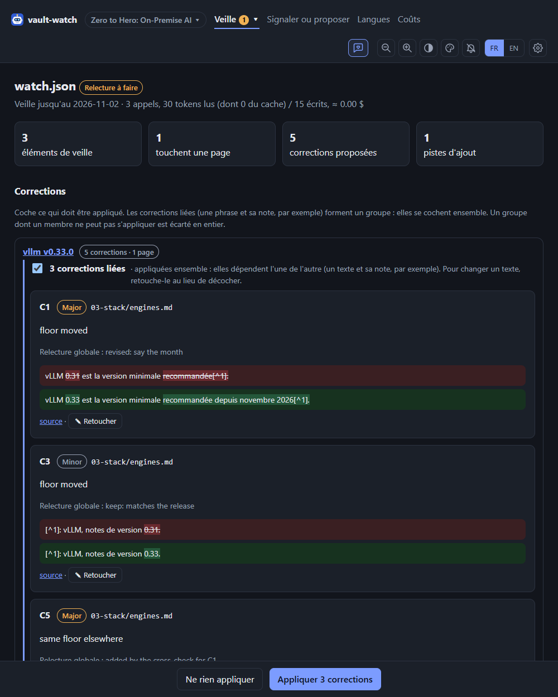
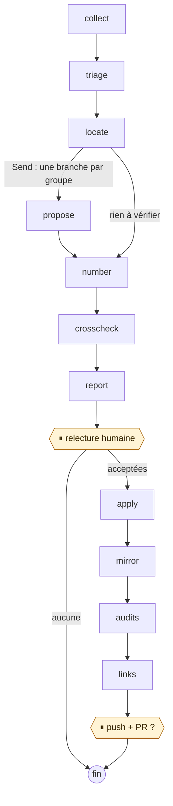
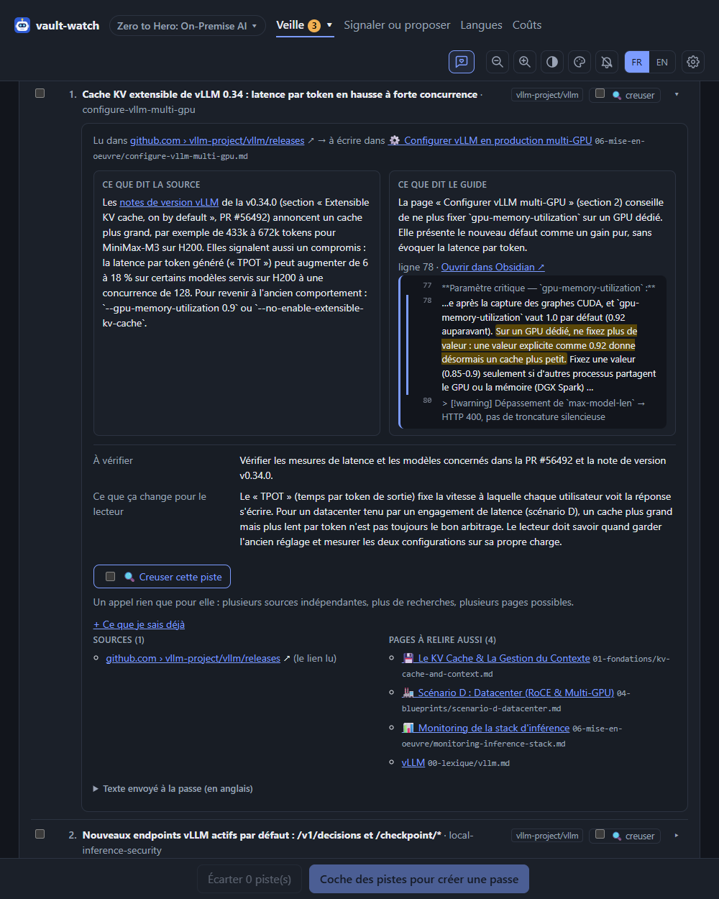

<div align="center">


# vault-watch-agent

**Tenir un guide Markdown à jour de ce qui change dans son domaine : un agent LangGraph propose des corrections sourcées, vous les relisez, il ouvre la pull request.**

[](https://www.python.org)
[](https://langchain-ai.github.io/langgraph/)
[](docs/fr/choose-a-model.md)
[](#linterface-web)
[](#principes)
[](LICENSE)

[English](README.md) · **Français**

**[Toute la documentation](docs/fr/README.md)** · [Brancher son guide](docs/fr/connect-your-guide.md) · [Une veille étape par étape](docs/fr/run.md) · [Vérifier le guide](docs/fr/check.md) · [Collecter une veille](docs/fr/collect.md) · [Compactage](docs/fr/compact.md) · [Nouveautés](docs/fr/news.md) · [Chapitres](docs/fr/chapters.md) · [Choisir un modèle](docs/fr/choose-a-model.md) · [Coûts](docs/fr/costs.md) · [Sécurité](docs/fr/security.md) · [Ce qui reste stable](docs/fr/compatibility.md) · [Présentation avec schémas](docs/fr/presentation.md) · [Structure du code](docs/fr/code.md)

</div>

---

Un guide technique vieillit une version à la fois : un numéro de version, une option renommée, un avis de sécurité
qui change une recommandation. vault-watch-agent lit ce qui a changé dans le domaine de votre guide (notes de
version, avis de sécurité, flux), trouve les phrases du guide devenues fausses, et propose des corrections qui citent
le texte actuel, donnent le nouveau et citent une source. Il les relit avec tout le guide en contexte, attend votre
relecture, applique sur une branche ce que vous avez accepté, traduit les changements dans les copies du guide en
d'autres langues, lance les contrôles propres au guide et, après un second oui, ouvre la pull request.

**Votre guide.** N'importe quel guide Markdown dans un dépôt git, décrit par un petit manifeste
(`vault-watch.toml`) : où sont les pages, dans quelle langue, quels dossiers en sont la copie traduite, d'où vient
sa veille, quels contrôles du guide lancer. Hébergé sur GitHub, sur un serveur Gitea, ou gardé en local. L'agent modifie le Markdown et s'arrête à la pull
request : si le guide est publié en site, c'est sa propre chaîne qui le reconstruit après la fusion, quelle qu'elle
soit.

**Votre modèle.** Claude par Claude Code sur un abonnement Claude (rien de facturé à l'appel) ou par l'API ; ou tout
serveur compatible OpenAI, local ou hébergé. Le projet ne mesure et ne garantit que Claude Opus 5.5 et Sonnet 5.5 :
voir [Choisir un modèle](docs/fr/choose-a-model.md).

**Votre décision.** Le modèle n'écrit jamais un fichier. Rien n'est appliqué avant votre relecture, rien n'est poussé
avant votre feu vert, et c'est vous qui fusionnez la pull request.



*L'écran de relecture sur une vraie veille du guide de référence (avis de sécurité de LiteLLM).*

## Démarrage rapide

```bash
pipx install git+https://github.com/DamienBecherini/vault-watch-agent@v1.3.1

cd mon-guide                # la racine du dépôt git du guide
vault-watch init            # écrit vault-watch.toml d'après ce que montre le dossier ; relisez-le, ajustez-le
vault-watch doctor          # ce qui est prêt, ce qui manque avant un premier passage
vault-watch collect         # facultatif : ce que disent les flux listés par le manifeste, sans modèle
vault-watch serve           # http://127.0.0.1:4430/ : veilles, relecture, publication, réglages
```

`init` devine la langue, les copies traduites, le dépôt GitHub du remote `origin` (un dépôt Gitea, c'est trois
lignes à ajouter) et les scripts du guide ; chaque clé du manifeste, et ce que débloque chaque partie facultative,
sont dans [Brancher son guide](docs/fr/connect-your-guide.md). Un guide d'exemple dans [`examples/`](examples/)
montre le minimum.

Ce qu'il faut :

| Pour | Quoi |
| :-- | :-- |
| tout guide | Python 3.11+, git |
| le modèle | un moteur : Claude Code connecté avec un abonnement Claude, une clé d'API Claude, ou un serveur compatible OpenAI ([réglages](#le-modèle)) |
| un guide sur GitHub | la CLI GitHub `gh`, connectée (`gh auth login`) |
| un guide sur Gitea | un jeton Gitea, donné par référence ([Brancher son guide](docs/fr/connect-your-guide.md), [Sécurité](docs/fr/security.md)) |
| les contrôles du guide | ce qu'ils lancent (Node.js pour un `npm test`, par exemple) |

## Déroulé d'un passage



| Étape | Ce qu'elle fait |
| :-- | :-- |
| `collect` | Lit la veille que nomme le manifeste : un fichier `watch.json`, une issue de la forge et l'artefact de son run de workflow, ou la collecte de l'agent lui-même depuis les flux du guide ([format de la veille](docs/fr/watch-format.md)) |
| `triage` | Le modèle trie les éléments : correction, candidat à un ajout, ou rien pour le guide (la consigne éditoriale du guide dit ce qui compte) |
| `locate` | Trouve les pages concernées et regroupe les éléments qui touchent les mêmes pages ou le même outil |
| `propose` | Une branche parallèle par groupe : des corrections qui citent le texte actuel, donnent le nouveau texte et une source |
| `number` | Numérote les corrections (C1, C2…), vérifie chaque citation, signale les modifications qui se chevauchent |
| `crosscheck` | Relit chaque correction avec tout le guide en contexte (cache de prompt, ou chapitre par chapitre quand il ne tient pas dans la fenêtre du modèle) et le web : garder, réviser ou rejeter, plus des retouches de cohérence sur d'autres pages. Puis un balayage : les valeurs que les corrections retirent et qui restent ailleurs |
| `report` | Écrit le rapport que vous relisez |
| `review` | ⏸ Pause : vous acceptez tout, rien, ou une liste |
| `apply` | Applique les corrections acceptées dans un worktree git sur une nouvelle branche et met à jour le champ de date des pages |
| `mirror` | Traduit les passages modifiés dans les copies du guide (une copie anglaise sous `en/`, par exemple) |
| `audits` | Lance les contrôles du guide, si le manifeste en déclare |
| `links` | Vérifie les liens externes des pages modifiées |
| `publish` | ⏸ Pause : sur un oui, pousse la branche et ouvre la pull request (un guide local garde la branche) |

Ce qui décide à chaque étape, un exemple avec son coût, et les deux écrans où vous décidez :
[Une veille étape par étape](docs/fr/run.md).

Deux autres sortes de passage passent par la même relecture et la même pull request : un **passage de correction**
transforme des erreurs signalées (par un lecteur, par une vérification) en corrections contrôlées, et une
**vérification du guide**, à la demande, cherche ce qui est faux ou incohérent dans tout le guide. Un **passage de
compactage** empêche le guide de s'alourdir : une veille ne fait qu'ajouter, donc un contrôle liste ce qui est
répété, empilé ou plus long que nécessaire, et les allègements que vous gardez sont relus comme des corrections
([Compactage](docs/fr/compact.md)). Un **passage d'ajouts** cherche ce qu'aucune source de la veille n'annonce : un
contrôle liste ce qu'un lecteur chercherait et ne trouve pas, et chaque piste que vous gardez est vérifiée sur le
web, puis écrite là où elle a sa place ([Nouveautés](docs/fr/news.md)).

## Principes

- **Le modèle propose, le code décide.** Chaque correction cite le texte actuel ; un contrôle déterministe la refuse
  si la citation n'apparaît pas exactement une fois dans la page. Les pages déclarées en lecture seule ne sont
  jamais modifiées.
- **Un humain dans la boucle, deux fois.** Le passage s'arrête après le rapport (`interrupt` de LangGraph), et de
  nouveau avant que quoi que ce soit ne quitte la machine. Un passage en pause est sauvegardé dans SQLite et repris
  plus tard, depuis un autre processus, des jours après s'il le faut.
- **Des preuves, pas la mémoire.** Les propositions s'appuient sur les notes de version et les avis de la veille, et
  la relecture croisée sur des sources primaires lues sur le web, jamais sur la seule mémoire du modèle.
- **Les règles du guide.** La consigne éditoriale et la politique de traduction sont dans le guide et lues à chaque
  passage ; l'agent a des valeurs par défaut pour un guide qui n'en a pas.

## Le modèle

| Moteur | Ce qui tourne | Ce que ça coûte |
| :-- | :-- | :-- |
| `claude-code` | [Claude Code](https://claude.com/claude-code) sur cette machine, connecté avec un abonnement Claude, lancé une fois par appel (`claude -p`) | Rien de facturé : l'usage compte dans les limites de l'abonnement |
| `api` | L'API Claude par le SDK officiel | Au token, au prix public |
| `openai` | Tout serveur compatible OpenAI : llama.cpp, vLLM, Ollama, un service hébergé ; recherche web par SearXNG | Celui de votre serveur |

Sans choix, l'agent prend Claude Code quand il le trouve connecté avec un abonnement, sinon l'API. Le moteur, le
modèle et l'effort de chaque rôle (raisonnement, traduction) se choisissent dans les Réglages de l'interface web
(l'engrenage), qui écrivent `~/.vault-watch/settings.json` ; `VAULT_WATCH_ENGINE` impose un moteur pour une commande.
L'agent ne bascule jamais de lui-même vers un moteur facturé : quand une limite de l'abonnement est atteinte, le
passage s'arrête et peut être repris plus tard (`resume --retry`) ou avec un autre moteur.

Les clés ne sont jamais stockées : les réglages prennent une référence, `env:NOM`, `sops:fichier#NOM` (un fichier
chiffré avec [sops](https://github.com/getsops/sops)) ou `file:chemin`, et refusent une clé en clair. Un autre
moteur peut s'ajouter sous forme de paquet ([Écrire un moteur](docs/fr/write-an-engine.md)).

## L'interface web

```bash
vault-watch serve                     # http://127.0.0.1:4430/
vault-watch serve --idle-exit 3600    # s'arrête après 1 h sans visite ni analyse en cours
vault-watch serve --notify fr         # notification Windows quand un passage vous attend, se termine ou échoue
```

Un écran par étape d'un passage : un passage en cours (chaque étape terminée envoyée à la page), la relecture (une
carte par correction avec un diff mot à mot, ses sources et le verdict de la relecture croisée), l'étape de
publication (contrôles, liens en défaut, le diff de la branche), puis la pull request. Autour :

| Page | À quoi elle sert |
| :-- | :-- |
| Veilles | Les veilles avec leur état, un bouton pour en analyser une, et les autres passages (correction, compactage, ajouts) |
| Sources | Ce que chaque source de la veille a apporté et ce qu'il en est sorti, et un contrôle des sources elles-mêmes, dont les changements partent dans une pull request ([quelles sources méritent leur place](docs/fr/collect.md#quelles-sources-méritent-leur-place)) |
| Vérifier le guide | Des contrôles à la demande, les gratuits et les payants avec leur estimation : audits, liens, fraîcheur, cohérence, traductions, ce qui alourdit le guide, les nouveautés. Leurs pistes se cochent, puis partent dans un passage ([Vérifier le guide](docs/fr/check.md)) |
| Signaler ou proposer | Des erreurs à corriger, ou une idée ou une nouvelle à vérifier et à écrire |
| Chapitres | Dans le menu sous le nom du guide : les chapitres sur lesquels l'agent travaille, proposés par un modèle ou écrits à la main : pourquoi et comment, [Chapitres](docs/fr/chapters.md) |
| Coûts | Ce que coûte l'entretien, par mois et par passage ([Coûts](docs/fr/costs.md)) |
| Réglages | L'engrenage : moteur, modèle et effort de chaque rôle ou d'une seule étape, les prix et d'où ils viennent, ce que le guide fournit |
| Donner mon avis | Une note, un bug, une idée : vous l'envoyez vous-même, par une issue GitHub ou un e-mail ; l'agent n'envoie rien |



*Les pistes de « nouveautés » sur le guide de référence : trois sont cochées, le bouton dit ce que coûterait le
passage d'ajouts.*

Chaque écran qui lance une étape payante dit ce qu'elle coûtera et ce qui la fera tourner (moteur, modèle, effort)
avant le clic. L'interface est en français ou en anglais, claire ou sombre, avec des palettes et une taille de texte
au choix. Un passage lancé ici peut être repris en ligne de commande, et l'inverse. Le serveur n'écoute que sur
127.0.0.1 ([Sécurité](docs/fr/security.md)).

## La ligne de commande

```bash
vault-watch run --watch-json watch.json     # ou --issue 50 pour une issue de la forge ; s'arrête à la relecture
vault-watch resume <passage> --accept C1,C3 # ou all / none ; applique, traduit, contrôle, s'arrête de nouveau
vault-watch resume <passage> --publish yes  # pousse la branche et ouvre la pull request
vault-watch status <passage>
vault-watch fix <passage> --findings erreurs.txt  # erreurs signalées → corrections contrôlées, même relecture et PR
vault-watch collect --json watch.json       # la veille depuis les flux du guide, sans modèle
vault-watch compact                         # ce que pèse et a pris chaque page, sans modèle ; --report : quoi alléger
vault-watch news                            # pistes : ce qu'un lecteur chercherait et ne trouve pas ; --explore : le web
vault-watch chapters                        # les chapitres sur lesquels l'agent travaille ; --propose : un modèle les propose
vault-watch costs --by month                # ou year, run, step
vault-watch --guide ../autre-guide doctor   # n'importe quelle commande sur un autre guide
```

## Le guide de référence

L'agent a été écrit pour [Zero to Hero : IA on-premise](https://ia-on-prem.damien.becherini.fr/)
([dépôt](https://github.com/DamienBecherini/ia-on-prem-vault)), environ 400 k tokens de contenu en français avec sa
copie anglaise, dont la veille de quinzaine est collectée par un workflow GitHub. C'est le guide dont les résultats
sont mesurés ci-dessous. Un second guide, privé, en français seulement et hébergé sur un Gitea auto-hébergé, a
vérifié que le manifeste et les forges fonctionnent sur un guide pour lequel l'agent n'a pas été écrit.

**Trois dépôts, un guide.** Le contenu est un coffre [Obsidian](https://obsidian.md) : des pages Markdown, des liens
wiki et des notes de bas de page, le français à la racine et l'anglais sous `en/`, lisible tel quel dans Obsidian.
Le site est construit par [starlight-obsidian-engine](https://github.com/DamienBecherini/starlight-obsidian-engine),
qui fait du coffre un site [Astro Starlight](https://starlight.astro.build) (liens wiki, diagrammes Mermaid, les deux
langues, la fenêtre « Donner mon avis ») ; la CI du guide le reconstruit et le déploie à chaque fusion sur `main` qui touche une page.
vault-watch-agent tient le contenu à jour et ignore tout du moteur : il lit et modifie le Markdown du coffre, lance
les contrôles du guide et ouvre une pull request ; la fusion redéploie ensuite le site.

**Produit.** Dix-neuf pull requests du guide faites par l'agent et fusionnées après relecture (au 20 novembre
2026), par exemple [#78](https://github.com/DamienBecherini/ia-on-prem-vault/pull/78) (une veille),
[#79](https://github.com/DamienBecherini/ia-on-prem-vault/pull/79) (30 corrections issues d'une vérification de tout
le guide), [#91](https://github.com/DamienBecherini/ia-on-prem-vault/pull/91) (un compactage) et
[#98](https://github.com/DamienBecherini/ia-on-prem-vault/pull/98) (des ajouts vérifiés sur le web).

**Évalué.** `vault-watch eval` rejoue une veille passée sur le guide tel qu'il était et fait apparier par un modèle
juge (toujours Claude) chaque proposition avec le diff fusionné par l'humain ([`metrics/eval/`](metrics/eval/)). Le
18 novembre 2026, le rejeu de la veille #77 a trouvé les 11 corrections de #78, aucune fausse. Sur la veille #30,
aucune proposition arrivée à la relecture n'était fausse ; la plupart des corrections manquées ne changeaient qu'une
date que la page de la version rendait elle-même trompeuse.

**Coût.** Chaque appel au modèle est noté dans un journal (ici [`metrics/usage.jsonl`](metrics/usage.jsonl), chez
vous `~/.vault-watch/usage.jsonl`) ; `vault-watch costs` en fait le total, avec à part les appels faits sur un
abonnement (0 facturé, et ce qu'ils auraient coûté sur l'API). Mesuré en novembre 2026 sur l'API au prix public, Opus
5.5 pour le raisonnement et Sonnet 5.5 pour la copie anglaise :

| Passage | Coût |
| :-- | --: |
| Veille avec extraits seulement (81 éléments gardés, 8 corrections) | 0,90 $ |
| Veille complète avec la relecture croisée de tout le guide | 2,95 – 4,45 $ |
| Passage de correction sur des erreurs signalées | 5,60 – 8,15 $ |
| Passage de correction de la traduction seule (Sonnet) | 0,35 $ |
| Vérification du guide à la demande (audits, liens, cohérence, traductions, affirmations datées) | 7,25 – 10,85 $ |
| Compactage : le rapport, puis un passage d'allègements sur 30 constats (Fable 5.2 sur ces deux étapes) | 6,28 $, puis 18,87 $ |
| Nouveautés : les pistes, puis un passage d'ajouts sur 2 à 5 pistes | 2,28 $, puis 8,70 – 12,95 $ |

La relecture croisée domine : écrire 400 k tokens dans le cache de prompt coûte environ 2 $, un appel suivant sur le
même cache environ 0,08 $. Deux veilles complètes par mois font environ 100 $ par an ; un guide deux fois plus petit
coûte à peu près moitié moins. Avec Claude Code sur un abonnement, rien n'est facturé, mais une relecture croisée
pèse sur les limites de l'abonnement.

Ces montants sont indicatifs : c'est ce que valent les appels au prix public de l'API. Les appels de l'auteur sont
passés par l'accès API de son abonnement Claude : il a payé son abonnement, rien de plus. Avec une clé facturée au
token, c'est ce que vous paieriez. Ce qui fait le prix, comment sont faites les estimations, et le journal :
[Coûts](docs/fr/costs.md).

## Ce que montre ce dépôt

| Fonction de LangGraph | Où | Pour quoi |
| :-- | :-- | :-- |
| `StateGraph` sur un état `TypedDict` | [`graph.py`](src/vault_watch_agent/graph.py), [`state.py`](src/vault_watch_agent/state.py) | Un nœud par étape ; l'état ne contient que du JSON, pour qu'un passage en pause puisse être stocké |
| Réducteurs (`Annotated[list, operator.add]`) | `state.py` | Les branches parallèles ajoutent leurs propositions et leur usage sans s'écraser |
| `Send` depuis une arête conditionnelle | `fan_out` dans `graph.py` | Une branche `propose` par groupe d'éléments, en parallèle |
| `interrupt()` et `Command(resume=…)` | nœuds `review` et `publish` | Les deux pauses humaines ; votre réponse est la valeur que renvoie `interrupt()` |
| Checkpointer `SqliteSaver`, un fil par passage | [`cli.py`](src/vault_watch_agent/cli.py), [`web.py`](src/vault_watch_agent/web.py) | `run` et `resume` sont des processus distincts, à des jours d'écart ; la page web et la ligne de commande partagent les passages |
| `update_state(…, as_node="propose")` | [`fix.py`](src/vault_watch_agent/fix.py) | Un passage de correction fait ses propres propositions, puis entre dans le graphe comme si `propose` avait tourné |
| `stream(stream_mode="updates")` | `web.py` | Chaque étape terminée est envoyée à la page (server-sent events) |

Chaque appel au modèle répond dans un modèle Pydantic (sortie structurée). Plus de 270 tests (pytest) font tourner tout le
graphe avec un faux modèle et un dépôt git jetable ; un contrat de moteur vérifie n'importe quel moteur. Comment les
modules s'emboîtent : [docs/fr/code.md](docs/fr/code.md).

## Choix de conception

- **LangGraph pour l'orchestration, le client propre à chaque moteur pour le modèle.** Le graphe a besoin d'un état,
  de branches parallèles, de pauses et d'un checkpointer ; les appels au modèle ont besoin de sortie structurée, de
  cache de prompt, de recherche web et de l'usage exact de chaque appel. Aucune surcouche de chat-model LangChain ne
  s'intercale.
- **Pas de RAG vectoriel.** Un guide qui tient dans la fenêtre du modèle est lu en entier, avec le cache de prompt :
  le modèle voit les notes de bas de page et les incohérences entre pages qu'une recherche par extraits couperait.
  Un guide qui ne tient pas est lu chapitre par chapitre. Une exception, au choix de l'éditeur : un appel qui
  vérifie une piste sur le web, en de nombreux tours de recherche, peut lire les pages que sa piste désigne et le
  plan du guide. Ces pages sont désignées par un appel qui avait tout le guide sous les yeux, et la relecture
  croisée qui suit lit chaque page.
- **Une veille corrige, l'éditeur décide de ce qui s'ajoute.** Une veille liste les ajouts (un nouveau modèle, un
  nouvel outil) comme candidats dans son rapport et n'en rédige aucun. Les rédiger est un passage à part, sur les
  pistes que l'éditeur garde.

## Limites

- **Du Markdown dans git.** Des pages dans un autre format, ou un guide qui est un sous-dossier d'un plus grand
  dépôt, ne sont pas pris en charge.
- **Pas de nouvelle page.** Un passage d'ajouts écrit dans les pages qui existent ; quand un sujet demande une page
  à lui, il le dit et dit ce qu'elle contiendrait, et l'écrire reste à l'éditeur.
- **Les dates sont difficiles.** Une version a une date de création, une date de tag et une date de publication ;
  quand ses sources ne tranchent pas, l'agent s'abstient plutôt que de deviner.
- **Mesuré sur Claude seulement.** Un autre modèle tourne, mais la qualité de ses corrections n'est pas mesurée :
  relisez avec soin ses « rien à changer » ([Choisir un modèle](docs/fr/choose-a-model.md)).

## Organisation du dépôt

```
src/vault_watch_agent/
  graph.py       le graphe : nœuds, arêtes, les deux pauses, texte du rapport et de la pull request
  state.py       état du graphe et sorties structurées imposées au modèle (Pydantic)
  guide.py       le guide tel que son manifeste le décrit (vault-watch.toml)
  vault.py       les pages : recherche, contrôle de citation exacte, application d'une modification, tout le guide
  chapters.py    les chapitres d'un guide ; reading.py le guide lu en entier, ou chapitre par chapitre
  llm.py         les moteurs (API Claude, Claude Code, extensions) ; openai_compat.py celui compatible OpenAI
  webtools.py    recherche web et lecture de pages pour les moteurs qui n'ont pas de web à eux
  steps.py       chaque étape qui appelle le modèle : son rôle, son effort, ce dont elle a besoin
  forge.py       GitHub (gh) et Gitea (API) : issues, artefacts, pull requests
  watches.py     d'où viennent les veilles ; collect.py la collecte de l'agent ; inputs.py le format de la veille
  sources.py     ce que chaque source de la veille a apporté ; sourcecheck.py les sources elles-mêmes, contrôlées
  crosscheck.py  relecture croisée ; fix.py passages de correction ; verify.py vérifications ; evaluate.py rejeux
  sizes.py       ce que pèse chaque page et ce qu'elle a pris ; compact.py compactage : ce qui pèse, les allègements
  news.py        ce qu'un lecteur chercherait et ne trouve pas : les pistes, les ajouts vérifiés sur le web
  prompts.py     consignes au modèle, tirées de la consigne éditoriale et de la politique de traduction du guide
  config.py      les réglages de l'utilisateur ; prices.py, costs.py ce que coûtent les appels
  store.py       la base des passages gardée légère ; notify.py les notifications du bureau
  onboard.py     init et doctor ; cli.py la ligne de commande ; web.py le serveur, static/ sa page (sans build)
tests/           faux modèle, dépôt git jetable, contrat de moteur
examples/        un guide d'exemple et son manifeste
metrics/         journal des coûts et résultats d'évaluation du guide de référence
docs/            la documentation (index : docs/fr/README.md), en anglais dans docs/, captures dans docs/images/
```

Étapes suivantes : [ROADMAP.md](ROADMAP.md). Changements : [CHANGELOG.md](CHANGELOG.md).

## Licence

[MIT](LICENSE)
