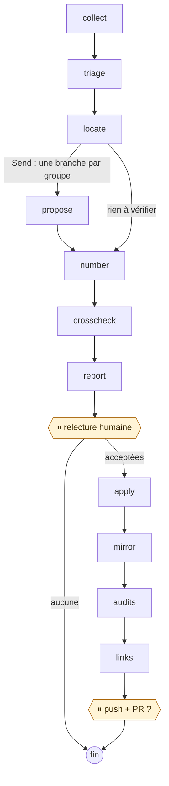
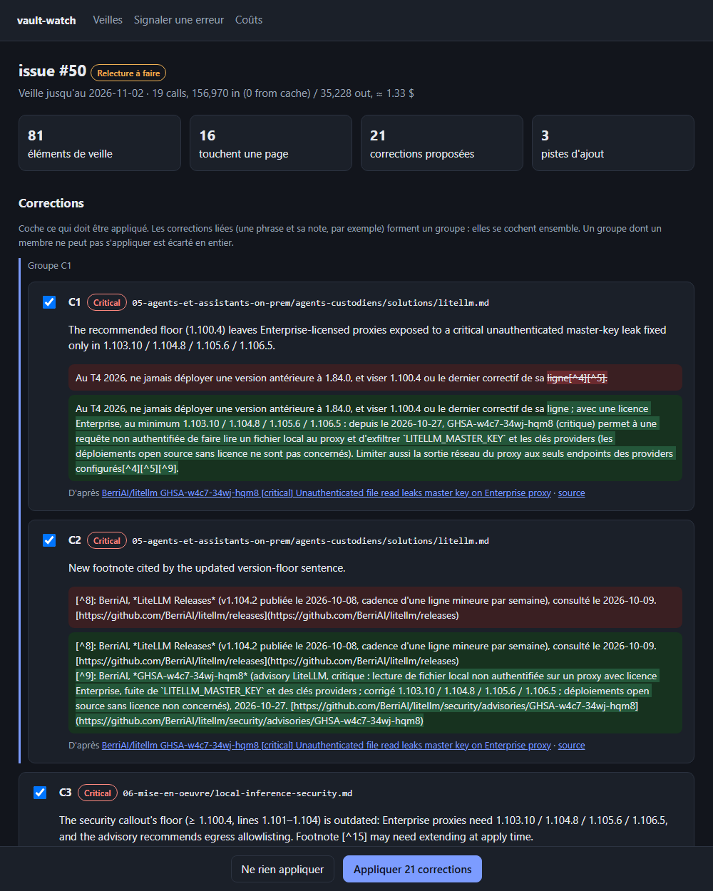

<div align="center">

# vault-watch-agent

**Un agent LangGraph qui tient à jour un guide technique de 400 k tokens, avec une relecture humaine avant toute publication.**

[](https://www.python.org)
[](https://langchain-ai.github.io/langgraph/)
[](https://docs.anthropic.com)
[](#interface-web)
[](#principes)
[](https://ia-on-prem.damien.becherini.fr)
[](LICENSE)

**Français** · [English](README.md)

[Présentation avec schémas](docs/presentation.fr.md) · [Structure du code](docs/code.fr.md)

</div>

---

Un agent [LangGraph](https://langchain-ai.github.io/langgraph/) qui tient à jour le guide
[Zero to Hero : l'IA on-premise](https://ia-on-prem.damien.becherini.fr/)
([dépôt](https://github.com/DamienBecherini/ia-on-prem-vault)) à partir de sa veille bimensuelle.

Le guide (environ 400 k tokens de contenu en français, avec un miroir en anglais) rassemble déjà ce qui a changé
dans son écosystème grâce à un script déterministe et à un workflow GitHub hebdomadaire : nouvelles versions,
avis de sécurité, Hugging Face, flux des éditeurs. Cet agent fait l'étape suivante. Il repère ce qui rend une
page fausse, propose des corrections sourcées, attend une relecture humaine, les applique sur une branche, met à
jour le miroir anglais, lance les contrôles et la vérification des liens du guide puis, après un second accord,
ouvre la pull request.

Il a produit les pull requests [#51](https://github.com/DamienBecherini/ia-on-prem-vault/pull/51),
[#53](https://github.com/DamienBecherini/ia-on-prem-vault/pull/53) et
[#54](https://github.com/DamienBecherini/ia-on-prem-vault/pull/54) du guide, toutes relues et fusionnées.



| Étape | Ce qu'elle fait |
| :-- | :-- |
| `collect` | Télécharge la veille : le ticket GitHub et l'artefact de son workflow (éléments, notes de version et avis de sécurité mis en cache) |
| `triage` | Claude trie les éléments : correction, candidat à un ajout, ou rien pour le guide |
| `locate` | Trouve les pages françaises concernées et regroupe les éléments qui touchent les mêmes pages ou le même outil |
| `propose` | Une branche parallèle par groupe : des corrections qui citent le texte actuel, donnent le nouveau texte et une source |
| `number` | Numérote les corrections (C1, C2…), vérifie chaque citation, signale les modifications qui se chevauchent |
| `crosscheck` | Relit chaque correction avec tout le guide français en contexte (cache de prompt) et le web : garder, réviser ou rejeter, plus des corrections de cohérence sur d'autres pages. Puis un balayage : le code repère les valeurs que les corrections retirent (une version, une option) et qui figurent encore ailleurs, et un second appel décide quelles occurrences doivent changer |
| `report` | Écrit le rapport Markdown que relit l'humain, avec les corrections qui ajoutent une version absente de leurs notes de bas de page et les valeurs retirées restées en place |
| `review` | ⏸ Pause : l'humain accepte tout, rien, ou une liste (un groupe est accepté ou refusé en entier) |
| `apply` | Applique les corrections acceptées dans un worktree git, met à jour `last_modified` et aligne le `version-floors.json` du guide sur les pages |
| `mirror` | Traduit les passages modifiés dans les pages anglaises (Claude Sonnet) |
| `audits` | Lance le `npm test` du guide (structure, sources, fraîcheur, i18n stricte) |
| `links` | Vérifie les liens externes des pages modifiées |
| `publish` | ⏸ Pause : sur un oui, pousse la branche et ouvre la pull request |

## Principes

- **Le modèle propose, le code décide.** Claude n'écrit jamais de fichier. Chaque correction cite le texte
  actuel ; un contrôle déterministe la refuse si la citation n'apparaît pas exactement une fois dans la page.
- **Un humain dans la boucle, deux fois.** Le run s'arrête après le rapport (`interrupt` de LangGraph), puis
  avant que quoi que ce soit ne quitte la machine. Un run en pause est enregistré dans SQLite et repris par une
  commande ultérieure, depuis un autre processus, plusieurs jours plus tard s'il le faut.
- **Des preuves, pas de la mémoire.** Les propositions s'appuient sur les notes de version et les avis de
  sécurité mis en cache par la veille, et la relecture croisée sur des sources primaires lues sur le web, jamais
  sur la seule mémoire du modèle.
- **Une seule source de règles.** La ligne éditoriale et la politique de traduction vivent dans le guide
  (`.agents/skills/vault-watch/`) et sont chargées à l'exécution : l'agent applique les règles du guide, il n'en
  garde pas sa propre copie.

## Comment LangGraph est utilisé

| Fonction | Où | Pour quoi |
| :-- | :-- | :-- |
| `StateGraph` sur un état `TypedDict` | [`graph.py`](src/vault_watch_agent/graph.py), [`state.py`](src/vault_watch_agent/state.py) | Un nœud par étape ; l'état ne contient que du JSON simple pour qu'un run en pause puisse être enregistré |
| Réducteurs (`Annotated[list, operator.add]`) | `state.py` | Les branches parallèles ajoutent leurs propositions et leur consommation sans s'écraser |
| Répartition `Send` depuis une arête conditionnelle | `fan_out` dans `graph.py` | Une branche `propose` par groupe d'éléments, lancées en parallèle (`max_concurrency`) |
| `interrupt()` et `Command(resume=…)` | Nœuds `review` et `publish` | Les deux pauses humaines ; la réponse de l'humain est la valeur que renvoie `interrupt()` |
| Checkpointer `SqliteSaver`, un fil par run | [`cli.py`](src/vault_watch_agent/cli.py), [`web.py`](src/vault_watch_agent/web.py) | `run` et `resume` sont des processus distincts, à plusieurs jours d'écart ; la page web et la ligne de commande partagent les runs |
| `update_state(…, as_node="propose")` | [`fix.py`](src/vault_watch_agent/fix.py) | Un run de correction fait ses propres propositions, puis entre dans le graphe comme si `propose` avait tourné : même relecture, même PR |
| `stream(stream_mode="updates")` | `web.py` | Chaque étape terminée est envoyée à la page (server-sent events) |

## Utilisation

Prérequis : Python 3.11+, git, Node.js (scripts de contrôle du guide), la CLI GitHub `gh` authentifiée (tickets
et artefacts de veille, push, pull requests), une clé d'API Anthropic et un clone local du guide.

```bash
python -m venv .venv && .venv/Scripts/python -m pip install -e ".[dev]"   # Windows ; bin/ sous Linux
export VAULT_PATH=../ia-on-prem-vault                                    # clone local du guide (par défaut)
export ANTHROPIC_API_KEY=...                                             # lue par le SDK Anthropic
```

### Interface web

```bash
vault-watch serve                     # http://127.0.0.1:4430/
vault-watch serve --idle-exit 3600    # s'arrête après 1 h sans visite ni analyse en cours
vault-watch serve --notify fr         # notification Windows quand un run vous attend, se termine ou échoue
```

Avec `--idle-exit`, le serveur peut être lancé à la demande par un lanceur, puis oublié : un run en pause pour
la relecture ou la publication ne perd rien, son état est dans les checkpoints. Le délai court depuis la fin de
la dernière analyse, et `GET /api/health` (contrat « service local » v2 : `state`, `busy`, `activity`, `idle`) indique à un lanceur si le serveur est occupé et combien de temps il
restera actif.

Un serveur FastAPI pilote le même graphe que la ligne de commande, avec un écran par pause : la liste des
tickets de veille et l'état de leur run, un run en cours (chaque étape terminée envoyée à la page en
server-sent events), la relecture (une carte par correction avec un diff au mot près entre le texte actuel et le
texte proposé, ses sources et l'avis de la relecture croisée ; les membres d'un groupe sont cochés ensemble),
l'étape de publication (contrôles, liens en défaut, diff de la branche), puis la pull request. Deux autres pages
servent à signaler des erreurs à corriger et à suivre le coût de l'entretien. Une piste (un doute de la relecture
croisée, un constat d'une vérification du guide) montre le passage en cause avec son numéro de ligne : le modèle
le cite, le code le retrouve dans la page, et une citation introuvable est signalée comme telle, jamais montrée
comme le texte du guide. L'interface est en anglais ou en
français (bascule dans l'en-tête, langue du navigateur par défaut) ; les corrections elles-mêmes sont en
français, la langue du guide.



Les appels au modèle tournent dans un fil d'exécution par run et chaque étape est enregistrée : on peut fermer
la page, et un run lancé ici peut être repris en ligne de commande. Le serveur n'écoute que sur 127.0.0.1,
refuse un en-tête `Host` non local (DNS rebinding) et exige un en-tête `X-Vault-Watch` sur toute requête qui
modifie quelque chose, qu'une page web étrangère ne peut pas envoyer sans une requête CORS préalable que le
serveur n'accorde jamais.

### Ligne de commande

```bash
vault-watch run --issue 50                  # s'arrête à la relecture, affiche le chemin du rapport
vault-watch resume issue-50 --accept C1,C3  # ou all / none ; applique, traduit, contrôle, s'arrête à nouveau
vault-watch resume issue-50 --publish yes   # pousse la branche et ouvre la PR
vault-watch status issue-50
```

Autres commandes :

```bash
vault-watch crosscheck issue-50                       # relance la relecture croisée sur tout le guide d'un run en pause
vault-watch fix fix-2026-11-08 --findings errors.txt  # erreurs signalées → corrections vérifiées, même relecture et même PR
vault-watch fix fix-2026-11-09 --from-threads issue-49,issue-50   # les doutes relevés par les relectures croisées
vault-watch fix fix-2026-11-09-2 --findings drift.txt --translation  # écarts de traduction : Sonnet corrige les pages anglaises d'après le français
vault-watch eval --issue 30 --at <commit> --truth <base>..<head> --variant full
vault-watch costs --by month                          # ou year, run, step
```

`fix` entre dans le graphe après `propose` (`graph.update_state(..., as_node="propose")`) : les erreurs trouvées
par une relecture croisée ou signalées par un lecteur passent par la même numérotation, la même relecture
croisée, la même relecture humaine, le même miroir, les mêmes contrôles et la même PR.

Les tests tournent avec un faux modèle et un dépôt git temporaire qui tient lieu de guide : `pytest`.

## Évaluation sur des veilles passées

Deux veilles traitées à la main avant l'existence de l'agent sont rejouées sur le guide tel qu'il était alors,
jusqu'à la pause de relecture, et un modèle juge rapproche chaque proposition du diff que l'humain a fusionné
(`vault-watch eval`, résultats dans [`metrics/eval/`](metrics/eval/)).

| Veille | Décision humaine | Agent, extraits par mots-clés | Agent, relecture croisée sur tout le guide |
| :-- | :-- | :-- | :-- |
| #30 (urgente, 89 éléments) | PR #32, 26 passages | 1 proposition, juste | 3 propositions : 2 concordent, 1 page supplémentaire valable |
| #47 (bimensuelle) | rien d'appliqué | 0 proposition | 0 proposition |

Aucune proposition arrivée à la relecture n'était fausse. Le rappel brut sur #30 est faible (2 passages de
correction sur 15), et la lecture des oublis en dit plus que le chiffre :

- le changement de fond de la veille (version minimale d'Open WebUI relevée à 0.11.4 après 15 avis de sécurité) a
  été trouvé sur chaque page qui l'énonce, plus une page que l'humain avait oubliée ;
- 9 des 13 passages de correction manqués ne changent qu'une date (Ollama 0.40 « septembre » → « octobre » sur
  8 pages, une note de bas de page 2 → 3 octobre). La page de version GitHub affiche le 25 septembre et l'agent
  s'est abstenu. L'humain avait raison : un run de correction ultérieur a montré que le 25 septembre est la date
  de création de l'objet de version sous le nom v0.40.0-rc0, renommé ensuite de rc1 à rc6 ; la v0.40.0 stable est
  sortie le 6 octobre (son changelog part de la v0.35.1, publiée le 2 octobre). Un oubli, donc, sur une date que la
  page de version elle-même rend trompeuse ;
- les ajouts (nouveaux paragraphes : transcription en temps réel, chaîne d'approvisionnement MCP) sont listés
  comme candidats, par conception, et ne comptent pas dans le rappel des corrections.

Le rejeu a révélé deux vrais défauts, tous deux corrigés : la relecture croisée rejetait une correction juste à
cause d'une date discutable (elle révise désormais le détail), et les éléments groupés se partageaient un même
budget d'extraits, si bien que le dernier élément d'un groupe pouvait n'en recevoir aucun (chaque élément a
maintenant sa part).

## Ce que coûte l'entretien

Chaque appel au modèle est consigné dans [`metrics/usage.jsonl`](metrics/usage.jsonl) (run, étape, modèle,
tokens, coût au prix catalogue calculé d'après la consommation renvoyée par l'API). Le fichier est versionné :
c'est l'historique de ce que coûte la mise à jour du guide. La page de facturation de la Console reste la
référence.

Mesures de novembre 2026, sur l'API Claude au prix catalogue, avec Claude Opus 5.5 pour le tri (effort moyen),
les propositions et la relecture croisée (effort élevé), et Claude Sonnet 5.5 pour le miroir anglais (effort
moyen). Un autre modèle ou un autre niveau d'effort changerait ces chiffres ; aucun autre modèle n'a été évalué
sur cette tâche.

| Run | Coût |
| :-- | --: |
| Veille avec extraits seulement (ticket #50, 81 éléments retenus, 8 corrections) | 0,90 $ |
| Veille complète avec relecture croisée sur tout le guide (tickets #49, #50) | 3,80 – 4,40 $ |
| Run de correction des erreurs trouvées par les relectures croisées (26 corrections, PR #54 du guide) | 6,60 $ |
| Autres runs de correction d'erreurs signalées (cinq runs) | 5,60 – 8,15 $ |
| Run de correction de traduction seule (Sonnet) | 0,35 $ |
| Vérification du guide à la demande (un run) | 7,25 $ |

La relecture croisée domine : écrire 400 k tokens dans le cache de prompt coûte environ 2 $, un appel suivant
sur le même cache environ 0,08 $. Deux veilles complètes par mois reviennent à environ 100 $ par an, pour les
veilles seules. Les runs de correction et les vérifications à la demande s'y ajoutent et dépendent du nombre
d'erreurs signalées : chacun ajoute environ 6 à 8 $.

Le journal totalise 73,70 $, tous dépensés le 2026-11-08 pendant la mise en place de l'agent : 15,75 $ de
veilles (dont des runs répétés des tickets #49 et #50), 40,61 $ de runs de correction, 10,09 $ de rejeux
d'évaluation et 7,25 $ pour une vérification. Cette journée est un coût de démarrage, pas un rythme mensuel.

## Choix de conception

- **LangGraph pour l'orchestration, le SDK Anthropic pour le modèle.** Le graphe a besoin d'un état, de
  branches parallèles (`Send`), de pauses (`interrupt` / `Command(resume=...)`) et d'un checkpointer ; les
  appels au modèle ont besoin d'une sortie structurée validée par Pydantic, du cache de prompt, de la recherche
  et de la lecture web côté serveur, et de la consommation exacte de chaque appel. Le SDK officiel fournit tout
  cela directement : aucune surcouche de modèle LangChain ne s'intercale.
- **Pas de RAG vectoriel.** Le guide français tient dans la fenêtre de contexte ; avec le cache de prompt, tout
  le lire coûte moins cher que construire et régler un index de recherche, et le modèle voit les notes de bas
  de page et les incohérences entre pages que la recherche découperait. La recherche devient utile au-delà du
  budget de contexte.
- **Des corrections seulement.** Les ajouts (un nouveau modèle, un nouvel outil) sont listés comme candidats dans
  le rapport, pas rédigés : décider que quelque chose a sa place dans le guide revient à l'éditeur. La
  découverte est la prochaine phase de la [feuille de route](ROADMAP.md).

## Limites

- **Un seul guide.** L'agent est écrit pour ce guide : il s'appuie sur son workflow de veille, ses scripts de
  contrôle, sa ligne éditoriale et son organisation FR + EN. Une autre base de connaissances demanderait ses
  propres `collect` et `audits`.
- **Pas encore d'ajouts.** Les nouveaux modèles et outils sont listés comme pistes ; la rédaction d'une
  nouvelle page n'est pas automatisée.
- **Les dates sont difficiles.** Une version a une date de création, une date de tag et une date de
  publication ; l'évaluation montre l'agent passant à côté d'une date que la page de version rendait trompeuse.
  Quand ses sources ne tranchent pas une date, il s'abstient.
- **Le modèle reste l'assistant d'un relecteur.** Toute modification passe par une relecture humaine et une
  pull request fusionnée ; l'agent ne pousse jamais sur `main`.

## Organisation du dépôt

```
src/vault_watch_agent/
  graph.py       le graphe : nœuds, arêtes, les deux pauses, texte du rapport et de la PR
  state.py       état du graphe et sorties structurées imposées au modèle (Pydantic)
  llm.py         appels à Claude : sortie structurée, cache de prompt, recherche et lecture web, journal des coûts
  prompts.py     prompts système, construits d'après la ligne éditoriale et la politique de traduction du guide
  vault.py       partie déterministe : recherche, contrôle des citations exactes, application, corpus du guide entier
  inputs.py      ticket de veille et artefact du workflow (gh), affirmations datées
  crosscheck.py  relecture croisée des corrections sur tout le guide
  fix.py         runs de correction : erreurs signalées → corrections (mode traduction : pages anglaises corrigées d'après le français)
  evaluate.py    rejeu des veilles passées et juge
  costs.py       totaux du journal des coûts
  cli.py         ligne de commande
  web.py         serveur FastAPI ; static/ contient la page (JS sans framework, sans étape de build)
tests/           faux modèle, dépôt git jetable qui tient lieu de guide
metrics/         journal des coûts et résultats d'évaluation (versionnés)
```

Présentation avec schémas : [docs/presentation.fr.md](docs/presentation.fr.md). Structure du code (modules, état du
graphe, appels au modèle, pause et reprise) : [docs/code.fr.md](docs/code.fr.md). Étapes suivantes : [ROADMAP.md](ROADMAP.md).

## Licence

[MIT](LICENSE)
