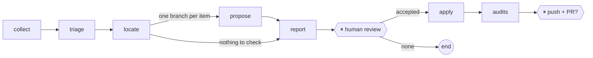

# vault-watch-agent

A [LangGraph](https://langchain-ai.github.io/langgraph/) agent that maintains the guide
[Zero to Hero: On-Premise AI](https://ia-on-prem.damien.becherini.fr/)
([repository](https://github.com/DamienBecherini/ia-on-prem-vault)) from its biweekly ecosystem watch.

The vault already collects what changed (GitHub releases and advisories, Hugging Face, vendor feeds) with a
deterministic script and a weekly GitHub workflow. This agent does the next step: it decides what touches the
guide, proposes sourced corrections, waits for a human review, applies them on a branch, runs the vault's own
audits and, after a second go-ahead, opens the pull request.



## Principles

- **The model proposes, the tools decide.** Claude never writes a file. Each proposal quotes the current text;
  a deterministic check refuses it unless the quote occurs exactly once in the page.
- **Human in the loop, twice.** The run stops after the report (LangGraph `interrupt`), and again before
  anything leaves the machine (push and pull request). A paused run is checkpointed in SQLite and resumed by
  a later command.
- **Evidence only.** Proposals rely on the release notes and advisory texts cached by the watch, never on the
  model's memory.

## Usage

```bash
python -m venv .venv && .venv/Scripts/python -m pip install -e ".[dev]"   # Windows; bin/ on Linux
export VAULT_PATH=../ia-on-prem-vault                                    # local clone of the vault

vault-watch run --issue 50                 # stops at the review, prints the report path
vault-watch resume issue-50 --accept C1,C3 # or all / none
vault-watch resume issue-50 --publish yes  # push the branch and open the PR
vault-watch status issue-50
```

`ANTHROPIC_API_KEY` must be in the environment. `gh` must be authenticated to read the watch issue and its
workflow artifact. Tests run with a fake model: `pytest`.

## Status

Day 1: graph, state, parallel proposals, two human pauses, apply and audits.
Next: retrieval over the guide instead of keyword search, English mirror sync, re-check of watchlist claims,
tools exposed through MCP.
