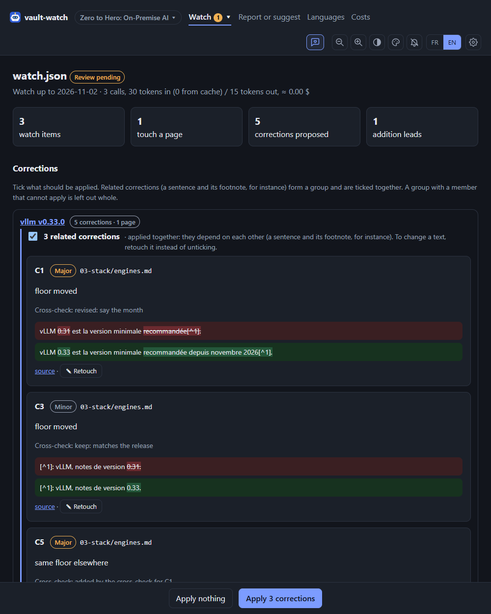
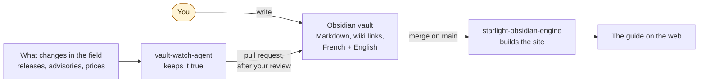
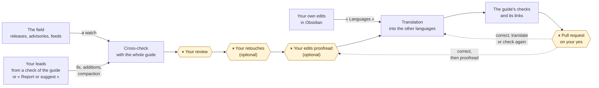
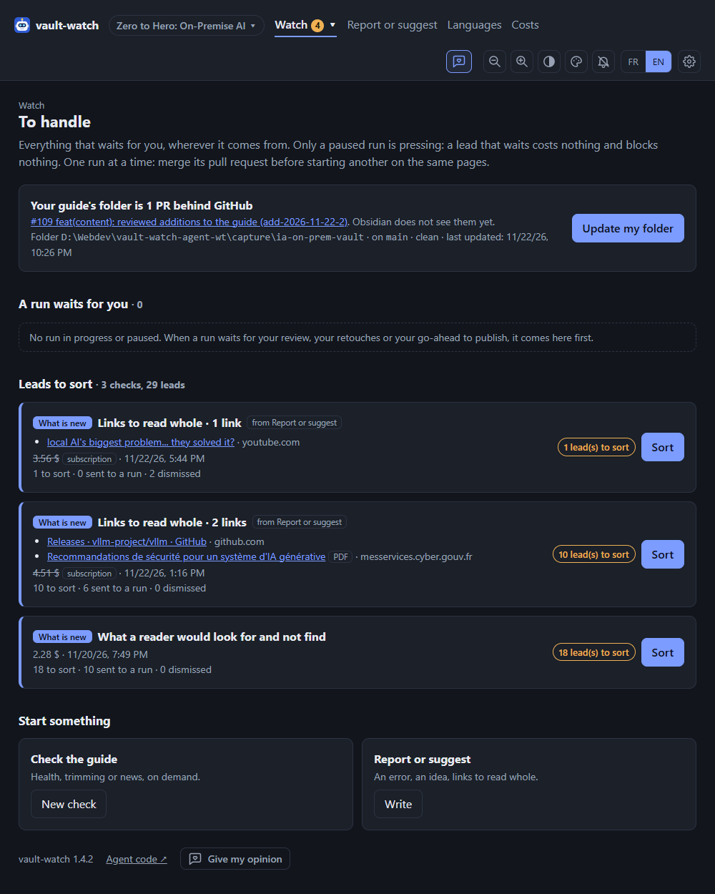
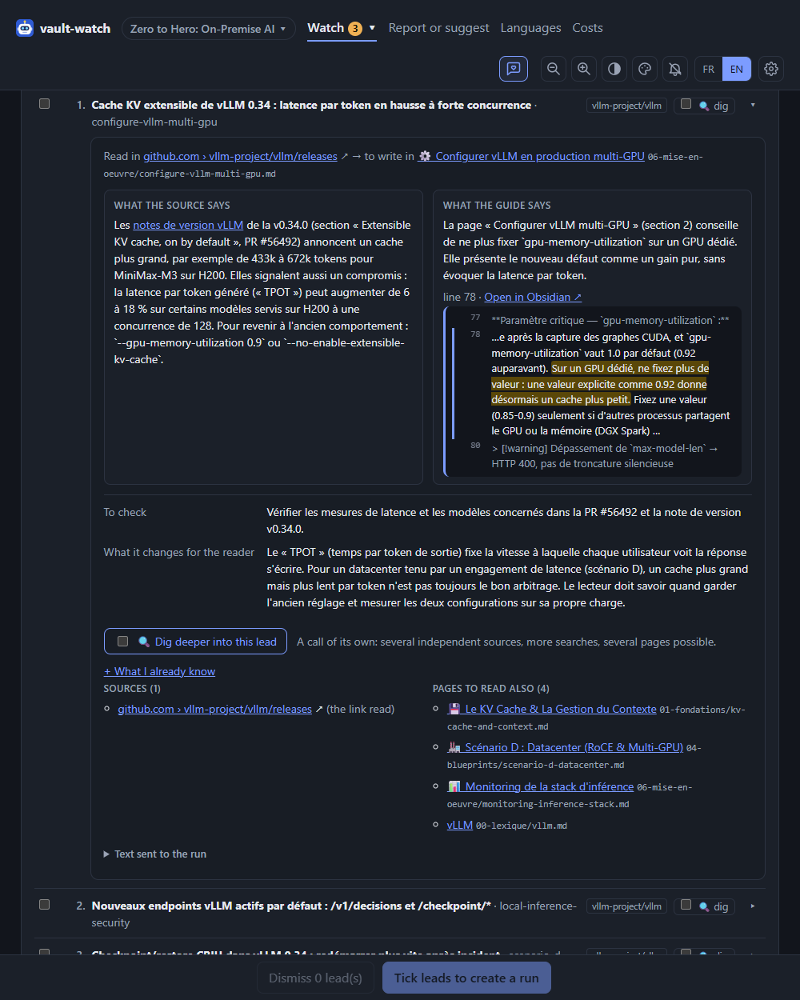
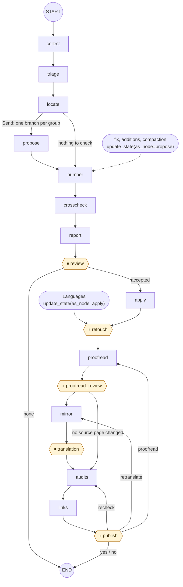

<div align="center">


# vault-watch-agent

**Keep a Markdown guide true, complete and light: a LangGraph agent follows its field, proposes sourced corrections and additions, and reviews yours; you decide, it opens the pull request.**

[](https://www.python.org)
[](https://langchain-ai.github.io/langgraph/)
[](docs/choose-a-model.md)
[](#the-web-interface)
[](#principles)
[](LICENSE)

**English** · [Français](README.fr.md)

**[All the documentation](docs/README.md)** · [Connect your guide](docs/connect-your-guide.md) · [A run, step by step](docs/run.md) · [Check the guide](docs/check.md) · [Costs](docs/costs.md) · [Security](docs/security.md)

</div>

---

A technical guide goes stale one release at a time. vault-watch-agent helps you keep it up, both ways: it proposes
and you review; you write and it reviews.

- **Watch**: every two weeks, the release notes, security advisories and feeds of the field; the sentences now
  wrong, with a sourced correction.
- **Check**: on demand, the whole guide: audits, links, freshness, consistency between pages, translations.
- **Complete**: what a reader would look for and not find, or a lead of yours (an idea, an article, a PDF, a video,
  what you already know), checked on the web and written where it belongs.
- **Lighten**: what is repeated, piled up or longer than it needs.
- **Fix**: the errors you or a reader report.
- **Review and translate your edits**: what you write in Obsidian, reviewed (spelling, facts checked on the web,
  consistency with the rest of the guide), then translated into the other languages, passage by passage.

Every proposal goes through your review, where you can retouch it, then the guide's own checks and the pull
request, on your yes. One page, « To handle », shows what waits for you.

**In use** on a guide of about 400 k tokens: more than twenty pull requests merged after review, and a past watch
replayed found the 11 corrections the editor had made, none wrong ([the reference guide](#the-reference-guide)).



*The review screen on a test watch (`watch.json`): a vLLM release that changes a sentence and its footnote, ticked together.*

## The idea

Three pieces, each in its own repository. You write a technical guide in [Obsidian](https://obsidian.md), as plain
Markdown notes in a git repository. An engine,
[starlight-obsidian-engine](https://github.com/DamienBecherini/starlight-obsidian-engine), publishes the vault on the
web as an [Astro Starlight](https://starlight.astro.build) site (wiki links, Mermaid diagrams, both languages),
rebuilt by the guide's CI at each merge. And this agent keeps it true: a guide on a fast-moving field goes stale
faster than one person can follow it.



## Your guide, your model, your decision

- **Your guide**: any Markdown guide in a git repository, on GitHub, on Gitea or kept local, described by a small
  manifest (`vault-watch.toml`): its pages, its languages, its watch, its own checks. The agent stops at the pull
  request; the guide's own chain rebuilds its site after the merge.
- **Your model**: Claude through Claude Code on a subscription (nothing billed per call) or through the API; or any
  OpenAI-compatible server, local or hosted. Measured on Claude Opus 5.5 and Sonnet 5.5 only
  ([Choose a model](docs/choose-a-model.md)).
- **Your decision**: the model never writes a file. Nothing is applied before your review, nothing is pushed before
  your go-ahead, and you merge the pull request.

## Quick start

```bash
pipx install git+https://github.com/DamienBecherini/vault-watch-agent@v1.6.1

cd my-guide                 # the root of the guide's git repository
vault-watch init            # writes vault-watch.toml from what the folder shows; read it, adjust it
vault-watch doctor          # what is ready, what is missing before a first run
vault-watch collect         # optional: what the feeds the manifest lists say, without a model
vault-watch serve           # http://127.0.0.1:4430/: To handle, review, publish, settings
```

`pipx` installs the command `vault-watch` for your account, in an environment of its own, whatever the folder you
run it from; if the command is not found afterwards, `pipx ensurepath` and a new terminal. The commands work on the
guide of the current folder (or the one `--guide` names). Tested on Windows and Linux; macOS should work, untested.

`init` guesses the language, the mirrors, the GitHub repository of the `origin` remote (a Gitea one is three lines to add) and the guide's own scripts; every
key of the manifest, and what each optional part unlocks, is in [Connect your guide](docs/connect-your-guide.md).
A sample guide in [`examples/`](examples/) shows the fewest parts.

What you need:

| For | What |
| :-- | :-- |
| every guide | Python 3.11+, git, [pipx](https://pipx.pypa.io) (`python -m pip install --user pipx`) |
| the model | one engine: Claude Code signed in with a Claude subscription, a Claude API key, or an OpenAI-compatible server ([settings](#the-model)) |
| a guide on GitHub | the GitHub CLI `gh`, signed in (`gh auth login`) |
| a guide on Gitea | a Gitea token, given by reference ([Connect your guide](docs/connect-your-guide.md), [Security](docs/security.md)) |
| the guide's checks | whatever they run (Node.js for an `npm test`, for instance) |
| desktop notifications (optional) | nothing on Windows and macOS; `notify-send` on Linux (`libnotify-bin` on Debian and Ubuntu). Tested on Windows only: on macOS or Linux, tell us how it went with « Give my opinion » in the interface |

## How a run goes



Every run takes this path; only where it starts differs. A watch starts from the field: the agent sorts its items,
finds the pages concerned and drafts the corrections. A fix, addition or compaction run starts from the leads you
kept (a check of the guide only gives leads), its proposals already drafted. A « Languages » run starts from your
edits, checked first if you want (spelling, facts, consistency), and stops beside each translation. What you write
during a run, at the retouches or at the publish step, can be proofread the same way before it goes on: the run
stops on the fixes found, and you choose. Each step, what
decides there and the screens where you decide: [A run, step by step](docs/run.md); the other runs:
[Check the guide](docs/check.md), [Compaction](docs/compact.md), [What is new](docs/news.md),
[Sync the languages](docs/run.md#sync-the-languages).

## Principles

- **The model proposes, the code decides.** Each correction quotes the current text; a deterministic check
  refuses it unless the quote occurs exactly once in the page. Pages declared read-only are never edited.
- **Human in the loop, writing.** The run stops after the report (LangGraph `interrupt`), where each proposal can
  be retouched; again after the corrections are applied, to retouch the pages themselves if you want; and before
  anything leaves the machine, where the pages and their translation can still be corrected; a « Languages » run
  also stops beside each translation. A paused run is checkpointed in SQLite and resumed later, from another
  process, days later if needed.
- **Evidence, not memory.** Proposals rely on the release notes and advisories of the watch, and the cross-check
  on primary sources read on the web, never on the model's memory alone.
- **The guide's rules.** The editorial brief and the translation policy live in the guide and are read at each
  run; the agent has defaults for a guide without them.

## The model

| Engine | What runs | What it costs |
| :-- | :-- | :-- |
| `claude-code` | [Claude Code](https://claude.com/claude-code) on this machine, signed in with a Claude subscription, run once per call (`claude -p`) | Nothing billed: the usage counts in the subscription's limits |
| `api` | The Claude API through the official SDK | Per token, at list price |
| `openai` | Any OpenAI-compatible server: llama.cpp, vLLM, Ollama, a hosted service; web search through SearXNG | Your server's |

Without a choice, the agent uses Claude Code when it finds it signed in with a subscription, otherwise the API.
The engine, the model and the effort of each role (reasoning, translation) are chosen in the Settings of the web
interface (the gear), which writes `~/.vault-watch/settings.json`; `VAULT_WATCH_ENGINE` forces one engine for a
command. The agent never falls back to a billed engine on its own: when a subscription limit is reached, the run
stops and can be resumed later (`resume --retry`) or with another engine.

Keys are never stored: the settings take a reference, `env:NAME`, `sops:file#NAME` (a file encrypted with
[sops](https://github.com/getsops/sops)) or `file:path`, and refuse a key in plain text. Another engine can be
added as a package ([Write an engine](docs/write-an-engine.md)).

## The web interface

```bash
vault-watch serve                     # http://127.0.0.1:4430/
vault-watch serve --idle-exit 3600    # stops after 1 h without a visit or a running analysis
vault-watch serve --notify en         # desktop notification when a run waits for you, ends or fails
```

One screen per step of a run: a run in progress (each finished step streamed to the page), the review (one block per
item or lead, one card per correction with a word-level diff, its source and the cross-check's verdict), the
retouches (your folder lent to Obsidian, or an editor in the page), the publish step (« Before publishing »: the
guide's checks, the translation, the links to check yourself; then each page changed beside its translation, still
correctable), then the pull request. Around them:



| Page | What it is for |
| :-- | :-- |
| Watch › To handle | The first page: everything that waits for you, wherever it comes from: a run paused for your review, a watch to start, the checks whose leads are to sort, and your guide's folder when it lacks pull requests merged, with « Update my folder »; the menu « Watch » shows how many |
| Watch › Automatic watch | The watches with their status and a button to analyse one |
| Watch › Every run | Every run, newest first: the watches', and those started from a check, from « Report or suggest » or from « Languages » |
| Watch › Sources followed | What each source of the watch brought and what became of it, and a check of the sources themselves, whose changes go to a pull request ([which sources earn their place](docs/collect.md#which-sources-earn-their-place)) |
| Watch › Check the guide | Checks on demand, of three kinds shown in colour (guide health, lighter guide, what is new), the free ones and the paid ones with their estimate: audits, links, freshness, consistency, translations, what makes the guide heavy, what is new. Their leads are sorted, then sent to a run ([Check the guide](docs/check.md)) |
| Report or suggest | Errors to fix, an idea or a piece of news to check and write, or links to read whole (an article, a page, a PDF, a video) for the leads they hold; what you type is kept as a draft, one per tab |
| Languages | The pages ahead of their mirror, and those you changed in your folder without committing: what changed is translated, then the usual checks and pull request ([A run, step by step](docs/run.md#sync-the-languages)) |
| Chapters | In the menu under the guide's name: the chapters the agent works on, proposed by a model or written by hand: why and how, [Chapters](docs/chapters.md) |
| Costs | What the upkeep costs, by month and by run ([Costs](docs/costs.md)) |
| Settings | The gear: engine, model and effort of each role or of one step, prices and where they come from, what the guide provides |
| Give my opinion | A note, a bug, an idea: you send it yourself, as a GitHub issue or an e-mail; the agent sends nothing |



*A lead of « Links to read whole » on the reference guide, unfolded; nothing is ticked yet, so the button asks to
tick leads.*

Every screen that starts a paid step says what it will cost (on a subscription, what it is worth at list price,
struck through) and what will run it (engine, model, effort) before the click. The interface is in English or
French (the checks' explanations too, translated when a pause shows them), light or dark, with palettes and a text size of your choice. A run started here can be resumed from the
command line, and the reverse. The server listens on 127.0.0.1 only
([Security](docs/security.md)).

## The command line

```bash
vault-watch run --watch-json watch.json     # or --issue 50 for a forge issue; stops at the review
vault-watch resume <run> --accept C1,C3     # or all / none; applies, translates, checks, stops again
                     --edit C3=my-text.md   # a proposal retouched by you before it applies
vault-watch resume <run> --publish yes      # push the branch and open the pull request
vault-watch status <run>
vault-watch fix <run> --findings errors.txt # reported errors → checked corrections, same review and PR
vault-watch collect --json watch.json       # the watch from the guide's feeds, no model
vault-watch compact                         # what each page weighs and gained, no model; --report: what to trim
vault-watch news                            # leads: what a reader would look for and not find; --explore: the web
vault-watch chapters                        # the chapters the agent works on; --propose: a model's split
vault-watch mirror                          # the pages ahead of their mirror; --yes: translate what changed
vault-watch costs --by month                # or year, run, step
vault-watch --guide ../other-guide doctor   # any command on another guide
```

## The reference guide

The agent was built for [Zero to Hero: On-Premise AI](https://ia-on-prem.damien.becherini.fr/)
([repository](https://github.com/DamienBecherini/ia-on-prem-vault)), about 400 k tokens of French content mirrored
in English, whose biweekly watch is collected by a GitHub workflow. It is the guide whose results are measured
below. A second guide, private, written in French only and hosted on a self-hosted Gitea, checked that the manifest
and the forges work on a guide the agent was not written for.

**How it is made.** An Obsidian vault: Markdown pages, wiki links and footnotes, French at the root and English
under `en/`, readable in Obsidian as it is. The guide's CI rebuilds the site with starlight-obsidian-engine at each
merge on `main` that changes a page. The agent knows nothing of the engine: it reads and edits the vault's
Markdown, runs the guide's own checks, and opens a pull request; the merge then redeploys the site.

**Produced.** More than twenty pull requests of the guide made by the agent and merged after review (as of 22
November 2026), for example [#78](https://github.com/DamienBecherini/ia-on-prem-vault/pull/78) (a watch),
[#79](https://github.com/DamienBecherini/ia-on-prem-vault/pull/79) (30 corrections from a check of the whole guide),
[#91](https://github.com/DamienBecherini/ia-on-prem-vault/pull/91) (a compaction),
[#98](https://github.com/DamienBecherini/ia-on-prem-vault/pull/98) (additions checked on the web) and
[#109](https://github.com/DamienBecherini/ia-on-prem-vault/pull/109) (additions from the leads of a video, retouched by the editor).

**Evaluated.** `vault-watch eval` replays a past watch on the guide as it was and has a judge model (always Claude)
match each proposal with the diff the human merged ([`metrics/eval/`](metrics/eval/)). On 18 November 2026 the
replay of watch #77 found the 11 corrections of #78, none wrong. On watch #30, no proposal that reached the review
was wrong; most misses changed only a date that the release page itself made misleading.

**Cost.** Every model call is logged in a journal (here [`metrics/usage.jsonl`](metrics/usage.jsonl), for you `~/.vault-watch/usage.jsonl`); `vault-watch costs` totals
it, with the calls made on a subscription apart (0 billed, and what they would have cost on the API). Measured in
November 2026 on the API at list price, Opus 5.5 for reasoning and Sonnet 5.5 for the English mirror:

| Run | Cost |
| :-- | --: |
| Watch with excerpts only (81 items kept, 8 corrections) | 0.90 $ |
| Full watch with the whole-guide cross-check | 2.95 – 4.45 $ |
| Fix run on reported errors | 5.60 – 8.15 $ |
| Translation-only fix run (Sonnet) | 0.35 $ |
| On-demand check of the guide (audits, links, consistency, translations, dated claims) | 7.25 – 10.85 $ |
| Compaction: the report, then a run of trims on 30 findings (Fable 5.2 on these two steps) | 6.28 $, then 18.87 $ |
| What is new: the leads, then an addition run on 2 to 5 leads | 2.28 $, then 8.70 – 12.95 $ |

The cross-check dominates: writing 400 k tokens to the prompt cache costs about 2 $, a later call on the same cache
about 0.08 $. Two full watches a month come to about 100 $ a year; a guide half the size costs about half. On
Claude Code with a subscription, nothing is billed, but a cross-check weighs on the subscription's limits.

These amounts are indicative: they are what the calls are worth at the API's list price. The author's calls went
through the API access of a Claude subscription: only the subscription was paid. With a key billed
per token, they are what you would pay. What makes the price, how the estimates are made, and the journal:
[Costs](docs/costs.md).

## What this repository shows



*The graph of [`graph.py`](src/vault_watch_agent/graph.py): a watch enters at `collect`, a run with its own proposals
as if `propose` had run, a « Languages » run after `apply` (it skips the retouch pause and stops at `translation`).
`proofread` and its pause run only when the editor asks for it; otherwise they let the run through.*

| LangGraph feature | Where | What for |
| :-- | :-- | :-- |
| `StateGraph` over a `TypedDict` state | [`graph.py`](src/vault_watch_agent/graph.py), [`state.py`](src/vault_watch_agent/state.py) | One node per step; the state holds plain JSON so a paused run can be stored |
| Reducers (`Annotated[list, operator.add]`) | `state.py` | Parallel branches append their proposals and their usage without overwriting each other |
| `Send` fan-out from a conditional edge | `fan_out` in [`graph_proposals.py`](src/vault_watch_agent/graph_proposals.py) | One `propose` branch per group of items, run in parallel |
| `interrupt()` and `Command(resume=…)` | `review`, `retouch`, `proofread_review`, `translation` and `publish` nodes | The five human pauses; your answer is the value `interrupt()` returns. A node that resumes runs again from its start, so the model calls a pause shows sit in the node before it (`report`, `proofread`) |
| `SqliteSaver` checkpointer, one thread per run | [`cli.py`](src/vault_watch_agent/cli.py), [`routes/context.py`](src/vault_watch_agent/routes/context.py) | `run` and `resume` are separate processes, days apart; the web page and the command line share the runs |
| `update_state(…, as_node=…)` | [`fix.py`](src/vault_watch_agent/fix.py), [`mirrors.py`](src/vault_watch_agent/mirrors.py) | A fix, addition or compaction run makes its own proposals, then enters the graph as if `propose` had run; a « Languages » run enters after `apply` |
| `stream(stream_mode="updates")` | `routes/context.py` | Each finished step is pushed to the page (server-sent events) |

Every model call answers into a Pydantic model (structured output). More than 350 tests (pytest) run the whole graph against
a fake model and a throwaway git repository; an engine contract checks any engine. How the modules fit together:
[docs/code.md](docs/code.md).

## Design choices

- **LangGraph for the orchestration, each engine's own client for the model.** The graph needs state, parallel
  branches, pauses and a checkpointer; the model calls need structured output, prompt caching, web search and the
  exact usage of each call. No LangChain chat-model wrapper sits in between.
- **No vector RAG.** A guide that fits the model's window is read whole, with prompt caching: the model sees
  footnotes and inconsistencies between pages that retrieval would cut. A guide that does not fit is read chapter
  by chapter. One exception, chosen by the editor: a call that checks one lead on the web, over many rounds of
  search, may read the pages its lead names and the plan of the guide. The pages are named by a call that had the
  whole guide before it, and the cross-check that follows reads every page.
- **A watch corrects, the editor decides what is added.** A watch lists additions (a new model, a new tool) as
  candidates in its report and writes none. Writing them is a run of its own, on the leads the editor keeps.

## Limits

- **Markdown in git.** Pages in another format, or a guide that is a subfolder of a larger repository, are not
  supported.
- **No new page.** An addition run writes in the pages that exist; when a subject needs a page of its own, it
  says so and what the page would hold, and writing it stays with the editor.
- **Dates are hard.** A release has a creation date, a tag date and a publication date; when its sources do not
  settle one, the agent declines rather than guesses.
- **Measured on Claude only.** Another model runs, but the quality of its corrections is not measured: review its
  « nothing to change » with care ([Choose a model](docs/choose-a-model.md)).

## Repository layout

```
src/vault_watch_agent/
  graph.py       the graph: its nodes and edges; graph_*.py the nodes by part of the run, the report and pull request text
  state.py       graph state and the structured outputs the model must answer with (Pydantic)
  guide.py       the guide as its manifest describes it (vault-watch.toml)
  vault.py       pages: search, exact-quote check, apply an edit, the whole guide for the cross-check
  quotes.py      the passage a finding is about; retouch.py the pause to retouch, your folder lent to Obsidian
  mirrors.py     what changed in a page, passage by passage; proofread.py your edits proofread (before a sync, in a run)
  chapters.py    the chapters of a guide; reading.py the guide read whole, or chapter by chapter
  llm.py         the engines' contract (plug-ins too); engines/ the Claude API and Claude Code; openai_compat.py the OpenAI-compatible one
  webtools.py    web search and page reading for the engines without a web of their own, and for Claude Code (mcp_fetch.py)
  steps.py       each step that calls the model: its role, its effort, what it needs
  forge.py       GitHub (gh) and Gitea (API): issues, artifacts, pull requests
  watches.py     where the watches come from; collect.py the agent's own collection; inputs.py the watch format
  sources.py     what each source of the watch brought; sourcecheck.py the sources themselves, checked
  crosscheck.py  whole-guide cross-check; fix.py fix runs; verify.py checks of the guide; evaluate.py replays
  sizes.py       what each page weighs and gained; compact.py compaction: what weighs, the trims
  news.py        what a reader would look for and not find: the leads, the additions checked on the web
  links.py       links read whole (a page, a README, a PDF); videos.py the text of a video, through dl-sub-dub
  prompts.py     system prompts, from the guide's brief and translation policy; explain.py the pauses' explanations, translated
  config.py      the user's settings; prices.py, costs.py what the calls cost
  store.py       the runs database kept light; notify.py desktop notifications
  onboard.py     init and doctor; cli.py the command line; web.py the server, routes/ its routes by area
  static/        the page: ES modules served as they are (no build step), checked by TypeScript (jsconfig.json, types/)
tests/           fake model, throwaway git repository, engine contract
examples/        a sample guide and its manifest
metrics/         the reference guide's cost journal and evaluation results
docs/            the documentation (index: docs/README.md), in French in docs/fr/, screenshots in docs/images/
```

Next steps: [ROADMAP.md](ROADMAP.md). Changes: [CHANGELOG.md](CHANGELOG.md).

## License

[MIT](LICENSE)
