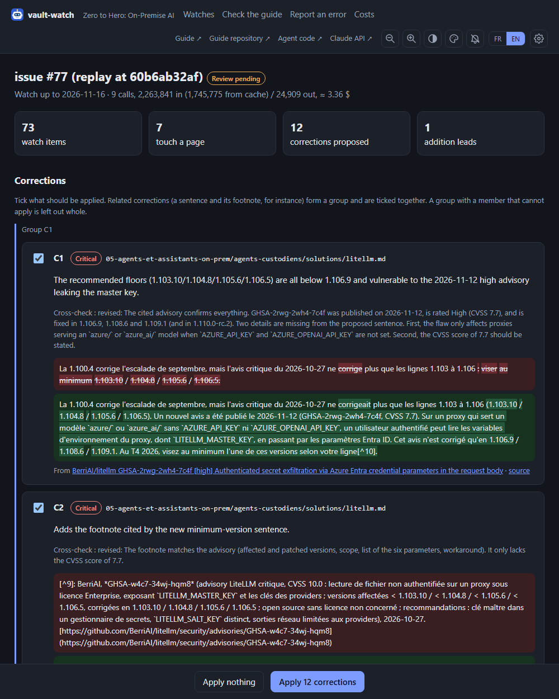
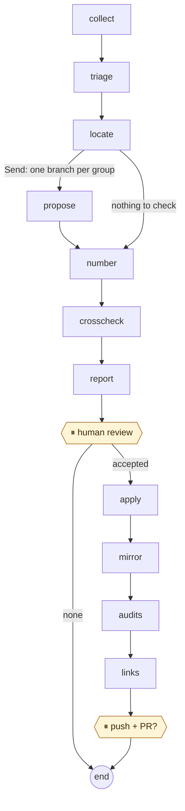

<div align="center">


# vault-watch-agent

**A LangGraph agent that keeps a 400 k-token technical guide up to date, with a human review before anything is published.**

[](https://www.python.org)
[](https://langchain-ai.github.io/langgraph/)
[](https://docs.anthropic.com)
[](#web-interface)
[](#principles)
[](https://ia-on-prem.damien.becherini.fr)
[](LICENSE)

**English** · [Français](README.fr.md)

[Overview with diagrams](docs/presentation.md) · [Connect your guide](docs/connect-your-guide.md) · [Collecting a watch](docs/collect.md) · [Choose a model](docs/choose-a-model.md) · [How the code fits together](docs/code.md) · [What stays stable](docs/compatibility.md)

</div>

---

A [LangGraph](https://langchain-ai.github.io/langgraph/) agent that maintains the guide
[Zero to Hero: On-Premise AI](https://ia-on-prem.damien.becherini.fr/)
([repository](https://github.com/DamienBecherini/ia-on-prem-vault)) from its biweekly ecosystem watch.

The guide (about 400 k tokens of French content, mirrored in English) already collects what changed in its
ecosystem with a deterministic script and a weekly GitHub workflow: releases, security advisories, Hugging Face,
vendor feeds. This agent does the next step. It decides what makes a page wrong, proposes sourced corrections,
waits for a human review, applies them on a branch, syncs the English mirror, runs the guide's own audits and
link checks and, after a second go-ahead, opens the pull request.

Since 0.3.0 it can keep any Markdown guide described by a manifest of its own: see
[Connect your guide](docs/connect-your-guide.md). Since 0.5.0 it can also collect the watch itself, from a list of feeds
and without a model, by hand or every week on GitHub: see [Collecting a watch](docs/collect.md).



*The review screen on a real watch of the guide (security advisories of LiteLLM): nothing is written to the guide
until the editor has ticked the corrections, and nothing is published before a second go-ahead.*

## What this repository shows

- A LangGraph `StateGraph` over a typed state (`WatchState`, a `TypedDict` with reducers), with one parallel branch
  per group of watch items (`Send`).
- Two human pauses (`interrupt`, resumed with `Command`): the review of the corrections, then the go-ahead to push
  and open the pull request. A SQLite checkpointer keeps a paused run for days, and another process resumes it (the
  command line or the web interface).
- Structured outputs: every model call answers into a Pydantic model. The whole guide (about 400 k tokens) is read
  through the prompt cache.
- A cost journal with one line per model call ([`metrics/usage.jsonl`](metrics/usage.jsonl)), and an evaluation
  that replays past watches on the guide as it was and scores the proposals against the pull request that was
  merged: on 18 November 2026, the replay of watch #77 found the 11 corrections of [#78](https://github.com/DamienBecherini/ia-on-prem-vault/pull/78), none wrong.
- 124 tests (pytest), a local web interface (FastAPI), and two model engines: Claude Code on a Claude subscription,
  or the Anthropic API.
- Twelve pull requests of the guide produced by the agent and merged after review, for example [#78](https://github.com/DamienBecherini/ia-on-prem-vault/pull/78) (a
  watch) and [#79](https://github.com/DamienBecherini/ia-on-prem-vault/pull/79) (30 corrections from a verification of the whole guide).



| Step | What it does |
| :-- | :-- |
| `collect` | Downloads the watch: the GitHub issue and the artifact of its workflow run (items, cached release notes and advisories) |
| `triage` | Claude sorts the items: correction, addition candidate, or nothing for the guide |
| `locate` | Finds the French pages concerned and groups the items that touch the same pages or the same tool |
| `propose` | One parallel branch per group: corrections that quote the current text, give the new text and a source |
| `number` | Numbers the corrections (C1, C2…), checks each quote, flags overlapping edits |
| `crosscheck` | Re-reads every correction with the whole French guide in context (prompt caching) and the web: keep, revise or reject, plus consistency edits on other pages. Then a sweep: the code finds the values the corrections remove (a version, a flag) that still appear elsewhere, and a second call decides which occurrences must change |
| `report` | Writes the Markdown report the human reviews, with the corrections that add a version their footnotes do not mention and the removed values left in place |
| `review` | ⏸ Pause: the human accepts all, none, or a list (a group is accepted or refused as a whole) |
| `apply` | Applies the accepted corrections on a git worktree, bumps `last_modified` and aligns the guide's `version-floors.json` with the pages |
| `mirror` | Translates the changed hunks into the English pages (Claude Sonnet) |
| `audits` | Runs the guide's `npm test` (structure, sources, freshness, strict i18n) |
| `links` | Checks the external links of the changed pages |
| `publish` | ⏸ Pause: on a yes, pushes the branch and opens the pull request |

## Principles

- **The model proposes, the code decides.** Claude never writes a file. Each correction quotes the current
  text; a deterministic check refuses it unless the quote occurs exactly once in the page.
- **Human in the loop, twice.** The run stops after the report (LangGraph `interrupt`), and again before
  anything leaves the machine. A paused run is checkpointed in SQLite and resumed by a later command, from
  another process, days later if needed.
- **Evidence, not memory.** Proposals rely on the release notes and advisories cached by the watch, and the
  cross-check on primary sources fetched from the web, never on the model's memory alone.
- **One source of rules.** The editorial brief and the translation policy live in the guide
  (`.agents/skills/vault-watch/`) and are loaded at run time: the agent applies the guide's rules, it does not
  keep its own copy.

## How LangGraph is used

| Feature | Where | What for |
| :-- | :-- | :-- |
| `StateGraph` over a `TypedDict` state | [`graph.py`](src/vault_watch_agent/graph.py), [`state.py`](src/vault_watch_agent/state.py) | One node per step; the state holds plain JSON so a paused run can be stored |
| Reducers (`Annotated[list, operator.add]`) | `state.py` | Parallel branches append their proposals and their usage without overwriting each other |
| `Send` fan-out from a conditional edge | `fan_out` in `graph.py` | One `propose` branch per group of items, run in parallel (`max_concurrency`) |
| `interrupt()` and `Command(resume=…)` | `review` and `publish` nodes | The two human pauses; the answer of the human is the value `interrupt()` returns |
| `SqliteSaver` checkpointer, one thread per run | [`cli.py`](src/vault_watch_agent/cli.py), [`web.py`](src/vault_watch_agent/web.py) | `run` and `resume` are separate processes, days apart; the web page and the CLI share the runs |
| `update_state(…, as_node="propose")` | [`fix.py`](src/vault_watch_agent/fix.py) | A fix run makes its own proposals, then enters the graph as if `propose` had run: same review and PR |
| `stream(stream_mode="updates")` | `web.py` | Each finished step is pushed to the page (server-sent events) |

## Usage

Requirements: Python 3.11+, git, Node.js (the guide's audit scripts), the GitHub CLI `gh` authenticated (watch
issues and artifacts, push, pull requests), a local clone of the guide, and one of the two model engines below.

```bash
python -m venv .venv && .venv/Scripts/python -m pip install -e ".[dev]"   # Windows; bin/ on Linux
export VAULT_PATH=../ia-on-prem-vault                                    # local clone of the guide (default)
export ANTHROPIC_API_KEY=...                                             # API engine only: read by the Anthropic SDK
```

Another guide: `vault-watch --guide ../my-guide init` writes its manifest (`vault-watch.toml`), `vault-watch --guide
../my-guide doctor` says what is ready and what is missing. The manifest, key by key, and what each optional part
unlocks: [Connect your guide](docs/connect-your-guide.md). Node.js and `gh` are needed only when the guide's checks
use Node and when it names a GitHub repository.

### Model engine: Claude Code on a subscription, or the API

| Engine | What runs | What it costs |
| :-- | :-- | :-- |
| `claude-code` | [Claude Code](https://claude.com/claude-code) installed on this machine and signed in with a Claude subscription, run once per call without a terminal (`claude -p`) | Nothing billed: the usage counts in the limits of the subscription |
| `api` | The Claude API through the official SDK (`ANTHROPIC_API_KEY`) | Per token, at list price |

Without a choice, the agent uses Claude Code when it finds it signed in with a subscription, otherwise the API.
The choice is made in the Settings page of the web interface (the gear in the header), which writes
`.vault-watch/settings.json`; `VAULT_WATCH_ENGINE=api` (or `claude-code`) forces one for a command and comes
before the settings. The agent never falls back to the API on its own: when a
limit of the subscription is reached, the run stops with the message of Claude Code and can be retried later
(`resume --retry`) or with the other engine.

Claude Code runs bare: none of the user's instructions, hooks, skills or MCP servers (`--safe-mode`), no
conversation kept, the API keys removed from its environment, and no tool but its web search and fetch on the
steps that check sources. It is refused when it is signed in otherwise than with a subscription (a Console
account, a key), because its calls would then be billed without a question.

The settings also hold the model and the effort of each role (reasoning, translation) and where the API key
is. The models offered are read from the API with the key (Models API); the effort moves every step of a role
one level down or up from the one the code gives it. The key itself
is never stored: the field takes a reference, `env:NAME` (an environment variable, the default being
`env:ANTHROPIC_API_KEY`), `sops:file#NAME` (a field of a file encrypted with [sops](https://github.com/getsops/sops),
decrypted when a call is made) or `file:path` (a file that holds the key alone). A key in plain text is refused
when the settings are saved and when they are read.

```json
{"engine": "", "key": "sops:../secrets/api.env#ANTHROPIC_API_KEY",
 "models": {"reasoning": "claude-opus-5-5", "translator": "claude-sonnet-5-5"}}
```

Two differences with the API are worth knowing. Claude Code's web fetch has a small model read the page and
report on it, where the API hands the page itself to the model: a check of an exact version or date can be
less sure. And a cross-check reads the whole guide (about 430 k tokens), which weighs on the limits of a
subscription; calls that share the guide read it from the prompt cache.

### Web interface

```bash
vault-watch serve                     # http://127.0.0.1:4430/
vault-watch serve --idle-exit 3600    # stops after 1 h without a visit or a running analysis
vault-watch serve --notify en         # Windows notification when a run waits for you, ends or fails
```

With `--idle-exit`, the server can be started on demand by a launcher and forgotten: a run paused for review
or publish loses nothing, its state is in the checkpoints. The delay runs from the end of the last analysis, and
`GET /api/health` (local service contract v2: `state`, `busy`, `activity`, `idle`) tells a launcher whether the server is busy and how long it will stay up.

A FastAPI server drives the same graph as the command line, one screen per pause: the list of watch issues
with their run status, a run in progress (each finished step streamed to the page by server-sent events), the
review (one card per correction with a word-level diff of the current and proposed text, its sources and the
cross-check's verdict; members of a group are ticked together), the publish step (audits, link problems, the
diff of the branch), then the pull request. Two more pages report errors to fix and show what the upkeep
costs, and the Settings (the gear: a window over the current page) choose the model engine. The header also holds the size of the text (two
magnifiers), light or dark, the palettes (built-in ones and your own, each with its WCAG contrast level) and a
bell: notifications of the browser when a run waits for you, ends or fails, while the page is not in sight
(off by default, the browser asks its permission on the first click). These choices stay in the browser. A lead (a doubt of the cross-check, a finding of a check of the guide) shows the passage it is about with
its line number: the model quotes it, the code finds it in the page, and a quote it cannot find is shown as such,
never as the guide's text. The interface is in English or French (toggle in the header, the browser language by default); the
corrections themselves are in French, the language of the guide.

Model calls run in a background thread per run and every step is checkpointed, so the page can be closed
and a run started here can be resumed from the command line. The server listens on 127.0.0.1 only, refuses
a non-local `Host` header (DNS rebinding) and requires an `X-Vault-Watch` header on every request that
changes something, which a foreign web page cannot send without a CORS preflight the server never grants.

### Command line

```bash
vault-watch run --issue 50                  # stops at the review, prints the report path
vault-watch resume issue-50 --accept C1,C3  # or all / none; applies, translates, audits, stops again
vault-watch resume issue-50 --publish yes   # push the branch and open the PR
vault-watch status issue-50
```

Other commands:

```bash
vault-watch crosscheck issue-50                       # re-run the whole-guide cross-check of a paused run
vault-watch fix fix-2026-11-08 --findings errors.txt  # reported errors → checked corrections, same review and PR flow
vault-watch fix fix-2026-11-09 --from-threads issue-49,issue-50   # the doubts noticed by the cross-checks
vault-watch fix fix-2026-11-09-2 --findings drift.txt --translation  # translation divergences: Sonnet fixes the English pages against the French
vault-watch eval --issue 30 --at <commit> --truth <base>..<head> --variant full
vault-watch costs --by month                          # or year, run, step
```

`fix` enters the graph after `propose` (`graph.update_state(..., as_node="propose")`): errors found by a
cross-check or reported by a reader get the same numbering, cross-check, review, mirror, audits and PR.

Tests run with a fake model and a temporary git repository standing for the guide: `pytest`.

## Evaluation on past watches

Two watches processed by hand before the agent existed are replayed on the guide as it was then, up to the
review pause, and a judge model matches each proposal with the diff the human merged (`vault-watch eval`,
results in [`metrics/eval/`](metrics/eval/)).

| Watch | Human decision | Agent, keyword excerpts | Agent, whole-guide cross-check |
| :-- | :-- | :-- | :-- |
| #30 (urgent, 89 items) | PR #32, 26 hunks | 1 proposal, right | 3 proposals: 2 match, 1 valid extra page |
| #47 (biweekly) | nothing applied | 0 proposals | 0 proposals |

No proposal that reached the review was wrong. The raw recall on #30 is low (2 of 15 correction hunks), and
reading the misses says more than the number:

- the substantive change of the watch (Open WebUI floor raised to 0.11.4 after 15 advisories) was found on every
  page that states it, plus one page the human had left out;
- 9 of the 13 missed correction hunks change only a date (Ollama 0.40 « septembre » → « octobre » on 8 pages,
  a footnote 2 → 3 October). The GitHub release page shows 25 September and the agent declined. The human was
  right: a later fix run found that 25 September is when the release object was created as v0.40.0-rc0, then
  renamed through rc1–rc6; the stable v0.40.0 came out on 6 October (its changelog starts from v0.35.1,
  released on 2 October). A miss, then, on a date the release page itself makes misleading;
- additions (new paragraphs: real-time transcription, MCP supply chain) are listed as candidates by design and
  are not counted in the correction recall.

The replay found two real defects, both fixed: the cross-check rejected a right correction over a debatable
date (it now revises the detail), and grouped items shared one excerpt budget, so the last item of a group
could get none (each item now has its own share).

## What the upkeep costs

Every model call is logged in [`metrics/usage.jsonl`](metrics/usage.jsonl) (run, step, model, tokens, cost at
list price computed from the usage the API returns). The file is versioned: it is the history of what keeping
the guide up to date costs. The Console's billing page stays the reference. A call made through Claude Code on
a subscription is logged with a cost of 0 and, apart, what it would have cost on the API (`list_usd`);
`vault-watch costs` shows both.

Measured in November 2026, on the Claude API at list price, with Claude Opus 5.5 for the triage (medium effort),
the proposals and the cross-check (high effort), and Claude Sonnet 5.5 for the English mirror (medium effort).
Another model or effort level would change these figures; no other model has been evaluated on this task.

| Run | Cost |
| :-- | --: |
| Watch with excerpts only (issue #50, 81 items kept, 8 corrections) | 0.90 $ |
| Full watch with the whole-guide cross-check (issues #49, #50) | 3.80 – 4.40 $ |
| Fix run on the errors found by the cross-checks (26 corrections, guide PR #54) | 6.60 $ |
| Other fix runs on reported errors (five runs) | 5.60 – 8.15 $ |
| Translation-only fix run (Sonnet) | 0.35 $ |
| On-demand check of the guide (one run) | 7.25 $ |

The cross-check dominates: writing 400 k tokens to the prompt cache costs about 2 $, a later call on the same
cache about 0.08 $. Two full watches a month come to about 100 $ a year, for the watches alone. Fix runs and
on-demand checks come on top and depend on how many errors are reported: each one adds about 6 to 8 $.

The journal totals 73.70 $, all spent on 2026-11-08 while the agent was being set up: 15.75 $ of watches
(including repeated runs of issues #49 and #50), 40.61 $ of fix runs, 10.09 $ of evaluation replays and 7.25 $
for one check. That day is a start-up cost, not a monthly rate.

## Design choices

- **LangGraph for the orchestration, the Anthropic SDK for the model.** The graph needs state, parallel
  branches (`Send`), pauses (`interrupt` / `Command(resume=...)`) and a checkpointer; the model calls need
  structured output validated by Pydantic, prompt caching, server-side web search and fetch, and the exact
  usage of each call. The official SDK gives the latter directly, so no LangChain chat-model wrapper sits in
  between.
- **No vector RAG.** The French guide fits in the context window; with prompt caching, reading all of it costs
  less than building and tuning a retrieval index, and the model sees footnotes and cross-page inconsistencies
  that retrieval would cut. Retrieval becomes useful past the context budget.
- **Corrections only.** Additions (a new model, a new tool) are listed as candidates in the report, not drafted:
  deciding that something belongs in the guide is the editor's call. Discovery is the next phase of the
  [roadmap](ROADMAP.md).

## Limits

- **One guide.** The agent is written for this guide: it relies on its watch workflow, its audit scripts, its
  editorial brief and its FR + EN layout. Another knowledge base would need its own `collect` and `audits`.
- **No additions yet.** New models and tools are listed as leads; drafting a new page is not automated.
- **Dates are hard.** A release has a creation date, a tag date and a publication date; the evaluation shows the
  agent missing a date the release page made misleading. When its sources do not settle a date, it declines.
- **The model stays a reviewer's assistant.** Every change goes through a human review and a merged pull
  request; the agent never pushes to `main`.

## Repository layout

```
src/vault_watch_agent/
  graph.py       the graph: nodes, edges, the two pauses, report and PR text
  state.py       graph state and the structured outputs the model must answer with (Pydantic)
  config.py      settings of the user: engine, reference to the API key, models
  llm.py         Claude calls (API or Claude Code on a subscription): structured output, prompt caching, web search and fetch, cost journal
  prompts.py     system prompts, built from the guide's own brief and translation policy
  vault.py       deterministic side: search, exact-quote check, apply, whole-guide corpus
  inputs.py      watch issue and workflow artifact (gh), freshness claims
  crosscheck.py  whole-guide cross-check of the corrections
  fix.py         fix runs: reported errors → corrections (translation mode: English pages fixed against the French)
  evaluate.py    replay of past watches and judge
  costs.py       cost journal totals
  cli.py         command line
  web.py         FastAPI server; static/ holds the page (vanilla JS, no build step): app.js, settings.js,
                 themes.js and boot.js (size of the text, mode, palettes), notify.js (browser notifications)
tests/           fake model, throwaway git repository standing for the guide
metrics/         cost journal and evaluation results (versioned)
```

Overview with diagrams: [docs/presentation.md](docs/presentation.md). How the code fits together (modules, graph state,
model calls, pause and resume): [docs/code.md](docs/code.md). Next steps: [ROADMAP.md](ROADMAP.md).

## License

[MIT](LICENSE)
