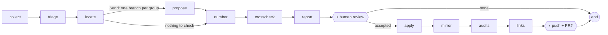
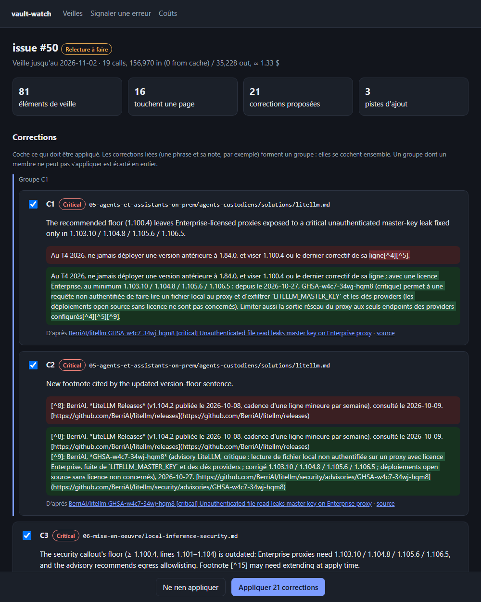

# vault-watch-agent

A [LangGraph](https://langchain-ai.github.io/langgraph/) agent that maintains the guide
[Zero to Hero: On-Premise AI](https://ia-on-prem.damien.becherini.fr/)
([repository](https://github.com/DamienBecherini/ia-on-prem-vault)) from its biweekly ecosystem watch.

The guide (about 400 k tokens of French content, mirrored in English) already collects what changed in its
ecosystem with a deterministic script and a weekly GitHub workflow: releases, security advisories, Hugging Face,
vendor feeds. This agent does the next step. It decides what makes a page wrong, proposes sourced corrections,
waits for a human review, applies them on a branch, syncs the English mirror, runs the guide's own audits and
link checks and, after a second go-ahead, opens the pull request.

It produced the pull requests [#51](https://github.com/DamienBecherini/ia-on-prem-vault/pull/51),
[#53](https://github.com/DamienBecherini/ia-on-prem-vault/pull/53) and
[#54](https://github.com/DamienBecherini/ia-on-prem-vault/pull/54) of the guide, all reviewed and merged.



| Step | What it does |
| :-- | :-- |
| `collect` | Downloads the watch: the GitHub issue and the artifact of its workflow run (items, cached release notes and advisories) |
| `triage` | Claude sorts the items: correction, addition candidate, or nothing for the guide |
| `locate` | Finds the French pages concerned and groups the items that touch the same pages or the same tool |
| `propose` | One parallel branch per group: corrections that quote the current text, give the new text and a source |
| `number` | Numbers the corrections (C1, C2…), checks each quote, flags overlapping edits |
| `crosscheck` | Re-reads every correction with the whole French guide in context (prompt caching) and the web: keep, revise or reject, plus consistency edits on other pages |
| `report` | Writes the Markdown report the human reviews |
| `review` | ⏸ Pause: the human accepts all, none, or a list (a group is accepted or refused as a whole) |
| `apply` | Applies the accepted corrections on a git worktree and bumps `last_modified` |
| `mirror` | Translates the changed hunks into the English pages (Claude Sonnet) |
| `audits` | Runs the guide's `npm test` (structure, sources, freshness, strict i18n) |
| `links` | Checks the external links of the changed pages |
| `publish` | ⏸ Pause: on a yes, pushes the branch and opens the pull request |

## Principles

- **The model proposes, the code decides.** Claude never writes a file. Each correction quotes the current
  text; a deterministic check refuses it unless the quote occurs exactly once in the page.
- **Human in the loop, twice.** The run stops after the report (LangGraph `interrupt`), and again before
  anything leaves the machine. A paused run is checkpointed in SQLite and resumed by a later command, from
  another process, days later if needed.
- **Evidence, not memory.** Proposals rely on the release notes and advisories cached by the watch, and the
  cross-check on primary sources fetched from the web, never on the model's memory alone.
- **One source of rules.** The editorial brief and the translation policy live in the guide
  (`.agents/skills/vault-watch/`) and are loaded at run time: the agent applies the guide's rules, it does not
  keep its own copy.

## Usage

```bash
python -m venv .venv && .venv/Scripts/python -m pip install -e ".[dev]"   # Windows; bin/ on Linux
export VAULT_PATH=../ia-on-prem-vault                                    # local clone of the guide
export ANTHROPIC_API_KEY=...                                             # gh must be authenticated too
```

### Web interface

```bash
vault-watch serve        # http://127.0.0.1:4430/
```

A FastAPI server drives the same graph as the command line, one screen per pause: the list of watch issues
with their run status, a run in progress (each finished step streamed to the page by server-sent events), the
review (one card per correction with a word-level diff of the current and proposed text, its sources and the
cross-check's verdict; members of a group are ticked together), the publish step (audits, link problems, the
diff of the branch), then the pull request. Two more pages report errors to fix and show what the upkeep
costs. The interface is in French, like the guide.



Model calls run in a background thread per run and every step is checkpointed, so the page can be closed
and a run started here can be resumed from the command line. The server listens on 127.0.0.1 only, refuses
a non-local `Host` header (DNS rebinding) and requires an `X-Vault-Watch` header on every request that
changes something, which a foreign web page cannot send without a CORS preflight the server never grants.

### Command line

```bash
vault-watch run --issue 50                  # stops at the review, prints the report path
vault-watch resume issue-50 --accept C1,C3  # or all / none; applies, translates, audits, stops again
vault-watch resume issue-50 --publish yes   # push the branch and open the PR
vault-watch status issue-50
```

Other commands:

```bash
vault-watch crosscheck issue-50                       # re-run the whole-guide cross-check of a paused run
vault-watch fix fix-2026-11-08 --findings errors.txt  # reported errors → checked corrections, same review and PR flow
vault-watch fix fix-2026-11-08 --from-threads issue-49,issue-50
vault-watch eval --issue 30 --at <commit> --truth <base>..<head> --variant full
vault-watch costs --by month                          # or year, run, step
```

`fix` enters the graph after `propose` (`graph.update_state(..., as_node="propose")`): errors found by a
cross-check or reported by a reader get the same numbering, cross-check, review, mirror, audits and PR.

Tests run with a fake model and a temporary git repository standing for the guide: `pytest`.

## Evaluation on past watches

Two watches processed by hand before the agent existed are replayed on the guide as it was then, up to the
review pause, and a judge model matches each proposal with the diff the human merged (`vault-watch eval`,
results in [`metrics/eval/`](metrics/eval/)).

| Watch | Human decision | Agent, keyword excerpts | Agent, whole-guide cross-check |
| :-- | :-- | :-- | :-- |
| #30 (urgent, 89 items) | PR #32, 26 hunks | 1 proposal, right | 3 proposals: 2 match, 1 valid extra page |
| #47 (biweekly) | nothing applied | 0 proposals | 0 proposals |

No proposal that reached the review was wrong. The raw recall on #30 is low (2 of 15 correction hunks), and
reading the misses says more than the number:

- the substantive change of the watch (Open WebUI floor raised to 0.11.4 after 15 advisories) was found on every
  page that states it, plus one page the human had left out;
- 9 of the 13 missed correction hunks change only a date (Ollama 0.40 « septembre » → « octobre » on 8 pages,
  a footnote 2 → 3 October). GitHub gives 25 September for the Ollama release: the agent declined for lack of
  evidence, which is defensible; the human's change is debatable;
- additions (new paragraphs: real-time transcription, MCP supply chain) are listed as candidates by design and
  are not counted in the correction recall.

The replay found two real defects, both fixed: the cross-check rejected a right correction over a debatable
date (it now revises the detail), and grouped items shared one excerpt budget, so the last item of a group
could get none (each item now has its own share).

## What the upkeep costs

Every model call is logged in [`metrics/usage.jsonl`](metrics/usage.jsonl) (run, step, model, tokens, cost at
list price computed from the usage the API returns). The file is versioned: it is the history of what keeping
the guide up to date costs. The Console's billing page stays the reference.

Measured in November 2026:

| Run | Cost |
| :-- | --: |
| Watch with excerpts only (issue #50, 81 items kept, 8 corrections) | 0.90 $ |
| Full watch with the whole-guide cross-check (issues #49, #50) | 3.80 – 4.40 $ |
| Fix run on the errors found by the cross-checks (26 corrections, guide PR #54) | 6.60 $ |

The cross-check dominates: writing 400 k tokens to the prompt cache costs about 2 $, a later call on the same
cache about 0.08 $. At two watches a month the upkeep is in the order of 100 $ a year.

## Design choices

- **LangGraph for the orchestration, the Anthropic SDK for the model.** The graph needs state, parallel
  branches (`Send`), pauses (`interrupt` / `Command(resume=...)`) and a checkpointer; the model calls need
  structured output validated by Pydantic, prompt caching, server-side web search and fetch, and the exact
  usage of each call. The official SDK gives the latter directly, so no LangChain chat-model wrapper sits in
  between.
- **No vector RAG.** The French guide fits in the context window; with prompt caching, reading all of it costs
  less than building and tuning a retrieval index, and the model sees footnotes and cross-page inconsistencies
  that retrieval would cut. Retrieval becomes useful past the context budget.
- **Corrections only.** Additions (a new model, a new tool) are listed as candidates in the report, not drafted:
  deciding that something belongs in the guide is the editor's call. Discovery is the next phase of the
  [roadmap](ROADMAP.md).

Architecture overview with diagrams (French, snapshot of 2026-11-08 before phase A):
[docs/presentation.html](docs/presentation.html).

## License

[MIT](LICENSE)
