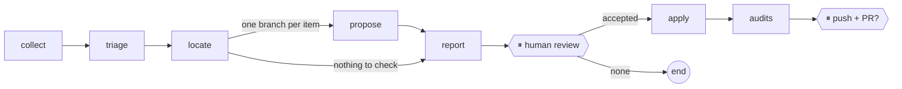

# vault-watch-agent

A [LangGraph](https://langchain-ai.github.io/langgraph/) agent that maintains the guide
[Zero to Hero: On-Premise AI](https://ia-on-prem.damien.becherini.fr/)
([repository](https://github.com/DamienBecherini/ia-on-prem-vault)) from its biweekly ecosystem watch.

The vault already collects what changed (GitHub releases and advisories, Hugging Face, vendor feeds) with a
deterministic script and a weekly GitHub workflow. This agent does the next step: it decides what touches the
guide, proposes sourced corrections, waits for a human review, applies them on a branch, runs the vault's own
audits and, after a second go-ahead, opens the pull request.



## Principles

- **The model proposes, the tools decide.** Claude never writes a file. Each proposal quotes the current text;
  a deterministic check refuses it unless the quote occurs exactly once in the page.
- **Human in the loop, twice.** The run stops after the report (LangGraph `interrupt`), and again before
  anything leaves the machine (push and pull request). A paused run is checkpointed in SQLite and resumed by
  a later command.
- **Evidence only.** Proposals rely on the release notes and advisory texts cached by the watch, never on the
  model's memory.

## Usage

```bash
python -m venv .venv && .venv/Scripts/python -m pip install -e ".[dev]"   # Windows; bin/ on Linux
export VAULT_PATH=../ia-on-prem-vault                                    # local clone of the vault

vault-watch run --issue 50                 # stops at the review, prints the report path
vault-watch resume issue-50 --accept C1,C3 # or all / none
vault-watch resume issue-50 --publish yes  # push the branch and open the PR
vault-watch status issue-50
```

## Evaluation on past watches

Two watches processed by hand before the agent existed are replayed on the vault as it was then, up to the
review pause, and a judge model matches each proposal with the diff the human merged (`vault-watch eval`,
results in [`metrics/eval/`](metrics/eval/)).

| Watch | Human decision | Agent, keyword excerpts | Agent, whole-vault cross-check |
| :-- | :-- | :-- | :-- |
| #30 (urgent, 89 items) | PR #32, 26 hunks | 1 proposal, right | 3 proposals: 2 match, 1 valid extra page |
| #47 (biweekly) | nothing applied | 0 proposals | 0 proposals |

No proposal that reached the review was wrong. The raw recall on #30 is low (2 of 15 correction hunks), and
reading the misses says more than the number:

- the substantive change of the watch (Open WebUI floor raised to 0.11.4 after 15 advisories) was found on every
  page that states it, plus one page the human had left out;
- 9 of the 13 missed correction hunks change only a date (Ollama 0.40 « septembre » → « octobre » on 8 pages,
  a footnote 2 → 3 October). GitHub gives 25 September for the Ollama release: the agent declined for lack of
  evidence, which is defensible; the human's change is debatable;
- additions (new paragraphs: real-time transcription, MCP supply chain) are listed as candidates by design and
  are not counted in the correction recall.

The replay found two real defects, both fixed: the cross-check rejected a right correction over a debatable
date (it now revises the detail), and grouped items shared one excerpt budget, so the last item of a group
could get none (each item now has its own share).

## What the upkeep costs

Every model call is logged in [`metrics/usage.jsonl`](metrics/usage.jsonl) (run, step, model, tokens, cost at
list price computed from the usage the API returns). The file is versioned: it is the history of what keeping
the guide up to date costs.

```bash
vault-watch costs                # by month (also --by year, run, step)
```

The Console's billing page stays the reference; the journal is checked against it from time to time.

`ANTHROPIC_API_KEY` must be in the environment. `gh` must be authenticated to read the watch issue and its
workflow artifact. Tests run with a fake model: `pytest`.

## Status

Day 1: graph, state, parallel proposals, two human pauses, apply and audits.
Next: retrieval over the guide instead of keyword search, English mirror sync, re-check of watchlist claims,
tools exposed through MCP.
