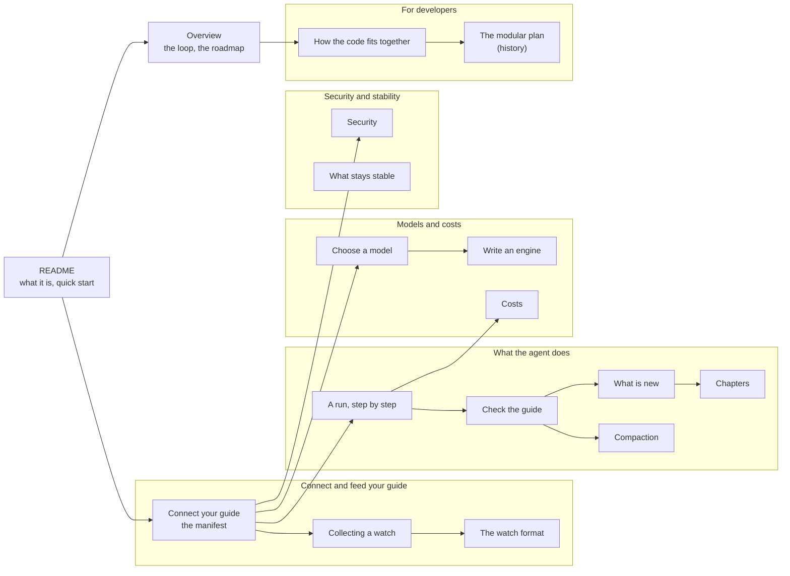

*[Version française](fr/README.md)*

# The documentation of vault-watch-agent

Every page, grouped by the question it answers. Each page is in English here and in French in [`fr/`](fr/), under
the same name; the screenshots are in [`images/`](images/). What the agent is, how to install it and the pages of
its interface: the [README](../README.md) of the repository.

## Discover

| Page | What it answers |
| :-- | :-- |
| [Overview](presentation.md) | Why a technical guide goes stale, the whole loop from a watch to a merged pull request, the two pauses, what the agent produced on the IA on-prem guide, what it is worth, where it goes next. Five diagrams |

## Connect and feed your guide

| Page | What it answers |
| :-- | :-- |
| [Connect your guide](connect-your-guide.md) | The three commands to start, the manifest `vault-watch.toml` key by key, what each optional part unlocks, the sample guide to try it on. A screenshot of the « Chapters » page |
| [Collecting a watch](collect.md) | `vault-watch collect`: the feeds a guide follows (`feeds.json`), the pre-triage without a model, the « Sources » page and the check of the sources, the weekly workflow on GitHub. A screenshot of the « Sources » page |
| [The watch format](watch-format.md) | `watch.json` field by field, for a guide that brings its own collector |

## What the agent does

| Page | What it answers |
| :-- | :-- |
| [A run, step by step](run.md) | One item of a watch through every step: what each reads, what decides, what can stop an edit; an example with its cost; the review screen and the publish screen; pauses and resumes. A diagram, a screenshot of the review |
| [Check the guide](check.md) | The eleven checks: what each reads, its estimate and what it cost, what it finds, where its leads go; the life of a lead; the runs they go to; « Report or suggest ». A diagram, a screenshot of the catalogue |
| [What is new](news.md) | What a reader would look for and not find: the leads from the guide and from the web, an idea of your own, the additions and their check on the web, what each call reads and costs. A screenshot of the leads |
| [Chapters](chapters.md) | The three steps that work on a part of the guide at a time, where the chapters come from, the automatic rule and why 150 KB and 20 KB, what a split that fits badly costs. A diagram of the rule |
| [Compaction](compact.md) | Keeping a guide from growing heavy: the sizes, the report, the trims, which model, what the code checks itself |

## Models and costs

| Page | What it answers |
| :-- | :-- |
| [Choose a model](choose-a-model.md) | The models measured on the IA on-prem guide, what each step asks of a model, a model for one step, what each setting changes, what was tried, measuring your own model. A screenshot of the Settings |
| [Write an engine](write-an-engine.md) | What the graph asks of an engine, how to declare one, the example of Ollama's own API, the contract tests |
| [Costs](costs.md) | What makes the price of a call (the prompt cache above all), where the money goes by kind of run, how the estimates are made and why they miss, where the prices come from, the journal and the « Costs » page, what lowers the cost. A diagram of the cache, a screenshot of the « Costs » page |

## Security and stability

| Page | What it answers |
| :-- | :-- |
| [Security](security.md) | Keys and tokens kept as references, what the model can do and what it cannot, what leaves the machine, the local server, what to check before connecting a guide |
| [What stays stable](compatibility.md) | The four formats frozen since 1.0 (manifest, watch, engine protocol, settings), the rules of a change, what is not frozen |

## For developers

| Page | What it answers |
| :-- | :-- |
| [How the code fits together](code.md) | The modules and their dependencies, the graph node by node, the state, one model call end to end, how a run pauses and resumes, the tests. Six diagrams |
| [The modular plan](modular-plan.md) | The plan of phase G, from one guide to an agent any guide can use. Kept as history, in English only |

At the root of the repository: [ROADMAP](../ROADMAP.md), [CHANGELOG](../CHANGELOG.md),
[CONTRIBUTING](../CONTRIBUTING.md).
