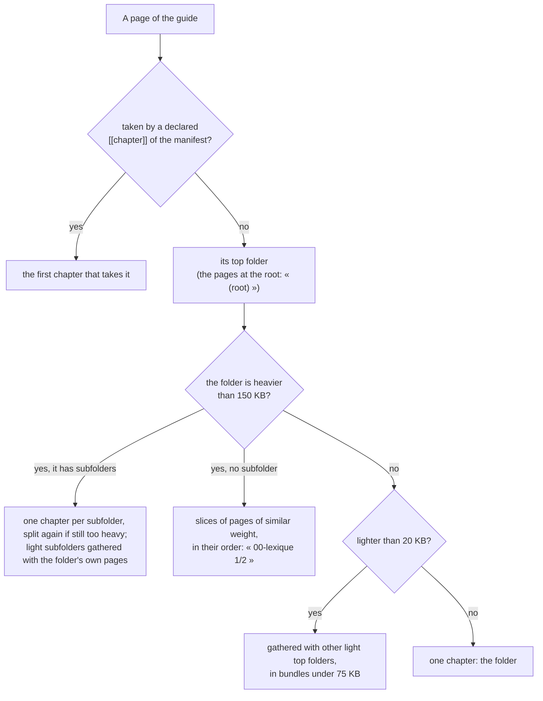

*[Version française](fr/chapters.md)*

# Chapters: how the agent splits a guide

Most steps of the agent read the whole guide in one call: a contradiction between two pages far apart is found only
that way. Three steps cannot, or should not, and work on a part of the guide at a time: a **chapter**. This page
says what they do with it, where the chapters come from, why the automatic rule has the thresholds it has, and
what a split that fits the guide badly costs.

## The three steps that work by chapter

| Step | What a chapter is for | What the number and the size of the chapters change |
| :-- | :-- | :-- |
| The web explored for [what is new](news.md#the-leads-from-the-web) | One paid call per chapter you tick: it searches the web on the subjects of its chapter (about 12 searches and 15 pages read), compares with the whole guide and keeps eight leads at the most | **The cost follows the number of chapters**: each call reads the whole guide from the cache and has the same web budget, whatever the size of its chapter (about 4.75 $ a chapter on the IA on-prem guide, estimated). **The size decides how well each subject is searched**: a chapter of forty subjects shares its dozen searches between them |
| The check of the translations | One call per chapter: its pages in the source language and their mirrors, side by side | Little: the guide is read once in all; more chapters is a little more instructions and answers |
| Every step that reads the whole guide, when it does not fit in the model's window | The cross-check, its sweep and the consistency check then make one call per chapter, with the pages the corrections change ([`reading.py`](../src/vault_watch_agent/reading.py)) | A chapter must fit in the window. A fact stated in two chapters is no longer seen in one read: the report and the run view say the guide was read by chapter |

On the IA on-prem guide with Claude (a window of a million tokens), the third case never happens: the guide is
read whole. The chapters matter there for the exploration of the web above all.

## Where the chapters come from

1. **The manifest of the guide**, when it declares them: `[[chapter]]` tables, each a name, its paths, and
   `explore = false` for a chapter left unticked when the web is explored. A page goes to the first chapter that
   takes it. The keys, and how to write them (by hand, or from a model's proposal reviewed on the « Chapters »
   page): [Connect your guide](connect-your-guide.md#chapter).
2. **The automatic rule**, for the pages no declared chapter takes, and for a guide that declares none.

`vault-watch chapters` lists the chapters as they are, with their weight and where each comes from; the
« Chapters » page of the interface (in the menu under the guide's name) shows the same.

## The automatic rule

It starts from the folders of the guide, since an author usually groups pages by subject:

1. One chapter per top folder; the pages at the root of the guide form one, « (root) ».
2. **A folder heavier than 150 KB is split**: one chapter per subfolder (each split again if it is still too
   heavy, the light subfolders gathered with the pages of the folder itself), or, when it has no subfolder, slices
   of pages of similar weight, in their order (« 00-lexique 1/2 », « 00-lexique 2/2 »).
3. **The top folders lighter than 20 KB are gathered**, in bundles that stay under 75 KB (half of 150): a home
   page, an « about » folder, a page of credits do not each cost a call.

The weight is the size of the Markdown files of the source language, front matter and footnotes included; the
mirrors do not count.

### Why 150 KB and 20 KB

They were set on the IA on-prem guide, the one the agent was written for, so that the rule gives without a
manifest about the split its author would choose. What the rule gives on it today (21 November 2026):

| Folder | Pages | Weight | By the rule |
| :-- | --: | --: | :-- |
| (root) | 2 | 14 KB | one chapter |
| `projet/` | 4 | 21 KB | one chapter |
| `00-lexique/` | 75 | 221 KB | split in two slices of about 110 KB (no subfolder) |
| `01-fondations/` to `04-blueprints/` | 4 to 6 each | 76 to 79 KB each | one chapter each |
| `05-agents-et-assistants-on-prem/` | 21 | 145 KB | one chapter: under 150 KB |
| `06-mise-en-oeuvre/` | 7 | 130 KB | one chapter |

Ten chapters, most of 76 to 145 KB: the size of a part a reader goes through as one subject, and of what a dozen
searches can cover. A lower threshold would have split the folders of 130 and 145 KB; a higher one would have left
the lexicon as one chapter of 221 KB.

The table also shows the weak point of a threshold. On 20 November `projet/` weighed under 20 KB and was gathered
with the root pages into one chapter of 32 KB; two pages about the agent grew by under 3 KB, and the same pages
are now two chapters, two calls when the web is explored. A rule on weights cannot know that these pages belong
together; a declared chapter can.

**They are fixed in the code**, not in the manifest: `BIG_KB` and `SMALL_KB` in
[`chapters.py`](../src/vault_watch_agent/chapters.py). A guide whose folders the rule splits badly does not change
them: it declares its chapters, which wins over the rule page by page. The manifest may declare only what the rule
gets wrong.

150 KB is used in two more places:

- **The model's proposal** is asked for chapters of about that size ([Connect your guide](connect-your-guide.md#chapter)).
- **A declared chapter above 225 KB** (one and a half times 150) is flagged by `vault-watch doctor` and on the
  « Chapters » page: a call on it reads and writes a lot. It is a warning, never a refusal. The lexicon of the IA
  on-prem guide (221 KB) is just under; it is declared with `explore = false`, so it costs nothing unless ticked.

## What a split that fits badly costs

| The split | What happens |
| :-- | :-- |
| Too many small chapters | The exploration of the web costs a call each (about 4.75 $ on the IA on-prem guide), for a few subjects. The check of the translations takes more calls for the same pages |
| Chapters too heavy | Their subjects share a dozen searches: some are never looked at, and the result does not say which. With a small window, a chapter may not fit in a call |
| Chapters that cut across subjects | One piece of news concerns two chapters: each call sees half of the pages it changes, or both find it (a lead found twice from the same source is listed once) |
| A glossary or the pages about the project explored | A call paid for pages the web brings nothing new to: declare them with `explore = false` |

## The IA on-prem guide

Since 20 November 2026 it declares nine chapters, proposed by a model (0.13 $), reviewed, then merged
([pull request #101](https://github.com/DamienBecherini/ia-on-prem-vault/pull/101)). What it changes from the rule:
the root pages and `projet/` are one chapter, « Accueil et projet » (35 KB), and with « Lexique » (221 KB, one
chapter) it is not explored by default; the folder of agents and assistants is cut along its two parts (« Agents
custodiens », 63 KB; « Assistants personnels et souveraineté », 82 KB), which the rule leaves as one chapter of
145 KB. Seven chapters are explored by default. Every page is taken by a declared chapter: the automatic rule now
only applies to a new folder no chapter covers, and `vault-watch doctor` says when a declared chapter takes no page any more.
