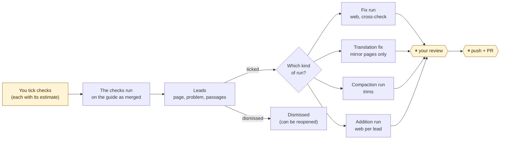

*[Version française](fr/check.md)*

# Check the guide: the checks, their leads, and where they go

A watch only looks at what its sources announce. The page « Check the guide » of the interface (in the menu
« Watch ») looks at the guide itself, on demand: whether its scripts pass, whether its sources still answer, whether its pages agree with
one another, whether its translations say the same thing, whether its dated claims still hold, what makes it heavy,
and what a reader would look for and not find. This page says what each check reads, what it costs, what it finds,
and what becomes of what it finds.

A check never edits the guide. What it finds is a **lead**: one line that names the pages, says what is wrong and
what a fix should check, with the passages concerned copied from the pages. The leads you tick go to a run, which
checks them on sources and goes through the same review and pull request as a watch.

## The catalogue

Eleven checks. Four run the guide's own scripts or read its files with no model, and cost nothing; seven have a
model read the guide. The estimates below are those the page showed on 21 November 2026 for the IA on-prem guide
(410 k tokens of French pages), with the models of its settings, at list price; the measured costs are those of
the checks run on 8 and 17 November ([what an estimate is](costs.md#the-estimates)).

| Check | What it reads | Model | Estimate | Measured | What it finds | Its leads go to |
| :-- | :-- | :-- | --: | --: | :-- | :-- |
| Guide audits | The guide's `[checks] audits` script (`npm test` for the IA on-prem guide) | none | free, ≈ 10 s | 0 $ | A log, pass or fail | no leads |
| Dead links | Every URL cited by a source page, probed by the guide's `[checks] sources` script | none | free, ≈ 2-4 min | 0 $ | The sources that do not answer (404, errors, timeouts), and those blocked by anti-bot protections, apart; crossed with the weekly report of the guide's CI when the manifest names it (`[checks] sources_weekly`): a source that fails only from the CI's runners answers here, listed apart, not to replace | a fix run |
| Freshness | The guide's `[checks] claims_due` script: the watchlist and the review dates of the pages | none | free, ≈ 5 s | 0 $ | The claims past their « Recheck by » date, the pages due for review | no leads: the re-check of claims uses them |
| Consistency of the whole guide | Every source page, in one call | reasoning (Opus 5.5) | 2.59 $ | 2.64 – 2.73 $ | Contradictions between pages, a page left behind by the others, wrong definitions, a footnote that does not support its sentence | a fix run |
| Translation fidelity | Each page beside its mirror, one call per chapter | translator (Sonnet 5.5) | 1.84 $ | 1.58 – 1.64 $ | A passage missing on one side, a figure, version or link that differs, text left untranslated | a translation fix run |
| Re-check of dated claims | The claims found by « Freshness », with their pages as they read today, checked on the web | reasoning | 0.18 $ a claim on the API, 0.07 $ with Claude Code | 2.50 $ for 12, 2.89 $ for 20 (API); 1.19 $ for 18 (Claude Code) | The claims whose page is now wrong, with what the sources say today | a fix run |
| Replacement of dead links | The dead sources found by « Dead links », with the lines that cite each one | reasoning | 0.27 $ a source | 0.54 $ and 3.57 $ for 2 | Where each page moved, or an equivalent primary source; each dead address is opened first, and one that opens and still says what the guide cites it for is not reported | a fix run |
| Size of the pages | The files, with their history over 90 days | none | free, ≈ 2 s | 0 $ | What each page weighs and gained; a warning for a page that grew much or passed its ceiling | no leads: compaction uses it |
| Compaction | Every page in one call, with the heaviest named | reasoning (Fable 5.2 on this guide) | 6.50 $ | 6.28 $ | The same fact repeated, history piled up, sections longer than what they say ([Compaction](compact.md)) | a compaction run |
| What is new | Every page, and what past watches set aside | reasoning | 2.45 $ | 2.28 $ | What the guide presents as current and has probably moved on, the subjects a reader would expect and no page covers ([What is new](news.md)) | an addition run |
| What is new: the web explored | One call per chapter ticked, each with the web and the whole guide | reasoning | 2.05 $, then 4.81 $ a chapter | not run yet | What the web says about a chapter's subjects that the guide does not, each lead with its sources ([Chapters](chapters.md)) | an addition run |
| What is new: the candidates judged | Every page, with the open candidates of the registry | reasoning | 2.16 $, and ≈ 0.03 $ a candidate | not run yet | Each candidate to add (where, which decision it changes), to watch or to dismiss, kept in the registry ([Judged with the guide](collect.md#judged-with-the-guide)) | an addition run |

The checks are of three kinds, which the list of the checks shows as tags in colour: **guide health** (the audits,
the dead links, freshness, consistency, the translations, the claims, the replacement of dead links), **lighter
guide** (the size of the pages, compaction) and **what is new** (the three checks of what is new, and « Links to read
whole », a thirteenth check that is not in the catalogue: it starts from « Report or suggest », [below](#report-or-suggest)).
A lead of a check of what is new can also be followed in the registry of candidates instead of written or dismissed
([From a search for what the guide lacks](collect.md#from-a-search-for-what-the-guide-lacks)).

Three checks need another one first, which runs even when it is not ticked: the re-check of claims needs
« Freshness », the replacement of dead links needs « Dead links », compaction needs « Size of the pages ». A
check whose script the manifest does not declare says « not checked: the guide declares no [checks] … » and
finds nothing.

The two follow-ups show how far an estimate can be from the bill when the model works on the web: the
replacement of two dead links cost 0.54 $ on 8 November and 3.57 $ on 17 November, the second time because the
model searched and read many more pages before it found a source it trusted. The estimate counts what the guide
weighs; the web it cannot count in advance.

## How a check runs

- **On the guide as merged.** The checks read a reading copy of the guide's base branch, brought up to date with
  the forge, not the folder you work in: a branch of yours, half edited, does not make leads. The commit read is
  kept with the check.
- **One after the other, independent.** A check that fails says « could not run » with the error, and the others
  go on. A call that fails after the model has answered (an answer cut at the output limit) is counted all the
  same.
- **The whole guide in one call**, for consistency, compaction and what is new. When the guide does not fit in the
  model's window, the check makes one call per chapter and says so: a contradiction between two chapters can be
  missed ([Chapters](chapters.md)).
- **The passages are checked by the code.** The model copies each passage it is about from its page; the agent
  looks for it in the page and shows it framed, with the sentence highlighted. A passage it does not find says
  « excerpt not found in the page », or « closest passage, not an exact quote ». The dead links are found by the
  code itself, so their passages are always exact.
- **A severity** on each lead: Critical, Major or Minor. A translation divergence the model judges, on second
  thought, to say the same thing on both sides is dropped; a page with no mirror is a Major lead found by the
  code.

## The list of the checks, and the page of a check

The page « Check the guide » shows first, under « To sort », the checks whose leads are still to sort (or that are
running); then « New check », the catalogue, folded while leads remain to sort; then « Previous checks », which can
be narrowed to one kind (« All », « Guide health », « Lighter guide », « What is new »). Each check is a card: its
kind in colour, a short title (« 7 checks », « Compaction », « Links to read whole · 2 links »), « from Report or
suggest » for a check started there, the links it read, what it cost (on a subscription, what it is worth at list
price, struck through: [Costs](costs.md#the-estimates)), its leads (« n to sort · n sent to a run · n dismissed »),
and the runs its leads went to while they wait for something, each with the button of its step (« Follow »,
« Review », « Approve publishing », « Merge on GitHub »). The checks whose leads are to sort are also on « To
handle », the first page of the interface; « Sort » opens the page of the check.

On the page of a check, each check is a card, folded once nothing is left to do in it, with « Tick / untick the n »
for its leads still open. A bar stays at the bottom of the page: what is ticked and what it costs, « Options »,
« Dismiss n lead(s) » and the button that creates the run (« Create a fix run · ≈ 6-8 $ », or « Create 2 runs: … »
when the leads ticked go to two kinds of run). « Options » opens above the bar, kept open or folded in the browser:
for the leads of what is new, « Dig deeper and reading » ([What is new](news.md#the-additions)); then « Engine and
models of this run », one card per step of the run (what it does, its engine, model and effort, how it is paid),
each with « change » for this run alone, a step changed so being framed. On a phone, « ⋯ » opens the options and a
« ? » on each card says what its step does. When a run is already in progress, the button asks before starting
another one at the same time.

## The life of a lead

| State | What it means | What you can do |
| :-- | :-- | :-- |
| To sort | Found by the check, not decided yet | Tick it and send it to a run, or dismiss it |
| Sent to a run | It is an item of a run, shown with where the run stands (review, publish, pull request to merge, merged) | Follow the run |
| Not checked by the run | Sent to an addition run whose call could not look at it (its web ran out, the call failed): nothing was searched or edited for it | Put it back to handle, to send it again |
| Dismissed | You judged it wrong or not worth it | Reopen it |

The leads ticked together go to as many runs as they have kinds: three consistency leads and two translation
leads make one fix run and one translation fix run, and the button says what each will cost. A lead that a fix run
finds already right, or wrong, gets an outcome with its reason in the run's report, not an edit.

Two habits keep the list honest. A new check while leads are still to sort finds them again, so the page warns
before it starts: sort them first (send them to a run, or dismiss them). Deleting a check deletes its leads, never the runs already started
from it.

## The runs the leads go to

| Run | What it does with a lead | Web | Cross-check | Cost on the IA on-prem guide |
| :-- | :-- | :-- | :-- | --: |
| Fix | Reads the whole guide, checks the lead on primary sources, proposes the smallest corrections that make every page concerned true, or says why none is needed | yes | yes, then the sweep | 5.60 – 8.15 $ |
| Translation fix | Corrects the mirror pages against the source pages | no | no | 0.35 $ (12 corrections) |
| Compaction | Proposes trims, judged on what they lose ([Compaction](compact.md)) | no | its own, without the web | 18.87 $ for 30 leads |
| Addition | Checks each lead on the web, then corrects what is out of date or adds what is missing where it belongs; never writes a new page ([What is new](news.md#the-additions)) | yes, per lead | yes, then the sweep | 6.35 $, then 2.18 $ a lead (estimate); 8.70 – 12.95 $ measured for 2 to 5 leads |

From there the run is a run like a watch: numbering, cross-check, report, your review, apply on a branch,
mirrors, audits, links, your go-ahead, pull request ([A run, step by step](run.md)).

## Report or suggest

The page « Report or suggest » (in the bar of the interface, or « Write » on « To handle ») skips the search for
leads, when you already know what to check:

- **An error to fix**: one per line, the page, what is wrong, and the right information if you have it. It makes a
  fix run, as a lead of « Consistency » would (about 5 to 7 $ on the API; nothing billed on a subscription).
- **An idea or a piece of news to dig into**: one subject per line, with an address if you have one. It makes an
  addition run, as a lead of « What is new » would; a box asks to dig each subject deeper (several sources, more
  searches, a little more expensive), and the page shows the count before you start.
- **Links to read whole**: one address per line (an article, a page, a PDF, a project's repository, a video). Each
  link is read whole, then Claude reads it with the whole guide and lists leads, which come on the page of a check
  « Links to read whole », to tick and send to an addition run ([details](news.md#links-to-read-whole)).

What you type is kept as a draft, one per tab: while you switch tabs, and in the browser against a reload, a crash
or a closed tab. « Clear » empties it, « Restore » brings it back. It empties once the run or the check has started;
a refusal or a lost connection keeps it, and the page says why.

A line typed by hand has no framed passage: the run finds the pages itself, with the whole guide in context. What
the cross-check of any run notices elsewhere in the guide, outside its corrections, is listed in its review under
« Noticed elsewhere in the guide »: copy the lines into « Report or suggest », tab « An error to fix », to have them
fixed.

On the command line, `vault-watch deadlinks` probes the dead links (crossed with the weekly report), then, asked
first, searches a replacement for each and writes them to a file for `vault-watch fix <thread> --findings <file>`.
`vault-watch news` (`--explore` for the web) and `vault-watch compact --report` run three of
these checks; `vault-watch fix <name> --findings file.txt` makes a run from a file of leads, one per line, with
`--translation`, `--compact` or `--add` for the other kinds (a line that begins with `!` is dug deeper).

## When

There is no schedule: the free checks cost nothing and can run at any time; the others cost, and their leads ask
for a review. What the IA on-prem guide did in November 2026: consistency, translations, claims and dead links
twice (8 and 17 November: 7.26 $ and 10.83 $), whose leads became five runs; compaction and what is new once each,
on 20 November. The page [Compaction](compact.md#when) suggests a quarterly rhythm for its part.
