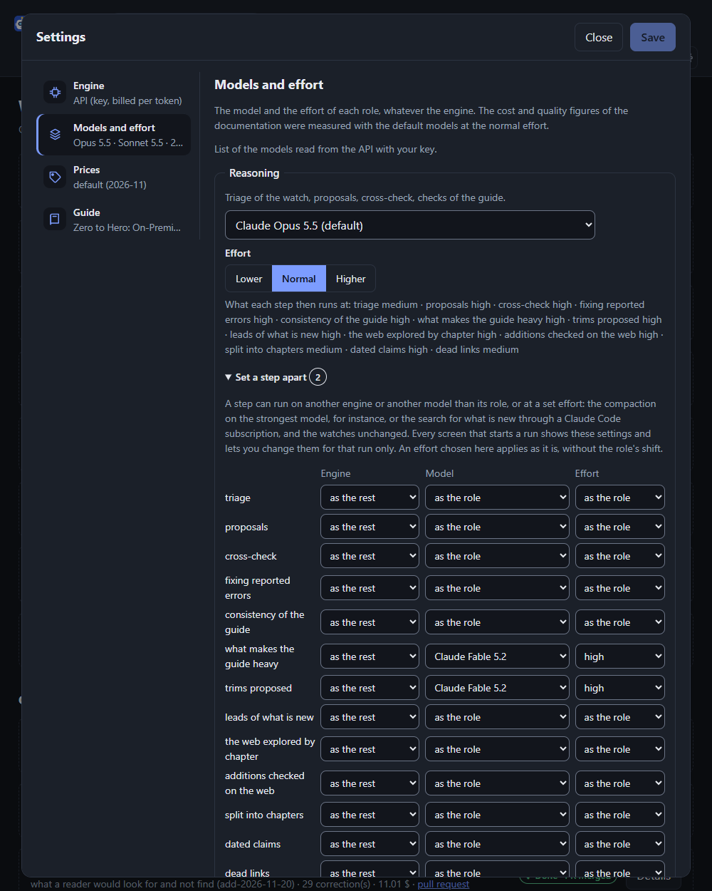

*[Version française](fr/choose-a-model.md)*

# Choose a model

Since 0.6.0 the agent runs on any engine: the Claude API, Claude Code, or any server of the OpenAI chat API, hosted
or local ([Write an engine](write-an-engine.md)). Running is not doing the work well. This page says which models
the agent is used with, what was tried beyond them, and why nothing more is promised.

## The models the IA on-prem guide uses

The agent keeps the guide [Zero to Hero: IA on-premise](https://github.com/DamienBecherini/ia-on-prem-vault) up to
date with:

| Role | Steps | Model |
| :-- | :-- | :-- |
| reasoning | triage of the watch, proposals, cross-check against the whole guide, sweep | Claude Opus 5.5 |
| translator | the English mirror of the corrected pages | Claude Sonnet 5.5 |

through the Claude API (billed per token) or Claude Code (the subscription). Every correction goes through the review
screen and a pull request a human merges: that review, not a score, is what the guide relies on.

These are the only models the project commits to. With any other one the engine works (it passes the
[contract tests](../tests/engine_contract.py)), the quality of the corrections is not measured, and you should check
its proposals before trusting a watch that says « nothing to change ».

## What each step asks of a model

- **Triage**: read the watch's items and keep those that may touch the guide. Short calls; a modest model does it.
- **Proposals**: decide, for each kept item and its excerpts of the guide, whether a sentence is now wrong and how
  to write it. The judgement step: a model that is too cautious answers « no change » and the watch looks clean.
- **Cross-check and sweep**: read the corrections against the whole guide, with the web, and find the other pages
  that state the same fact. The longest step, and where most corrections come from (7 of the 11 of watch #77). A
  window smaller than the guide makes the agent read it by chapter: more calls, and a fact stated in two chapters is
  no longer seen in one read.
- **Mirror**: translate the corrected passages. A good translation model is enough.

## A model for one step

The Settings give a model and an effort to two roles: reasoning (triage, proposals, cross-check, the checks of the
guide, the compaction, what is new, the chapters) and translation (the mirror, the translation checks). A step can be set apart from its
role: « Models and effort », then « Set a step apart » under the role. It then runs on the model chosen for it,
and at the effort chosen for it when one is: that effort applies as it is, where the role's « lower » and
« higher » move every other step one level. Everything else follows the role.

The use this was made for: the [compaction](compact.md) on the strongest model, a few times a year, while the
watches stay on the model measured here. The estimates and the cost journal follow the model of each step.
In `settings.json`: `"steps": {"compaction": {"model": "claude-fable-5-2", "effort": "high"}}`.

A step can also have its own engine (`"steps": {"news": {"engine": "claude-code"}}`): the search for what is
new through a subscription, for instance, while the watches stay on the API. Without a model of its own, such a
step takes the model its role has with that engine. If its engine cannot be used (the API without a key), the
error comes when that step is asked, not before.

Three levels, from the most general to the most particular:

| Level | Where | Applies to |
| :-- | :-- | :-- |
| The defaults | The agent itself | A machine where nothing was set |
| The Settings | « Engine », « Models and effort », « Set a step apart » | Every run from then on |
| This run only | « change for this time », beside each check and under « Engine and models of this run » of « Report or suggest » and « Languages »; « change » on the card of each step, in the « Options » of the bar that creates a run from leads | That run, down to its last step (the mirrors after the review); the Settings are not touched |

Each screen that starts a run shows what will run each of its steps (engine, model, effort) and how it is paid,
before the click. An engine forced for a whole command (`VAULT_WATCH_ENGINE`) wins over all three.

## What each setting changes

What the Settings change, and what each choice costs or risks. The figures of this documentation were measured
with the defaults: Opus 5.5 and Sonnet 5.5, at the normal effort, on the API.

| Setting | The choices | What it changes |
| :-- | :-- | :-- |
| Engine | Automatic (Claude Code when it is signed in with a subscription, otherwise the API), Claude Code, the API, an OpenAI-compatible server | Who pays: Claude Code counts in the subscription's limits and bills nothing; the API bills each token at list price ([Costs](costs.md)). How the web is read: on the API, the model reads the pages it opens; on Claude Code, it searches with Claude Code's own search and reads the pages through the agent's page reader (public addresses only, 30,000 characters a page at most). A run stops at a subscription limit and resumes later: the agent never moves to the API by itself |
| Model, per role | Reasoning: triage, proposals, cross-check, the checks of the guide, compaction, what is new, the chapters. Translation: the mirrors, the check of the translations, the fixes of translations | The quality of the work: the proposals and the cross-check are where a weaker model shows, by answering « nothing to change » ([What each step asks of a model](#what-each-step-asks-of-a-model)). The price of every call of the role. The window: a model that cannot read the whole guide makes the agent read it by chapter ([Chapters](chapters.md)) |
| Effort, per role | Lower, normal, higher | Each step has its own level in the code (medium for the triage, the chapters, the dead links and the translator's steps; high for the others). This setting moves every step of the role one level, within low… max. Higher: more thinking, so more output tokens, a slower run and more of the cost or of the subscription's limits. Lower: the reverse, not measured on the guide |
| A step set apart | Its engine, its model, its effort | That step alone, as set: its effort applies as it is, not moved by the role's. The compaction on Fable 5.2, for instance, about twice the price of Opus 5.5 for that step |
| For this run only | « change for this time », beside each check and under « Engine and models of this run » of « Report or suggest » and « Languages »; « change » on the card of each step, in the « Options » of the bar that creates a run from leads | The same choices, for one run, down to its mirrors; the Settings are not touched |
| Prices | Set by hand, the public list, or the defaults | The amounts of the estimates and of the journal, never what the agent does ([where the prices come from](costs.md#where-the-prices-come-from)) |




With an OpenAI-compatible server, more settings: its address, the reference of its key, the model's window
when the server does not give it (a smaller window means a guide read by chapter), how its JSON answers are made
(a schema enforced by the server, or given in the instructions), its billing (per token at the price set in
« Prices », or a local model, nothing billed), whether the effort is sent, and the address of a SearXNG instance
for web search: without one, the model can read the pages whose address it has but cannot search, and the steps
that check on the web say so.

Some choices are not in the Settings because they are made per run. The chapters the web is explored on, ticked
on the page « Check the guide » (each one costs a call). What each lead of an addition run reads, the whole guide
or its pages and the plan of the guide ([What is new](news.md#the-additions)). A lead dug deeper. And the web budget
of a call is fixed in the code: 20 searches and 30 pages on the API, as for the agent's own web tools on an
OpenAI-compatible server; an exploration of a chapter is asked to keep to about 12 searches and 15 pages.

## What was tried

**Cheaper Claude models (27 November 2026).** Watch #77 replayed whole (variant full, with the cross-check of the
whole guide) on the API: the triage, the proposals and the cross-check on each model, the judge on Opus 5.5 every
time (`issue77-full-b2*.json`):

| Model | Corrections of the merged PR found | Wrong | Cost at list price (judge apart) |
| :-- | --: | --: | --: |
| Claude Opus 5.5 | 9 of 9 | 0 | 3.26 $ |
| Claude Sonnet 5.5 | 9 of 9, and a valid rewording | 0 | 1.57 $ |
| Claude Haiku 5.5 | 8 of 9, a footnote missed | 0 | 0.12 $ |

Haiku also wrote two proposals quoting text their page does not have; the agent's check set them aside before the
review. Watch #77 is one security advisory to carry to every page that gives the minimum version: a search more
than a judgement. The merged PR is the agent's own proposals on Opus 5.5, reviewed by a human: what Opus missed is
in no truth, and is scored at best a valid extra. One run on one watch: Sonnet 5.5 is to be replayed on a watch that asks for judgement before the
defaults change.

**A local model on a laptop.** Qwen3.6-35B-A3B (llama.cpp, quantized, 64k window) on an 8 GB laptop GPU. It runs
every step in the schema; on the sample guide, read whole in one call, its cross-check found the contradiction
planted between two chapters. On watch #77 replayed by excerpts (no
cross-check), it kept the right item, a LiteLLM security advisory, saw that the guide's minimum version was below
the advisory's, then declined to change the sentence: no proposal, where Claude Opus 5.5 made three, all right. One
run on one watch: a sign, not a measure.

Models able to do the proposal step locally need far more memory: a graphics card of 32 GB or more, or an engine that
streams a large model from the SSD (InferSSD or the like) on such a card. The project has none, so no local model is
recommended.

**A hosted model through the OpenAI-compatible engine.** Claude Haiku 5.5 through Anthropic's OpenAI layer, on the
sample guide only, to try the engine itself (schema in the instructions, web search through SearXNG, per-token
billing). It says nothing of other hosted models: for a Claude model, use the Claude API engine.

## Measuring your own model

`vault-watch eval` replays a past watch on the guide as it was, up to the review, and compares the proposals with
the pull request a human merged after it:

```bash
vault-watch eval --issue 77 --at <commit before the PR> --truth <base>..<head> --variant keyword --judge claude-code
```

`keyword` stops before the cross-check (minutes); `full` runs it (the whole guide, much longer on a local model). Read
the result with its limits:

- **The judge is a model.** It pairs each proposal with the hunks of the merged diff. By default it is a Claude
  model (`--judge api|claude-code`), so that a local model does not score itself; but Claude judging Claude's
  proposals is not neutral either. Read the pairing in the result file, not only the figures.
- **The truth is what the human merged.** For watch #77 that pull request was itself a run of the agent on Claude
  Opus, checked and merged by a human: replaying Opus measures how well it repeats a reviewed run, not an
  independent truth. A watch the human processed by hand (as #30) is a fairer test.
- **One watch is one case.** Several watches, of several kinds (security, releases, prices), before deciding.

The result files of the runs above are in [`metrics/eval/`](../metrics/eval/).
