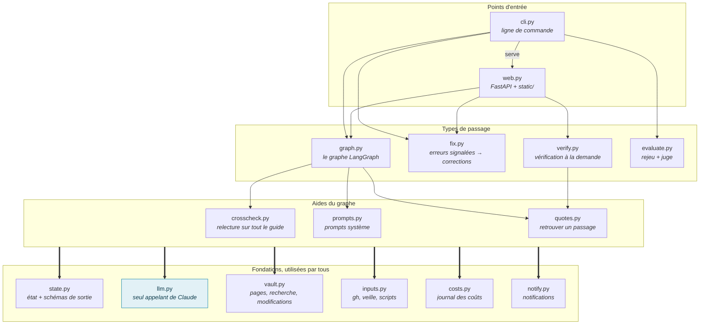
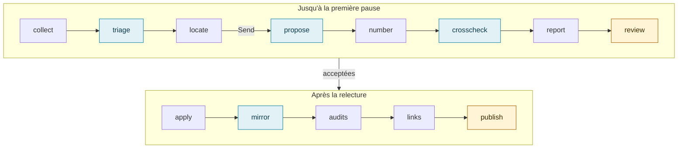
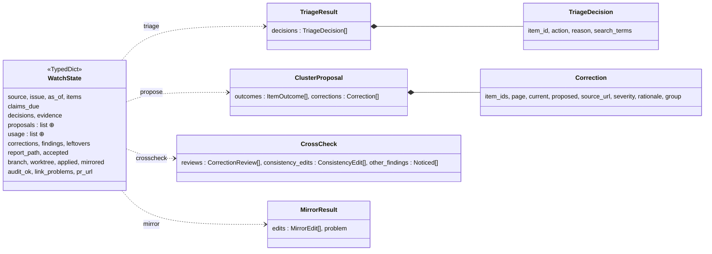
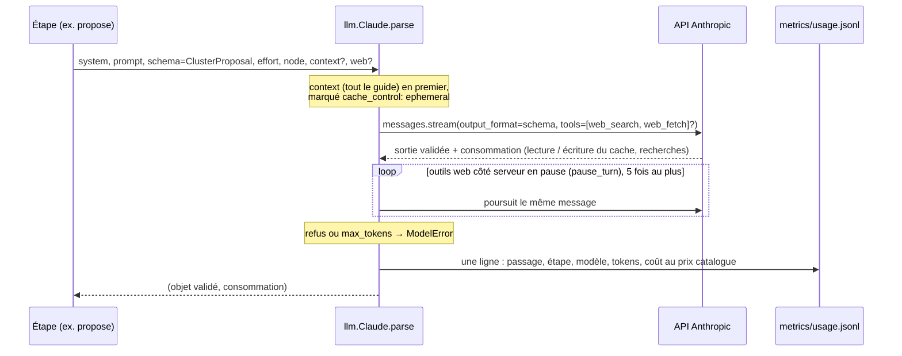
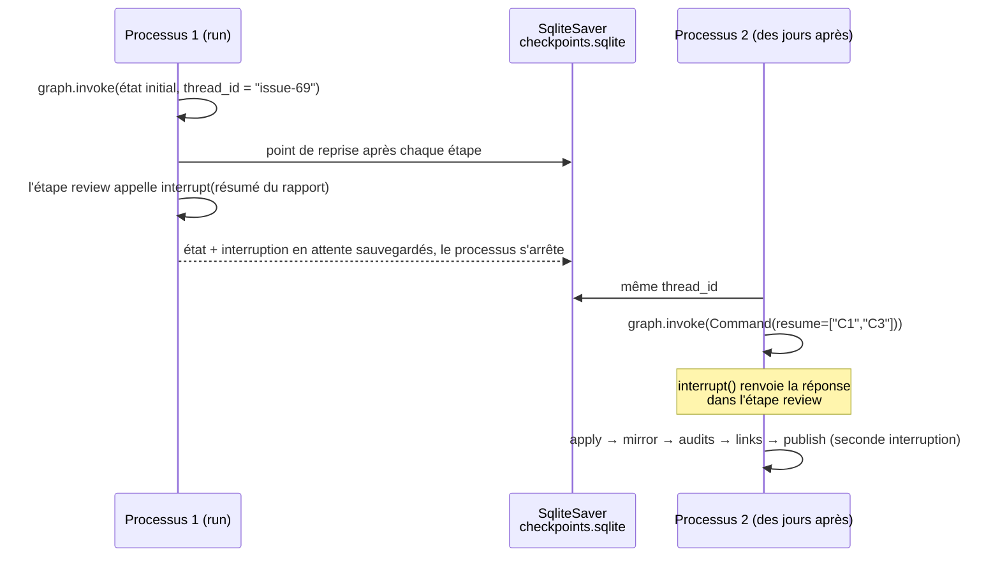
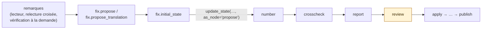

# vault-watch-agent : structure du code

**Un guide de lecture pour développeurs : les modules, l'état du graphe, où le modèle est appelé, et comment un passage en pause survit.**

[English](code.md) · **Français** · [Présentation](presentation.fr.md) · [README](../README.fr.md)

---

Environ 3 000 lignes de Python dans [`src/vault_watch_agent/`](../src/vault_watch_agent/), une page statique sans étape
de build, et des tests qui font tourner tout le graphe avec un faux modèle sur un dépôt git jetable. Commencez par
[`graph.py`](../src/vault_watch_agent/graph.py) : tout le reste l'alimente ou le pilote.

## Les modules et leurs dépendances

Seuls les liens principaux sont dessinés ; le tableau ci-dessous donne le rôle de chaque module. Deux règles donnent sa forme au code :

- **Une seule porte vers le modèle.** Seul [`llm.py`](../src/vault_watch_agent/llm.py) importe `anthropic`. Tous les
  autres modules reçoivent un objet doté d'une méthode `parse(system, prompt, schema, effort, node, context, web)`
  (le protocole `LLM`) : les tests le remplacent par un faux.
- **Une seule porte vers le guide.** Lire, chercher et modifier les pages passe par
  [`vault.py`](../src/vault_watch_agent/vault.py) ; les appels à `git`, `gh` et aux scripts du guide passent par
  [`inputs.py`](../src/vault_watch_agent/inputs.py). Le modèle ne touche jamais un fichier.

| Module | Lignes | Rôle |
| :-- | --: | :-- |
| `graph.py` | 606 | Construit le graphe (`build(deps, checkpointer)`), une fonction imbriquée par étape ; rapport, titre et texte de la PR |
| `web.py` | 570 | `create_app(settings)` : routes REST, server-sent events, tâches de fond, la page statique |
| `verify.py` | 315 | Catalogue des contrôles (`Check`), estimations de coût, une fonction `run_*` par contrôle |
| `cli.py` | 247 | `vault-watch run / resume / fix / eval / costs / serve` ; branche le checkpointer et les dépendances |
| `vault.py` | 234 | Pages françaises, recherche par mots-clés avec extraits, contrôle de la citation exacte, application d'une modification, balayage des restes |
| `crosscheck.py` | 211 | Seconde lecture des corrections avec tout le guide en cache dans le contexte, puis le balayage |
| `quotes.py` | 158 | Retrouve le passage dont parle une remarque : correspondance exacte, sinon la fenêtre de lignes la plus proche sur le texte normalisé |
| `fix.py` | 135 | Transforme des remarques en propositions, puis en état initial qui entre dans le graphe après `propose` |
| `evaluate.py` | 126 | Morceaux du diff fusionné par l'humain face aux propositions de l'agent, appariés par un modèle juge |
| `llm.py` | 121 | Sortie structurée, cache de prompt, recherche et lecture web côté serveur, journal des coûts |
| `state.py` | 116 | `WatchState` et les schémas Pydantic auxquels le modèle doit répondre |
| `prompts.py` | 79 | Prompts système construits à partir de la charte éditoriale et de la politique de traduction du guide |
| `inputs.py` | 65 | Issue et artefact de la veille (`gh`), éléments, affirmations à revérifier |
| `costs.py` | 63 | Totaux de `metrics/usage.jsonl` par mois, année, passage ou étape |
| `notify.py` | 47 | Notifications Windows de `serve --notify` |

## Le graphe, étape par étape

| Étape | Ce qu'elle appelle | Nature |
| :-- | :-- | :-- |
| `collect` | `inputs.download_watch`, `inputs.load_items`, `inputs.claims_due` |  |
| `triage` | `llm.parse(TriageResult)`, `prompts.triage` | Claude |
| `locate` | `vault.search`, `clusters()` ; puis `fan_out` renvoie un `Send` par groupe |  |
| `propose` | `llm.parse(ClusterProposal)`, `prompts.propose` | Claude |
| `number` | `vault.check`, `mark_unsafe`, `mark_conflicts` |  |
| `crosscheck` | `crosscheck.run` / `sweep` / `amend`, `vault.corpus`, `quotes.locate_all` | Claude |
| `report` | `render_report` |  |
| `review` | `interrupt()` | ⏸ humain |
| `apply` | `git worktree`, `vault.apply` |  |
| `mirror` | `translator.parse(MirrorResult)`, `prompts.mirror` | Claude |
| `audits` | `npm test` du guide |  |
| `links` | `link_problems` |  |
| `publish` | `interrupt()`, `git push`, `gh pr create` | ⏸ humain |

`build(deps, checkpointer)` reçoit une dataclass `Deps` : le chemin du guide, le modèle des étapes de raisonnement
(`llm`), celui du miroir anglais (`translator`), l'activation de la relecture croisée, le dépôt GitHub et sa branche de
base, la date du jour. Les étapes sont des fonctions imbriquées qui capturent `deps` : un test construit le même graphe
avec des faux.

## L'état qui le traverse

`WatchState` ([`state.py`](../src/vault_watch_agent/state.py)) est un `TypedDict` de valeurs JSON simples : un passage en
pause est sérialisé tel quel par le checkpointer. Chaque étape ne renvoie que les clés qu'elle change.

`⊕` marque les deux clés qui ont un reducer (`Annotated[list, operator.add]`) : les branches `propose` parallèles
ajoutent leurs propositions et leur consommation de tokens au lieu de s'écraser. Les classes Pydantic sont
l'`output_format` des appels au modèle : une réponse qui ne valide pas est une erreur, pas une supposition.

## Un appel au modèle, de bout en bout

## Comment un passage se met en pause et reprend

La ligne de commande et la page web partagent le même fichier SQLite et les mêmes identifiants de passage : un passage
lancé depuis l'une peut être terminé depuis l'autre. Le serveur web fait tourner le graphe dans un thread de fond et
envoie `graph.stream(stream_mode="updates")` à la page en server-sent events.

## Les passes de correction entrent au milieu du graphe

Une passe de correction fait ses propres propositions, puis indique à LangGraph qu'elles sortent de `propose` : à partir
de `number`, c'est le même graphe, le même rapport, la même relecture et la même pull request qu'une veille. Une
correction de traduction met `mode = "translation"` et saute la relecture croisée du français.

## Tests

| Fichier | Ce qu'il couvre |
| :-- | :-- |
| [`tests/test_graph.py`](../tests/test_graph.py) | Tout le graphe avec un `FakeLLM` qui répond selon le schéma demandé, sur un dépôt git jetable qui tient lieu de guide : les deux pauses, apply, mirror, texte de la PR |
| [`tests/test_web.py`](../tests/test_web.py) | Les routes FastAPI, les tâches de fond, le contrat de santé |
| [`tests/test_quotes.py`](../tests/test_quotes.py) | Retrouver un passage : correspondance exacte, fenêtre la plus proche |
| [`tests/test_costs.py`](../tests/test_costs.py) | Totaux du journal des coûts |

Aucun test n'appelle la vraie API. `vault-watch eval` est la mesure sur de vraies veilles (résultats dans
[`metrics/eval/`](../metrics/eval/)).

## Par où commencer la lecture

1. [`state.py`](../src/vault_watch_agent/state.py) : ce qu'un passage sait à chaque étape.
2. [`graph.py`](../src/vault_watch_agent/graph.py), `build()` : les étapes et les arêtes, puis l'étape qui vous intéresse.
3. [`llm.py`](../src/vault_watch_agent/llm.py) : cache, outils web, journal des coûts, en 120 lignes environ.
4. [`vault.py`](../src/vault_watch_agent/vault.py), `check()` et `apply()` : pourquoi le modèle ne peut pas abîmer une
   page.
5. [`web.py`](../src/vault_watch_agent/web.py) ou [`cli.py`](../src/vault_watch_agent/cli.py) : comment les passages sont
   lancés, mis en pause et repris.

Les schémas sont en Mermaid : GitHub les affiche ; dans VS Code ou Cursor, l'aperçu Markdown a besoin de l'extension
*Markdown Preview Mermaid Support*.
