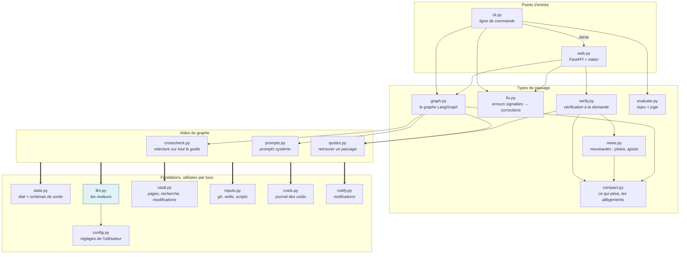
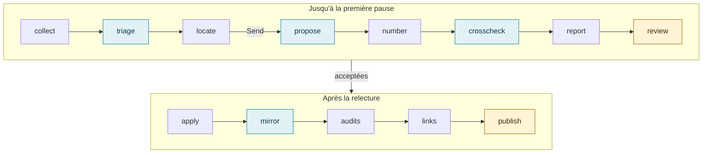
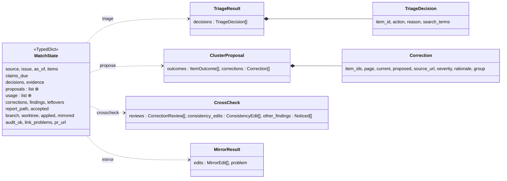
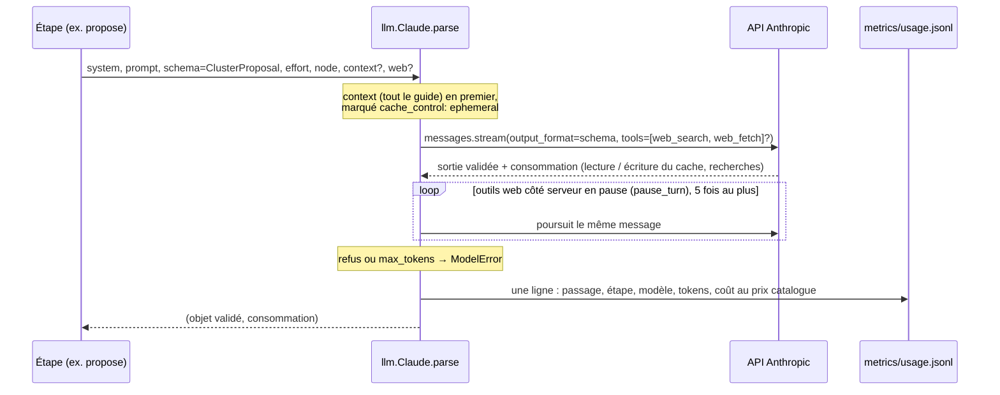
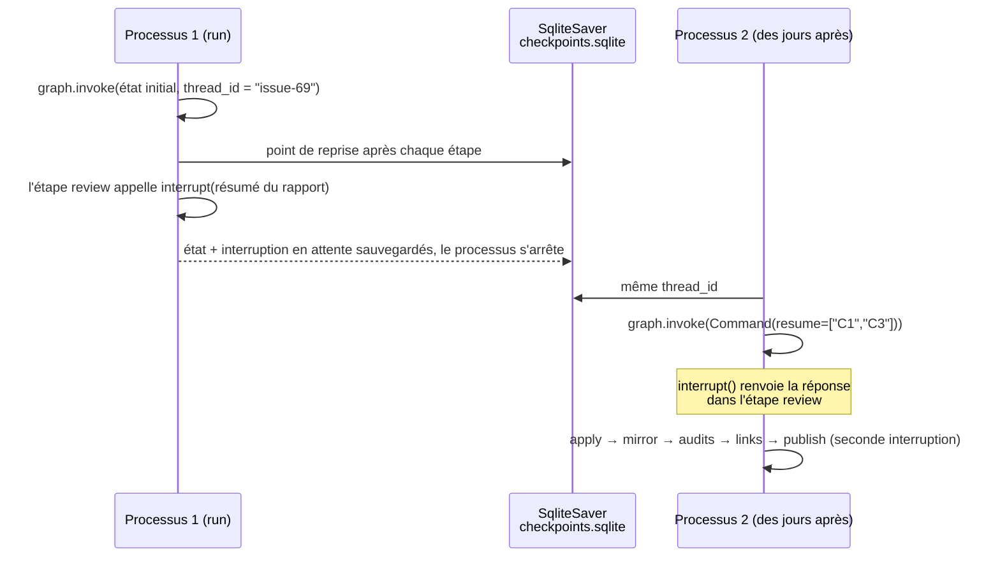
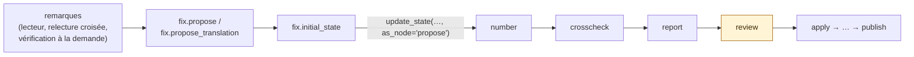

# vault-watch-agent : structure du code

**Un guide de lecture pour développeurs : les modules, l'état du graphe, où le modèle est appelé, et comment un passage en pause survit.**

[English](code.md) · **Français** · [Présentation](presentation.fr.md) · [README](../README.fr.md)

---

Environ 7 000 lignes de Python dans [`src/vault_watch_agent/`](../src/vault_watch_agent/), une page statique sans étape
de build, et des tests qui font tourner tout le graphe avec un faux modèle sur un dépôt git jetable. Commencez par
[`graph.py`](../src/vault_watch_agent/graph.py) : tout le reste l'alimente ou le pilote.

## Les modules et leurs dépendances

Seuls les liens principaux sont dessinés ; le tableau ci-dessous donne le rôle de chaque module. Deux règles donnent sa forme au code :

- **Une seule porte vers le modèle.** Seuls [`llm.py`](../src/vault_watch_agent/llm.py) et les moteurs qu'il charge appellent un modèle. Tous les autres modules reçoivent un objet doté d'une méthode
  `parse(system, prompt, schema, effort, node, context, web)` (le protocole `LLM`) : les tests le remplacent par un
  faux. Trois moteurs l'implémentent : `Claude` (l'API), `ClaudeCode` (`claude -p` sur un abonnement Claude) et
  `OpenAICompatible` (tout serveur compatible OpenAI, dans [`openai_compat.py`](../src/vault_watch_agent/openai_compat.py)),
  et un autre paquet peut ajouter le sien (un point d'entrée `EngineKind`) ; `create(role, journal, settings)`
  choisit d'après les réglages de l'utilisateur.
- **Une seule porte vers le guide.** Lire, chercher et modifier les pages passe par
  [`vault.py`](../src/vault_watch_agent/vault.py) ; les appels à `git` et aux scripts du guide passent par
  [`inputs.py`](../src/vault_watch_agent/inputs.py), ceux de la forge (`gh`) par [`forge.py`](../src/vault_watch_agent/forge.py). Le modèle ne touche jamais un fichier.

| Module | Lignes | Rôle |
| :-- | --: | :-- |
| `web.py` | 807 | `create_app(settings)` : routes REST, server-sent events, tâches de fond, réglages de l'utilisateur, avis pour les notifications de la page, la page statique |
| `graph.py` | 655 | Construit le graphe (`build(deps, checkpointer)`), une fonction imbriquée par étape ; rapport, titre et texte de la PR |
| `collect.py` | 568 | `vault-watch collect` : lit les flux du guide (GitHub, RSS, Hugging Face…), trie par règles, écrit un `watch.json` ; portage du collecteur du guide IA on-prem |
| `llm.py` | 506 | Les moteurs (API, Claude Code sur un abonnement, le moteur compatible OpenAI, et ceux d'autres paquets, `EngineKind`, protocole 1) : sortie structurée, cache de prompt, recherche et lecture web, capacités, journal des coûts |
| `cli.py` | 521 | `vault-watch init / doctor / run / resume / fix / eval / collect / compact / news / prices / costs / serve` ; trouve le guide, branche le checkpointer et les dépendances |
| `verify.py` | 417 | Catalogue des contrôles (`Check`), estimations de coût, une fonction `run_*` par contrôle |
| `guide.py` | 352 | Le guide tel que le décrit son manifeste (`vault-watch.toml`) : pages, miroirs, veille, règles, contrôles, budget |
| `onboard.py` | 335 | `init` (un manifeste d'après ce que montre un dépôt) et `doctor` (ce qui tournera, ce qui manque) |
| `openai_compat.py` | 323 | Le moteur compatible OpenAI (llama.cpp, vLLM, Ollama, un service hébergé) : sortie structurée, boucle des outils web, usage et coût |
| `vault.py` | 353 | Pages du guide, recherche par mots-clés avec extraits, contrôle de la citation exacte, application d'une modification (un passage retiré en entier ne laisse pas de trou), balayage des restes, les valeurs qu'aucune page ne dit plus |
| `compact.py` | 214 | Compactage : les consignes du rapport, des allègements et de leur relecture croisée ; les notes qu'un allègement laisse sans phrase retirées avec lui, un allègement qui laisserait une phrase citer une note retirée refusé |
| `news.py` | 192 | Chercher les nouveautés : la consigne des pistes, ce que les veilles passées ont mis de côté (lu dans leurs rapports), les ajouts pour les pistes gardées, quelques-unes par appel avec le web (`compact.in_calls` fait les appels) |
| `crosscheck.py` | 264 | Seconde lecture des corrections avec tout le guide en cache dans le contexte (ou chapitre par chapitre), puis le balayage |
| `webtools.py` | 234 | Recherche web (SearXNG) et lecture de pages pour les moteurs sans web propre ; adresses publiques seulement |
| `forge.py` | 223 | Issues, artefacts et pull requests derrière une interface `Forge` : GitHub (par `gh`) et Gitea (son API REST, un jeton par référence) ; `for_guide` prend celle du manifeste |
| `config.py` | 185 | Les réglages de l'utilisateur (`settings.json`) : moteur, modèles, prix, et la clé d'API sous forme de référence (`env:`, `sops:`, `file:`), jamais de valeur |
| `prices.py` | 182 | Le prix d'un modèle et son origine : celui de l'utilisateur, une liste téléchargée, les valeurs par défaut |
| `quotes.py` | 158 | Retrouve le passage dont parle une remarque : correspondance exacte, sinon la fenêtre de lignes la plus proche sur le texte normalisé |
| `sizes.py` | 157 | Le poids de chaque page face à son budget, ses sections les plus lourdes, la croissance du guide lue dans Git ; sans modèle |
| `fix.py` | 162 | Transforme des remarques en propositions, puis en état initial qui entre dans le graphe après `propose` |
| `evaluate.py` | 148 | Morceaux du diff fusionné par l'humain face aux propositions de l'agent, appariés par un modèle juge |
| `watches.py` | 139 | D'où viennent les veilles (`[watch] source`) : issues GitHub, fichiers `watch.json`, collecte de l'agent, aucune |
| `inputs.py` | 121 | La veille selon le contrat (`check_watch`), ses éléments retenus, son artefact ; les scripts du guide ; affirmations à revérifier |
| `prompts.py` | 119 | Prompts système construits à partir de la charte éditoriale et de la politique de traduction du guide |
| `state.py` | 117 | `WatchState` et les schémas Pydantic auxquels le modèle doit répondre |
| `reading.py` | 99 | Comment le guide est lu : en entier en un appel, ou chapitre par chapitre s'il dépasse la fenêtre du modèle |
| `costs.py` | 87 | Totaux de `metrics/usage.jsonl` par mois, année, passage ou étape ; les appels passés sur un abonnement à part |
| `steps.py` | 56 | Chaque étape d'un passage : son rôle, son effort, ce qu'elle demande à un moteur |
| `notify.py` | 47 | Notifications Windows de `serve --notify` |

## Le graphe, étape par étape

| Étape | Ce qu'elle appelle | Nature |
| :-- | :-- | :-- |
| `collect` | `inputs.download_watch`, `inputs.load_items`, `inputs.claims_due` |  |
| `triage` | `llm.parse(TriageResult)`, `prompts.triage` | Claude |
| `locate` | `vault.search`, `clusters()` ; puis `fan_out` renvoie un `Send` par groupe |  |
| `propose` | `llm.parse(ClusterProposal)`, `prompts.propose` | Claude |
| `number` | `vault.check`, `mark_unsafe`, `mark_conflicts` |  |
| `crosscheck` | `crosscheck.run` / `sweep` / `amend`, `vault.corpus`, `quotes.locate_all` | Claude |
| `report` | `render_report` |  |
| `review` | `interrupt()` | ⏸ humain |
| `apply` | `git worktree`, `vault.apply` |  |
| `mirror` | `translator.parse(MirrorResult)`, `prompts.mirror` | Claude |
| `audits` | `npm test` du guide |  |
| `links` | `link_problems` |  |
| `publish` | `interrupt()`, `git push`, `gh pr create` | ⏸ humain |

`build(deps, checkpointer)` reçoit une dataclass `Deps` : le chemin du guide, le modèle des étapes de raisonnement
(`llm`), celui du miroir anglais (`translator`), l'activation de la relecture croisée, le dépôt GitHub et sa branche de
base, la date du jour. Les étapes sont des fonctions imbriquées qui capturent `deps` : un test construit le même graphe
avec des faux.

## L'état qui le traverse

`WatchState` ([`state.py`](../src/vault_watch_agent/state.py)) est un `TypedDict` de valeurs JSON simples : un passage en
pause est sérialisé tel quel par le checkpointer. Chaque étape ne renvoie que les clés qu'elle change.

`⊕` marque les deux clés qui ont un reducer (`Annotated[list, operator.add]`) : les branches `propose` parallèles
ajoutent leurs propositions et leur consommation de tokens au lieu de s'écraser. Les classes Pydantic sont
l'`output_format` des appels au modèle : une réponse qui ne valide pas est une erreur, pas une supposition.

## Un appel au modèle, de bout en bout

## Comment un passage se met en pause et reprend

La ligne de commande et la page web partagent le même fichier SQLite et les mêmes identifiants de passage : un passage
lancé depuis l'une peut être terminé depuis l'autre. Le serveur web fait tourner le graphe dans un thread de fond et
envoie `graph.stream(stream_mode="updates")` à la page en server-sent events.

## Les passes de correction entrent au milieu du graphe

Une passe de correction fait ses propres propositions, puis indique à LangGraph qu'elles sortent de `propose` : à partir
de `number`, c'est le même graphe, le même rapport, la même relecture et la même pull request qu'une veille. Une
correction de traduction met `mode = "translation"` et saute la relecture croisée du français.

## Tests

| Fichier | Ce qu'il couvre |
| :-- | :-- |
| [`tests/test_graph.py`](../tests/test_graph.py) | Tout le graphe avec un `FakeLLM` qui répond selon le schéma demandé, sur un dépôt git jetable qui tient lieu de guide : les deux pauses, apply, mirror, texte de la PR |
| [`tests/test_web.py`](../tests/test_web.py) | Les routes FastAPI, les tâches de fond, le contrat de santé |
| [`tests/test_quotes.py`](../tests/test_quotes.py) | Retrouver un passage : correspondance exacte, fenêtre la plus proche |
| [`tests/test_costs.py`](../tests/test_costs.py) | Totaux du journal des coûts |
| [`tests/test_llm.py`](../tests/test_llm.py) | Le moteur Claude Code avec un faux `claude` : la commande lancée, ce qu'il en lit, ce qu'il refuse |
| [`tests/test_config.py`](../tests/test_config.py) | Les réglages de l'utilisateur : valeurs par défaut, ce qui est refusé, une clé qui n'est jamais qu'une référence |

Aucun test n'appelle la vraie API ni le vrai Claude Code. `vault-watch eval` est la mesure sur de vraies veilles (résultats dans
[`metrics/eval/`](../metrics/eval/)).

## Par où commencer la lecture

1. [`state.py`](../src/vault_watch_agent/state.py) : ce qu'un passage sait à chaque étape.
2. [`graph.py`](../src/vault_watch_agent/graph.py), `build()` : les étapes et les arêtes, puis l'étape qui vous intéresse.
3. [`llm.py`](../src/vault_watch_agent/llm.py) : les deux moteurs, cache, outils web, journal des coûts, en 300 lignes environ.
4. [`vault.py`](../src/vault_watch_agent/vault.py), `check()` et `apply()` : pourquoi le modèle ne peut pas abîmer une
   page.
5. [`web.py`](../src/vault_watch_agent/web.py) ou [`cli.py`](../src/vault_watch_agent/cli.py) : comment les passages sont
   lancés, mis en pause et repris.

Les schémas sont en Mermaid : GitHub les affiche ; dans VS Code ou Cursor, l'aperçu Markdown a besoin de l'extension
*Markdown Preview Mermaid Support*.
