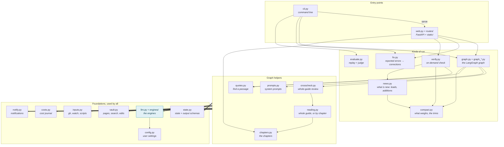
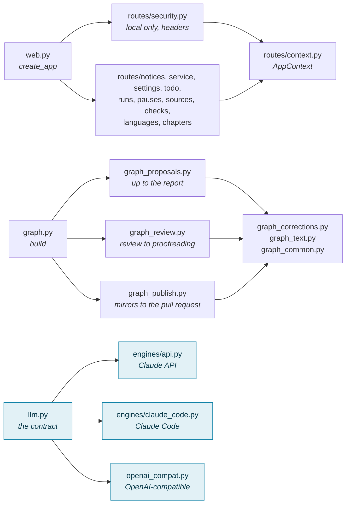
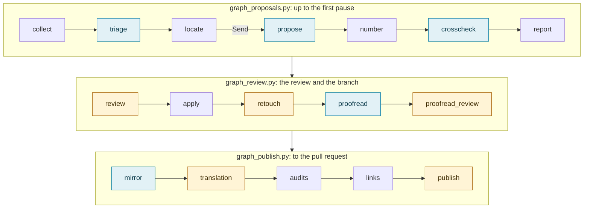
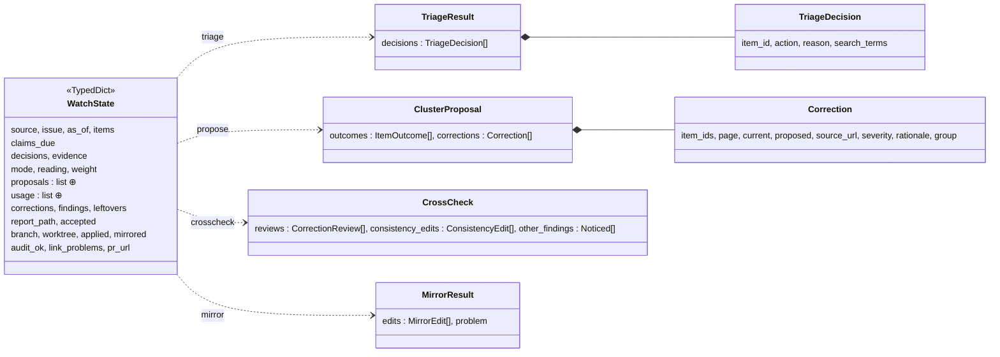
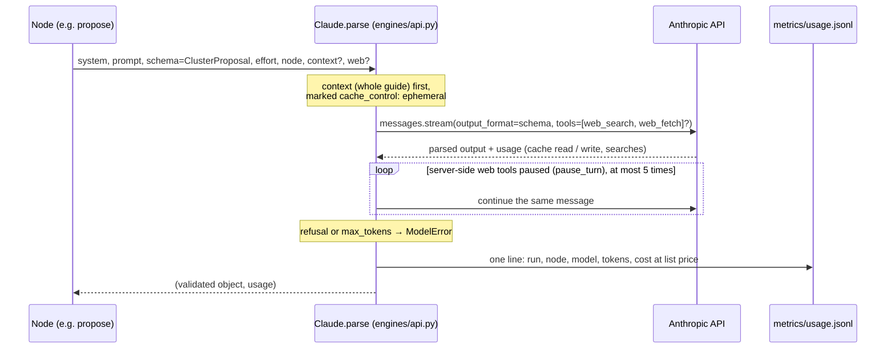
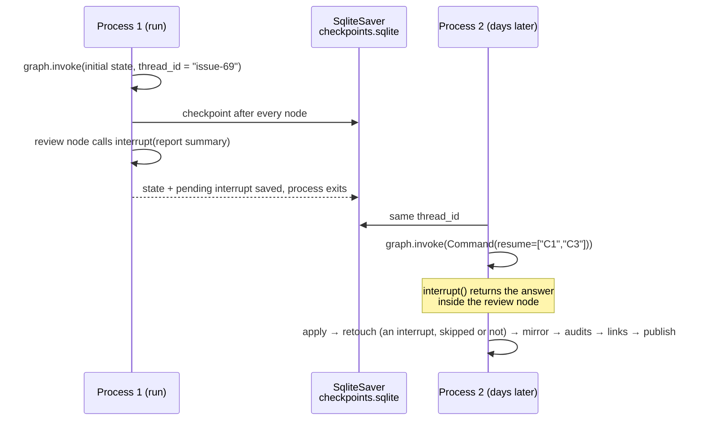
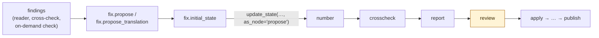

<div align="center">

# vault-watch-agent: how the code fits together

**A reading guide for developers: modules, the graph state, where the model is called, and how a paused run survives.**

**English** · [Français](fr/code.md) · [Overview](presentation.md) · [README](../README.md)

</div>

---

About 14,100 lines of Python in [`src/vault_watch_agent/`](../src/vault_watch_agent/), a static page without build step
(about 5,800 lines of JavaScript and CSS, ES modules checked by TypeScript),
and tests that run the whole graph against a fake model and a throwaway git repository. Start with
[`graph.py`](../src/vault_watch_agent/graph.py): everything else either feeds it or drives it.

## Modules and their dependencies



Three of these modules are split by area. `web.py` makes the app from one router per area of the page, `graph.py`
wires nodes written in one module per part of the run, and `llm.py` keeps the contract that each engine's module
builds on:



Only the main links are drawn; the tables below give each module's role. Two rules shape the code:

- **One door to the model.** Only [`llm.py`](../src/vault_watch_agent/llm.py) and the engines it loads call a model. Every other module receives an object with a `parse(system, prompt, schema, effort, node, context, web)`
  method (the `LLM` protocol), so the tests swap it for a fake. Three engines implement it, each in its own module
  with its `KIND`: `Claude` (the API, [`engines/api.py`](../src/vault_watch_agent/engines/api.py)), `ClaudeCode`
  (`claude -p` on a Claude subscription, [`engines/claude_code.py`](../src/vault_watch_agent/engines/claude_code.py))
  and `OpenAICompatible` (any OpenAI-compatible server, in
  [`openai_compat.py`](../src/vault_watch_agent/openai_compat.py)), and another package can add its own (an
  `EngineKind` entry point); `create(role, journal, settings)` picks one from the user's settings.
- **One door to the guide.** Reading, searching and editing pages go through
  [`vault.py`](../src/vault_watch_agent/vault.py); calls to `git` and the guide's own scripts go through
  [`inputs.py`](../src/vault_watch_agent/inputs.py), the forge's (`gh`) through [`forge.py`](../src/vault_watch_agent/forge.py). The model never touches a file.

| Module | Lines | Role |
| :-- | --: | :-- |
| `web.py` | 83 | `create_app(settings)`: the app made from the routers of `routes/` (below), the static page with a version in the addresses of its files; the names the module had before its routes moved still imported from it |
| `graph.py` | 94 | Builds the graph (`build(deps, checkpointer)`): the nodes and the edges. Each node is a function `node(deps, state)` of the module of its part of the run, bound to `deps` with `functools.partial` |
| `graph_proposals.py` | 258 | The nodes up to the review, read-only: `collect`, `triage`, `locate` and `fan_out` (the groups of items, `clusters`), `propose`, `number`, `crosscheck`, `report` |
| `graph_review.py` | 212 | The nodes of the review and of the branch: `review`, `apply`, `retouch`, `proofread`, `proofread_review` |
| `graph_publish.py` | 249 | The nodes from the branch to the pull request: `mirror`, `translation`, `audits`, `links`, `publish`; `correct_again`, what the publish pause sends back (a check, a translation or a proofreading again) |
| `graph_corrections.py` | 101 | The free checks of the corrections (`mark_unsafe`, `mark_conflicts`: an edit that changes nothing, a footnote lost, two edits of the same passage) and the editor's retouches at the review (`retouchable`, `retouched`) |
| `graph_text.py` | 304 | What a run writes for people: the report, the usage and weight lines, the pull request's title and description |
| `graph_common.py` | 51 | What the nodes share: `Deps`, git in a worktree, the order of the proposals, the branch of a run |
| `cli.py` | 771 | `vault-watch init / doctor / run / resume / status / crosscheck / fix / news / chapters / mirror / compact / eval / prices / collect / costs / serve`; finds the guide, wires the checkpointer and the dependencies |
| `collect.py` | 702 | `vault-watch collect`: reads the guide's feeds (GitHub, RSS, Hugging Face…), triages by rules, writes a `watch.json`; a port of the IA on-prem guide's collector |
| `llm.py` | 442 | The contract every engine keeps: the `LLM` and `Engine` protocols, `ModelError`, the efforts, `Capabilities`, the cost journal (`_Journal`), `EngineKind` and `engines()` (protocol 1); `engine()` and `create`, the engine of a role (`Routed` when steps are set apart); whether Claude Code is installed and signed in |
| `engines/api.py` | 190 | `Claude`, the Claude API through the official SDK, billed per token: structured output, prompt caching, the server-side web search and fetch, the output limits read from the Models API |
| `engines/claude_code.py` | 157 | `ClaudeCode`, Claude Code on a Claude subscription, `claude -p` once per call; the agent's page reader offered as its `web_fetch` |
| `engines/__init__.py` | 13 | The package of the engines; it loads the contract of `llm.py` first |
| `openai_compat.py` | 336 | The OpenAI-compatible engine (llama.cpp, vLLM, Ollama, a hosted service): structured output, the web tools loop, usage and cost |
| `verify.py` | 677 | Catalogue of checks (`Check`), cost estimates, one `run_*` function per check |
| `news.py` | 463 | Look for what is new: the prompt of the leads, what past watches set aside (read from their reports), the leads found on the web chapter by chapter, the additions for the leads kept, one lead per call with the web, on the pages the lead names and the plan of the guide, or on the whole guide (`compact.in_calls` makes the calls); what two calls add to the same page put together |
| `links.py` | 269 | A run from links (D5): each address read whole without a model (a page, a repository's README, a PDF with the optional `pypdf`; a video through dl-sub-dub, `videos.py`), then one call per link with the whole guide, without the web, for the leads it holds; a check of « Check the guide » (`verify.run_links`) |
| `videos.py` | 230 | The text of a video through dl-sub-dub's route « text of a video » (contract 1): dl-sub-dub started when it does not answer (the command of `videos.start`, set by hand in `settings.json`), its state followed until it ends, the token read from its reference, what it says when it cannot (busy, stopped, older); the site's description, chapters and words in paragraphs with their time |
| `mirrors.py` | 245 | What changed in a source page, as passages a translator can carry to its mirror (a paragraph, a table row, a list line, from git); the pages ahead of their mirror; the branch and the state of a « Sync the languages » run |
| `proofread.py` | 155 | The editor's edits checked before a sync (an option of the page « Languages »), or during a run when asked (the nodes `proofread` and `proofread_review` of the graph): spelling by the translation model, facts on the web by the reasoning model, consistency with the rest of the guide by the cross-check; the fixes accepted applied in the guide's folder |
| `retouch.py` | 175 | The pause to retouch the pages of a run's branch: the guide's folder lent to the run (detached at the branch's tip, what it held set aside in a stash named after the run), the retouches committed as the editor's, the branch moved forward, the folder given back |
| `guide.py` | 435 | The guide as its manifest (`vault-watch.toml`) describes it: pages, mirrors, watch, rules, checks, budget; a folder without a manifest refused, the IA on-prem guide apart |
| `chapters.py` | 413 | The chapters of a guide: those its manifest declares, the automatic rule for the other pages, a model's proposal from the outline of the guide, the manifest rewritten on a branch |
| `sourcecheck.py` | 386 | « Check the sources »: asks each source itself (network, no model), reads the guide again, proposes changes to the feeds file and rewrites it for a pull request |
| `compact.py` | 372 | Compaction: the prompts of the report, of the trims and of their cross-check; the notes a trim orphans removed with it, a trim that would leave a sentence citing a removed note refused; `in_calls`, several calls that share the guide in the cache or read only the pages they name |
| `vault.py` | 465 | Pages of the guide, keyword search with excerpts, exact-quote check, apply an edit (a passage removed whole leaves no hole), leftovers sweep, the values no page states any more |
| `onboard.py` | 355 | `init` (a manifest from what a repository shows) and `doctor` (what will run, what is missing) |
| `crosscheck.py` | 266 | Second reading of the corrections with the whole guide cached in context (or chapter by chapter), then the sweep |
| `config.py` | 273 | The user's settings (`settings.json`): engine, models, prices, and the API key as a reference (`env:`, `sops:`, `file:`), never a value |
| `webtools.py` | 261 | Web search (SearXNG) and page reading for the engines without a web of their own, and for Claude Code; public addresses only |
| `mcp_fetch.py` | 70 | That page reader offered to Claude Code as a local MCP tool (`web_fetch`) in place of its WebFetch: a minimal MCP server over standard input and output |
| `forge.py` | 229 | Issues, artifacts and pull requests behind a `Forge` interface: GitHub (through `gh`) and Gitea (its REST API, a token by reference); `for_guide` picks the manifest's |
| `sizes.py` | 190 | What each page weighs against its budget, its heaviest sections, the guide's growth read from Git; no model |
| `fix.py` | 206 | Turns findings into proposals, then into an initial state that enters the graph after `propose` |
| `prices.py` | 182 | The price of a model and its origin: the user's, a fetched list, the defaults |
| `sources.py` | 179 | What each feed of the watch brought and what became of it, with a verdict by rule, from the watches and the runs kept on the machine; no model, no network |
| `quotes.py` | 173 | Locates the passage a finding talks about: exact match, else the closest window of lines on normalised text |
| `evaluate.py` | 148 | Hunks of the human's merged diff vs. the agent's proposals, matched by a judge model |
| `watches.py` | 141 | Where the watches come from (`[watch] source`): GitHub issues, `watch.json` files, the agent's own collection, none |
| `prompts.py` | 135 | System prompts built from the guide's own editorial brief and translation policy |
| `inputs.py` | 124 | The watch as the contract says (`check_watch`), its kept items, its artifact; the guide's scripts; freshness claims due |
| `state.py` | 137 | `WatchState` and the Pydantic schemas the model must answer with |
| `reading.py` | 101 | How the guide is read: whole in one call, or chapter by chapter when it does not fit the model's window |
| `costs.py` | 87 | Totals of `metrics/usage.jsonl` by month, year, run or step; the calls made on a subscription apart |
| `steps.py` | 89 | Each step that calls the model: its role, its effort, what it needs from an engine |
| `store.py` | 53 | The runs database kept light: only the last checkpoint of each run stays, the space is given back to the disk |
| `notify.py` | 110 | Desktop notifications for `serve --notify`: Windows, macOS, Linux |
| `explain.py` | 94 | The explanations of a pause in the page's language (`/api/explain`): one call of the translation model for the lines not translated yet, each line kept |

The routes of the server are in [`routes/`](../src/vault_watch_agent/routes/), one module per area of the page. Each
one has a `router(ctx)` that makes its FastAPI router from the app's context; `web.create_app` includes them all:

| Module | Lines | Role |
| :-- | --: | :-- |
| `context.py` | 401 | `AppContext`, what the routers share: the server's `Settings`, the background `Job`s, the checkpoints and the graph that reads them, `read_json` and `write_json`, a run's summary, the states of the pull requests, the pause a run waits at |
| `security.py` | 76 | Local only: the middleware that refuses a Host that is not local, a request another site makes the browser send (`Sec-Fetch-Site`, `Origin`) and a request of the API without the `X-Vault-Watch` header; the headers of every answer (`Content-Security-Policy`, `X-Frame-Options`, `Cache-Control: no-cache` on the page and its files) |
| `notices.py` | 69 | What the human has to do next when background work stops: on the desktop (`serve --notify`) and in the page whose bell is on |
| `service.py` | 91 | The server itself: health, info, costs, the explanations of a pause |
| `settings.py` | 159 | « Settings »: the steps, the models, the user's settings, the prices |
| `todo.py` | 92 | « To handle »: the watches, a new watch collected, the guide's folder (« Update my folder ») |
| `runs.py` | 268 | The runs: the list, one run, its report, its diff and the stream of its steps; a watch analysed, findings or leads sent to a fix run, a run resumed after an error |
| `pauses.py` | 221 | The answers to a run's pauses: the review, the retouches (the run's folder, the guide's folder lent to it), the proofreading, the translation, the publish step |
| `sources.py` | 181 | « Sources followed »: what each feed brought, the check of the sources and its proposals |
| `checks.py` | 309 | « Check the guide »: the verifications, their leads and notes, their estimates; the state of dl-sub-dub for the videos |
| `languages.py` | 236 | « Languages »: the mirrors, « Sync the languages », the editor's edits checked before the sync |
| `chapters.py` | 117 | « Chapters »: the chapters seen, proposed by a model, declared through a pull request |
| `__init__.py` | 2 | The package of the routes |

The page is in [`static/`](../src/vault_watch_agent/static/): ES modules served as they are, without build step.
`index.html` loads `app.js` as a module, which imports the others; `boot.js` stays a classic script in `<head>`, so
that the mode, the palette and the size of the text apply before the first paint. Each script starts with
`// @ts-check`: [`jsconfig.json`](../jsconfig.json) at the root of the repository and the two globals of `boot.js`
declared in [`types/page.d.ts`](../types/page.d.ts) let TypeScript check them, with nothing built. Every answer
under `/static/` carries `Cache-Control: no-cache`: the browser asks again for each module (a 304 when it has not
changed), so an update never leaves an old module beside a new one.

| File | Lines | Role |
| :-- | --: | :-- |
| `index.html` | 42 | The page: the header, `boot.js`, the style, `app.js` as a module |
| `boot.js` | 107 | Before the first paint (a classic script): light or dark, the palette, the size of the text |
| `app.js` | 33 | The entry module: the header, the notices, the first screen |
| `util.js` | 91 | The helpers of every screen: the DOM, HTML escaped, links out of the page and into Obsidian, a help bubble |
| `api.js` | 22 | The calls of the server's API, and what the server says of itself (`/api/info`) |
| `texts.js` | 907 | The texts of the interface in French and in English (`T`) |
| `explain.js` | 39 | The lines a model or a check wrote in English, shown in the language of the interface |
| `header.js` | 103 | The header and its menus |
| `router.js` | 65 | Which screen the address shows |
| `steps.js` | 120 | The engine, model and effort of a run's steps, and what an action costs |
| `watches.js` | 195 | « To handle », the automatic watch, every run, the guide's folder |
| `run.js` | 89 | One run: its screen chosen by its state, its steps while it runs, its end |
| `review.js` | 184 | The review of a run's corrections |
| `retouch.js` | 165 | The retouch pause, and the banner while the guide's folder is lent |
| `proofread.js` | 98 | The fixes of a proofreading, ticked and retouched |
| `translation.js` | 65 | The translation pause of a « Sync the languages » run |
| `pairs.js` | 72 | Which translated passage goes beside which passage of the source (`alignPairs`) |
| `publish.js` | 188 | The pause before publishing |
| `diff.js` | 47 | What changed, word by word |
| `editor.js` | 126 | The passages a run changed, highlighted in a text area |
| `checks.js` | 153 | « Check the guide »: the checks to start, those with leads to sort, the history |
| `check.js` | 340 | The page of one check: its results and its leads |
| `rules.js` | 33 | What may be ticked on the page of a check |
| `report.js` | 125 | « Report or suggest » |
| `sources.js` | 203 | « Sources followed » |
| `languages.js` | 154 | « Languages » |
| `chapters.js` | 128 | « Chapters » |
| `costs.js` | 26 | « Costs » |
| `themes.js` | 325 | The look of the page: size of the text, light or dark, the palettes, the Theme window |
| `notify.js` | 91 | The notifications of the browser, the bell |
| `settings.js` | 641 | The Settings window |
| `feedback.js` | 214 | « Give my opinion » |
| `style.css` | 670 | The style of every screen |

## The graph, node by node



| Step | Module | What it calls | Kind |
| :-- | :-- | :-- | :-- |
| `collect` | `graph_proposals.py` | `inputs.download_watch`, `inputs.load_items`, `inputs.claims_due` |  |
| `triage` | `graph_proposals.py` | `llm.parse(TriageResult)`, `prompts.triage` | model |
| `locate` | `graph_proposals.py` | `vault.search`; then `fan_out` makes the groups (`clusters`) and returns one `Send` per group |  |
| `propose` | `graph_proposals.py` | `llm.parse(ClusterProposal)`, `prompts.propose`, `vault.check` | model |
| `number` | `graph_proposals.py` | `mark_conflicts` and `mark_unsafe` (`graph_corrections.py`); `news.merge` for additions, `compact.with_orphan_notes` for trims |  |
| `crosscheck` | `graph_proposals.py` | `reading.plan`, `crosscheck.run` / `amend` / `sweep`, `vault.leftovers` | model |
| `report` | `graph_proposals.py` | `render_report` (`graph_text.py`) |  |
| `review` | `graph_review.py` | `interrupt()`; `retouched` for the texts the editor retouched | ⏸ human |
| `apply` | `graph_review.py` | `git worktree`, `vault.apply` |  |
| `retouch` | `graph_review.py` | `interrupt()`, `retouch.commit` | ⏸ human |
| `proofread` | `graph_review.py` | `proofread.run`, only when the editor asked for it | model |
| `proofread_review` | `graph_review.py` | `interrupt()` when the proofreading found something, `proofread.accept` | ⏸ human |
| `mirror` | `graph_publish.py` | `mirrors.changed_pages`, `mirrors.edits_of`, `translator.parse(MirrorResult)`, `prompts.mirror` | model |
| `translation` | `graph_publish.py` | `interrupt()` in a « Sync the languages » run, `vault.apply` | ⏸ human |
| `audits` | `graph_publish.py` | the guide's own checks (`[checks] audits` of its manifest) |  |
| `links` | `graph_publish.py` | `link_problems` |  |
| `publish` | `graph_publish.py` | `interrupt()`, `git push`, the forge's pull request (`forge.py`), `pr_title` and `pr_body` (`graph_text.py`) | ⏸ human |

`build(deps, checkpointer)` receives a `Deps` dataclass (`graph_common.py`): the guide path and its working folder,
the model for the reasoning steps (`llm`), the model for the mirrors (`translator`), whether to run the cross-check,
the repository on its forge and the base branch, today's date. Each node is a plain function of `deps` and the state;
`build` binds `deps` with `functools.partial`, so a test builds the same graph with fakes, or calls one node alone.

## The state that flows through it

`WatchState` ([`state.py`](../src/vault_watch_agent/state.py)) is a `TypedDict` of plain JSON values: a paused run is
serialised by the checkpointer as is. Each node returns only the keys it changes.



`⊕` marks the two keys with a reducer (`Annotated[list, operator.add]`): the parallel `propose` branches append their
proposals and their token usage instead of overwriting each other. The Pydantic classes are the `output_format` of
the model calls: an answer that does not validate is an error, not a guess.

## One model call, end to end



## How a run pauses and resumes



The CLI and the web page share the same SQLite file and the same thread ids, so a run started from one can be
finished from the other. The web server runs the graph in a background thread and streams
`graph.stream(stream_mode="updates")` to the page as server-sent events (`AppContext` in
[`routes/context.py`](../src/vault_watch_agent/routes/context.py)).

## Fix runs enter the graph in the middle



A fix run makes its own proposals, then tells LangGraph they came out of `propose`: from `number` on, it is the same
graph, the same report, the same review and the same pull request as a watch. The state's `mode` says which kind
of run it is, and three other kinds enter the same way: a translation fix (`"translation"`, which skips the
cross-check), a compaction run (`"compact"`, trims proposed by `compact.py`, with a cross-check written for
trims) and an addition run (`"add"`, the leads checked on the web by `news.py`). A « Sync the languages » run
(`"mirror"`, `mirrors.py`) enters later, as if `apply` had just run: its branch holds the pages edited by hand, and
`mirror_since` says from which commit each page ahead of its mirror is translated.

## Tests

| File | What it covers |
| :-- | :-- |
| [`tests/test_graph.py`](../tests/test_graph.py) | The whole graph with a `FakeLLM` answering per schema, on a throwaway git repository standing for the guide: both pauses, apply, mirror, PR text |
| [`tests/test_web.py`](../tests/test_web.py) | The FastAPI routes, through `create_app`; background jobs, health contract |
| [`tests/test_quotes.py`](../tests/test_quotes.py) | Locating passages: exact match, closest window |
| [`tests/test_costs.py`](../tests/test_costs.py) | Cost journal totals |
| [`tests/test_llm.py`](../tests/test_llm.py) | The Claude Code engine with a fake `claude`: the command it runs, what it reads back, what it refuses |
| [`tests/test_config.py`](../tests/test_config.py) | The user's settings: defaults, what is refused, a key that is only ever a reference |
| [`tests/test_guide.py`](../tests/test_guide.py), [`tests/test_onboard.py`](../tests/test_onboard.py) | The manifest: what it accepts and refuses, the working folder of a guide; `init` and `doctor` |
| [`tests/test_sample_guide.py`](../tests/test_sample_guide.py) | A whole run on the sample guide of `examples/`, with its planted errors |
| [`tests/test_engine_contract.py`](../tests/test_engine_contract.py), [`tests/test_openai_compat.py`](../tests/test_openai_compat.py) | Every engine against the same recorded answers ([Write an engine](write-an-engine.md)); the OpenAI-compatible engine and its web tools |
| [`tests/test_collect.py`](../tests/test_collect.py), [`tests/test_sources.py`](../tests/test_sources.py), [`tests/test_sourcecheck.py`](../tests/test_sourcecheck.py) | The collection of a watch and its pre-triage; what each source brought; the check of the sources |
| [`tests/test_compact.py`](../tests/test_compact.py), [`tests/test_sizes.py`](../tests/test_sizes.py) | Compaction: the report, the trims, the notes removed with them; the weight and the growth of the pages |
| [`tests/test_news.py`](../tests/test_news.py), [`tests/test_explore.py`](../tests/test_explore.py), [`tests/test_chapters.py`](../tests/test_chapters.py) | The leads, the additions (one lead per call, what each call reads, a lead left unchecked), the web explored by chapter; the chapters |
| [`tests/test_links.py`](../tests/test_links.py), [`tests/test_videos.py`](../tests/test_videos.py) | A run from links, each read whole without a model; the text of a video, against a fake dl-sub-dub that answers as its contract says |
| [`tests/test_mirrors.py`](../tests/test_mirrors.py), [`tests/test_retouch.py`](../tests/test_retouch.py), [`tests/test_proofread.py`](../tests/test_proofread.py), [`tests/test_proofread_run.py`](../tests/test_proofread_run.py) | The passages that changed in a source page; a proposal retouched in the review; the editor's edits proofread before a sync and during a run |
| [`tests/test_explain.py`](../tests/test_explain.py) | The explanations of a pause in the page's language: one call for the lines not translated yet, a model that fails leaves the English |
| [`tests/test_steps.py`](../tests/test_steps.py), [`tests/test_step_engine.py`](../tests/test_step_engine.py) | A step set apart from its role: its own model, effort or engine, in the Settings or for one run |
| [`tests/test_rules.py`](../tests/test_rules.py) | What may be ticked on the page of a check (`static/rules.js`, run by node as an ES module): a lead dug deeper is always a lead ticked, whatever the order of the clicks |
| [`tests/test_pairs.py`](../tests/test_pairs.py) | Which translated passage goes beside which passage of the source (`static/pairs.js`, run by node): a passage left without a translation gets an empty cell, and the passages after it stay beside their own translation |
| [`tests/test_forge.py`](../tests/test_forge.py) | GitHub and Gitea behind the same interface |
| [`tests/test_network_guard.py`](../tests/test_network_guard.py), [`tests/test_mcp_fetch.py`](../tests/test_mcp_fetch.py), [`tests/test_pages_only.py`](../tests/test_pages_only.py) | The page reader never reaches the machine or its local network (DNS rebinding, an IPv6 address carrying a private IPv4, a redirection); the MCP tool Claude Code gets; a correction touches only a content page of the guide or its mirror |
| [`tests/test_folder.py`](../tests/test_folder.py), [`tests/test_store.py`](../tests/test_store.py), [`tests/test_notify.py`](../tests/test_notify.py), [`tests/test_python311.py`](../tests/test_python311.py) | The guide's folder against its forge (« Update my folder »); the runs database kept light; the desktop notifications of each system; nothing that Python 3.11 refuses |
| [`tests/test_page_smoke.py`](../tests/test_page_smoke.py) | Every screen of the page drawn in a headless Chrome, in French and in English, without a JavaScript error nor « undefined » shown |

No test calls the real API nor the real Claude Code. `vault-watch eval` is the measure against real watches (results in
[`metrics/eval/`](../metrics/eval/)).

Beside the tests, the CI checks the code itself: ruff on `src` and `tests` and pyright on `src` (the job `lint`;
their rules in `[tool.ruff]` and `[tool.pyright]` of [`pyproject.toml`](../pyproject.toml)), and TypeScript on the
page's scripts (the job `page`).
`pip install -e ".[dev]"` brings ruff and pyright; TypeScript comes through `npx`, with Node. To run them before a
push, from the root of the repository:

```bash
python -m ruff check src tests
python -m pyright
npx -y -p typescript@5.9 tsc -p jsconfig.json --noEmit
```

## Where to look first

1. [`state.py`](../src/vault_watch_agent/state.py): what a run knows at each step.
2. [`graph.py`](../src/vault_watch_agent/graph.py), `build()`: the nodes and the edges, then the node you care about in
   `graph_proposals.py`, `graph_review.py` or `graph_publish.py`.
3. [`llm.py`](../src/vault_watch_agent/llm.py): the contract of the engines, the choice of one, the cost journal; then
   an engine in [`engines/`](../src/vault_watch_agent/engines/) or `openai_compat.py`: caching, web tools.
4. [`vault.py`](../src/vault_watch_agent/vault.py), `check()` and `apply()`: why the model cannot damage a page.
5. [`routes/runs.py`](../src/vault_watch_agent/routes/runs.py) and
   [`routes/pauses.py`](../src/vault_watch_agent/routes/pauses.py), or [`cli.py`](../src/vault_watch_agent/cli.py):
   how runs are started, paused and resumed.

The diagrams are Mermaid: GitHub displays them; in VS Code or Cursor, the Markdown preview needs the
*Markdown Preview Mermaid Support* extension.
