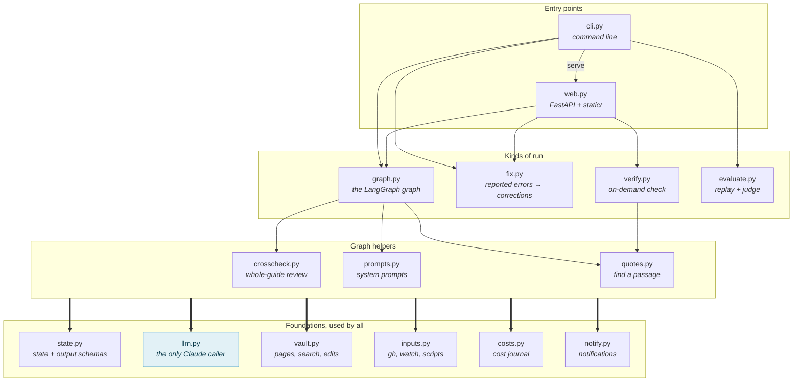
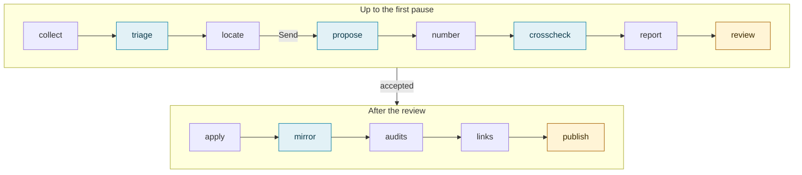
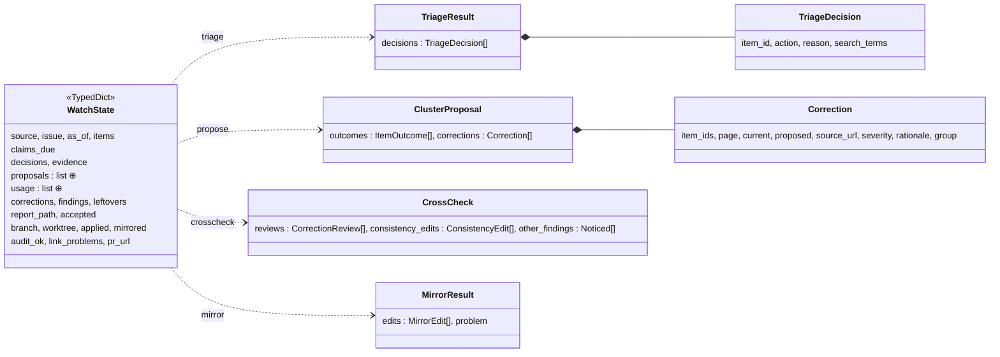
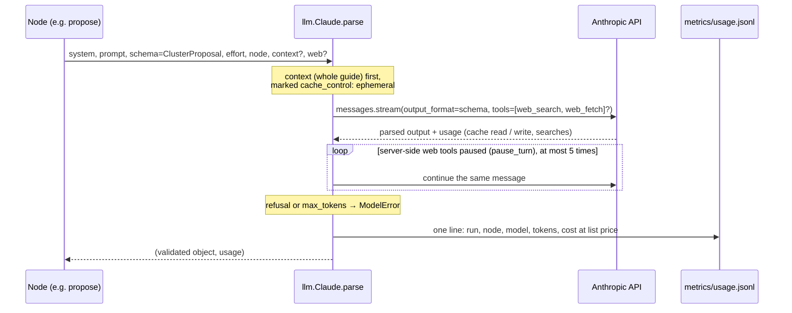
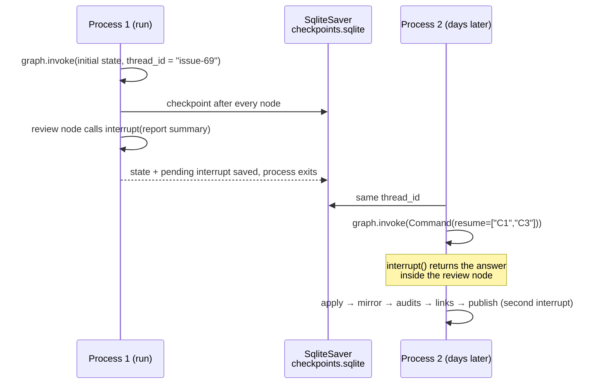
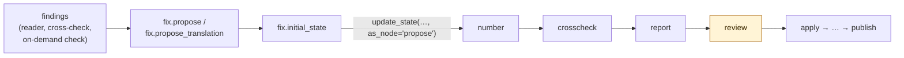

# vault-watch-agent: how the code fits together

**A reading guide for developers: modules, the graph state, where the model is called, and how a paused run survives.**

**English** · [Français](code.fr.md) · [Overview](presentation.md) · [README](../README.md)

---

About 3,000 lines of Python in [`src/vault_watch_agent/`](../src/vault_watch_agent/), a static page without build step,
and tests that run the whole graph against a fake model and a throwaway git repository. Start with
[`graph.py`](../src/vault_watch_agent/graph.py): everything else either feeds it or drives it.

## Modules and their dependencies

Only the main links are drawn; the table below gives each module's role. Two rules shape the code:

- **One door to the model.** Only [`llm.py`](../src/vault_watch_agent/llm.py) imports `anthropic`. Every other
  module receives an object with a `parse(system, prompt, schema, effort, node, context, web)` method (the `LLM`
  protocol), so the tests swap it for a fake.
- **One door to the guide.** Reading, searching and editing pages go through
  [`vault.py`](../src/vault_watch_agent/vault.py); calls to `git`, `gh` and the guide's own scripts go through
  [`inputs.py`](../src/vault_watch_agent/inputs.py). The model never touches a file.

| Module | Lines | Role |
| :-- | --: | :-- |
| `graph.py` | 606 | Builds the graph (`build(deps, checkpointer)`), one closure per node; report, PR title and body |
| `web.py` | 570 | `create_app(settings)`: REST routes, server-sent events, background jobs, the static page |
| `verify.py` | 315 | Catalogue of checks (`Check`), cost estimates, one `run_*` function per check |
| `cli.py` | 247 | `vault-watch run / resume / fix / eval / costs / serve`; wires the checkpointer and the dependencies |
| `vault.py` | 234 | French pages, keyword search with excerpts, exact-quote check, apply an edit, leftovers sweep |
| `crosscheck.py` | 211 | Second reading of the corrections with the whole guide cached in context, then the sweep |
| `quotes.py` | 158 | Locates the passage a finding talks about: exact match, else the closest window of lines on normalised text |
| `fix.py` | 135 | Turns findings into proposals, then into an initial state that enters the graph after `propose` |
| `evaluate.py` | 126 | Hunks of the human's merged diff vs. the agent's proposals, matched by a judge model |
| `llm.py` | 121 | Structured output, prompt caching, server-side web search and fetch, cost journal |
| `state.py` | 116 | `WatchState` and the Pydantic schemas the model must answer with |
| `prompts.py` | 79 | System prompts built from the guide's own editorial brief and translation policy |
| `inputs.py` | 65 | Watch issue and artifact (`gh`), items, freshness claims due |
| `costs.py` | 63 | Totals of `metrics/usage.jsonl` by month, year, run or step |
| `notify.py` | 47 | Windows toast notifications for `serve --notify` |

## The graph, node by node

| Step | What it calls | Kind |
| :-- | :-- | :-- |
| `collect` | `inputs.download_watch`, `inputs.load_items`, `inputs.claims_due` |  |
| `triage` | `llm.parse(TriageResult)`, `prompts.triage` | Claude |
| `locate` | `vault.search`, `clusters()`; then `fan_out` returns one `Send` per group |  |
| `propose` | `llm.parse(ClusterProposal)`, `prompts.propose` | Claude |
| `number` | `vault.check`, `mark_unsafe`, `mark_conflicts` |  |
| `crosscheck` | `crosscheck.run` / `sweep` / `amend`, `vault.corpus`, `quotes.locate_all` | Claude |
| `report` | `render_report` |  |
| `review` | `interrupt()` | ⏸ human |
| `apply` | `git worktree`, `vault.apply` |  |
| `mirror` | `translator.parse(MirrorResult)`, `prompts.mirror` | Claude |
| `audits` | `npm test` of the guide |  |
| `links` | `link_problems` |  |
| `publish` | `interrupt()`, `git push`, `gh pr create` | ⏸ human |

`build(deps, checkpointer)` receives a `Deps` dataclass: the guide path, the model for the reasoning steps (`llm`),
the model for the English mirror (`translator`), whether to run the cross-check, the GitHub repository and base
branch, today's date. Nodes are closures over `deps`, so a test builds the same graph with fakes.

## The state that flows through it

`WatchState` ([`state.py`](../src/vault_watch_agent/state.py)) is a `TypedDict` of plain JSON values: a paused run is
serialised by the checkpointer as is. Each node returns only the keys it changes.

`⊕` marks the two keys with a reducer (`Annotated[list, operator.add]`): the parallel `propose` branches append their
proposals and their token usage instead of overwriting each other. The Pydantic classes are the `output_format` of
the model calls: an answer that does not validate is an error, not a guess.

## One model call, end to end

## How a run pauses and resumes

The CLI and the web page share the same SQLite file and the same thread ids, so a run started from one can be
finished from the other. The web server runs the graph in a background thread and streams
`graph.stream(stream_mode="updates")` to the page as server-sent events.

## Fix runs enter the graph in the middle

A fix run makes its own proposals, then tells LangGraph they came out of `propose`: from `number` on, it is the same
graph, the same report, the same review and the same pull request as a watch. A translation fix sets
`mode = "translation"` and skips the French cross-check.

## Tests

| File | What it covers |
| :-- | :-- |
| [`tests/test_graph.py`](../tests/test_graph.py) | The whole graph with a `FakeLLM` answering per schema, on a throwaway git repository standing for the guide: both pauses, apply, mirror, PR text |
| [`tests/test_web.py`](../tests/test_web.py) | The FastAPI routes, background jobs, health contract |
| [`tests/test_quotes.py`](../tests/test_quotes.py) | Locating passages: exact match, closest window |
| [`tests/test_costs.py`](../tests/test_costs.py) | Cost journal totals |

No test calls the real API. `vault-watch eval` is the measure against real watches (results in
[`metrics/eval/`](../metrics/eval/)).

## Where to look first

1. [`state.py`](../src/vault_watch_agent/state.py): what a run knows at each step.
2. [`graph.py`](../src/vault_watch_agent/graph.py), `build()`: the nodes and the edges, then the node you care about.
3. [`llm.py`](../src/vault_watch_agent/llm.py): caching, web tools, cost journal, in about 120 lines.
4. [`vault.py`](../src/vault_watch_agent/vault.py), `check()` and `apply()`: why the model cannot damage a page.
5. [`web.py`](../src/vault_watch_agent/web.py) or [`cli.py`](../src/vault_watch_agent/cli.py): how runs are started,
   paused and resumed.

The diagrams are Mermaid: GitHub displays them; in VS Code or Cursor, the Markdown preview needs the
*Markdown Preview Mermaid Support* extension.
