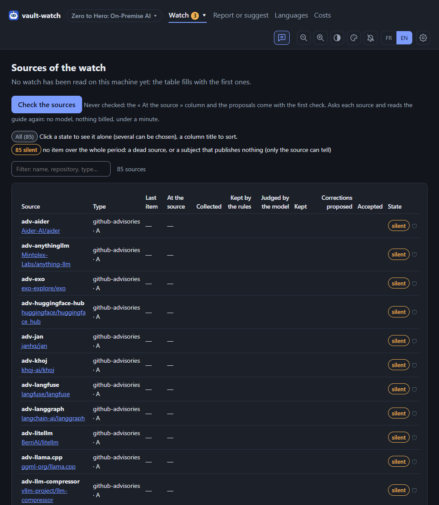

*[Version française](fr/collect.md)*

# Collecting a watch (`vault-watch collect`)

A watch lists what changed in your guide's field over a few days. The agent can collect it itself: you list the
feeds to read in a `feeds.json`, and `vault-watch collect` gathers the items of the window, drops the routine by
rules, keeps the release notes and advisory texts, and writes a [`watch.json`](watch-format.md). An item kept whose
feed gives no text (a blog post, a press release, a model page) gets the start of its own page instead: the model
reads the primary source rather than a title alone. No model is called: a collection costs nothing.

```bash
vault-watch --guide ../my-guide collect                  # the last 8 days; Markdown report on stdout
vault-watch --guide ../my-guide collect --days 15 --json watch.json --markdown watch.md
vault-watch --guide ../my-guide collect --since 2026-11-01 --only security,releases
vault-watch --guide ../my-guide collect --no-triage      # keep every item of the window
```

Without `--json`, the watch goes to `watches/watch-<date>.json` in the guide's working folder. With
`source = "feeds"`, the interface lists it there (below).

GitHub limits requests without a token. Set `GITHUB_TOKEN` (or `GH_TOKEN`), for example
`GITHUB_TOKEN=$(gh auth token)`, before collecting. Security advisories need it.

## In the manifest

```toml
[watch]
source = "feeds"                    # « Automatic watch » lists the collected watches and has a « Collect a watch » button
feeds = "watch/feeds.json"          # the feeds to read (any source can name it: `vault-watch collect` works anyway)
floors = "watch/floors.json"        # optional: the lowest versions the guide recommends
seen = "watch/seen.md"              # optional: items already triaged, dropped when they come back
```

`floors` defaults to the file of `[checks] version_floors` when the guide has one.

## `feeds.json`

```json
{
  "defaults": { "days": 8, "maxItemsPerFeed": 15 },
  "domains": { "security": "Security", "releases": "Releases", "news": "News" },
  "feeds": [
    { "id": "memos", "domain": "releases", "type": "github-releases", "repo": "usememos/memos", "tier": "A" },
    { "id": "adv-memos", "domain": "security", "type": "github-advisories", "repo": "usememos/memos", "tier": "A" },
    { "id": "postgresql-news", "domain": "news", "type": "rss", "url": "https://www.postgresql.org/news.rss",
      "tier": "A", "keywords": ["released", "security"] }
  ]
}
```

The sample guide has a complete one: [`examples/sample-guide/feeds.json`](../examples/sample-guide/feeds.json).

| Key | What it is |
| :-- | :-- |
| `defaults.days` | The window when the command gives none (8). |
| `defaults.maxItemsPerFeed` | At most this many items per feed, the newest (15). |
| `domains` | Optional. The sections of the report, in order, with their titles. Without it, the domains appear in the order of the feeds, with `security` first and the leads (`discovery`, `signals`) last. |
| `feeds` | The feeds, below. |

### A feed

| Key | For | What it is |
| :-- | :-- | :-- |
| `id` | all | A unique name: it appears in the report, and `floors` uses it. |
| `domain` | all | The section of the report: the part of the guide the feed concerns. |
| `type` | all | `github-releases`, `github-tags`, `github-advisories`, `rss` (RSS 2.0 or Atom; the default), `youtube`, `huggingface-author`, `huggingface-trending`, `github-search`, `page` (a watched page, below). |
| `tier` | all | How far the source can be trusted: `A` primary, `B` reputable secondary, `C` a lead only. Tier C items are counted as leads. |
| `repo` | the GitHub types except search | `owner/name`. |
| `url` | `rss`, `page` | The address of the feed, or of the page. |
| `watch` | `page` | Optional. A regular expression: what to watch in the text of the page. Without it, every line of the page. |
| `name` | `page` | The name shown in the title of the item (the address otherwise). |
| `channelId`, `name` | `youtube` | The channel and the name shown before each title. |
| `author` | `huggingface-author` | The publisher on Hugging Face. |
| `query`, `minStars`, `maxAgeDays`, `limit` | `github-search` | Young repositories that gained traction: the search, the stars (500), the age in days (30), the number (10). |
| `limit` | `huggingface-trending` | How many trending models to read (40); publishers already followed are left out. |
| `keywords` | any | Keep only the items whose title or summary has one of these words, matched at the start of a word (`IA` does not match « Debian »). |
| `exclude` | any | A regular expression: items whose title matches are left out. The title of a GitHub item starts with the repository: `owner/repo v2.3.0`, `owner/repo GHSA-…`. Moving tags (`stable`, `latest`, `next`, `v1`…) are dropped by the pre-triage anyway. |
| `minLevel` | releases, tags | `major`, `minor` (default) or `patch`: smaller releases are dropped. |
| `collapse` | releases, tags | `true` for a project that publishes a build per commit: the window's releases become a single routine line. |
| `discovery` | any | `true`: the feed looks for what the guide does not cover yet. Its items go in the `discovery` section, and an item counts by its age (`maxAgeDays`, 45), not by the window. |

### A watched page

Some facts of a guide are published by no feed: a price list, a compatibility table, the supported versions of a
product. A feed of type `page` reads such a page at each watch and tells when it no longer says what it said:

```json
{ "id": "lambda-pricing", "domain": "hardware", "type": "page", "url": "https://lambda.com/pricing",
  "name": "Lambda GPU Cloud pricing", "tier": "A", "watch": ".*\\$\\d.*" }
```

`watch` chooses what counts. `.*\$\d.*` (in JSON each `\` is doubled, as above) keeps the lines that hold a price
in dollars, each with what it is the price of (« NVIDIA HGX A100 | 80 GB | … | $3.19 »); `\$\d+\.\d+` would keep the
prices alone. Without `watch` the
whole text is compared, and a page that shows a date or a counter changes at every reading: give an expression
whenever you can. Only the readable text is read (no menu, no script): a page that draws its figures with a script
shows nothing to watch, which the first collection makes visible (its item list stays empty for ever).

The item of a change lists what is no longer on the page and what is new, as the notes the model reads. Its
address ends with `#changed-<date>`: one change is told once, whatever the number of watches whose window holds it.

What the page said is kept in the watch itself (`pages` in `watch.json`), and the next collection compares with
the most recent watch it finds: those kept in the working folder, or `--previous <watch.json or folder>`. The
first reading of a page is its reference: no item, and the report says so. The reusable workflow below fetches
the previous watch from the last run that has one, which needs `actions: read` in the caller's permissions.

## The pre-triage

Each item is kept or dropped by rule, with a reason. Only the kept items reach the model. The rules:

- **Releases.** Pre-releases (rc, alpha, beta, dev, nightly, preview, canary, snapshot) and releases below
  `minLevel` are dropped. A release whose notes mention a security fix (security, CVE, GHSA, vulnerability) is kept
  anyway.
- **Advisories.** An advisory of low severity is dropped, and so is one already fixed at the guide's floor: the
  floor is outside the vulnerable range, or the first patched version is at or below the floor, or the fix
  published for the floor's own release line is. A High or Critical advisory that the floor does not cover is
  **urgent**, and the run handles it first.
- **Models.** Quantized variants, adapters (LoRA), and fine-tunes by another publisher (in discovery) are dropped.
- **Already seen.** An item whose address is in the `seen` file is dropped.

The floors file:

```json
{ "floors": { "adv-memos": "26.11.0" } }
```

The seen file can be in any format: each `http(s)://` address it contains counts. A table of the items you already
triaged works.

## Which sources earn their place

The page « Sources followed » of the interface (in the menu « Watch », `GET /api/sources`) shows, for each feed
of `feeds.json`, what it brought and what became of it. Nothing is asked of a model or of the network: the table is computed from the watches kept
on the machine (each item names its feed) and from the runs made from them.




| Column | What it counts |
| :-- | :-- |
| Collected | distinct items seen in the watches (their windows overlap: an item counts once) |
| Kept by the rules | those the pre-triage kept, before any model |
| Judged by the model | those a run has triaged |
| Kept | those the model kept for a correction or as an addition candidate |
| Corrections proposed, accepted | corrections that cite an item of the feed, and those the reviewer accepted |

Each feed gets the verdict of a rule, which the page states:

| Verdict | Rule |
| :-- | :-- |
| in error | the collector could not read it in the latest watch |
| noise | at least 10 items judged by the model, one in ten at most kept, no correction proposed |
| silent | no item over the whole period: a dead source, or a subject that publishes nothing |
| leads without follow-up | items kept by the model, no correction came out of them |
| few items | a few items, none kept: too few to judge |
| useful | at least one correction proposed, or one addition candidate |

A feed of security advisories is insurance: its silence is good news, and it is never called noise. The verdicts
are where to look, not decisions: removing or adding a feed stays an edit of `feeds.json`, through a pull request
of the guide.

### Checking the sources

« Check the sources », on the same page, asks each source itself and reads the guide again. No model, nothing
billed, under a minute; GitHub is asked with `GITHUB_TOKEN`, else with the token of `gh` when it is signed in.
The table gains what each source says today (its last publication, or what is wrong), and the page lists
proposals:

| Proposal | When | Ticked |
| :-- | :-- | :-- |
| Remove | the source answers « not found », or its repository is archived | yes: a fact settles it |
| Change | the repository was renamed: the feed follows it | yes |
| Remove | the source does not answer (a time-out, a refusal), or answers and lists nothing | no |
| Remove | the table calls it noise, or no page of the guide names what it follows any more | no |
| Add | a GitHub repository or a Hugging Face publisher cited in at least two pages, alive, followed by no feed | no |
| Add | the security advisories of a tool followed for its releases only | no |

A source that has published nothing for 180 days is said, never proposed for removal: a tool that stopped moving
is a fact about the guide's subject, and the page that recommends it is what to look at. The maintainer's own
repositories are not proposed.

The proposals you tick go to one pull request (a branch, for a guide without a repository) that edits
`feeds.json` and nothing else: the lines of the other feeds are not touched. A new feed gets the domain of the
feeds cited in the same pages; correct it in the pull request if it is wrong.

## On a schedule, on GitHub

The reusable workflow [`collect.yml`](../.github/workflows/collect.yml) does the collection on GitHub. It installs
the agent, collects, keeps `watch.json` as an artifact and opens an issue with the report. Add this file to the
guide as `.github/workflows/watch.yml`:

```yaml
name: Watch
on:
  schedule: [{ cron: "30 6 * * 1" }]   # Mondays, 06:30 UTC
  workflow_dispatch:
permissions:
  contents: read
  issues: write
  actions: read   # for watched pages: the previous watch is read from its run
jobs:
  watch:
    uses: DamienBecherini/vault-watch-agent/.github/workflows/collect.yml@v1.4.3
    with:
      days: 8
```

Then set the manifest to `source = "issues"` with `label = "watch"`: the agent reads these issues, and their
artifact holds the watch. The workflow's inputs:

| Input | Default | What it is |
| :-- | :-- | :-- |
| `days` | the feeds file's | The window. |
| `guide` | `.` | The guide's folder in its repository. |
| `label`, `artifact` | `watch`, `weekly-watch` | The issue's label and the artifact's name; the manifest's `label` and `artifact` must match. |
| `title` | `Watch` | The start of the issue's title. |
| `urgent_only` | `false` | Open an issue only for an urgent advisory: a run between two full ones. |
| `open_issue` | `true` | `false`: keep the artifact, open nothing. |
| `agent_ref` | the version of the workflow | The version of the agent to install. |

No issue is opened when nothing is kept. The reference guide's workflow runs every Monday and opens an issue every
other week, with a window of 15 days; on the other weeks it runs with `urgent_only`, so an urgent advisory comes
sooner.

## The IA on-prem guide's collector

`vault-watch collect` was ported from the collector the IA on-prem guide had, `scripts/watch-feeds.mjs`: the same
feed types, the same rules, the same output format. Before the guide changed over, both were run on its 63 feeds
over the same window and gave the same items with the same triage, the same notes and the same urgencies (compared
on 18 November 2026: 172 items, 105 kept since 3 November; 455 items, 241 kept since 1 June). Since 19 November
2026 the guide's workflow calls the reusable workflow above, and its script is gone. A guide can keep its
own collector: the agent only reads the `watch.json`.
