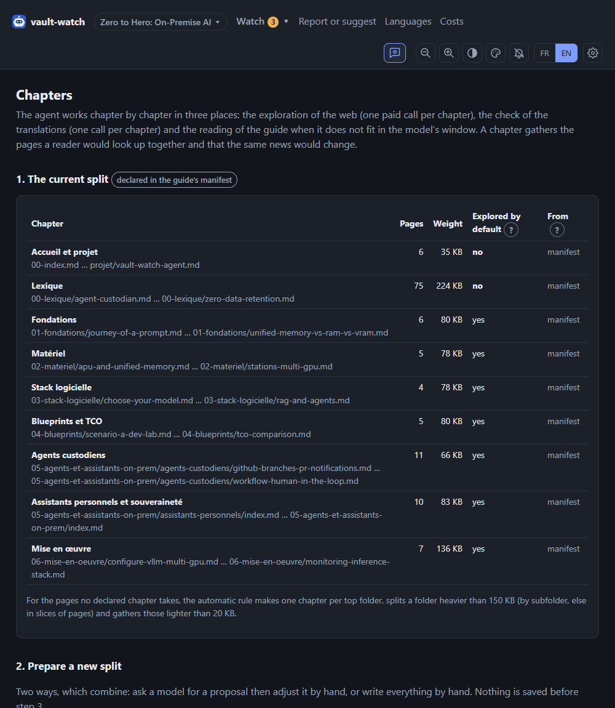

*[Version française](fr/connect-your-guide.md)*

# Connect your guide

vault-watch-agent keeps a Markdown guide up to date: it reads a watch (what changed in the field), proposes
corrections with their sources, lets you review them, and opens a pull request with the ones you accept. It knows
your guide through one file at its root, `vault-watch.toml`. This page describes that file key by key, what each
optional part unlocks, and how to check that everything is ready.

What a guide needs, at least: Markdown pages in a git repository (the guide is the root of its repository), and a
name and a language in its manifest. Everything else is optional; a missing part switches a step off, it never
makes a run fail. A folder without a manifest is refused, with what to do: `vault-watch init` (the IA on-prem guide,
which the agent was written for, is the one exception).

## In three commands

```bash
vault-watch --guide ../my-guide init      # writes vault-watch.toml from what the folder shows
vault-watch --guide ../my-guide doctor    # what is ready, what is missing (exit code 1 if a run cannot start)
vault-watch --guide ../my-guide serve     # the web interface, on this guide
```

`init` looks at the folder: the GitHub repository of its `origin` remote, its branch, the language of the pages,
the folders that repeat them in another language, the date field of their front matter. It leaves out the tooling
(`node_modules/`, `scripts/`, `docs/`…), the folders whose name starts with `_` (private notes, templates) and the
repository files (`README.md`, `CLAUDE.md`…), and lists the npm scripts of the guide as hints for `[checks]`. Each
guess is commented: read the file before the first run. `--print` shows it without writing it, `--force` replaces
an existing one.

`doctor` checks the manifest, the pages, each mirror, git, `gh` and the repository, the watch, each check and the
program it needs, and the engine (Claude Code signed in with a subscription, or an API key found).

Without `--guide`, the commands take `VAULT_PATH`, then the current folder when it holds a `vault-watch.toml`. The
runs of each guide are kept apart, in a folder of their own under `~/.vault-watch/guides/`; the settings (engine,
models, in `~/.vault-watch/settings.json`) are shared by every guide. `VAULT_WATCH_HOME` puts that folder elsewhere;
a `.vault-watch` folder in the current folder, as the agent used before 1.0, is still used when it exists. The cost
journal goes to `~/.vault-watch/usage.jsonl` (`VAULT_WATCH_JOURNAL` to change it). Nothing is written inside the
guide outside a run's branch.

## The manifest

The smallest useful one, from the sample guide (`examples/sample-guide/`):

```toml
schema = 1

[guide]
name = "Self-hosted notes server"
description = "running Quillnote, a notes server, and Larkdb, its database, on a machine of your own"

[content]
language = "en"
exclude = ["README.md"]
modified_field = "last_modified"

[watch]
source = "file"
path = "watch.json"
```

A guide that uses every part: [`examples/manifests/ia-on-prem-vault.toml`](../examples/manifests/ia-on-prem-vault.toml).

An unknown key, or a value of the wrong kind, stops the agent with a message that names the key: a typo must not
switch a part off without a word.

### `schema`

`1`, the version of the format. Optional (1 by default). Frozen from 1.0: what may change, and how, is in [compatibility.md](compatibility.md).

### `[guide]`

| Key | Required | What it is |
| :-- | :-- | :-- |
| `name` | yes | The guide's name, in the interface and in the prompts. |
| `description` | no | What the guide is about, in one sentence. It goes into the prompts: the model judges relevance against it. |
| `repository` | no | `owner/name` on the forge (GitHub unless `forge` says otherwise). Without it the guide is local: no issue is read, no pull request is opened, the branch of a run stays on your machine. |
| `forge` | no | Where `repository` lives: `github` (default, through `gh`, authenticated by `gh auth login`) or `gitea` (through the Gitea API, with a token). |
| `forge_url` | with `gitea` | The address of the Gitea server, such as `https://gitea.example.org` or `http://192.168.1.10:3000`. |
| `forge_token` | no | Gitea: where the token is, as a reference, never the token itself: `env:NAME` (default `env:GITEA_TOKEN`), `sops:file#NAME` or `file:path`. It needs the `repository` scope in writing to open pull requests, and the `issue` scope (writing) for an `issues` watch. A Gitea token is valid on every repository its account can reach: give the agent an account of its own, collaborator of the guide's repository alone. |
| `site` | no | The published site, linked from the interface. |
| `base_branch` | no | The branch runs start from and pull requests target (`main` by default). |

### `[content]`

| Key | Required | What it is |
| :-- | :-- | :-- |
| `language` | yes | The language the pages are written in (`en`, `fr`, `de`…). The prompts ask for corrections in it. |
| `include` | no | Glob patterns of the pages (`["**/*.md", "**/*.mdx"]` by default). `*` stays in one folder, `**` crosses folders. |
| `exclude` | no | Glob patterns left out (`["docs/**", "README.md"]`). Dot folders (`.git`, `.agents`…) are always left out. |
| `mirrors` | no | Translated copies kept in step: `{ en = "en/" }` means `en/<page>` is the English copy of `<page>`. The folder ends with `/`; its pages are not pages of the source language. |
| `readonly` | no | Glob patterns of pages the agent reads (excerpts, cross-check) but never edits: pages your own scripts generate (an edit would be lost at the next build), or pages that report dated statements. A correction proposed on one is refused (`read-only`). |
| `modified_field` | no | A front matter date that an accepted correction sets to the day's date (`last_modified`). Without it, the dates of the pages do not change. |

### `[watch]`

Where the items of a watch come from.

| `source` | With | What the agent reads |
| :-- | :-- | :-- |
| `none` (default) | | No watch: the agent verifies the guide and fixes reported errors only. |
| `issues` | `label` (`veille` by default), `artifact` (`weekly-watch` by default) | (Named `github-issue` before 1.0, a name still read.) Open issues with that label in `repository`, on its forge (GitHub or Gitea, whose Actions artifacts need Gitea 1.23 or later). The body of the issue links the workflow run that collected the watch (`.../actions/runs/<id>`); the items are the `watch.json` of that run's artifact named `artifact`. |
| `file` | `path` | A `watch.json` of the guide, or a folder of them (one per watch, listed newest first in the interface, each with its window and its items kept; a file that breaks the format is listed with what is wrong). Also any file given on the command line (`vault-watch run --watch-json`). |
| `feeds` | `feeds` | The watches the agent collected from the guide's feeds (`vault-watch collect`, or the « Collect a watch » button of the interface), kept in the guide's working folder. |

With any source, `feeds` (a `feeds.json`), `floors` and `seen` let `vault-watch collect` gather a watch from the
guide's feeds, without a model; the reusable GitHub workflow does it on the guide's schedule (every two weeks for the reference guide) and opens the issue:
[Collecting a watch](collect.md).

`changes_page` (any source) names a page where a watch records changes as dated lines, such as « What changed
since »: every proposal step sees it whole, whatever the item's keywords found, and adds a line by quoting the
page's last line (or a placeholder sentence) and giving it back followed by the new one. It must not be read-only.

`candidates` (any source) names the registry of discovery, a JSON file of the guide the agent creates, and
`candidate_kinds` the kinds of its candidates, as fits the guide: `["model", "tool", "hardware"]` when it is not
given, `["software", "plugin", "host"]` for a guide of self-hosted software; « other » is always added. Short names
in lower case (letters, digits, -); the page translates the default ones and shows the others as they are written.
`candidate_readers` names where its candidates are read without a model: `"huggingface"` (a model page),
`"github"` (a repository); none when it is not given, so that nothing is sent to these sites for a guide that has
no use for them ([Collecting a watch](collect.md#the-registry-of-candidates)). `source_tiers` names the guide's file
of source tiers (domains under « ## Tier A/B/C », or JSON): the score of a candidate counts its independent publishers
by tier ([One entity under several names, and its score](collect.md#one-entity-under-several-names-and-its-score)).

A `watch.json` holds the items your collector kept (feeds, release pages, advisories); its format, key by key:
[The watch format](watch-format.md).

```json
{
  "until": "2026-11-02",
  "items": [
    { "title": "Quillnote 5.0 released: Python 3.11 required", "url": "https://example.org/quillnote/releases/5.0",
      "triage": "keep", "date": "2026-10-28", "notes": "The minimum Python version moves to 3.11." },
    { "title": "Larkdb security advisory", "url": "https://example.org/larkdb/advisories/7", "triage": "keep",
      "date": "2026-10-30", "urgent": true, "severity": "High", "notes": "larkdb dump before 2.1..." }
  ]
}
```

Only the items with `"triage": "keep"` are read, urgent ones first. `notes` is what the model reads about the item:
the more facts it holds (versions, dates, figures), the less the model has to guess. `until` is the end of the
watch window, the date of the run's report.

### `[rules]`

Your own instructions for the model, as files of the guide. Without them the agent uses its own, in
[`src/vault_watch_agent/defaults/`](../src/vault_watch_agent/defaults/): read them before writing yours.

| Key | What it governs |
| :-- | :-- |
| `brief` | What a watch item can lead to (nothing, a correction, an addition), which sources count, the size of a correction, severity. |
| `translation_policy` | How a mirror follows the source pages (fidelity, what is never translated, front matter). Used only with `mirrors`. |

### `[checks]`

The guide's own scripts, run by the agent in a copy of the guide. Each one is optional: a check the guide does not
declare reads « not checked » in the report, on the publish screen and in the pull request, never « passed ».
`{out}` in a command is replaced by the path of a JSON file the agent reads afterwards.

| Key | Runs | Expected |
| :-- | :-- | :-- |
| `audits` | before the pull request, on the corrected copy | Exit code 0 when the guide is sound. Its output goes into the pull request when it fails. |
| `claims_due` | at the start of a run (no network) | `{out}`: `{"claimsDue": [{"page": "...", "claim": "...", "recheckBy": "2026-11-01"}]}`, the dated claims whose recheck date has passed. They are listed in the report. |
| `sources` | before the pull request | `{out}`: `{"sources": [{"url": "...", "citations": [{"page": "..."}], "probe": {"status": "ok", "code": 200}}]}`. A source cited by a corrected page whose status is `dead`, `server-error`, `network-error`, `timeout` or `blocked` is listed on the publish screen. |
| `sources_weekly` | by the check « Dead links » | `"artifact/file.json"`: the artifact of the guide's CI that holds the JSON report of the same source audit, run weekly (`"freshness-report/sources.json"` for the IA on-prem guide). Its newest one is downloaded through the forge and crossed with the probe made from your machine: a source dead from both is to replace, one that fails only from the CI's runners answers here (a site that refuses data-centre addresses) and is listed apart. Needs `[guide] repository`. |
| `version_floors` | after the corrections are applied | A table `{ script = "...", file = "..." }`: `node <script> --write` updates `file` (the minimum versions the pages state), committed with the corrections. |

### `[budget]`

`max_context_tokens`: a ceiling on what a single model call may read of the guide, whatever the model. The
cross-check, its sweep and the coherence check read the whole guide in one call when it fits in the model's window
(minus a reserve of 100 k tokens for the instructions, the web and the answer) and under this ceiling; otherwise they
run chapter by chapter (one [chapter](#chapter) per call, with the pages the corrections change), and the report and the
run view say so: a contradiction between two chapters can then be missed. Not set: the model's window decides.

`growth_kb` (5 by default) and `growth_percent` (25): a page that gained that many KB in 90 days, or that share of
what it weighed, is flagged as having grown much. `page_kb` and `[budget.pages]`: an optional ceiling, in KB, for
every page, and another one for the pages of a folder (`"00-lexicon/**" = 8` under `[budget.pages]`; the first
pattern that matches wins); none by default, since how long a page should be depends on its subject. A flagged
page is a warning of `vault-watch doctor`, of `vault-watch compact` and of the « Size of the pages » check, never a
failure: it says where a [compaction](compact.md) should look first. A read-only page is listed with its weight
and never flagged.

### `[[chapter]]`

The chapters are the pages the agent works on together. Three steps go chapter by chapter: the exploration of the
web ([what is new](news.md), one paid call per chapter), the check of the translations (one call per chapter), and
every step that reads the whole guide when the model's window is too small for it. A chapter is best a set of
pages a reader would look up together and that the same news would change. Why the chapters matter, why the
thresholds below, and what a split that fits badly costs: [Chapters](chapters.md).

Optional. Without it, an automatic rule applies: one chapter per top folder (the pages at the root form one); a
folder heavier than 150 KB is split along its subfolders, or in slices of pages of similar weight when it has none;
the top folders lighter than 20 KB are gathered. To decide yourself, declare chapters, each a table:

```toml
[[chapter]]
name = "Hardware"
paths = ["02-hardware/", "03-stack/choose-a-gpu.md"]

[[chapter]]
name = "Glossary"
paths = ["00-glossary/"]
explore = false
```

| Key | Meaning |
| :-- | :-- |
| `name` | How the chapter is called on the screens and on the command line (`news --explore --chapters`). Unique, 80 characters at most, no comma, no quotation mark |
| `paths` | What it holds: a folder (`"02-hardware/"`, everything under it), a glob (`*` within a folder, `**` across folders) or a page. A page goes to the first chapter that takes it: write the particular before the general |
| `explore` | `false` leaves the chapter unticked when the web is explored (a glossary, the pages about the project: the web brings nothing new to them by itself). It can still be ticked. `true` by default |

The pages no chapter takes follow the automatic rule, so a manifest may declare only what the rule gets wrong.

`[[chapter]]` is read from the agent 1.3.0. An older agent refuses a manifest that has it (an unknown key): update
the agent wherever the guide is read, a workflow that collects its watch included, before you merge such a manifest.

Three ways to write these tables, all reviewed by you before they reach the guide:

- **A model proposes them.** Page « Chapters » of the interface (in the menu under the guide's name), or
  `vault-watch chapters --propose`. One call reads the outline of the guide (the path, weight, title and headings
  of each page, not its text: about a twentieth of the guide) and proposes chapters, with those not to explore by
  default and a sentence of reasons for each. Its cost is said first. Nothing is written by the call.
- **By hand on the same page**: add, rename, move paths, or « Take the current split » to adjust what is there.
  The chapters it gives, with their weight, are shown again after each change, before anything is saved.
- **By hand in the manifest.**



Saving from the page writes the manifest on a branch of the guide (`chore/chapters-<date>`) and opens a pull
request when the guide has a repository; the split applies once it is merged. `vault-watch chapters --propose
--write` puts it in the manifest of the folder instead, for you to commit. `vault-watch chapters` lists the
chapters as they are now, with their weight; `--automatic` removes the declared ones. Run it again, or open the
page, when the guide gains a folder or a chapter grows much: `vault-watch doctor` says when a declared chapter
takes no page any more.

## What each part unlocks

| Without | The agent |
| :-- | :-- |
| `repository` | works locally: no issue, no pull request, no link to the forge. |
| `mirrors` | has no translation step and no translation check. |
| `modified_field` | leaves the dates of the pages as they are. |
| `[watch]` | verifies the guide and fixes the errors you report (`vault-watch fix`, « Check the guide » in the interface). |
| `[rules]` | follows its default brief and translation policy. |
| a check of `[checks]` | says « not checked » where the check would have reported. |

The « Guide » category of the Settings shows the same thing for the guide being served: each part, provided or
missing, and what a missing one switches off.

## The sample guide

`examples/sample-guide/` is a made-up guide of twelve pages with one planted error per check, and its manifest uses
the fewest parts. To try the agent on it, copy it out of this repository (a guide is the root of its own git
repository), then:

```bash
cp -r examples/sample-guide ../sample-guide && cd ../sample-guide
git init -b main && git add . && git commit -m "sample guide"
vault-watch doctor
vault-watch run --watch-json watch.json
```

A run calls the model: with the Claude Code engine it uses your Claude subscription, with the API engine it is
billed to your key (see « The model » in the README).
