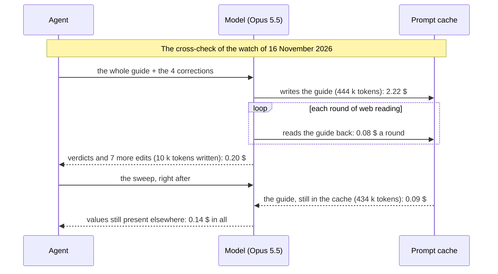

*[Version française](fr/costs.md)*

# Costs: what makes the price, the estimates, the journal

Every call to a model is counted: before a paid step, the interface shows an estimate; after it, the journal keeps
what it cost. This page says what makes the price of a call, how the estimates are made and why they can miss,
where the prices come from, and how the journal and the « Costs » page read.

**The amounts are indicative.** They are what the calls are worth at the API's list price. The author's calls went
through the API access of his Claude subscription: he paid his subscription and nothing more. With a key billed
per token, they are what you would pay; on Claude Code with a subscription, nothing is billed.

## What makes the price of a call

A call is paid in four kinds of tokens, each at its own rate, plus the web searches. The prices of November 2026,
in dollars per million tokens:

| Model | Read (input) | Written (output, thinking included) | Read from the cache | Written to the cache |
| :-- | --: | --: | --: | --: |
| Claude Opus 5.5 | 4.00 | 20.00 | 0.20 | 5.00 |
| Claude Sonnet 5.5 | 2.00 | 10.00 | 0.10 | 2.50 |
| Claude Fable 5.2 | 8.00 | 40.00 | 0.20 | 10.00 |

A web search costs 0.01 $; the pages it brings back, and the pages the model opens, are read like any input.

**The guide weighs the most.** Many steps read the whole guide: about 410 k tokens for the IA on-prem guide. Sent as
plain input to Opus 5.5, that would be 1.64 $ a time. The agent sends it as a cached context instead: the first
call writes it to the cache (2.05 $, a quarter more than plain input), and every read after that, by the same call
or another one, costs 0.08 $. The cache lasts five minutes after its last use, so the calls that share it run
close together: the rounds of one call, the sweep right after the cross-check, the chapters explored side by side.

That cross-check cost 2.70 $: 2.22 $ to write the guide to the cache, 0.26 $ to read it back over its rounds, 0.20 $
of answer. The proposals before it, which see excerpts only, cost 0.30 $ for four calls. **What a run costs is
first how many times the guide is written to a cache**, then how many rounds read it back, then what the model
writes. A guide half the size costs about half.

## Where the money goes, by kind of run

| Run | What weighs | Measured on the IA on-prem guide |
| :-- | :-- | --: |
| A watch | The cross-check: the guide written once, read at each round, about four fifths of the run | 2.95 – 4.45 $ |
| A fix run | The proposals read the whole guide and the web for each error, then the cross-check writes the guide again | 5.60 – 8.15 $ |
| A translation fix | The pages and their mirrors, on the translator model; no web, no cross-check | 0.35 $ |
| A check of the guide | Consistency (the guide written once, 27 k tokens written), translations (one call per chapter), the claims on the web | 7.25 – 10.85 $ |
| Compaction | The report writes a long answer (48 k tokens on Fable 5.2); the run writes the trims of each finding | 6.28 $, then 18.87 $ for 30 findings |
| What is new | The leads: one call on the whole guide, 2.28 $. The addition run: about 4 $ of cross-check whatever the leads, then each lead a call of 7 to 30 rounds on the web, 1.80 – 2.80 $ when it reads the whole guide, 0.40 – 1.30 $ when it reads its pages and the plan | 8.70 – 12.95 $ for 2 to 5 leads |
| The web explored | One call per chapter, each about 25 rounds, each round reading the guide from the cache and the web read so far | estimated 4.81 $ a chapter |

The detail of each check is on [Check the guide](check.md#the-catalogue), of compaction on
[Compaction](compact.md#which-model), of the leads and additions on
[What is new](news.md#what-each-call-reads-and-what-it-costs).

## The estimates

Before a paid step, the interface shows what it should cost: on the button of a watch, of each check, of a run made
from leads, of a split into chapters. An estimate is made of three things:

1. **The weight of the guide**, from the size of its files: 2.1 bytes a token, measured on the IA on-prem guide
   (853 KB of French pages = 408 k tokens). A guide in another language, or with more code, has more tokens a
   byte; where it matters (does the guide fit in the window?), the count is raised by 15 %.
2. **What the step writes, and how many rounds it reads**, measured on the IA on-prem guide and written in the code
   with the run they come from (`verify.py`): 27 k tokens written by the consistency check, 18 rounds and 80 k
   tokens of web pages per lead of an addition run, 25 rounds per chapter explored… What a step writes is **counted
   high on purpose**: an estimate shown before a billed run should not be beaten.
3. **The prices of the models of your settings**, step by step (a step set apart on another model is priced on
   it), from the price table below.

An estimate begins with « ≈ » because the web cannot be counted in advance: how many searches a model makes, and how
long the pages it opens are, depend on what it finds. The replacement of two dead links cost 0.54 $ on 8 November
and 3.57 $ on 17 November, for the same estimate. Steps without the web stay close: the consistency check was
estimated 2.59 $ and cost 2.64 and 2.73 $; the leads of « What is new », 2.45 $ for 2.28 $.

An estimate is also shown when nothing is billed: on a subscription, the page says « subscription, not billed »
in place of the amount; with a local model, « local model, not billed »; with another OpenAI-compatible provider,
« billed by your provider ».

## Where the prices come from

A price is the four rates of a model, with where it comes from. The first source that knows the model wins:

| Source | What it is | How to change it |
| :-- | :-- | :-- |
| set | A price you set in the Settings | The Settings, « Prices », « Set » |
| fetched | The public list (LiteLLM's), read only when you ask, with its date | « Read the list » then « Replace with this list » in the Settings, or `vault-watch prices update` |
| default | The list shipped with the agent, with the month it was checked (`defaults/prices.json`) | A new version of the agent |

`vault-watch prices show` lists each model with its price and its source. An estimate made on a default price says
so (« default of 2026-11 »). A model that no source knows has no price: its calls count 0, and the Settings say
it. A dated model id takes the price of the longest known id it begins with.

## The journal and the « Costs » page

Every call adds a line to the journal: the date, the run, the kind of run, the step, the model, the tokens of each
kind, the web searches and the cost. For you it is `~/.vault-watch/usage.jsonl`; this repository keeps the
journal of the IA on-prem guide, [`metrics/usage.jsonl`](../metrics/usage.jsonl), versioned.

- **The cost of a call on the API** is computed from the usage the API returns, at the price of the table: it is
  an estimate of the bill, and the Console's billing page stays the reference.
- **A call through Claude Code on a subscription** costs 0 in the journal, and keeps apart what it would have cost
  on the API (`list_usd`, as Claude Code reports it).
- **A call to a local model** costs 0.

The « Costs » page of the interface totals the journal by month and by run, with the calls made on a subscription
in columns of their own. `vault-watch costs --by month` (or `year`, `run`, `step`) gives the same on the command
line; `--by step` shows which steps weigh, across every run.

## What lowers the cost

| Lever | What it changes | What it can cost in quality |
| :-- | :-- | :-- |
| Claude Code with a subscription | Nothing billed; the calls count in the subscription's limits, and a cross-check weighs on them | Nothing: same models. A run stops at the limit and resumes later |
| A smaller model for one step | The translation on Sonnet 5.5 costs half of Opus 5.5 | Depends on the step: see [Choose a model](choose-a-model.md) |
| A lower effort | Less thinking written, so fewer output tokens | The model thinks less before it answers; measure it on your guide before keeping it ([Choose a model](choose-a-model.md#measuring-your-own-model)) |
| An addition run on « the lead's pages and the plan » | Each lead's call reads its pages instead of the guide at each round: about half (the default of `vault-watch fix --add`) | A lead that touches pages it did not name sees less; the cross-check still reads the whole guide |
| Fewer chapters explored | 4.81 $ less per chapter left unticked | Its subjects are not searched |
| A lighter guide | Every step that reads the guide costs in proportion ([Compaction](compact.md)) | None, if what is trimmed was repeated |

The agent never chooses a billed engine by itself: when a subscription limit is reached the run stops, and the
review warns when what is left of a run would go to a billed engine because the Settings changed.
