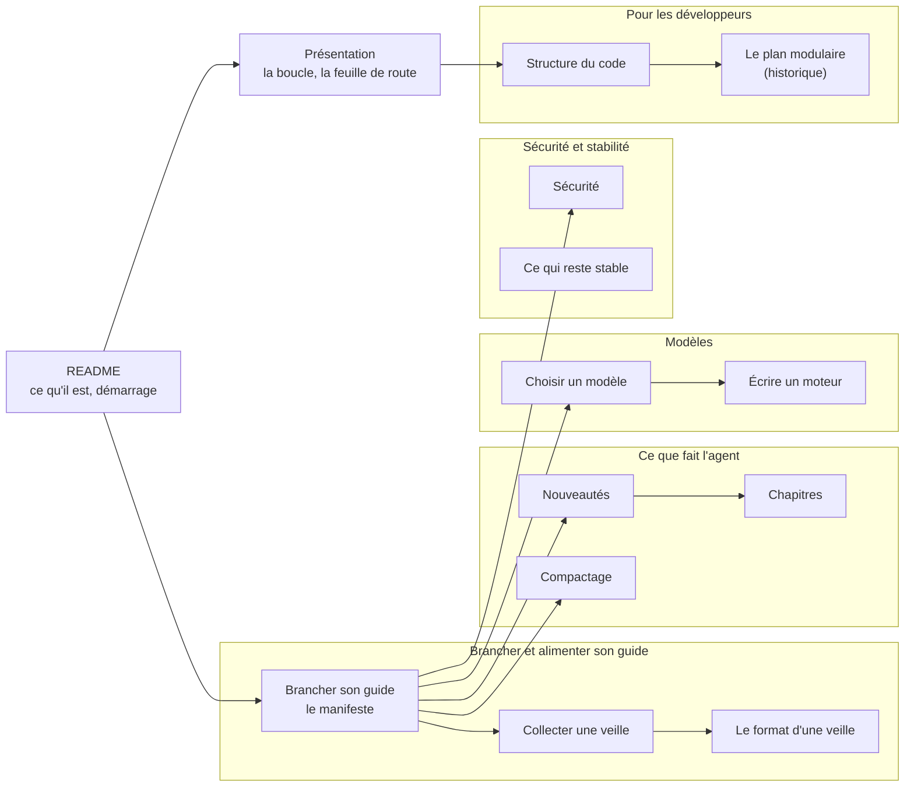

*[English version](../README.md)*

# La documentation de vault-watch-agent

Toutes les pages, rangées selon la question à laquelle elles répondent. Chaque page est ici en français, et en
anglais dans [`docs/`](../), sous le même nom ; les captures d'écran sont dans [`images/`](../images/). Ce qu'est
l'agent, comment l'installer et les pages de son interface : le [README](../../README.fr.md) du dépôt.

## Découvrir

| Page | Ce à quoi elle répond |
| :-- | :-- |
| [Présentation](presentation.md) | Pourquoi un guide technique vieillit vite, toute la boucle d'une veille à une pull request fusionnée, les deux pauses, ce que l'agent a produit sur le guide IA on-prem, ce que ça vaut, la suite. Cinq schémas |

## Brancher et alimenter son guide

| Page | Ce à quoi elle répond |
| :-- | :-- |
| [Brancher son guide](connect-your-guide.md) | Les trois commandes pour démarrer, le manifeste `vault-watch.toml` clé par clé, ce que débloque chaque partie facultative, le guide d'exemple pour essayer. Une capture de la page « Chapitres » |
| [Collecter une veille](collect.md) | `vault-watch collect` : les flux que suit un guide (`feeds.json`), le pré-tri sans modèle, la page « Sources » et le contrôle des sources, le workflow hebdomadaire sur GitHub |
| [Le format d'une veille](watch-format.md) | `watch.json` champ par champ, pour un guide qui apporte son propre collecteur |

## Ce que fait l'agent

| Page | Ce à quoi elle répond |
| :-- | :-- |
| [Nouveautés](news.md) | Ce qu'un lecteur chercherait et ne trouve pas : les pistes tirées du guide et du web, une idée à soi, les ajouts et leur vérification sur le web, ce que lit et coûte chaque appel. Une capture des pistes |
| [Chapitres](chapters.md) | Les trois étapes qui travaillent sur une partie du guide à la fois, d'où viennent les chapitres, la règle automatique et pourquoi 150 Ko et 20 Ko, ce que coûte un découpage mal adapté |
| [Compactage](compact.md) | Empêcher un guide de s'alourdir : les tailles, le rapport, les coupes, quel modèle, ce que le code vérifie lui-même |

## Modèles

| Page | Ce à quoi elle répond |
| :-- | :-- |
| [Choisir un modèle](choose-a-model.md) | Les modèles mesurés sur le guide IA on-prem, ce que chaque étape demande à un modèle, un modèle pour une étape, ce qui a été essayé, mesurer son propre modèle |
| [Écrire un moteur](write-an-engine.md) | Ce que le graphe demande à un moteur, comment le déclarer, l'exemple de l'API propre d'Ollama, les tests de contrat |

## Sécurité et stabilité

| Page | Ce à quoi elle répond |
| :-- | :-- |
| [Sécurité](security.md) | Clés et jetons gardés comme références, ce que le modèle peut faire et ce qu'il ne peut pas, ce qui sort de la machine, le serveur local, ce qu'il faut vérifier avant de brancher un guide |
| [Ce qui reste stable](compatibility.md) | Les quatre formats figés depuis 1.0 (manifeste, veille, protocole des moteurs, réglages), les règles d'un changement, ce qui n'est pas figé |

## Pour les développeurs

| Page | Ce à quoi elle répond |
| :-- | :-- |
| [Structure du code](code.md) | Les modules et leurs dépendances, le graphe nœud par nœud, l'état, un appel au modèle de bout en bout, la pause et la reprise d'un passage, les tests. Six schémas |
| [Le plan modulaire](../modular-plan.md) | Le plan de la phase G, d'un seul guide à un agent que tout guide peut utiliser. Gardé comme historique, en anglais seulement |

À la racine du dépôt : [ROADMAP](../../ROADMAP.md), [CHANGELOG](../../CHANGELOG.md),
[CONTRIBUTING](../../CONTRIBUTING.md) (en anglais).
