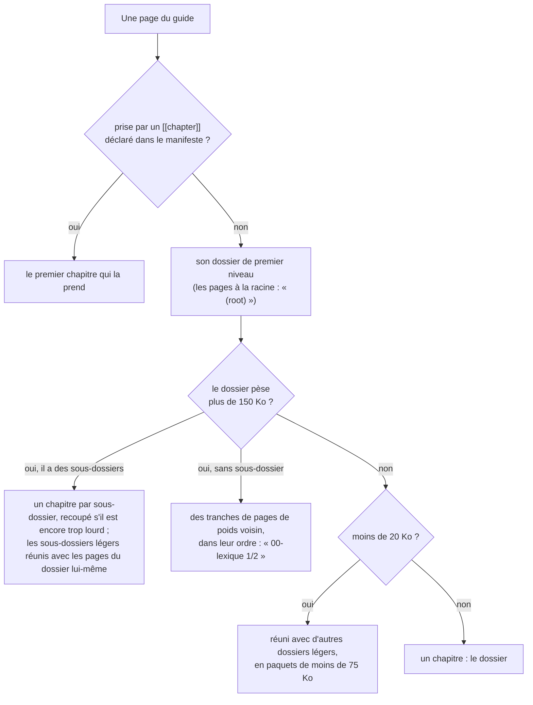

*[English version](../chapters.md)*

# Chapitres : comment l'agent découpe un guide

La plupart des étapes de l'agent lisent tout le guide en un appel : c'est la seule façon de trouver une
contradiction entre deux pages éloignées. Trois étapes ne le peuvent pas, ou ne le doivent pas, et travaillent sur
une partie du guide à la fois : un **chapitre**. Cette page dit ce qu'elles en font, d'où viennent les chapitres,
pourquoi la règle automatique a les seuils qu'elle a, et ce que coûte un découpage mal adapté au guide.

## Les trois étapes qui travaillent par chapitre

| Étape | À quoi sert un chapitre | Ce que changent le nombre et la taille des chapitres |
| :-- | :-- | :-- |
| Le web exploré pour les [nouveautés](news.md#les-pistes-depuis-le-web) | Un appel payant par chapitre coché : il cherche sur le web les sujets de son chapitre (environ 12 recherches et 15 pages lues), compare avec tout le guide et garde huit pistes au plus | **Le coût suit le nombre de chapitres** : chaque appel lit tout le guide depuis le cache et a le même budget web, quelle que soit la taille de son chapitre (environ 4,75 $ par chapitre sur le guide IA on-prem, estimé). **La taille décide de la façon dont chaque sujet est cherché** : un chapitre de quarante sujets partage sa douzaine de recherches entre eux |
| Le contrôle des traductions | Un appel par chapitre : ses pages dans la langue source et leurs miroirs, côte à côte | Peu de chose : le guide est lu une fois en tout ; plus de chapitres, c'est un peu plus de consignes et de réponses |
| Toute étape qui lit tout le guide, quand il ne tient pas dans la fenêtre du modèle | La relecture croisée, son balayage et le contrôle de cohérence font alors un appel par chapitre, avec les pages que les corrections modifient ([`reading.py`](../../src/vault_watch_agent/reading.py)) | Un chapitre doit tenir dans la fenêtre. Un fait énoncé dans deux chapitres n'est plus vu d'une seule lecture : le rapport et la vue du passage disent que le guide a été lu par chapitre |

Sur le guide IA on-prem avec Claude (une fenêtre d'un million de tokens), le troisième cas n'arrive jamais : le
guide est lu en entier. Les chapitres y comptent surtout pour l'exploration du web.

## D'où viennent les chapitres

1. **Le manifeste du guide**, quand il les déclare : des tables `[[chapter]]`, chacune avec un nom, ses chemins, et
   `explore = false` pour un chapitre laissé décoché quand le web est exploré. Une page va au premier chapitre qui
   la prend. Les clés, et comment les écrire (à la main, ou à partir d'une proposition d'un modèle relue sur la
   page « Chapitres ») : [Brancher son guide](connect-your-guide.md#chapter).
2. **La règle automatique**, pour les pages qu'aucun chapitre déclaré ne prend, et pour un guide qui n'en déclare
   aucun.

`vault-watch chapters` liste les chapitres tels qu'ils sont, avec leur poids et l'origine de chacun ; la page
« Chapitres » de l'interface (dans le menu sous le nom du guide) montre la même chose.

## La règle automatique

Elle part des dossiers du guide, puisqu'un auteur range d'ordinaire ses pages par sujet :

1. Un chapitre par dossier de premier niveau ; les pages à la racine du guide en forment un, « (root) ».
2. **Un dossier de plus de 150 Ko est coupé** : un chapitre par sous-dossier (chacun recoupé s'il est encore trop
   lourd, les sous-dossiers légers réunis avec les pages du dossier lui-même), ou, quand il n'a pas de sous-dossier,
   des tranches de pages de poids voisin, dans leur ordre (« 00-lexique 1/2 », « 00-lexique 2/2 »).
3. **Les dossiers de premier niveau de moins de 20 Ko sont réunis**, en paquets qui restent sous 75 Ko (la moitié
   de 150) : une page d'accueil, un dossier « à propos », une page de crédits ne coûtent pas chacun un appel.

Le poids est la taille des fichiers Markdown de la langue source, front matter et notes de bas de page comprises ;
les miroirs ne comptent pas.

### Pourquoi 150 Ko et 20 Ko

Ils ont été réglés sur le guide IA on-prem, celui pour lequel l'agent a été écrit, pour que la règle donne sans
manifeste à peu près le découpage que choisirait son auteur. Ce que la règle donne sur lui aujourd'hui
(21 novembre 2026) :

| Dossier | Pages | Poids | Par la règle |
| :-- | --: | --: | :-- |
| (root) | 2 | 14 Ko | un chapitre |
| `projet/` | 4 | 21 Ko | un chapitre |
| `00-lexique/` | 75 | 221 Ko | coupé en deux tranches d'environ 110 Ko (pas de sous-dossier) |
| `01-fondations/` à `04-blueprints/` | 4 à 6 chacun | 76 à 79 Ko chacun | un chapitre chacun |
| `05-agents-et-assistants-on-prem/` | 21 | 145 Ko | un chapitre : sous 150 Ko |
| `06-mise-en-oeuvre/` | 7 | 130 Ko | un chapitre |

Dix chapitres, la plupart de 76 à 145 Ko : la taille d'une partie qu'un lecteur parcourt comme un seul sujet, et
de ce qu'une douzaine de recherches peut couvrir. Un seuil plus bas aurait coupé les dossiers de 130 et 145 Ko ; un
seuil plus haut aurait laissé le lexique en un seul chapitre de 221 Ko.

Le tableau montre aussi le point faible d'un seuil. Le 20 novembre, `projet/` pesait moins de 20 Ko et était
réuni avec les pages de la racine en un chapitre de 32 Ko ; deux pages sur l'agent ont pris moins de 3 Ko, et les
mêmes pages font maintenant deux chapitres, deux appels quand le web est exploré. Une règle sur des poids ne peut
pas savoir que ces pages vont ensemble ; un chapitre déclaré, si.

**Ils sont fixés dans le code**, pas dans le manifeste : `BIG_KB` et `SMALL_KB` dans
[`chapters.py`](../../src/vault_watch_agent/chapters.py). Un guide que la règle découpe mal ne les change pas : il
déclare ses chapitres, qui l'emportent sur la règle page par page. Le manifeste peut ne déclarer que ce que la règle
fait mal.

150 Ko sert à deux autres endroits :

- **La proposition du modèle** : il lui est demandé des chapitres d'environ cette taille
  ([Brancher son guide](connect-your-guide.md#chapter)).
- **Un chapitre déclaré de plus de 225 Ko** (une fois et demie 150) est signalé par `vault-watch doctor` et sur la
  page « Chapitres » : un appel sur lui lit et écrit beaucoup. C'est un avertissement, jamais un refus. Le lexique
  du guide IA on-prem (221 Ko) est juste en dessous ; il est déclaré avec `explore = false`, donc ne coûte rien
  s'il n'est pas coché.

## Ce que coûte un découpage mal adapté

| Le découpage | Ce qui se passe |
| :-- | :-- |
| Trop de petits chapitres | L'exploration du web coûte un appel chacun (environ 4,75 $ sur le guide IA on-prem), pour quelques sujets. Le contrôle des traductions prend plus d'appels pour les mêmes pages |
| Des chapitres trop lourds | Leurs sujets se partagent une douzaine de recherches : certains ne sont jamais regardés, et le résultat ne dit pas lesquels. Avec une petite fenêtre, un chapitre peut ne pas tenir dans un appel |
| Des chapitres qui coupent des sujets en deux | Une nouvelle concerne deux chapitres : chaque appel voit la moitié des pages qu'elle change, ou les deux la trouvent (une piste trouvée deux fois à la même source n'est listée qu'une fois) |
| Un lexique ou les pages sur le projet explorés | Un appel payé pour des pages auxquelles le web n'apporte rien de neuf : les déclarer avec `explore = false` |

## Le guide IA on-prem

Depuis le 20 novembre 2026, il déclare neuf chapitres, proposés par un modèle (0,13 $), relus, puis fusionnés
([pull request #101](https://github.com/DamienBecherini/ia-on-prem-vault/pull/101)). Ce qu'ils changent par rapport
à la règle : les pages de la racine et `projet/` forment un chapitre, « Accueil et projet » (35 Ko), et avec
« Lexique » (221 Ko, un seul chapitre) il n'est pas exploré par défaut ; le dossier des agents et assistants est
coupé selon ses deux parties (« Agents custodiens », 63 Ko ; « Assistants personnels et souveraineté », 82 Ko), que
la règle laisse en un chapitre de 145 Ko. Sept chapitres sont explorés par défaut. Chaque page est prise par un
chapitre déclaré : la règle automatique ne s'applique plus qu'à un nouveau dossier qu'aucun chapitre ne couvre, et
`vault-watch doctor` dit quand un chapitre déclaré ne prend plus aucune page.
