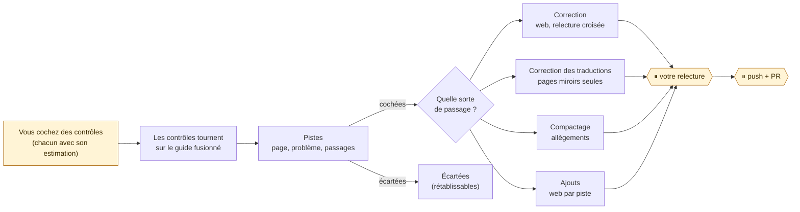

*[English version](../check.md)*

# Vérifier le guide : les contrôles, leurs pistes, et où elles partent

Une veille ne regarde que ce que ses sources annoncent. La page « Vérifier le guide » de l'interface (dans le menu
« Veille ») regarde le guide lui-même, à la demande : si ses scripts passent, si ses sources répondent encore, si ses pages sont d'accord
entre elles, si ses traductions disent la même chose, si ses affirmations datées tiennent toujours, ce qui
l'alourdit, et ce qu'un lecteur chercherait sans le trouver. Cette page dit ce que lit chaque contrôle, ce qu'il
coûte, ce qu'il trouve, et ce que devient ce qu'il trouve.

Un contrôle ne modifie jamais le guide. Ce qu'il trouve est une **piste** : une ligne qui nomme les pages, dit ce
qui ne va pas et ce qu'une correction devrait vérifier, avec les passages concernés copiés des pages. Les pistes
que vous cochez partent dans un passage, qui les vérifie sur des sources et passe par la même relecture et la même
pull request qu'une veille.

## Le catalogue

Onze contrôles. Quatre utilisent les scripts du guide ou lisent ses fichiers sans modèle, et ne coûtent rien ;
sept font lire le guide par un modèle. Les estimations ci-dessous sont celles qu'affichait la page le
21 novembre 2026 pour le guide IA on-prem (410 k tokens de pages françaises), avec les modèles de ses réglages, au
prix public ; les coûts mesurés sont ceux des contrôles lancés les 8 et 17 novembre
([ce qu'est une estimation](costs.md#les-estimations)).

| Contrôle | Ce qu'il lit | Modèle | Estimation | Mesuré | Ce qu'il trouve | Ses pistes partent dans |
| :-- | :-- | :-- | --: | --: | :-- | :-- |
| Contrôles du guide | Le script `[checks] audits` du guide (`npm test` pour le guide IA on-prem) | aucun | gratuit, ≈ 10 s | 0 $ | Un journal, réussi ou en échec | pas de pistes |
| Liens morts | Chaque URL citée par une page source, interrogée par le script `[checks] sources` du guide | aucun | gratuit, ≈ 2 à 4 min | 0 $ | Les sources qui ne répondent pas (404, erreurs, délais dépassés), et à part celles que bloquent des protections anti-robots | un passage de correction |
| Fraîcheur | Le script `[checks] claims_due` du guide : la watchlist et les dates de revue des pages | aucun | gratuit, ≈ 5 s | 0 $ | Les affirmations dont la date « Recheck by » est passée, les pages à revoir | pas de pistes : la revérification des affirmations s'en sert |
| Cohérence de tout le guide | Toutes les pages sources, en un appel | raisonnement (Opus 5.5) | 2,59 $ | 2,64 à 2,73 $ | Contradictions entre pages, une page restée en arrière des autres, définitions fausses, une note qui ne soutient pas sa phrase | un passage de correction |
| Fidélité des traductions | Chaque page à côté de son miroir, un appel par chapitre | traduction (Sonnet 5.5) | 1,84 $ | 1,58 à 1,64 $ | Un passage absent d'un côté, un chiffre, une version ou un lien qui diffère, du texte non traduit | un passage de correction des traductions |
| Revérification des affirmations datées | Les affirmations trouvées par « Fraîcheur », vérifiées sur le web | raisonnement | 0,21 $ par affirmation (4,20 $ pour 20) | 2,50 $ pour 12, 2,89 $ pour 20 | Les affirmations devenues fausses, avec ce que disent les sources aujourd'hui | un passage de correction |
| Remplacement des liens morts | Les sources mortes trouvées par « Liens morts », avec les lignes qui citent chacune | raisonnement | 0,27 $ par source | 0,54 $ et 3,57 $ pour 2 | Où chaque page a déménagé, ou une source primaire équivalente | un passage de correction |
| Taille des pages | Les fichiers, avec leur historique sur 90 jours | aucun | gratuit, ≈ 2 s | 0 $ | Ce que pèse chaque page et ce qu'elle a pris ; un avertissement pour une page qui a beaucoup grossi ou dépassé son plafond | pas de pistes : le compactage s'en sert |
| Compactage | Toutes les pages en un appel, les plus lourdes nommées | raisonnement (Fable 5.2 sur ce guide) | 6,50 $ | 6,28 $ | Le même fait répété, l'historique empilé, les sections plus longues que ce qu'elles disent ([Compactage](compact.md)) | un passage de compactage |
| Nouveautés | Toutes les pages, et ce que les veilles passées ont mis de côté | raisonnement | 2,45 $ | 2,28 $ | Ce que le guide présente comme actuel et qui a sans doute évolué, les sujets qu'un lecteur attendrait et qu'aucune page ne couvre ([Nouveautés](news.md)) | un passage d'ajouts |
| Nouveautés : exploration du web | Un appel par chapitre coché, chacun avec le web et tout le guide | raisonnement | 2,05 $, puis 4,81 $ par chapitre | pas encore lancé | Ce que le web dit des sujets d'un chapitre et que le guide ne dit pas, chaque piste avec ses sources ([Chapitres](chapters.md)) | un passage d'ajouts |

Les contrôles sont de trois sortes, que la liste des vérifications montre par des étiquettes en couleur : **santé
du guide** (les contrôles du guide, les liens morts, la fraîcheur, la cohérence, les traductions, les affirmations,
le remplacement des liens morts), **allègement** (la taille des pages, le compactage) et **nouveautés** (les deux
contrôles de nouveautés, et « Des liens à lire en entier », un douzième contrôle absent du catalogue : il se lance
depuis « Signaler ou proposer », [plus bas](#signaler-ou-proposer)).

Trois contrôles ont besoin d'un autre avant eux, qui tourne même s'il n'est pas coché : la revérification des
affirmations a besoin de « Fraîcheur », le remplacement des liens morts de « Liens morts », le compactage de
« Taille des pages ». Un contrôle dont le manifeste ne déclare pas le script dit qu'il n'a pas vérifié, faute de
`[checks]` déclaré, et ne trouve rien.

Les deux contrôles de suivi montrent à quel point une estimation peut s'éloigner de la facture quand le modèle
travaille sur le web : le remplacement de deux liens morts a coûté 0,54 $ le 8 novembre et 3,57 $ le 17 novembre,
la seconde fois parce que le modèle a cherché et lu beaucoup plus de pages avant de trouver une source qui lui
inspire confiance. L'estimation compte ce que pèse le guide ; le web, elle ne peut pas le compter d'avance.

## Comment un contrôle tourne

- **Sur le guide fusionné.** Les contrôles lisent une copie de lecture de la branche de base du guide, mise à jour
  depuis la forge, pas le dossier où vous travaillez : une de vos branches, à moitié modifiée, ne produit pas de
  pistes. Le commit lu est gardé avec la vérification.
- **L'un après l'autre, indépendants.** Un contrôle qui échoue dit « n'a pas pu tourner » avec l'erreur, et les
  autres continuent. Un appel qui échoue après que le modèle a répondu (une réponse coupée à la limite de sortie)
  est compté quand même.
- **Tout le guide en un appel**, pour la cohérence, le compactage et les nouveautés. Quand le guide ne tient pas
  dans la fenêtre du modèle, le contrôle fait un appel par chapitre et le dit : une contradiction entre deux
  chapitres peut échapper ([Chapitres](chapters.md)).
- **Les passages sont vérifiés par le code.** Le modèle copie chaque passage dont il parle depuis sa page ;
  l'agent le cherche dans la page et l'affiche encadré, la phrase en surligné. Un passage introuvable porte
  « extrait introuvable dans la page », ou « passage le plus proche, pas une citation exacte ». Les liens morts
  sont trouvés par le code lui-même : leurs passages sont toujours exacts.
- **Une gravité** pour chaque piste : « Critique », « Majeur » ou « Mineur » (Critical, Major ou Minor dans la
  ligne envoyée au passage). Une divergence de traduction que le modèle juge, à
  la réflexion, dire la même chose des deux côtés est écartée ; une page sans miroir est une piste Major trouvée
  par le code.

## La liste des vérifications, et la page d'une vérification

La page « Vérifier le guide » montre d'abord, sous « À trier », les vérifications dont des pistes restent à trier
(ou qui tournent) ; puis « Nouvelle vérification », le catalogue, replié tant que des pistes restent à trier ; puis
« Vérifications précédentes », que l'on peut restreindre à une sorte (« Toutes », « Santé du guide »,
« Allègement », « Nouveautés »). Chaque vérification est une carte : sa sorte en couleur, un titre court
(« 7 contrôles », « Compactage », « Des liens à lire en entier · 2 liens »), « depuis Signaler ou proposer » pour une
vérification lancée là, les liens qu'elle a lus, ce qu'elle a coûté (sur un abonnement, ce qu'elle vaut au prix
catalogue, barré : [Coûts](costs.md#les-estimations)), ses pistes (« n à trier · n envoyée(s) à une passe ·
n écartée(s) »), et les passages où sont parties ses pistes tant qu'ils attendent quelque chose, chacun avec le
bouton de son étape (« Suivre », « Relire », « Valider la publication », « Fusionner sur GitHub »). Les
vérifications dont des pistes sont à trier sont aussi sur « À traiter », la première page de l'interface ; « Trier »
ouvre la page de la vérification.

Sur la page d'une vérification, chaque contrôle est une carte, repliée quand il n'y reste rien à faire, avec
« Cocher / décocher les n » pour ses pistes encore ouvertes. Une barre reste en bas de la page : ce qui est coché et
ce que cela coûte, « Options », « Écarter n piste(s) » et le bouton qui crée le passage (« Créer une passe fix ·
≈ 6-8 $ », ou « Créer 2 passes : … » quand les pistes cochées partent dans deux sortes de passage). « Options »
s'ouvre au-dessus de la barre, ouvert ou replié selon votre dernier choix dans le navigateur : pour les pistes de
nouveautés, « Creuser et lecture » ([Nouveautés](news.md#les-ajouts)) ; puis « Moteur et modèles de cette passe »,
une carte par étape du passage (ce qu'elle fait, son moteur, son modèle et son effort, comment elle est payée),
chacune avec « changer » pour ce passage seulement, une étape ainsi changée étant encadrée. Sur un téléphone, « ⋯ »
ouvre les options, et un « ? » sur chaque carte dit ce que fait son étape. Quand un passage tourne déjà, le bouton
demande avant d'en lancer un autre en même temps.

## La vie d'une piste

| État | Ce qu'il veut dire | Ce que vous pouvez faire |
| :-- | :-- | :-- |
| À trier | Trouvée par le contrôle, pas encore décidée | La cocher et l'envoyer dans un passage, ou l'écarter |
| Envoyée à une passe | C'est un élément d'un passage, affiché avec l'état du passage (relecture, publication, pull request à fusionner, fusionnée) | Suivre le passage |
| Pas vérifiée par la passe | Envoyée dans un passage d'ajouts dont l'appel n'a pas pu la regarder (son web épuisé, l'appel en échec) : rien n'a été cherché ni modifié pour elle | La remettre à traiter, pour la renvoyer |
| Écartée | Vous l'avez jugée fausse ou sans intérêt | La rétablir |

Les pistes cochées ensemble partent dans autant de passages qu'elles ont de sortes : trois pistes de cohérence et
deux de traduction font un passage de correction et un passage de correction des traductions, et le bouton dit ce
que chacun coûtera. Une piste qu'un passage de correction trouve déjà juste, ou fausse, reçoit une issue avec sa
raison dans le rapport du passage, pas une modification.

Deux habitudes gardent la liste honnête. Une nouvelle vérification alors que des pistes restent à trier les
retrouverait : la page prévient avant de la lancer, triez-les d'abord (envoyez-les dans un passage, ou écartez-les).
Supprimer une vérification
supprime ses pistes, jamais les passages déjà lancés à partir d'elle.

## Les passages où partent les pistes

| Passage | Ce qu'il fait d'une piste | Web | Relecture croisée | Coût sur le guide IA on-prem |
| :-- | :-- | :-- | :-- | --: |
| Correction | Lit tout le guide, vérifie la piste sur des sources primaires, propose les plus petites corrections qui rendent justes toutes les pages concernées, ou dit pourquoi il n'en faut pas | oui | oui, puis le balayage | 5,60 à 8,15 $ |
| Correction des traductions | Corrige les pages miroirs d'après les pages sources | non | non | 0,35 $ (12 corrections) |
| Compactage | Propose des allègements, jugés sur ce qu'ils font perdre ([Compactage](compact.md)) | non | la sienne, sans le web | 18,87 $ pour 30 pistes |
| Ajouts | Vérifie chaque piste sur le web, puis corrige ce qui est dépassé ou ajoute ce qui manque là où c'est sa place ; n'écrit jamais de nouvelle page ([Nouveautés](news.md#les-ajouts)) | oui, par piste | oui, puis le balayage | 6,35 $, puis 2,18 $ par piste (estimé) ; 8,70 à 12,95 $ mesurés pour 2 à 5 pistes |

À partir de là, le passage est un passage comme une veille : numérotation, relecture croisée, rapport, votre
relecture, application sur une branche, miroirs, contrôles, liens, votre feu vert, pull request
([Une veille étape par étape](run.md)).

## Signaler ou proposer

La page « Signaler ou proposer » (dans la barre de l'interface, ou « Écrire » sur « À traiter ») saute la recherche
de pistes, quand vous savez déjà quoi vérifier :

- **Une erreur à corriger** : une par ligne, la page, ce qui est faux, et si possible la bonne information. Cela
  fait un passage de correction, comme le ferait une piste de « Cohérence » (5 à 7 $ environ sur l'API ; rien de
  facturé sur un abonnement).
- **Une idée ou une information à creuser** : un sujet par ligne, avec une adresse si vous en avez une. Cela fait
  un passage d'ajouts, comme le ferait une piste de « Nouveautés » ; une case demande de creuser chaque sujet
  (plusieurs sources, plus de recherches, un peu plus cher), et la page donne le compte avant de lancer.
- **Des liens à lire en entier** : une adresse par ligne (un article, une page, un PDF, le dépôt d'un projet, une
  vidéo). Chaque lien est lu en entier, puis Claude le lit avec tout le guide et liste des pistes, qui arrivent sur
  la page d'un contrôle « Des liens à lire en entier », à cocher et à envoyer dans un passage d'ajouts
  ([détails](news.md#des-liens-à-lire-en-entier)).

Ce que vous tapez est gardé comme brouillon, un par onglet : quand vous changez d'onglet, et dans le navigateur
contre un rechargement, un plantage ou un onglet fermé. « Effacer » le vide, « Rétablir » le fait revenir. Il se
vide une fois le passage ou la vérification lancé ; un refus ou une connexion perdue le garde, et la page dit
pourquoi.

Une ligne tapée à la main n'a pas de passage encadré : le passage trouve les pages lui-même, avec tout le guide en
contexte. Ce que la relecture croisée d'un passage remarque ailleurs dans le guide, hors de ses corrections, est
listé dans sa relecture sous « Remarqué ailleurs dans le guide » : copiez les lignes dans « Signaler ou proposer »,
onglet « Une erreur à corriger », pour les faire corriger.

En ligne de commande, `vault-watch news` (`--explore` pour le web) et `vault-watch compact --report` lancent trois
de ces contrôles ; `vault-watch fix <nom> --findings fichier.txt` fait un passage à partir d'un fichier de pistes,
une par ligne, avec `--translation`, `--compact` ou `--add` pour les autres sortes (une ligne qui commence par `!`
est creusée).

## Quand

Pas de calendrier : les contrôles gratuits ne coûtent rien et peuvent tourner à tout moment ; les autres coûtent,
et leurs pistes demandent une relecture. Ce qu'a fait le guide IA on-prem en novembre 2026 : cohérence, traductions,
affirmations et liens morts deux fois (8 et 17 novembre : 7,26 $ et 10,83 $), dont les pistes ont fait cinq
passages ; compactage et nouveautés une fois chacun, le 20 novembre. La page [Compactage](compact.md#quand) propose
un rythme trimestriel pour sa part.
