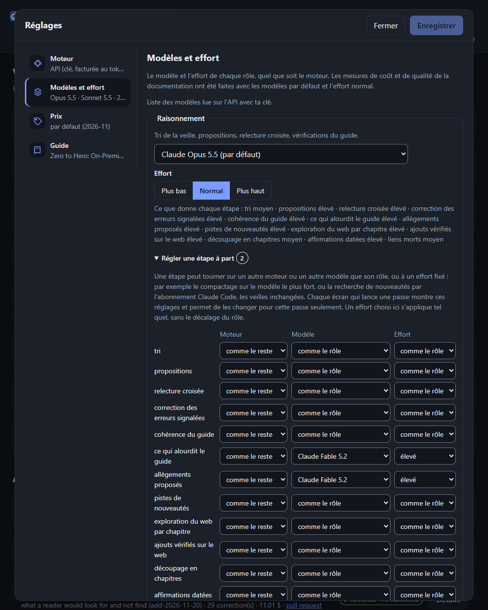

*[English version](../choose-a-model.md)*

# Choisir un modèle

Depuis la 0.6.0, l'agent tourne sur n'importe quel moteur : l'API Claude, Claude Code, ou tout serveur de l'API de
chat d'OpenAI, hébergé ou local ([Écrire un moteur](write-an-engine.md)). Tourner n'est pas bien faire le travail.
Cette page dit avec quels modèles l'agent est utilisé, ce qui a été essayé au-delà, et pourquoi rien de plus n'est
promis.

## Les modèles du guide IA on-premise

L'agent tient à jour le guide [Zero to Hero : IA on-premise](https://github.com/DamienBecherini/ia-on-prem-vault)
avec :

| Rôle | Étapes | Modèle |
| :-- | :-- | :-- |
| raisonnement | tri de la veille, propositions, relecture globale du guide, balayage | Claude Opus 5.5 |
| traduction | le miroir anglais des pages corrigées | Claude Sonnet 5.5 |

par l'API Claude (facturée au token) ou par Claude Code (l'abonnement). Chaque correction passe par l'écran de
relecture et une pull request qu'un humain fusionne : c'est cette relecture, pas un score, qui garantit le guide.

Ce sont les seuls modèles sur lesquels le projet s'engage. Avec un autre, le moteur fonctionne (il passe les
[tests de contrat](../../tests/engine_contract.py)), la qualité des corrections n'est pas mesurée, et il faut vérifier
ses propositions avant de croire une veille qui dit « rien à changer ».

## Ce que chaque étape demande au modèle

- **Tri** : lire les éléments de la veille et garder ceux qui peuvent toucher le guide. Des appels courts ; un
  modèle modeste y arrive.
- **Propositions** : décider, pour chaque élément gardé et ses extraits du guide, si une phrase est devenue fausse et
  comment la réécrire. L'étape de jugement : un modèle trop prudent répond « pas de changement » et la veille semble
  propre.
- **Relecture globale et balayage** : relire les corrections face au guide entier, avec le web, et trouver les
  autres pages qui énoncent le même fait. L'étape la plus longue, et celle d'où viennent la plupart des corrections
  (7 des 11 de la veille #77). Une fenêtre plus petite que le guide fait lire le guide par chapitre : plus d'appels,
  et un fait énoncé dans deux chapitres n'est plus vu d'une seule lecture.
- **Miroir** : traduire les passages corrigés. Un bon modèle de traduction suffit.

## Un modèle pour une seule étape

Les Réglages donnent un modèle et un effort à deux rôles : le raisonnement (tri, propositions, relecture croisée,
vérifications du guide, compactage, nouveautés, chapitres) et la traduction (le miroir, le contrôle des traductions). Une étape peut être
réglée à part de son rôle : « Modèles et effort », puis « Régler une étape à part » sous le rôle. Elle tourne
alors sur le modèle choisi pour elle, et à l'effort choisi pour elle s'il y en a un : cet effort s'applique tel
quel, alors que « plus bas » et « plus haut » du rôle décalent d'un cran toutes les autres étapes. Tout le reste
suit le rôle.

L'usage pour lequel c'est fait : le [compactage](compact.md) sur le modèle le plus fort, quelques fois par an,
pendant que les veilles restent sur le modèle mesuré ici. Les estimations et le journal des coûts
suivent le modèle de chaque étape. Dans `settings.json` :
`"steps": {"compaction": {"model": "claude-fable-5-2", "effort": "high"}}`.

Une étape peut aussi avoir son propre moteur (`"steps": {"news": {"engine": "claude-code"}}`) : la recherche de
nouveautés par un abonnement, par exemple, pendant que les veilles restent sur l'API. Sans modèle à elle, une telle
étape prend le modèle que son rôle a avec ce moteur. Si son moteur ne peut pas servir (l'API sans clé), l'erreur
arrive quand cette étape est demandée, pas avant.

Trois niveaux, du plus général au plus particulier :

| Niveau | Où | S'applique à |
| :-- | :-- | :-- |
| Les valeurs par défaut | L'agent lui-même | Une machine où rien n'a été réglé |
| Les Réglages | « Moteur », « Modèles et effort », « Régler une étape à part » | Tous les passages à partir de là |
| Ce passage seulement | « changer pour cette fois », à côté de chaque contrôle et sous « Moteur et modèles de cette passe » de « Signaler ou proposer » et de « Langues » ; « changer » sur la carte de chaque étape, dans les « Options » de la barre qui crée un passage à partir de pistes | Ce passage, jusqu'à sa dernière étape (les miroirs après la relecture) ; les Réglages ne sont pas touchés |

Chaque écran qui lance un passage montre ce qui fera tourner chacune de ses étapes (moteur, modèle, effort) et
comment c'est payé, avant le clic. Un moteur imposé à toute une commande (`VAULT_WATCH_ENGINE`) l'emporte sur les
trois.

## Ce que change chaque réglage

Ce que changent les Réglages, et ce que coûte ou risque chaque choix. Les chiffres de cette documentation ont été
mesurés avec les valeurs par défaut : Opus 5.5 et Sonnet 5.5, à l'effort normal, sur l'API.

| Réglage | Les choix | Ce qu'il change |
| :-- | :-- | :-- |
| Moteur | Automatique (Claude Code quand il est connecté avec un abonnement, sinon l'API), Claude Code, l'API, un serveur compatible OpenAI | Qui paie : Claude Code compte dans les limites de l'abonnement et ne facture rien ; l'API facture chaque token au prix public ([Coûts](costs.md)). Comment le web est lu : sur l'API, le modèle lit les pages qu'il ouvre ; sur Claude Code, un modèle plus petit lit chaque page et rapporte ce qu'il y a trouvé. Un passage s'arrête à une limite d'abonnement et reprend plus tard : l'agent ne passe jamais à l'API de lui-même |
| Modèle, par rôle | Raisonnement : tri, propositions, relecture croisée, vérifications du guide, compactage, nouveautés, chapitres. Traduction : les miroirs, le contrôle des traductions, les corrections de traductions | La qualité du travail : c'est aux propositions et à la relecture croisée qu'un modèle plus faible se voit, en répondant « rien à changer » ([Ce que chaque étape demande au modèle](#ce-que-chaque-étape-demande-au-modèle)). Le prix de chaque appel du rôle. La fenêtre : un modèle qui ne peut pas lire tout le guide le fait lire par chapitre ([Chapitres](chapters.md)) |
| Effort, par rôle | Plus bas, normal, plus haut | Chaque étape a son niveau dans le code (medium pour le tri, les chapitres, les liens morts et les étapes du traducteur ; high pour les autres). Ce réglage décale d'un cran chaque étape du rôle, entre low et max. Plus haut : plus de réflexion, donc plus de tokens en sortie, un passage plus lent et plus de coût ou de limites d'abonnement. Plus bas : l'inverse, pas mesuré sur le guide |
| Une étape à part | Son moteur, son modèle, son effort | Cette étape seule, telle que réglée : son effort s'applique tel quel, sans le décalage du rôle. Le compactage sur Fable 5.2, par exemple, environ deux fois le prix d'Opus 5.5 pour cette étape |
| Pour ce passage seulement | « changer pour cette fois », à côté de chaque contrôle et sous « Moteur et modèles de cette passe » de « Signaler ou proposer » et de « Langues » ; « changer » sur la carte de chaque étape, dans les « Options » de la barre qui crée un passage à partir de pistes | Les mêmes choix, pour un passage, jusqu'à ses miroirs ; les Réglages ne sont pas touchés |
| Prix | Fixés à la main, la liste publique, ou les valeurs par défaut | Les montants des estimations et du journal, jamais ce que fait l'agent ([d'où viennent les prix](costs.md#doù-viennent-les-prix)) |




Avec un serveur compatible OpenAI, d'autres réglages : son adresse, la référence de sa clé, la fenêtre du modèle
quand le serveur ne la donne pas (une fenêtre plus petite, c'est un guide lu par chapitre), la façon dont ses
réponses JSON sont faites (un schéma imposé par le serveur, ou donné dans les instructions), sa facturation (au
token au prix fixé dans « Prix », ou un modèle local, rien de facturé), l'envoi ou non de l'effort, et l'adresse
d'une instance SearXNG pour la recherche web : sans elle, le modèle peut lire les pages dont il a l'adresse mais ne
peut pas chercher, et les étapes qui vérifient sur le web le disent.

Certains choix ne sont pas dans les Réglages parce qu'ils se font à chaque passage. Les chapitres sur lesquels le
web est exploré, cochés sur la page « Vérifier le guide » (chacun coûte un appel). Ce que lit chaque piste d'un
passage d'ajouts, tout le guide ou ses pages et le plan du guide ([Nouveautés](news.md#les-ajouts)). Une piste
creusée. Et le budget web d'un appel est fixé dans le code : 20 recherches et 30 pages sur l'API, comme pour les
outils web de l'agent sur un serveur compatible OpenAI ; l'exploration d'un chapitre est priée de s'en tenir à
environ 12 recherches et 15 pages.

## Ce qui a été essayé

**Un modèle local sur un portable.** Qwen3.6-35B-A3B (llama.cpp, quantifié, fenêtre de 64k) sur un GPU de portable
de 8 Go. Il répond à chaque étape dans le schéma ; sur le guide exemple, lu en entier d'un seul appel, sa relecture
globale a trouvé la contradiction plantée entre deux chapitres. Sur la
veille #77 rejouée par extraits (sans relecture globale), il a gardé le bon élément, un avis de sécurité LiteLLM, a vu
que la version minimale du guide était inférieure à celle de l'avis, puis a refusé de changer la phrase : aucune
proposition, là où Claude Opus 5.5 en a fait trois, toutes justes. Un essai sur une veille : un signe, pas une mesure.

Les modèles capables de l'étape des propositions en local demandent bien plus de mémoire : une carte graphique de
32 Go ou plus, ou un moteur qui lit un grand modèle depuis le SSD (InferSSD ou équivalent) sur une telle carte. Le
projet n'en a pas : aucun modèle local n'est recommandé.

**Un modèle hébergé par le moteur compatible OpenAI.** Claude Haiku 5.5 par la couche OpenAI d'Anthropic, sur le
guide exemple seulement, pour essayer le moteur lui-même (schéma dans les instructions, recherche web par SearXNG,
facturation au token). Cela ne dit rien des autres modèles hébergés : pour un modèle Claude, prendre le moteur API
Claude.

## Mesurer son propre modèle

`vault-watch eval` rejoue une veille passée sur le guide tel qu'il était, jusqu'à la relecture, et compare les
propositions à la pull request qu'un humain a fusionnée ensuite :

```bash
vault-watch eval --issue 77 --at <commit avant la PR> --truth <base>..<head> --variant keyword --judge claude-code
```

`keyword` s'arrête avant la relecture globale (quelques minutes) ; `full` la fait (le guide entier, bien plus long sur
un modèle local). Lire le résultat avec ses limites :

- **Le juge est un modèle.** Il apparie chaque proposition aux morceaux du diff fusionné. Par défaut c'est un modèle
  Claude (`--judge api|claude-code`), pour qu'un modèle local ne se note pas lui-même ; mais Claude jugeant les
  propositions de Claude n'est pas neutre non plus. Lire l'appariement dans le fichier de résultat, pas seulement les
  chiffres.
- **La vérité, c'est ce que l'humain a fusionné.** Pour la veille #77, cette pull request était elle-même un run de
  l'agent sur Claude Opus, vérifié et fusionné par un humain : rejouer Opus mesure à quel point il refait un run
  relu, pas une vérité indépendante. Une veille traitée à la main (comme la #30) est un test plus juste.
- **Une veille est un cas.** Plusieurs veilles, de plusieurs natures (sécurité, versions, prix), avant de décider.

Les fichiers de résultat des essais ci-dessus sont dans [`metrics/eval/`](../../metrics/eval/).
