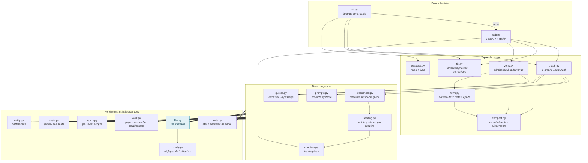
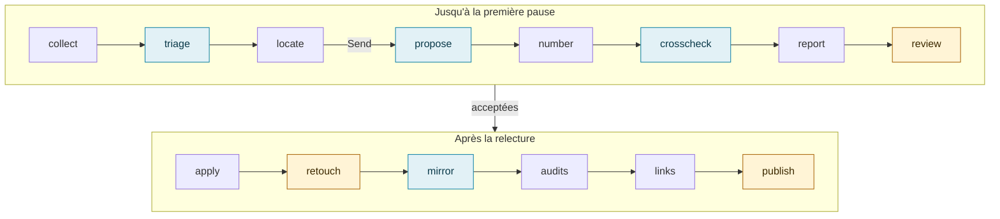
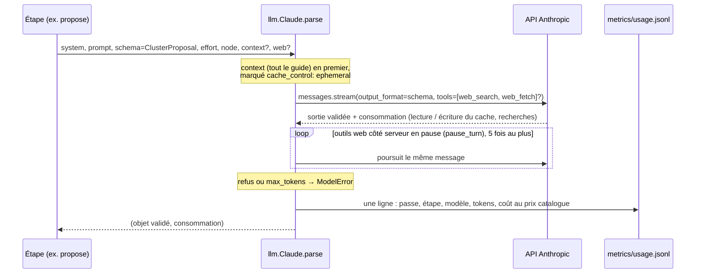
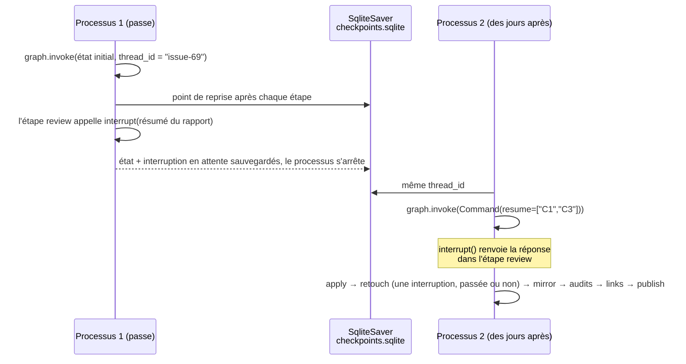
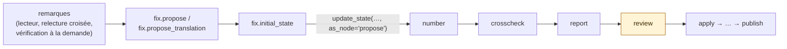

# vault-watch-agent : structure du code

**Un guide de lecture pour développeurs : les modules, l'état du graphe, où le modèle est appelé, et comment une passe en pause survit.**

[English](../code.md) · **Français** · [Présentation](presentation.md) · [README](../../README.fr.md)

---

Environ 12 800 lignes de Python dans [`src/vault_watch_agent/`](../../src/vault_watch_agent/), une page statique sans étape
de build (environ 5 300 lignes de JavaScript et de CSS), et des tests qui font tourner tout le graphe avec un faux modèle sur un dépôt git jetable. Commencez par
[`graph.py`](../../src/vault_watch_agent/graph.py) : tout le reste l'alimente ou le pilote.

## Les modules et leurs dépendances

Seuls les liens principaux sont dessinés ; le tableau ci-dessous donne le rôle de chaque module. Deux règles donnent sa forme au code :

- **Une seule porte vers le modèle.** Seuls [`llm.py`](../../src/vault_watch_agent/llm.py) et les moteurs qu'il charge appellent un modèle. Tous les autres modules reçoivent un objet doté d'une méthode
  `parse(system, prompt, schema, effort, node, context, web)` (le protocole `LLM`) : les tests le remplacent par un
  faux. Trois moteurs l'implémentent : `Claude` (l'API), `ClaudeCode` (`claude -p` sur un abonnement Claude) et
  `OpenAICompatible` (tout serveur compatible OpenAI, dans [`openai_compat.py`](../../src/vault_watch_agent/openai_compat.py)),
  et un autre paquet peut ajouter le sien (un point d'entrée `EngineKind`) ; `create(role, journal, settings)`
  choisit d'après les réglages de l'utilisateur.
- **Une seule porte vers le guide.** Lire, chercher et modifier les pages passe par
  [`vault.py`](../../src/vault_watch_agent/vault.py) ; les appels à `git` et aux scripts du guide passent par
  [`inputs.py`](../../src/vault_watch_agent/inputs.py), ceux de la forge (`gh`) par [`forge.py`](../../src/vault_watch_agent/forge.py). Le modèle ne touche jamais un fichier.

| Module | Lignes | Rôle |
| :-- | --: | :-- |
| `web.py` | 1840 | `create_app(settings)` : routes REST, server-sent events, tâches de fond, les données de chaque page (veilles, sources, vérifications, chapitres, coûts), réglages de l'utilisateur, avis pour les notifications de la page, la page statique |
| `graph.py` | 1053 | Construit le graphe (`build(deps, checkpointer)`), une fonction imbriquée par étape ; rapport, titre et texte de la PR |
| `cli.py` | 754 | `vault-watch init / doctor / run / resume / status / crosscheck / fix / news / chapters / mirror / compact / eval / prices / collect / costs / serve` ; trouve le guide, branche le checkpointer et les dépendances |
| `collect.py` | 702 | `vault-watch collect` : lit les flux du guide (GitHub, RSS, Hugging Face…), trie par règles, écrit un `watch.json` ; portage du collecteur du guide IA on-prem |
| `llm.py` | 678 | Les moteurs (API, Claude Code sur un abonnement, le moteur compatible OpenAI, et ceux d'autres paquets, `EngineKind`, protocole 1) : sortie structurée, cache de prompt, recherche et lecture web, capacités, journal des coûts |
| `verify.py` | 670 | Catalogue des contrôles (`Check`), estimations de coût, une fonction `run_*` par contrôle |
| `news.py` | 463 | Chercher les nouveautés : la consigne des pistes, ce que les veilles passées ont mis de côté (lu dans leurs rapports), les pistes trouvées sur le web chapitre par chapitre, les ajouts pour les pistes gardées, une piste par appel avec le web, sur les pages que la piste désigne et le plan du guide, ou sur tout le guide (`compact.in_calls` fait les appels) ; ce que deux appels ajoutent à la même page réuni |
| `links.py` | 269 | Une passe à partir de liens (D5) : chaque adresse lue en entier sans modèle (une page, le README d'un dépôt, un PDF avec `pypdf` en option ; une vidéo par dl-sub-dub, `videos.py`), puis un appel par lien avec tout le guide, sans le web, pour les pistes qu'il contient ; un contrôle de « Vérifier le guide » (`verify.run_links`) |
| `videos.py` | 149 | Le texte d'une vidéo par la route « texte d'une vidéo » de dl-sub-dub (contrat 1) : son état suivi jusqu'à la fin, le jeton lu depuis sa référence, ce qu'il dit quand il ne peut pas (occupé, arrêté, trop ancien) ; la description, les chapitres et les paroles du site en paragraphes avec leur heure |
| `mirrors.py` | 245 | Ce qui a changé dans une page source, en passages qu'un traducteur peut reporter dans son miroir (un paragraphe, une ligne de tableau, une ligne de liste, d'après git) ; les pages en avance sur leur miroir ; la branche et l'état d'une passe « Synchroniser les langues » |
| `proofread.py` | 155 | Les modifications de l'éditeur vérifiées avant une synchronisation (une option de la page « Langues »), ou pendant une passe quand il le demande (les nœuds `proofread` et `proofread_review` du graphe) : l'orthographe par le modèle de traduction, les faits sur le web par le modèle de raisonnement, la cohérence avec le reste du guide par la relecture croisée ; les corrections acceptées appliquées dans le dossier du guide |
| `retouch.py` | 175 | La pause pour retoucher les pages de la branche d'une passe : le dossier du guide prêté à la passe (détaché sur le dernier commit de la branche, ce qu'il contenait mis de côté dans une remise nommée d'après la passe), les retouches commitées au nom de l'éditeur, la branche avancée, le dossier rendu |
| `guide.py` | 414 | Le guide tel que le décrit son manifeste (`vault-watch.toml`) : pages, miroirs, veille, règles, contrôles, budget |
| `chapters.py` | 413 | Les chapitres d'un guide : ceux que son manifeste déclare, la règle automatique pour les autres pages, la proposition d'un modèle à partir du plan du guide, le manifeste réécrit sur une branche |
| `sourcecheck.py` | 386 | « Vérifier les sources » : interroge chaque source elle-même (réseau, sans modèle), relit le guide, propose des changements au fichier des flux et le réécrit pour une pull request |
| `compact.py` | 372 | Compactage : les consignes du rapport, des allègements et de leur relecture croisée ; les notes qu'un allègement laisse sans phrase retirées avec lui, un allègement qui laisserait une phrase citer une note retirée refusé ; `in_calls`, plusieurs appels qui partagent le guide en cache ou ne lisent que les pages qu'ils désignent |
| `vault.py` | 465 | Pages du guide, recherche par mots-clés avec extraits, contrôle de la citation exacte, application d'une modification (un passage retiré en entier ne laisse pas de trou), balayage des restes, les valeurs qu'aucune page ne dit plus |
| `onboard.py` | 348 | `init` (un manifeste d'après ce que montre un dépôt) et `doctor` (ce qui tournera, ce qui manque) |
| `openai_compat.py` | 323 | Le moteur compatible OpenAI (llama.cpp, vLLM, Ollama, un service hébergé) : sortie structurée, boucle des outils web, usage et coût |
| `crosscheck.py` | 266 | Seconde lecture des corrections avec tout le guide en cache dans le contexte (ou chapitre par chapitre), puis le balayage |
| `config.py` | 273 | Les réglages de l'utilisateur (`settings.json`) : moteur, modèles, prix, et la clé d'API sous forme de référence (`env:`, `sops:`, `file:`), jamais de valeur |
| `webtools.py` | 261 | Recherche web (SearXNG) et lecture de pages pour les moteurs sans web propre, et pour Claude Code ; adresses publiques seulement |
| `mcp_fetch.py` | 70 | Ce lecteur de pages offert à Claude Code en outil MCP local (`web_fetch`) à la place de son WebFetch : un serveur MCP minimal sur l'entrée et la sortie standard |
| `forge.py` | 229 | Issues, artefacts et pull requests derrière une interface `Forge` : GitHub (par `gh`) et Gitea (son API REST, un jeton par référence) ; `for_guide` prend celle du manifeste |
| `sizes.py` | 190 | Le poids de chaque page face à son budget, ses sections les plus lourdes, la croissance du guide lue dans Git ; sans modèle |
| `fix.py` | 205 | Transforme des remarques en propositions, puis en état initial qui entre dans le graphe après `propose` |
| `prices.py` | 182 | Le prix d'un modèle et son origine : celui de l'utilisateur, une liste téléchargée, les valeurs par défaut |
| `sources.py` | 179 | Ce que chaque flux de la veille a apporté et ce qu'il en est sorti, avec un verdict par règle, d'après les veilles et les passes gardées sur la machine ; sans modèle, sans réseau |
| `quotes.py` | 173 | Retrouve le passage dont parle une remarque : correspondance exacte, sinon la fenêtre de lignes la plus proche sur le texte normalisé |
| `evaluate.py` | 148 | Morceaux du diff fusionné par l'humain face aux propositions de l'agent, appariés par un modèle juge |
| `watches.py` | 140 | D'où viennent les veilles (`[watch] source`) : issues GitHub, fichiers `watch.json`, collecte de l'agent, aucune |
| `prompts.py` | 135 | Prompts système construits à partir de la charte éditoriale et de la politique de traduction du guide |
| `inputs.py` | 124 | La veille selon le contrat (`check_watch`), ses éléments retenus, son artefact ; les scripts du guide ; affirmations à revérifier |
| `state.py` | 129 | `WatchState` et les schémas Pydantic auxquels le modèle doit répondre |
| `reading.py` | 101 | Comment le guide est lu : en entier en un appel, ou chapitre par chapitre s'il dépasse la fenêtre du modèle |
| `costs.py` | 87 | Totaux de `metrics/usage.jsonl` par mois, année, passe ou étape ; les appels passés sur un abonnement à part |
| `steps.py` | 88 | Chaque étape qui appelle le modèle : son rôle, son effort, ce qu'elle demande à un moteur |
| `store.py` | 53 | La base des passes gardée légère : seul le dernier point de contrôle de chaque passe reste, l'espace est rendu au disque |
| `notify.py` | 110 | Notifications du bureau de `serve --notify` : Windows, macOS, Linux |

La page est du JavaScript sans outillage dans [`static/`](../../src/vault_watch_agent/static/), chargé tel quel :
`app.js` (le routeur, les textes dans les deux langues, chaque écran), `settings.js` (la fenêtre des Réglages),
`feedback.js` (« Donner mon avis »), `themes.js` et `boot.js` (clair ou sombre, les palettes, la taille du texte,
appliqués avant le premier affichage), `notify.js` (les notifications du navigateur), `rules.js` (ce qui peut être coché sur la
page d'une vérification).

## Le graphe, étape par étape

| Étape | Ce qu'elle appelle | Nature |
| :-- | :-- | :-- |
| `collect` | `inputs.download_watch`, `inputs.load_items`, `inputs.claims_due` |  |
| `triage` | `llm.parse(TriageResult)`, `prompts.triage` | Claude |
| `locate` | `vault.search`, `clusters()` ; puis `fan_out` renvoie un `Send` par groupe |  |
| `propose` | `llm.parse(ClusterProposal)`, `prompts.propose` | Claude |
| `number` | `vault.check`, `mark_unsafe`, `mark_conflicts` |  |
| `crosscheck` | `crosscheck.run` / `sweep` / `amend`, `vault.corpus`, `quotes.locate_all` | Claude |
| `report` | `render_report` |  |
| `review` | `interrupt()` | ⏸ humain |
| `apply` | `git worktree`, `vault.apply` |  |
| `mirror` | `mirrors.changed_pages`, `mirrors.edits_of`, `translator.parse(MirrorResult)`, `prompts.mirror` | Claude |
| `audits` | les contrôles du guide (`[checks] audits` de son manifeste) |  |
| `links` | `link_problems` |  |
| `publish` | `interrupt()`, `git push`, la pull request de la forge (`forge.py`) | ⏸ humain |

`build(deps, checkpointer)` reçoit une dataclass `Deps` : le chemin du guide et son dossier de travail, le modèle des
étapes de raisonnement (`llm`), celui des miroirs (`translator`), l'activation de la relecture croisée, le dépôt sur
sa forge et la branche de base, la date du jour. Les étapes sont des fonctions imbriquées qui capturent `deps` : un test construit le même graphe
avec des faux.

## L'état qui le traverse

`WatchState` ([`state.py`](../../src/vault_watch_agent/state.py)) est un `TypedDict` de valeurs JSON simples : une passe en
pause est sérialisée telle quelle par le checkpointer. Chaque étape ne renvoie que les clés qu'elle change.

`⊕` marque les deux clés qui ont un reducer (`Annotated[list, operator.add]`) : les branches `propose` parallèles
ajoutent leurs propositions et leur consommation de tokens au lieu de s'écraser. Les classes Pydantic sont
l'`output_format` des appels au modèle : une réponse qui ne valide pas est une erreur, pas une supposition.

## Un appel au modèle, de bout en bout

## Comment une passe se met en pause et reprend

La ligne de commande et la page web partagent le même fichier SQLite et les mêmes identifiants de passe : une passe
lancée depuis l'une peut être terminé depuis l'autre. Le serveur web fait tourner le graphe dans un thread de fond et
envoie `graph.stream(stream_mode="updates")` à la page en server-sent events.

## Les passes de correction entrent au milieu du graphe

Une passe de correction fait ses propres propositions, puis indique à LangGraph qu'elles sortent de `propose` : à partir
de `number`, c'est le même graphe, le même rapport, la même relecture et la même pull request qu'une veille. Le
`mode` de l'état dit de quelle sorte de passe il s'agit, et trois autres sortes entrent de la même façon : une
correction de traduction (`"translation"`, qui saute la relecture croisée), une passe de compactage (`"compact"`,
des allègements proposés par `compact.py`, avec une relecture croisée écrite pour eux) et une passe d'ajouts
(`"add"`, les pistes vérifiées sur le web par `news.py`). Une passe « Synchroniser les langues » (`"mirror"`,
`mirrors.py`) entre plus loin, comme si `apply` venait de tourner : sa branche porte les pages modifiées à la main, et
`mirror_since` dit de quel commit part la traduction de chaque page en avance sur son miroir.

## Tests

| Fichier | Ce qu'il couvre |
| :-- | :-- |
| [`tests/test_graph.py`](../../tests/test_graph.py) | Tout le graphe avec un `FakeLLM` qui répond selon le schéma demandé, sur un dépôt git jetable qui tient lieu de guide : les deux pauses, apply, mirror, texte de la PR |
| [`tests/test_web.py`](../../tests/test_web.py) | Les routes FastAPI, les tâches de fond, le contrat de santé |
| [`tests/test_quotes.py`](../../tests/test_quotes.py) | Retrouver un passage : correspondance exacte, fenêtre la plus proche |
| [`tests/test_costs.py`](../../tests/test_costs.py) | Totaux du journal des coûts |
| [`tests/test_llm.py`](../../tests/test_llm.py) | Le moteur Claude Code avec un faux `claude` : la commande lancée, ce qu'il en lit, ce qu'il refuse |
| [`tests/test_config.py`](../../tests/test_config.py) | Les réglages de l'utilisateur : valeurs par défaut, ce qui est refusé, une clé qui n'est jamais qu'une référence |
| [`tests/test_guide.py`](../../tests/test_guide.py), [`tests/test_onboard.py`](../../tests/test_onboard.py) | Le manifeste : ce qu'il accepte et refuse, le dossier de travail d'un guide ; `init` et `doctor` |
| [`tests/test_sample_guide.py`](../../tests/test_sample_guide.py) | Une passe entière sur le guide d'exemple de `examples/`, avec ses erreurs placées exprès |
| [`tests/test_engine_contract.py`](../../tests/test_engine_contract.py), [`tests/test_openai_compat.py`](../../tests/test_openai_compat.py) | Chaque moteur face aux mêmes réponses enregistrées ([Écrire un moteur](write-an-engine.md)) ; le moteur compatible OpenAI et ses outils web |
| [`tests/test_collect.py`](../../tests/test_collect.py), [`tests/test_sources.py`](../../tests/test_sources.py), [`tests/test_sourcecheck.py`](../../tests/test_sourcecheck.py) | La collecte d'une veille et son pré-tri ; ce que chaque source a apporté ; le contrôle des sources |
| [`tests/test_compact.py`](../../tests/test_compact.py), [`tests/test_sizes.py`](../../tests/test_sizes.py) | Le compactage : le rapport, les allègements, les notes retirées avec eux ; le poids et la croissance des pages |
| [`tests/test_news.py`](../../tests/test_news.py), [`tests/test_explore.py`](../../tests/test_explore.py), [`tests/test_chapters.py`](../../tests/test_chapters.py) | Les pistes, les ajouts (une piste par appel, ce que lit chaque appel, une piste restée sans vérification), le web exploré par chapitre ; les chapitres |
| [`tests/test_rules.py`](../../tests/test_rules.py) | Ce qui peut être coché sur la page d'un contrôle (`static/rules.js`, exécuté par node) : une piste creusée est toujours une piste cochée, quel que soit l'ordre des clics |
| [`tests/test_forge.py`](../../tests/test_forge.py) | GitHub et Gitea derrière la même interface |
| [`tests/test_network_guard.py`](../../tests/test_network_guard.py), [`tests/test_mcp_fetch.py`](../../tests/test_mcp_fetch.py), [`tests/test_pages_only.py`](../../tests/test_pages_only.py) | Le lecteur de pages n'atteint jamais la machine ni son réseau local (DNS rebinding, une adresse IPv6 qui porte une IPv4 privée, une redirection) ; l'outil MCP que reçoit Claude Code ; une correction ne touche qu'une page de contenu du guide ou son miroir |
| [`tests/test_page_smoke.py`](../../tests/test_page_smoke.py) | Chaque écran de la page dessiné dans un Chrome sans interface, en français et en anglais, sans erreur JavaScript ni « undefined » affiché |

Aucun test n'appelle la vraie API ni le vrai Claude Code. `vault-watch eval` est la mesure sur de vraies veilles (résultats dans
[`metrics/eval/`](../../metrics/eval/)).

## Par où commencer la lecture

1. [`state.py`](../../src/vault_watch_agent/state.py) : ce qu'une passe sait à chaque étape.
2. [`graph.py`](../../src/vault_watch_agent/graph.py), `build()` : les étapes et les arêtes, puis l'étape qui vous intéresse.
3. [`llm.py`](../../src/vault_watch_agent/llm.py) : les moteurs, cache, outils web, journal des coûts.
4. [`vault.py`](../../src/vault_watch_agent/vault.py), `check()` et `apply()` : pourquoi le modèle ne peut pas abîmer une
   page.
5. [`web.py`](../../src/vault_watch_agent/web.py) ou [`cli.py`](../../src/vault_watch_agent/cli.py) : comment les passes sont
   lancées, mises en pause et reprises.

Les schémas sont en Mermaid : GitHub les affiche ; dans VS Code ou Cursor, l'aperçu Markdown a besoin de l'extension
*Markdown Preview Mermaid Support*.
