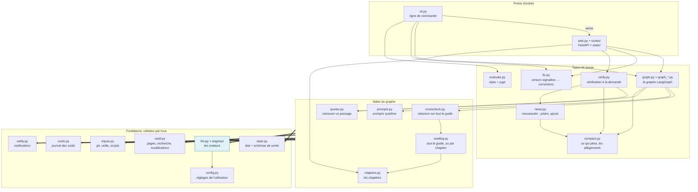
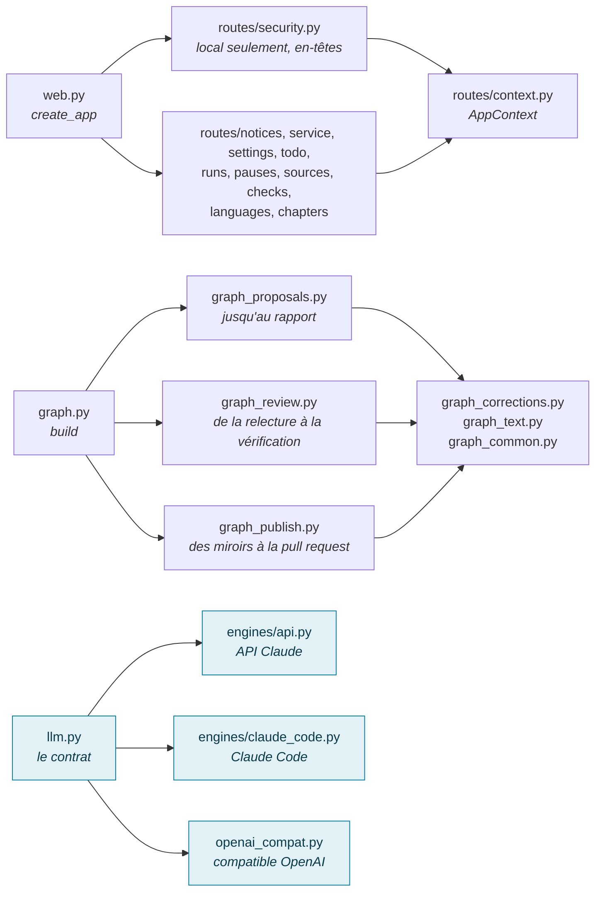
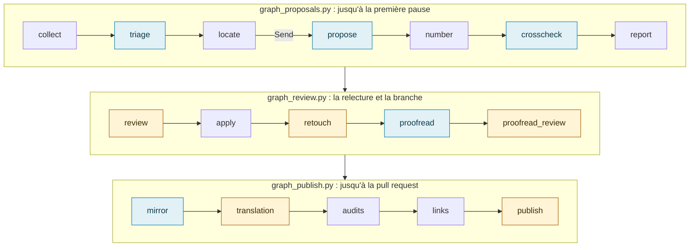
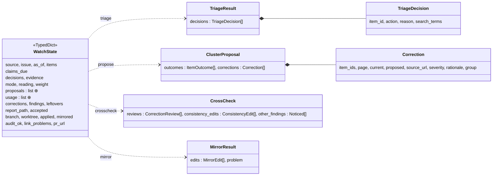
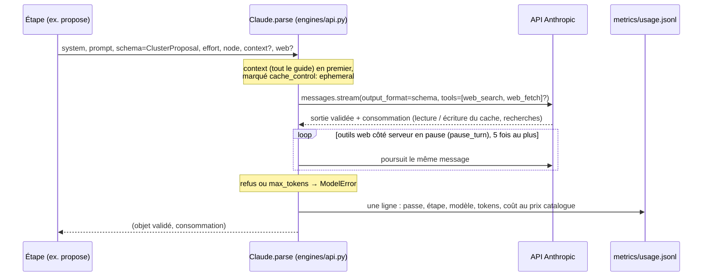
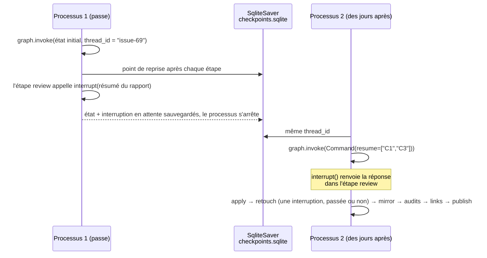
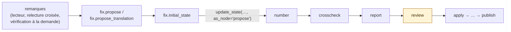

<div align="center">

# vault-watch-agent : structure du code

**Un guide de lecture pour développeurs : les modules, l'état du graphe, où le modèle est appelé, et comment une passe en pause survit.**

[English](../code.md) · **Français** · [Présentation](presentation.md) · [README](../../README.fr.md)

</div>

---

Environ 14 100 lignes de Python dans [`src/vault_watch_agent/`](../../src/vault_watch_agent/), une page statique sans étape
de build (environ 5 800 lignes de JavaScript et de CSS, des modules ES vérifiés par TypeScript), et des tests qui font tourner tout le graphe avec un faux modèle sur un dépôt git jetable. Commencez par
[`graph.py`](../../src/vault_watch_agent/graph.py) : tout le reste l'alimente ou le pilote.

## Les modules et leurs dépendances



Trois de ces modules sont découpés par domaine. `web.py` construit l'application à partir d'un routeur par partie de
la page, `graph.py` relie des étapes écrites dans un module par partie de la passe, et `llm.py` garde le contrat sur
lequel s'appuie le module de chaque moteur :



Seuls les liens principaux sont dessinés ; les tableaux ci-dessous donnent le rôle de chaque module. Deux règles donnent sa forme au code :

- **Une seule porte vers le modèle.** Seuls [`llm.py`](../../src/vault_watch_agent/llm.py) et les moteurs qu'il charge appellent un modèle. Tous les autres modules reçoivent un objet doté d'une méthode
  `parse(system, prompt, schema, effort, node, context, web)` (le protocole `LLM`) : les tests le remplacent par un
  faux. Trois moteurs l'implémentent, chacun dans son module avec son `KIND` : `Claude` (l'API,
  [`engines/api.py`](../../src/vault_watch_agent/engines/api.py)), `ClaudeCode` (`claude -p` sur un abonnement Claude,
  [`engines/claude_code.py`](../../src/vault_watch_agent/engines/claude_code.py)) et `OpenAICompatible` (tout serveur
  compatible OpenAI, dans [`openai_compat.py`](../../src/vault_watch_agent/openai_compat.py)),
  et un autre paquet peut ajouter le sien (un point d'entrée `EngineKind`) ; `create(role, journal, settings)`
  choisit d'après les réglages de l'utilisateur.
- **Une seule porte vers le guide.** Lire, chercher et modifier les pages passe par
  [`vault.py`](../../src/vault_watch_agent/vault.py) ; les appels à `git` et aux scripts du guide passent par
  [`inputs.py`](../../src/vault_watch_agent/inputs.py), ceux de la forge (`gh`) par [`forge.py`](../../src/vault_watch_agent/forge.py). Le modèle ne touche jamais un fichier.

| Module | Lignes | Rôle |
| :-- | --: | :-- |
| `web.py` | 83 | `create_app(settings)` : l'application construite à partir des routeurs de `routes/` (plus bas), la page statique avec une version dans l'adresse de ses fichiers ; les noms que le module avait avant le départ de ses routes s'importent toujours depuis lui |
| `graph.py` | 94 | Construit le graphe (`build(deps, checkpointer)`) : les étapes et les arêtes. Chaque étape est une fonction `node(deps, state)` du module de sa partie de la passe, liée à `deps` par `functools.partial` |
| `graph_proposals.py` | 258 | Les étapes jusqu'à la relecture, en lecture seule : `collect`, `triage`, `locate` et `fan_out` (les groupes d'éléments, `clusters`), `propose`, `number`, `crosscheck`, `report` |
| `graph_review.py` | 212 | Les étapes de la relecture et de la branche : `review`, `apply`, `retouch`, `proofread`, `proofread_review` |
| `graph_publish.py` | 249 | Les étapes de la branche à la pull request : `mirror`, `translation`, `audits`, `links`, `publish` ; `correct_again`, ce que la pause de publication renvoie (une vérification, une traduction ou une relecture de plus) |
| `graph_corrections.py` | 101 | Les contrôles gratuits des corrections (`mark_unsafe`, `mark_conflicts` : une modification qui ne change rien, une note perdue, deux modifications du même passage) et les retouches de l'éditeur à la relecture (`retouchable`, `retouched`) |
| `graph_text.py` | 304 | Ce qu'une passe écrit pour les humains : le rapport, les lignes de consommation et de poids, le titre et la description de la pull request |
| `graph_common.py` | 51 | Ce que les étapes partagent : `Deps`, git dans un worktree, l'ordre des propositions, la branche d'une passe |
| `cli.py` | 771 | `vault-watch init / doctor / run / resume / status / crosscheck / fix / news / chapters / mirror / compact / eval / prices / collect / costs / serve` ; trouve le guide, branche le checkpointer et les dépendances |
| `collect.py` | 702 | `vault-watch collect` : lit les flux du guide (GitHub, RSS, Hugging Face…), trie par règles, écrit un `watch.json` ; portage du collecteur du guide IA on-prem |
| `llm.py` | 442 | Le contrat que tient chaque moteur : les protocoles `LLM` et `Engine`, `ModelError`, les efforts, `Capabilities`, le journal des coûts (`_Journal`), `EngineKind` et `engines()` (protocole 1) ; `engine()` et `create`, le moteur d'un rôle (`Routed` quand des étapes sont réglées à part) ; si Claude Code est installé et connecté |
| `engines/api.py` | 190 | `Claude`, l'API Claude par le SDK officiel, facturée au token : sortie structurée, cache de prompt, recherche et lecture web côté serveur, limites de sortie lues dans l'API Models |
| `engines/claude_code.py` | 157 | `ClaudeCode`, Claude Code sur un abonnement Claude, `claude -p` une fois par appel ; le lecteur de pages de l'agent offert comme son `web_fetch` |
| `engines/__init__.py` | 13 | Le paquet des moteurs ; il charge d'abord le contrat de `llm.py` |
| `openai_compat.py` | 336 | Le moteur compatible OpenAI (llama.cpp, vLLM, Ollama, un service hébergé) : sortie structurée, boucle des outils web, usage et coût |
| `verify.py` | 677 | Catalogue des contrôles (`Check`), estimations de coût, une fonction `run_*` par contrôle |
| `news.py` | 463 | Chercher les nouveautés : la consigne des pistes, ce que les veilles passées ont mis de côté (lu dans leurs rapports), les pistes trouvées sur le web chapitre par chapitre, les ajouts pour les pistes gardées, une piste par appel avec le web, sur les pages que la piste désigne et le plan du guide, ou sur tout le guide (`compact.in_calls` fait les appels) ; ce que deux appels ajoutent à la même page réuni |
| `links.py` | 269 | Une passe à partir de liens (D5) : chaque adresse lue en entier sans modèle (une page, le README d'un dépôt, un PDF avec `pypdf` en option ; une vidéo par dl-sub-dub, `videos.py`), puis un appel par lien avec tout le guide, sans le web, pour les pistes qu'il contient ; un contrôle de « Vérifier le guide » (`verify.run_links`) |
| `videos.py` | 230 | Le texte d'une vidéo par la route « texte d'une vidéo » de dl-sub-dub (contrat 1) : dl-sub-dub démarré quand il ne répond pas (la commande de `videos.start`, réglée à la main dans `settings.json`), son état suivi jusqu'à la fin, le jeton lu depuis sa référence, ce qu'il dit quand il ne peut pas (occupé, arrêté, trop ancien) ; la description, les chapitres et les paroles du site en paragraphes avec leur heure |
| `mirrors.py` | 245 | Ce qui a changé dans une page source, en passages qu'un traducteur peut reporter dans son miroir (un paragraphe, une ligne de tableau, une ligne de liste, d'après git) ; les pages en avance sur leur miroir ; la branche et l'état d'une passe « Synchroniser les langues » |
| `proofread.py` | 155 | Les modifications de l'éditeur vérifiées avant une synchronisation (une option de la page « Langues »), ou pendant une passe quand il le demande (les nœuds `proofread` et `proofread_review` du graphe) : l'orthographe par le modèle de traduction, les faits sur le web par le modèle de raisonnement, la cohérence avec le reste du guide par la relecture croisée ; les corrections acceptées appliquées dans le dossier du guide |
| `retouch.py` | 175 | La pause pour retoucher les pages de la branche d'une passe : le dossier du guide prêté à la passe (détaché sur le dernier commit de la branche, ce qu'il contenait mis de côté dans une remise nommée d'après la passe), les retouches commitées au nom de l'éditeur, la branche avancée, le dossier rendu |
| `guide.py` | 435 | Le guide tel que le décrit son manifeste (`vault-watch.toml`) : pages, miroirs, veille, règles, contrôles, budget ; un dossier sans manifeste refusé, le guide IA on-prem à part |
| `chapters.py` | 413 | Les chapitres d'un guide : ceux que son manifeste déclare, la règle automatique pour les autres pages, la proposition d'un modèle à partir du plan du guide, le manifeste réécrit sur une branche |
| `sourcecheck.py` | 386 | « Vérifier les sources » : interroge chaque source elle-même (réseau, sans modèle), relit le guide, propose des changements au fichier des flux et le réécrit pour une pull request |
| `compact.py` | 372 | Compactage : les consignes du rapport, des allègements et de leur relecture croisée ; les notes qu'un allègement laisse sans phrase retirées avec lui, un allègement qui laisserait une phrase citer une note retirée refusé ; `in_calls`, plusieurs appels qui partagent le guide en cache ou ne lisent que les pages qu'ils désignent |
| `vault.py` | 465 | Pages du guide, recherche par mots-clés avec extraits, contrôle de la citation exacte, application d'une modification (un passage retiré en entier ne laisse pas de trou), balayage des restes, les valeurs qu'aucune page ne dit plus |
| `onboard.py` | 355 | `init` (un manifeste d'après ce que montre un dépôt) et `doctor` (ce qui tournera, ce qui manque) |
| `crosscheck.py` | 266 | Seconde lecture des corrections avec tout le guide en cache dans le contexte (ou chapitre par chapitre), puis le balayage |
| `config.py` | 273 | Les réglages de l'utilisateur (`settings.json`) : moteur, modèles, prix, et la clé d'API sous forme de référence (`env:`, `sops:`, `file:`), jamais de valeur |
| `webtools.py` | 261 | Recherche web (SearXNG) et lecture de pages pour les moteurs sans web propre, et pour Claude Code ; adresses publiques seulement |
| `mcp_fetch.py` | 70 | Ce lecteur de pages offert à Claude Code en outil MCP local (`web_fetch`) à la place de son WebFetch : un serveur MCP minimal sur l'entrée et la sortie standard |
| `forge.py` | 229 | Issues, artefacts et pull requests derrière une interface `Forge` : GitHub (par `gh`) et Gitea (son API REST, un jeton par référence) ; `for_guide` prend celle du manifeste |
| `sizes.py` | 190 | Le poids de chaque page face à son budget, ses sections les plus lourdes, la croissance du guide lue dans Git ; sans modèle |
| `fix.py` | 206 | Transforme des remarques en propositions, puis en état initial qui entre dans le graphe après `propose` |
| `prices.py` | 182 | Le prix d'un modèle et son origine : celui de l'utilisateur, une liste téléchargée, les valeurs par défaut |
| `sources.py` | 179 | Ce que chaque flux de la veille a apporté et ce qu'il en est sorti, avec un verdict par règle, d'après les veilles et les passes gardées sur la machine ; sans modèle, sans réseau |
| `quotes.py` | 173 | Retrouve le passage dont parle une remarque : correspondance exacte, sinon la fenêtre de lignes la plus proche sur le texte normalisé |
| `evaluate.py` | 148 | Morceaux du diff fusionné par l'humain face aux propositions de l'agent, appariés par un modèle juge |
| `watches.py` | 141 | D'où viennent les veilles (`[watch] source`) : issues GitHub, fichiers `watch.json`, collecte de l'agent, aucune |
| `prompts.py` | 135 | Prompts système construits à partir de la charte éditoriale et de la politique de traduction du guide |
| `inputs.py` | 124 | La veille selon le contrat (`check_watch`), ses éléments retenus, son artefact ; les scripts du guide ; affirmations à revérifier |
| `state.py` | 137 | `WatchState` et les schémas Pydantic auxquels le modèle doit répondre |
| `reading.py` | 101 | Comment le guide est lu : en entier en un appel, ou chapitre par chapitre s'il dépasse la fenêtre du modèle |
| `costs.py` | 87 | Totaux de `metrics/usage.jsonl` par mois, année, passe ou étape ; les appels passés sur un abonnement à part |
| `steps.py` | 89 | Chaque étape qui appelle le modèle : son rôle, son effort, ce qu'elle demande à un moteur |
| `store.py` | 53 | La base des passes gardée légère : seul le dernier point de contrôle de chaque passe reste, l'espace est rendu au disque |
| `notify.py` | 110 | Notifications du bureau de `serve --notify` : Windows, macOS, Linux |
| `explain.py` | 94 | Les explications d'une pause dans la langue de la page (`/api/explain`) : un appel du modèle de traduction pour les lignes pas encore traduites, chaque ligne gardée |

Les routes du serveur sont dans [`routes/`](../../src/vault_watch_agent/routes/), un module par partie de la page.
Chacun a un `router(ctx)` qui construit son routeur FastAPI à partir du contexte de l'application ; `web.create_app` les inclut tous :

| Module | Lignes | Rôle |
| :-- | --: | :-- |
| `context.py` | 401 | `AppContext`, ce que les routeurs partagent : les `Settings` du serveur, les tâches de fond (`Job`), les points de reprise et le graphe qui les lit, `read_json` et `write_json`, le résumé d'une passe, l'état des pull requests, la pause où une passe attend |
| `security.py` | 76 | Local seulement : le middleware qui refuse un Host qui n'est pas local, une requête qu'un autre site fait envoyer au navigateur (`Sec-Fetch-Site`, `Origin`) et une requête de l'API sans l'en-tête `X-Vault-Watch` ; les en-têtes de chaque réponse (`Content-Security-Policy`, `X-Frame-Options`, `Cache-Control: no-cache` sur la page et ses fichiers) |
| `notices.py` | 69 | Ce que l'humain doit faire ensuite quand une tâche de fond s'arrête : sur le bureau (`serve --notify`) et dans la page dont la cloche est activée |
| `service.py` | 91 | Le serveur lui-même : santé, informations, coûts, les explications d'une pause |
| `settings.py` | 159 | « Réglages » : les étapes, les modèles, les réglages de l'utilisateur, les prix |
| `todo.py` | 92 | « À traiter » : les veilles, une nouvelle veille collectée, le dossier du guide (« Mettre à jour mon dossier ») |
| `runs.py` | 268 | Les passes : la liste, une passe, son rapport, son diff et le flux de ses étapes ; une veille analysée, des remarques ou des pistes envoyées à une passe de correction, une passe reprise après une erreur |
| `pauses.py` | 221 | Les réponses aux pauses d'une passe : la relecture, les retouches (le dossier de la passe, le dossier du guide qui lui est prêté), la vérification des modifications, la traduction, la publication |
| `sources.py` | 181 | « Sources suivies » : ce que chaque flux a apporté, le contrôle des sources et ses propositions |
| `checks.py` | 309 | « Vérifier le guide » : les vérifications, leurs pistes et leurs notes, leurs estimations ; l'état de dl-sub-dub pour les vidéos |
| `languages.py` | 236 | « Langues » : les miroirs, « Synchroniser les langues », les modifications de l'éditeur vérifiées avant la synchronisation |
| `chapters.py` | 117 | « Chapitres » : les chapitres vus, proposés par un modèle, déclarés par une pull request |
| `__init__.py` | 2 | Le paquet des routes |

La page est dans [`static/`](../../src/vault_watch_agent/static/) : des modules ES servis tels quels, sans étape de build.
`index.html` charge `app.js` comme module, qui importe les autres ; `boot.js` reste un script classique dans `<head>`,
pour que le mode, la palette et la taille du texte s'appliquent avant le premier affichage. Chaque script commence par
`// @ts-check` : [`jsconfig.json`](../../jsconfig.json) à la racine du dépôt et les deux globales de `boot.js`
déclarées dans [`types/page.d.ts`](../../types/page.d.ts) permettent à TypeScript de les vérifier, sans rien construire.
Chaque réponse sous `/static/` porte `Cache-Control: no-cache` : le navigateur redemande chaque module (un 304 quand il
n'a pas changé), si bien qu'une mise à jour ne laisse jamais un ancien module à côté d'un nouveau.

| Fichier | Lignes | Rôle |
| :-- | --: | :-- |
| `index.html` | 42 | La page : l'en-tête, `boot.js`, le style, `app.js` comme module |
| `boot.js` | 107 | Avant le premier affichage (un script classique) : clair ou sombre, la palette, la taille du texte |
| `app.js` | 33 | Le module d'entrée : l'en-tête, les notifications, le premier écran |
| `util.js` | 91 | Les aides de chaque écran : le DOM, le HTML échappé, les liens hors de la page et vers Obsidian, une bulle d'aide |
| `api.js` | 22 | Les appels à l'API du serveur, et ce que le serveur dit de lui-même (`/api/info`) |
| `texts.js` | 907 | Les textes de l'interface en français et en anglais (`T`) |
| `explain.js` | 39 | Les lignes qu'un modèle ou un contrôle a écrites en anglais, montrées dans la langue de l'interface |
| `header.js` | 103 | L'en-tête et ses menus |
| `router.js` | 65 | Quel écran l'adresse affiche |
| `steps.js` | 120 | Le moteur, le modèle et l'effort des étapes d'une passe, et ce que coûte une action |
| `watches.js` | 195 | « À traiter », la veille automatique, toutes les passes, le dossier du guide |
| `run.js` | 89 | Une passe : son écran choisi d'après son état, ses étapes pendant qu'elle tourne, sa fin |
| `review.js` | 184 | La relecture des corrections d'une passe |
| `retouch.js` | 165 | La pause des retouches, et le bandeau tant que le dossier du guide est prêté |
| `proofread.js` | 98 | Les corrections d'une vérification des modifications, cochées et retouchées |
| `translation.js` | 65 | La pause de la traduction d'une passe « Synchroniser les langues » |
| `pairs.js` | 72 | Quel passage traduit va à côté de quel passage de la source (`alignPairs`) |
| `publish.js` | 188 | La pause avant la publication |
| `diff.js` | 47 | Ce qui a changé, mot à mot |
| `editor.js` | 126 | Les passages qu'une passe a changés, surlignés dans une zone de texte |
| `checks.js` | 153 | « Vérifier le guide » : les vérifications à lancer, celles qui ont des pistes à trier, l'historique |
| `check.js` | 340 | La page d'une vérification : ses résultats et ses pistes |
| `rules.js` | 33 | Ce qui peut être coché sur la page d'une vérification |
| `report.js` | 125 | « Signaler ou proposer » |
| `sources.js` | 203 | « Sources suivies » |
| `languages.js` | 154 | « Langues » |
| `chapters.js` | 128 | « Chapitres » |
| `costs.js` | 26 | « Coûts » |
| `themes.js` | 325 | L'apparence de la page : taille du texte, clair ou sombre, les palettes, la fenêtre Thème |
| `notify.js` | 91 | Les notifications du navigateur, la cloche |
| `settings.js` | 641 | La fenêtre des Réglages |
| `feedback.js` | 214 | « Donner mon avis » |
| `style.css` | 670 | Le style de chaque écran |

## Le graphe, étape par étape



| Étape | Module | Ce qu'elle appelle | Nature |
| :-- | :-- | :-- | :-- |
| `collect` | `graph_proposals.py` | `inputs.download_watch`, `inputs.load_items`, `inputs.claims_due` |  |
| `triage` | `graph_proposals.py` | `llm.parse(TriageResult)`, `prompts.triage` | modèle |
| `locate` | `graph_proposals.py` | `vault.search` ; puis `fan_out` forme les groupes (`clusters`) et renvoie un `Send` par groupe |  |
| `propose` | `graph_proposals.py` | `llm.parse(ClusterProposal)`, `prompts.propose`, `vault.check` | modèle |
| `number` | `graph_proposals.py` | `mark_conflicts` et `mark_unsafe` (`graph_corrections.py`) ; `news.merge` pour des ajouts, `compact.with_orphan_notes` pour des allègements |  |
| `crosscheck` | `graph_proposals.py` | `reading.plan`, `crosscheck.run` / `amend` / `sweep`, `vault.leftovers` | modèle |
| `report` | `graph_proposals.py` | `render_report` (`graph_text.py`) |  |
| `review` | `graph_review.py` | `interrupt()` ; `retouched` pour les textes que l'éditeur a retouchés | ⏸ humain |
| `apply` | `graph_review.py` | `git worktree`, `vault.apply` |  |
| `retouch` | `graph_review.py` | `interrupt()`, `retouch.commit` | ⏸ humain |
| `proofread` | `graph_review.py` | `proofread.run`, seulement quand l'éditeur l'a demandé | modèle |
| `proofread_review` | `graph_review.py` | `interrupt()` quand la vérification a trouvé quelque chose, `proofread.accept` | ⏸ humain |
| `mirror` | `graph_publish.py` | `mirrors.changed_pages`, `mirrors.edits_of`, `translator.parse(MirrorResult)`, `prompts.mirror` | modèle |
| `translation` | `graph_publish.py` | `interrupt()` dans une passe « Synchroniser les langues », `vault.apply` | ⏸ humain |
| `audits` | `graph_publish.py` | les contrôles du guide (`[checks] audits` de son manifeste) |  |
| `links` | `graph_publish.py` | `link_problems` |  |
| `publish` | `graph_publish.py` | `interrupt()`, `git push`, la pull request de la forge (`forge.py`), `pr_title` et `pr_body` (`graph_text.py`) | ⏸ humain |

`build(deps, checkpointer)` reçoit une dataclass `Deps` (`graph_common.py`) : le chemin du guide et son dossier de
travail, le modèle des étapes de raisonnement (`llm`), celui des miroirs (`translator`), l'activation de la relecture
croisée, le dépôt sur sa forge et la branche de base, la date du jour. Chaque étape est une simple fonction de `deps`
et de l'état ; `build` lui lie `deps` par `functools.partial` : un test construit le même graphe avec des faux, ou
appelle une étape seule.

## L'état qui le traverse

`WatchState` ([`state.py`](../../src/vault_watch_agent/state.py)) est un `TypedDict` de valeurs JSON simples : une passe en
pause est sérialisée telle quelle par le checkpointer. Chaque étape ne renvoie que les clés qu'elle change.



`⊕` marque les deux clés qui ont un reducer (`Annotated[list, operator.add]`) : les branches `propose` parallèles
ajoutent leurs propositions et leur consommation de tokens au lieu de s'écraser. Les classes Pydantic sont
l'`output_format` des appels au modèle : une réponse qui ne valide pas est une erreur, pas une supposition.

## Un appel au modèle, de bout en bout



## Comment une passe se met en pause et reprend



La ligne de commande et la page web partagent le même fichier SQLite et les mêmes identifiants de passe : une passe
lancée depuis l'une peut être terminée depuis l'autre. Le serveur web fait tourner le graphe dans un thread de fond et
envoie `graph.stream(stream_mode="updates")` à la page en server-sent events (`AppContext` dans
[`routes/context.py`](../../src/vault_watch_agent/routes/context.py)).

## Les passes de correction entrent au milieu du graphe



Une passe de correction fait ses propres propositions, puis indique à LangGraph qu'elles sortent de `propose` : à partir
de `number`, c'est le même graphe, le même rapport, la même relecture et la même pull request qu'une veille. Le
`mode` de l'état dit de quelle sorte de passe il s'agit, et trois autres sortes entrent de la même façon : une
correction de traduction (`"translation"`, qui saute la relecture croisée), une passe de compactage (`"compact"`,
des allègements proposés par `compact.py`, avec une relecture croisée écrite pour eux) et une passe d'ajouts
(`"add"`, les pistes vérifiées sur le web par `news.py`). Une passe « Synchroniser les langues » (`"mirror"`,
`mirrors.py`) entre plus loin, comme si `apply` venait de tourner : sa branche porte les pages modifiées à la main, et
`mirror_since` dit de quel commit part la traduction de chaque page en avance sur son miroir.

## Tests

| Fichier | Ce qu'il couvre |
| :-- | :-- |
| [`tests/test_graph.py`](../../tests/test_graph.py) | Tout le graphe avec un `FakeLLM` qui répond selon le schéma demandé, sur un dépôt git jetable qui tient lieu de guide : les deux pauses, apply, mirror, texte de la PR |
| [`tests/test_web.py`](../../tests/test_web.py) | Les routes FastAPI, par `create_app` ; les tâches de fond, le contrat de santé |
| [`tests/test_quotes.py`](../../tests/test_quotes.py) | Retrouver un passage : correspondance exacte, fenêtre la plus proche |
| [`tests/test_costs.py`](../../tests/test_costs.py) | Totaux du journal des coûts |
| [`tests/test_llm.py`](../../tests/test_llm.py) | Le moteur Claude Code avec un faux `claude` : la commande lancée, ce qu'il en lit, ce qu'il refuse |
| [`tests/test_config.py`](../../tests/test_config.py) | Les réglages de l'utilisateur : valeurs par défaut, ce qui est refusé, une clé qui n'est jamais qu'une référence |
| [`tests/test_guide.py`](../../tests/test_guide.py), [`tests/test_onboard.py`](../../tests/test_onboard.py) | Le manifeste : ce qu'il accepte et refuse, le dossier de travail d'un guide ; `init` et `doctor` |
| [`tests/test_sample_guide.py`](../../tests/test_sample_guide.py) | Une passe entière sur le guide d'exemple de `examples/`, avec ses erreurs placées exprès |
| [`tests/test_engine_contract.py`](../../tests/test_engine_contract.py), [`tests/test_openai_compat.py`](../../tests/test_openai_compat.py) | Chaque moteur face aux mêmes réponses enregistrées ([Écrire un moteur](write-an-engine.md)) ; le moteur compatible OpenAI et ses outils web |
| [`tests/test_collect.py`](../../tests/test_collect.py), [`tests/test_sources.py`](../../tests/test_sources.py), [`tests/test_sourcecheck.py`](../../tests/test_sourcecheck.py) | La collecte d'une veille et son pré-tri ; ce que chaque source a apporté ; le contrôle des sources |
| [`tests/test_compact.py`](../../tests/test_compact.py), [`tests/test_sizes.py`](../../tests/test_sizes.py) | Le compactage : le rapport, les allègements, les notes retirées avec eux ; le poids et la croissance des pages |
| [`tests/test_news.py`](../../tests/test_news.py), [`tests/test_explore.py`](../../tests/test_explore.py), [`tests/test_chapters.py`](../../tests/test_chapters.py) | Les pistes, les ajouts (une piste par appel, ce que lit chaque appel, une piste restée sans vérification), le web exploré par chapitre ; les chapitres |
| [`tests/test_links.py`](../../tests/test_links.py), [`tests/test_videos.py`](../../tests/test_videos.py) | Une passe à partir de liens, chacun lu en entier sans modèle ; le texte d'une vidéo, face à un faux dl-sub-dub qui répond comme le dit son contrat |
| [`tests/test_mirrors.py`](../../tests/test_mirrors.py), [`tests/test_retouch.py`](../../tests/test_retouch.py), [`tests/test_proofread.py`](../../tests/test_proofread.py), [`tests/test_proofread_run.py`](../../tests/test_proofread_run.py) | Les passages qui ont changé dans une page source ; une proposition retouchée à la relecture ; les modifications de l'éditeur vérifiées avant une synchronisation et pendant une passe |
| [`tests/test_explain.py`](../../tests/test_explain.py) | Les explications d'une pause dans la langue de la page : un appel pour les lignes pas encore traduites, un modèle qui échoue laisse l'anglais |
| [`tests/test_steps.py`](../../tests/test_steps.py), [`tests/test_step_engine.py`](../../tests/test_step_engine.py) | Une étape réglée à part de son rôle : son modèle, son effort ou son moteur, dans les Réglages ou pour une passe |
| [`tests/test_rules.py`](../../tests/test_rules.py) | Ce qui peut être coché sur la page d'un contrôle (`static/rules.js`, exécuté par node comme module ES) : une piste creusée est toujours une piste cochée, quel que soit l'ordre des clics |
| [`tests/test_pairs.py`](../../tests/test_pairs.py) | Quel passage traduit va à côté de quel passage de la source (`static/pairs.js`, exécuté par node) : un passage resté sans traduction reçoit une case vide, et les passages qui le suivent restent à côté de leur propre traduction |
| [`tests/test_forge.py`](../../tests/test_forge.py) | GitHub et Gitea derrière la même interface |
| [`tests/test_network_guard.py`](../../tests/test_network_guard.py), [`tests/test_mcp_fetch.py`](../../tests/test_mcp_fetch.py), [`tests/test_pages_only.py`](../../tests/test_pages_only.py) | Le lecteur de pages n'atteint jamais la machine ni son réseau local (DNS rebinding, une adresse IPv6 qui porte une IPv4 privée, une redirection) ; l'outil MCP que reçoit Claude Code ; une correction ne touche qu'une page de contenu du guide ou son miroir |
| [`tests/test_folder.py`](../../tests/test_folder.py), [`tests/test_store.py`](../../tests/test_store.py), [`tests/test_notify.py`](../../tests/test_notify.py), [`tests/test_python311.py`](../../tests/test_python311.py) | Le dossier du guide face à sa forge (« Mettre à jour mon dossier ») ; la base des passes gardée légère ; les notifications du bureau de chaque système ; rien que Python 3.11 refuse |
| [`tests/test_page_smoke.py`](../../tests/test_page_smoke.py) | Chaque écran de la page dessiné dans un Chrome sans interface, en français et en anglais, sans erreur JavaScript ni « undefined » affiché |

Aucun test n'appelle la vraie API ni le vrai Claude Code. `vault-watch eval` est la mesure sur de vraies veilles (résultats dans
[`metrics/eval/`](../../metrics/eval/)).

À côté des tests, la CI vérifie le code lui-même : ruff sur `src` et `tests` et pyright sur `src` (le job `lint` ;
leurs règles dans `[tool.ruff]` et `[tool.pyright]` de [`pyproject.toml`](../../pyproject.toml)), et TypeScript sur les
scripts de la page (le job `page`). `pip install -e ".[dev]"` installe ruff et pyright ; TypeScript vient par `npx`,
avec Node. Pour les lancer avant un push, depuis la racine du dépôt :

```bash
python -m ruff check src tests
python -m pyright
npx -y -p typescript@5.9 tsc -p jsconfig.json --noEmit
```

## Par où commencer la lecture

1. [`state.py`](../../src/vault_watch_agent/state.py) : ce qu'une passe sait à chaque étape.
2. [`graph.py`](../../src/vault_watch_agent/graph.py), `build()` : les étapes et les arêtes, puis l'étape qui vous intéresse dans
   `graph_proposals.py`, `graph_review.py` ou `graph_publish.py`.
3. [`llm.py`](../../src/vault_watch_agent/llm.py) : le contrat des moteurs, le choix de l'un d'eux, le journal des coûts ;
   puis un moteur dans [`engines/`](../../src/vault_watch_agent/engines/) ou `openai_compat.py` : cache, outils web.
4. [`vault.py`](../../src/vault_watch_agent/vault.py), `check()` et `apply()` : pourquoi le modèle ne peut pas abîmer une
   page.
5. [`routes/runs.py`](../../src/vault_watch_agent/routes/runs.py) et
   [`routes/pauses.py`](../../src/vault_watch_agent/routes/pauses.py), ou [`cli.py`](../../src/vault_watch_agent/cli.py) :
   comment les passes sont lancées, mises en pause et reprises.

Les schémas sont en Mermaid : GitHub les affiche ; dans VS Code ou Cursor, l'aperçu Markdown a besoin de l'extension
*Markdown Preview Mermaid Support*.
