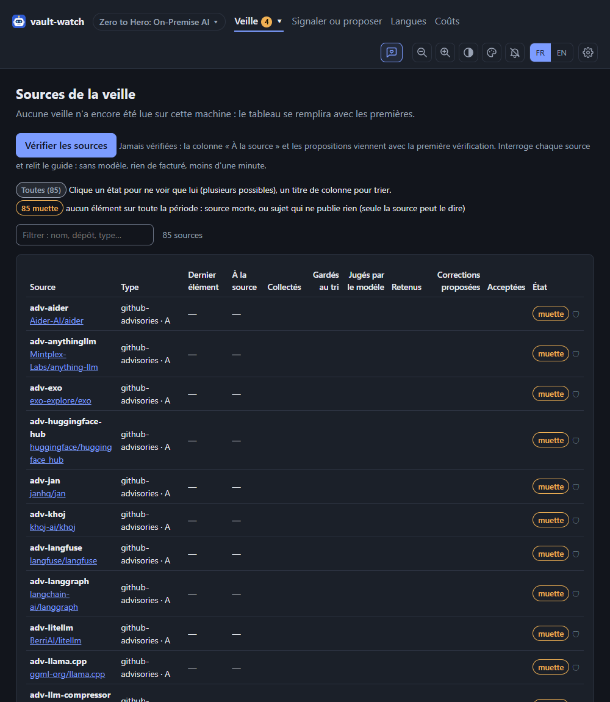

*[English version](../collect.md)*

# Collecter une veille (`vault-watch collect`)

Une veille liste ce qui a changé dans le domaine du guide sur quelques jours. L'agent peut la collecter lui-même :
vous listez dans un `feeds.json` les flux à lire, et `vault-watch collect` rassemble les éléments de la fenêtre,
écarte la routine par règles, garde les notes de version et le texte des avis, puis écrit un
[`watch.json`](watch-format.md). Un élément retenu dont le flux ne donne aucun texte (un billet de blog, un
communiqué, la page d'un modèle) reçoit à la place le début de sa propre page : le modèle lit la source primaire
plutôt qu'un titre seul. Aucun modèle n'est appelé : une collecte ne coûte rien.

```bash
vault-watch --guide ../mon-guide collect                  # les 8 derniers jours ; rapport Markdown sur la sortie
vault-watch --guide ../mon-guide collect --days 15 --json watch.json --markdown watch.md
vault-watch --guide ../mon-guide collect --since 2026-11-01 --only security,releases
vault-watch --guide ../mon-guide collect --no-triage      # garder tous les éléments de la fenêtre
```

Sans `--json`, la veille va dans `watches/watch-<date>.json` du dossier de travail du guide. Avec
`source = "feeds"`, l'interface la liste à cet endroit (ci-dessous).

GitHub limite les requêtes sans jeton. Définissez `GITHUB_TOKEN` (ou `GH_TOKEN`) avant de collecter, par exemple
`GITHUB_TOKEN=$(gh auth token)`. Les avis de sécurité en ont besoin.

## Dans le manifeste

```toml
[watch]
source = "feeds"                    # « Veille automatique » liste les veilles collectées et offre un bouton « Collecter une veille »
feeds = "watch/feeds.json"          # les flux à lire (toute source peut le nommer : `vault-watch collect` marche quand même)
floors = "watch/floors.json"        # facultatif : les versions minimales que le guide recommande
seen = "watch/seen.md"              # facultatif : les éléments déjà triés, écartés s'ils reviennent
candidates = "watch/candidates.json" # facultatif : le registre de la découverte (créé par l'agent au premier enregistrement)
candidate_kinds = ["model", "tool", "hardware"]  # facultatif : les types de ses candidats (ceux-ci par défaut ; "other" ajouté)
```

Sans `floors`, l'agent prend le fichier de `[checks] version_floors` quand le guide en a un.

## `feeds.json`

```json
{
  "defaults": { "days": 8, "maxItemsPerFeed": 15 },
  "domains": { "security": "Sécurité", "releases": "Versions", "news": "Actualités" },
  "feeds": [
    { "id": "memos", "domain": "releases", "type": "github-releases", "repo": "usememos/memos", "tier": "A" },
    { "id": "adv-memos", "domain": "security", "type": "github-advisories", "repo": "usememos/memos", "tier": "A" },
    { "id": "postgresql-news", "domain": "news", "type": "rss", "url": "https://www.postgresql.org/news.rss",
      "tier": "A", "keywords": ["released", "security"] }
  ]
}
```

Le guide d'exemple en a un complet : [`examples/sample-guide/feeds.json`](../../examples/sample-guide/feeds.json).

| Clé | Ce que c'est |
| :-- | :-- |
| `defaults.days` | La fenêtre quand la commande n'en donne pas (8). |
| `defaults.maxItemsPerFeed` | Au plus ce nombre d'éléments par flux, les plus récents (15). |
| `domains` | Facultatif. Les sections du rapport, dans l'ordre, avec leur titre. Sans lui, les domaines viennent dans l'ordre des flux, `security` en tête et les pistes (`discovery`, `signals`) à la fin. |
| `feeds` | Les flux, ci-dessous. |

### Un flux

| Clé | Pour | Ce que c'est |
| :-- | :-- | :-- |
| `id` | tous | Un nom unique : il apparaît dans le rapport, et `floors` s'en sert. |
| `domain` | tous | La section du rapport : la partie du guide que le flux concerne. |
| `type` | tous | `github-releases`, `github-tags`, `github-advisories`, `rss` (RSS 2.0 ou Atom ; par défaut), `youtube`, `huggingface-author`, `huggingface-trending`, `github-search`, `page` (une page surveillée, plus bas). |
| `tier` | tous | La confiance due à la source : `A` primaire, `B` secondaire réputée, `C` simple piste. Les éléments de niveau C comptent comme des pistes. |
| `repo` | les types GitHub sauf la recherche | `propriétaire/nom`. |
| `url` | `rss`, `page` | L'adresse du flux, ou de la page. |
| `watch` | `page` | Facultatif. Une expression régulière : ce qu'il faut surveiller dans le texte de la page. Sans elle, chaque ligne de la page. |
| `name` | `page` | Le nom affiché dans le titre de l'élément (l'adresse sinon). |
| `channelId`, `name` | `youtube` | La chaîne, et le nom affiché devant chaque titre. |
| `author` | `huggingface-author` | L'éditeur sur Hugging Face. |
| `query`, `minStars`, `maxAgeDays`, `limit` | `github-search` | Les dépôts jeunes qui ont vite pris : la recherche, les étoiles (500), l'âge en jours (30), le nombre (10). |
| `limit` | `huggingface-trending` | Combien de modèles en vogue lire (40) ; ceux des éditeurs déjà suivis sont laissés de côté. |
| `keywords` | tous | Ne garder que les éléments dont le titre ou le résumé contient l'un de ces mots, cherché en début de mot (`IA` ne trouve pas « Debian »). |
| `exclude` | tous | Une expression régulière : les éléments dont le titre y correspond sont laissés de côté. Le titre d'un élément GitHub commence par le dépôt : `owner/repo v2.3.0`, `owner/repo GHSA-…`. Les étiquettes mobiles (`stable`, `latest`, `next`, `v1`…) sont de toute façon écartées par le pré-tri. |
| `minLevel` | versions, étiquettes | `major`, `minor` (par défaut) ou `patch` : les versions plus petites sont écartées. |
| `collapse` | versions, étiquettes | `true` pour un projet qui publie une version par commit : les versions de la fenêtre deviennent une seule ligne de routine. |
| `discovery` | tous | `true` : le flux cherche ce que le guide ne couvre pas encore. Ses éléments vont dans la section `discovery`, et un élément compte selon son âge (`maxAgeDays`, 45), pas selon la fenêtre. |

### Une page surveillée

Certains faits d'un guide ne sont publiés par aucun flux : une grille de prix, un tableau de compatibilité, les
versions prises en charge d'un produit. Un flux de type `page` lit une telle page à chaque veille et prévient quand
elle ne dit plus ce qu'elle disait :

```json
{ "id": "lambda-pricing", "domain": "hardware", "type": "page", "url": "https://lambda.com/pricing",
  "name": "Lambda GPU Cloud pricing", "tier": "A", "watch": ".*\\$\\d.*" }
```

`watch` choisit ce qui compte. `.*\$\d.*` (en JSON chaque `\` est doublé, comme ci-dessus) garde les lignes qui
contiennent un prix en dollars, chacune avec ce dont c'est le prix (« NVIDIA HGX A100 | 80 GB | … | $3.19 ») ;
`\$\d+\.\d+` garderait les prix seuls. Sans
`watch`, tout le texte est comparé, et une page qui affiche une date ou un compteur change à chaque lecture : donnez
une expression dès que possible. Seul le texte lisible est lu (ni menu, ni script) : une page qui dessine ses
chiffres par un script ne montre rien à surveiller, ce que la première collecte rend visible (sa liste de valeurs
reste vide).

L'élément d'un changement liste ce qui n'est plus sur la page et ce qui est nouveau : ce sont les notes que lit le
modèle. Son adresse se termine par `#changed-<date>` : un changement est annoncé une fois, quel que soit le nombre
de veilles dont la fenêtre le contient.

Ce que la page disait est gardé dans la veille elle-même (`pages` dans `watch.json`), et la collecte suivante
compare avec la veille la plus récente qu'elle trouve : celles gardées dans le dossier de travail, ou
`--previous <watch.json ou dossier>`. La première lecture d'une page est sa référence : aucun élément, et le
rapport le dit. Le workflow réutilisable ci-dessous va chercher la veille précédente dans le dernier run qui en a
une, ce qui demande `actions: read` dans les permissions de l'appelant.

## Le tri préalable

Chaque élément est retenu ou écarté par une règle, avec une raison. Seuls les éléments retenus arrivent au modèle.
Les règles :

- **Versions.** Les préversions (rc, alpha, beta, dev, nightly, preview, canary, snapshot) et les versions sous
  `minLevel` sont écartées. Une version dont les notes parlent d'un correctif de sécurité (security, CVE, GHSA,
  vulnerability) est retenue quand même.
- **Avis.** Un avis de faible gravité est écarté, de même qu'un avis déjà corrigé au plancher du guide : le plancher
  est hors de la plage vulnérable, ou la première version corrigée est égale ou inférieure au plancher, ou le
  correctif publié pour la branche du plancher l'est. Un avis High ou Critical que le plancher ne couvre pas est
  **urgent**, et la passe le traite en premier.
- **Modèles.** Les variantes quantifiées, les adaptateurs (LoRA) et les affinages d'un autre éditeur (en
  découverte) sont écartés.
- **Déjà vus.** Un élément dont l'adresse figure dans le fichier `seen` est écarté, comme celui que suit le registre
  des candidats (ci-dessous).

Le fichier des planchers :

```json
{ "floors": { "adv-memos": "26.11.0" } }
```

Le fichier des éléments déjà vus peut avoir n'importe quel format : chaque adresse `http(s)://` qu'il contient
compte. Un tableau des éléments déjà triés convient.

## Le registre des candidats

`candidates` désigne un fichier JSON du guide où l'agent suit ce qu'il a trouvé et que le guide ne couvre pas encore :
quelque chose d'un des types du guide (`candidate_kinds` : par défaut un modèle, un outil, un matériel, ou autre),
avec ses sources, un état (`lead` piste, `watching` en observation, `confirmed`
confirmé, `proposed` proposé, `added` ajouté, `dismissed` écarté), une raison, une date de revérification et son
historique. La collecte écarte les adresses qu'il suit, pour qu'un candidat mis de côté ne revienne pas chaque
semaine, et liste dans la veille et son issue les candidats dont la date de revérification est arrivée
(« Candidates to look at again », le `recheck` de la veille). Le fichier n'a pas besoin d'exister : l'agent le crée au
premier enregistrement, et rien ne change sans la clé.

La page « Candidats » (menu « Veille ») le montre par état et le change : ajouter un candidat à la main, le mettre en
observation ou l'écarter (une raison, obligatoire pour écarter, et une date de revérification), le proposer comme
ajout (« Proposer un ajout » s'ouvre avec sa ligne ; la passe lancée, il devient `proposed`). Les changements restent
dans un brouillon de l'agent ; « Publier le registre » les écrit sur une branche du guide et ouvre la pull request,
qui ajoute aussi la clé au manifeste s'il n'en a pas (le chemin est alors demandé). Tant qu'elle est ouverte, publier
à nouveau y ajoute un commit.

## Quelles sources méritent leur place

La page « Sources suivies » de l'interface (dans le menu « Veille », `GET /api/sources`) montre, pour chaque
flux de `feeds.json`, ce qu'il a apporté et ce qu'il en est sorti. Rien n'est demandé à un modèle ni au réseau : le tableau est calculé à partir des
veilles gardées sur la machine (chaque élément nomme son flux) et des passes faites à partir d'elles.




| Colonne | Ce qu'elle compte |
| :-- | :-- |
| Collectés | les éléments distincts vus dans les veilles (leurs fenêtres se recouvrent : un élément compte une fois) |
| Gardés au tri | ceux que le tri préalable a gardés, avant tout modèle |
| Jugés par le modèle | ceux qu'une passe a triés |
| Retenus | ceux que le modèle a retenus pour une correction ou comme candidat à un ajout |
| Corrections proposées, acceptées | les corrections qui citent un élément du flux, et celles que le relecteur a acceptées |

Chaque flux reçoit le verdict d'une règle, que la page énonce :

| Verdict | Règle |
| :-- | :-- |
| en erreur | le collecteur n'a pas pu le lire à la dernière veille |
| bruit | au moins 10 éléments jugés par le modèle, un sur dix au plus retenu, aucune correction proposée |
| muette | aucun élément sur toute la période : source morte, ou sujet qui ne publie rien |
| pistes sans suite | des éléments retenus par le modèle, aucune correction n'en est sortie |
| peu d'éléments | quelques éléments, rien de retenu : trop peu pour juger |
| utile | au moins une correction proposée, ou un candidat à l'ajout |

Un flux de failles de sécurité est une assurance : son silence est une bonne nouvelle, et il n'est jamais classé en
bruit. Les verdicts disent où regarder, ils ne décident rien : retirer ou ajouter un flux reste une modification de
`feeds.json`, par une pull request du guide.

### Vérifier les sources

« Vérifier les sources », sur la même page, interroge chaque source elle-même et relit le guide. Sans modèle, rien
de facturé, moins d'une minute ; GitHub est interrogé avec `GITHUB_TOKEN`, sinon avec le jeton de `gh` s'il est
connecté. Le tableau gagne ce que chaque source dit aujourd'hui (sa dernière publication, ou ce qui ne va pas), et
la page liste des propositions :

| Proposition | Quand | Cochée |
| :-- | :-- | :-- |
| Retirer | la source répond « introuvable », ou son dépôt est archivé | oui : un fait tranche |
| Modifier | le dépôt a été renommé : le flux le suit | oui |
| Retirer | la source ne répond pas (délai dépassé, refus), ou répond sans rien lister | non |
| Retirer | le tableau la classe en bruit, ou plus aucune page du guide ne nomme ce qu'elle suit | non |
| Ajouter | un dépôt GitHub ou un éditeur Hugging Face cité dans au moins deux pages, vivant, suivi par aucun flux | non |
| Ajouter | les failles de sécurité d'un outil suivi seulement pour ses versions | non |

Une source qui n'a rien publié depuis 180 jours est signalée, jamais proposée au retrait : un outil qui ne bouge
plus est une information sur le sujet du guide, et c'est la page qui le recommande qu'il faut regarder. Les dépôts
du mainteneur lui-même ne sont pas proposés.

Les propositions cochées partent dans une seule pull request (une branche, pour un guide sans dépôt) qui modifie
`feeds.json` et rien d'autre : les lignes des autres flux ne sont pas touchées. Un nouveau flux reçoit le domaine
des flux cités dans les mêmes pages ; corrigez-le dans la pull request s'il est faux.

## À heure fixe, sur GitHub

Le workflow réutilisable [`collect.yml`](../../.github/workflows/collect.yml) fait la collecte sur GitHub. Il installe
l'agent, collecte, garde `watch.json` comme artefact et ouvre une issue avec le rapport. Ajoutez ce fichier au guide
sous le nom `.github/workflows/watch.yml` :

```yaml
name: Watch
on:
  schedule: [{ cron: "30 6 * * 1" }]   # le lundi, 6 h 30 UTC
  workflow_dispatch:
permissions:
  contents: read
  issues: write
  actions: read   # pour les pages surveillées : la veille précédente est lue dans son run
jobs:
  watch:
    uses: DamienBecherini/vault-watch-agent/.github/workflows/collect.yml@v1.6.1
    with:
      days: 8
```

Le manifeste passe alors à `source = "issues"` avec `label = "watch"` : l'agent lit ces issues, dont
l'artefact contient la veille. Les paramètres du workflow :

| Paramètre | Par défaut | Ce que c'est |
| :-- | :-- | :-- |
| `days` | celle du fichier de flux | La fenêtre. |
| `guide` | `.` | Le dossier du guide dans son dépôt. |
| `label`, `artifact` | `watch`, `weekly-watch` | L'étiquette de l'issue et le nom de l'artefact ; `label` et `artifact` du manifeste doivent être les mêmes. |
| `title` | `Watch` | Le début du titre de l'issue. |
| `urgent_only` | `false` | N'ouvrir une issue que pour un avis urgent : une passe entre deux passes complètes. |
| `open_issue` | `true` | `false` : garder l'artefact, ne rien ouvrir. |
| `agent_ref` | la version du workflow | La version de l'agent à installer. |

Aucune issue n'est ouverte quand rien n'est retenu. Le workflow du guide de référence tourne chaque lundi et ouvre
une issue une semaine sur deux, avec une fenêtre de 15 jours ; les autres semaines il tourne avec `urgent_only`, et
un avis urgent arrive plus tôt.

## Le collecteur du guide IA on-premise

`vault-watch collect` est un portage du collecteur qu'avait le guide IA on-premise, `scripts/watch-feeds.mjs` : les
mêmes types de flux, les mêmes règles, le même format de résultat. Avant que le guide ne change, les deux ont tourné
sur ses 63 flux et sur la même fenêtre, et ont donné les mêmes éléments avec le même tri, les mêmes notes et les
mêmes urgences (comparaison du 18 novembre 2026 : 172 éléments, 105 retenus depuis le 3 novembre ; 455 éléments, 241
retenus depuis le 1er juin). Depuis le 19 novembre 2026, le workflow du guide appelle le workflow
réutilisable ci-dessus, et son script a disparu. Un guide peut garder son propre collecteur : l'agent ne lit que le
`watch.json`.
