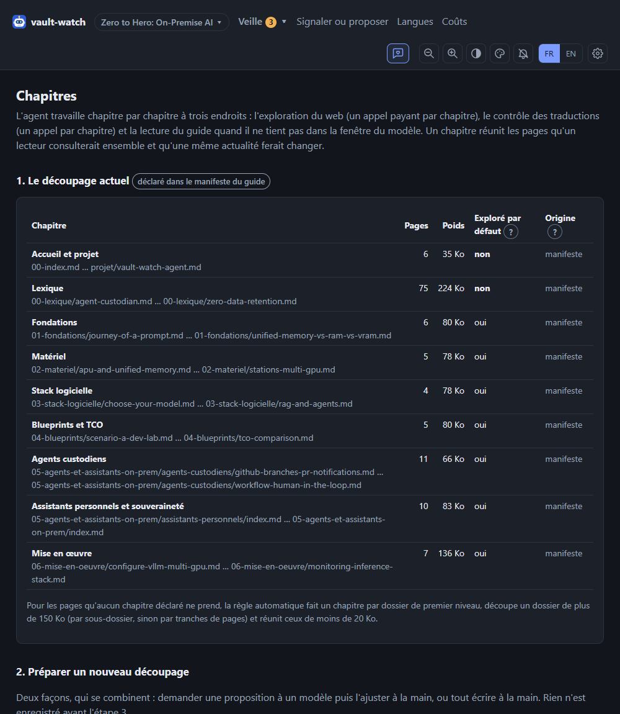

*[English version](../connect-your-guide.md)*

# Brancher son guide

vault-watch-agent tient à jour un guide en Markdown : il lit une veille (ce qui a changé dans le domaine), propose
des corrections avec leurs sources, vous les fait relire, et ouvre une pull request avec celles que vous acceptez. Il
connaît votre guide par un seul fichier à sa racine, `vault-watch.toml`. Cette page décrit ce fichier clé par clé,
ce que chaque partie facultative débloque, et comment vérifier que tout est prêt.

Le minimum pour un guide : des pages Markdown dans un dépôt git (le guide est la racine de son dépôt), et un nom et
une langue dans son manifeste. Tout le reste est facultatif : une partie absente désactive une étape, elle ne fait
jamais échouer une passe. Un dossier sans manifeste est refusé, avec ce qu'il faut faire : `vault-watch init` (le
guide IA on-prem, pour lequel l'agent a été écrit, est la seule exception).

## En trois commandes

```bash
vault-watch --guide ../mon-guide init      # écrit vault-watch.toml d'après ce que montre le dossier
vault-watch --guide ../mon-guide doctor    # ce qui est prêt, ce qui manque (code de sortie 1 si une passe ne peut pas partir)
vault-watch --guide ../mon-guide serve     # l'interface web, sur ce guide
```

`init` regarde le dossier : le dépôt GitHub de son remote `origin`, sa branche, la langue des pages, les dossiers
qui les répètent dans une autre langue, le champ de date de leur front matter. Il laisse de côté l'outillage
(`node_modules/`, `scripts/`, `docs/`…), les dossiers dont le nom commence par `_` (notes privées, modèles) et les
fichiers du dépôt (`README.md`, `CLAUDE.md`…), et liste les scripts npm du guide comme pistes pour `[checks]`.
Chaque supposition est commentée : relisez le fichier avant la première passe. `--print` l'affiche sans l'écrire,
`--force` remplace un manifeste existant.

`doctor` vérifie le manifeste, les pages, chaque miroir, git, `gh` et le dépôt, la veille, chaque contrôle et le
programme dont il a besoin, et le moteur (Claude Code connecté avec un abonnement, ou une clé d'API trouvée).

Sans `--guide`, les commandes prennent `VAULT_PATH`, puis le dossier courant s'il contient un `vault-watch.toml`.
Les passes de chaque guide sont rangées à part, dans un dossier à elles sous `~/.vault-watch/guides/` ; les réglages
(moteur, modèles, dans `~/.vault-watch/settings.json`) sont communs à tous les guides. `VAULT_WATCH_HOME` place ce
dossier ailleurs ; un dossier `.vault-watch` dans le dossier courant, comme l'agent l'utilisait avant 1.0, sert
encore s'il existe. Le journal des coûts va dans `~/.vault-watch/usage.jsonl` (`VAULT_WATCH_JOURNAL` pour le
changer). Rien n'est écrit dans le guide en dehors de la branche d'une passe.

## Le manifeste

Le plus petit qui serve, celui du guide d'exemple (`examples/sample-guide/`) :

```toml
schema = 1

[guide]
name = "Self-hosted notes server"
description = "running Quillnote, a notes server, and Larkdb, its database, on a machine of your own"

[content]
language = "en"
exclude = ["README.md"]
modified_field = "last_modified"

[watch]
source = "file"
path = "watch.json"
```

Un guide qui utilise toutes les parties : [`examples/manifests/ia-on-prem-vault.toml`](../../examples/manifests/ia-on-prem-vault.toml).

Une clé inconnue, ou une valeur du mauvais type, arrête l'agent avec un message qui nomme la clé : une faute de
frappe ne doit pas désactiver une partie sans rien dire.

### `schema`

`1`, la version du format. Facultatif (1 par défaut). Figé à partir de 1.0 : ce qui peut changer, et comment, est dans [fr/compatibility.md](compatibility.md).

### `[guide]`

| Clé | Obligatoire | Ce que c'est |
| :-- | :-- | :-- |
| `name` | oui | Le nom du guide, dans l'interface et dans les consignes du modèle. |
| `description` | non | Le sujet du guide, en une phrase. Elle entre dans les consignes : le modèle juge la pertinence d'après elle. |
| `repository` | non | `propriétaire/nom` sur la forge (GitHub, sauf si `forge` en nomme une autre). Sans lui, le guide est local : aucune issue lue, aucune pull request, la branche d'une passe reste sur votre machine. |
| `forge` | non | Où se trouve `repository` : `github` (par défaut, par `gh`, authentifié par `gh auth login`) ou `gitea` (par l'API de Gitea, avec un jeton). |
| `forge_url` | avec `gitea` | L'adresse du serveur Gitea, par exemple `https://gitea.example.org` ou `http://192.168.1.10:3000`. |
| `forge_token` | non | Gitea : où se trouve le jeton, sous forme de référence, jamais le jeton lui-même : `env:NOM` (par défaut `env:GITEA_TOKEN`), `sops:fichier#NOM` ou `file:chemin`. Il lui faut le droit `repository` en écriture pour ouvrir les pull requests, et le droit `issue` (en écriture) pour une veille `issues`. Un jeton Gitea vaut pour tous les dépôts que son compte peut atteindre : donnez à l'agent un compte à lui, collaborateur du seul dépôt du guide. |
| `site` | non | Le site publié, lié depuis l'interface. |
| `base_branch` | non | La branche d'où partent les passes et que visent les pull requests (`main` par défaut). |

### `[content]`

| Clé | Obligatoire | Ce que c'est |
| :-- | :-- | :-- |
| `language` | oui | La langue des pages (`fr`, `en`, `de`…). Les corrections sont demandées dans cette langue. |
| `include` | non | Motifs glob des pages (`["**/*.md", "**/*.mdx"]` par défaut). `*` reste dans un dossier, `**` traverse les dossiers. |
| `exclude` | non | Motifs glob écartés (`["docs/**", "README.md"]`). Les dossiers qui commencent par un point (`.git`, `.agents`…) sont toujours écartés. |
| `mirrors` | non | Copies traduites tenues au même niveau : `{ en = "en/" }` veut dire que `en/<page>` est la copie anglaise de `<page>`. Le dossier finit par `/` ; ses pages ne sont pas des pages de la langue source. |
| `readonly` | non | Motifs glob des pages que l'agent lit (extraits, relecture globale) sans jamais les modifier : les pages que vos propres scripts génèrent (une modification serait perdue à la génération suivante), ou celles qui rapportent des propos datés. Une correction proposée sur l'une d'elles est refusée (`read-only`). |
| `modified_field` | non | Une date du front matter qu'une correction acceptée met à la date du jour (`last_modified`). Sans elle, les dates des pages ne changent pas. |

### `[watch]`

D'où viennent les éléments d'une veille.

| `source` | Avec | Ce que lit l'agent |
| :-- | :-- | :-- |
| `none` (défaut) | | Pas de veille : l'agent vérifie le guide et corrige seulement les erreurs signalées. |
| `issues` | `label` (`veille` par défaut), `artifact` (`weekly-watch` par défaut) | (Nommée `github-issue` avant 1.0, nom toujours lu.) Les issues ouvertes de `repository` qui portent cette étiquette, sur sa forge (GitHub ou Gitea ; les artefacts des Actions de Gitea demandent Gitea 1.23 ou plus récent). Le corps de l'issue contient le lien du run du workflow qui a collecté la veille (`.../actions/runs/<id>`) ; les éléments sont le `watch.json` de l'artefact `artifact` de ce run. |
| `file` | `path` | Un `watch.json` du guide, ou un dossier qui en contient (un par veille, listés du plus récent au plus ancien dans l'interface, chacun avec sa fenêtre et ses éléments retenus ; un fichier qui ne respecte pas le format est listé avec ce qui ne va pas). Aussi tout fichier donné en ligne de commande (`vault-watch run --watch-json`). |
| `feeds` | `feeds` | Les veilles que l'agent a collectées depuis les flux du guide (`vault-watch collect`, ou le bouton « Collecter une veille » de l'interface), rangées dans le dossier de travail du guide. |

Quelle que soit la source, `feeds` (un `feeds.json`), `floors` et `seen` permettent à `vault-watch collect` de
rassembler une veille depuis les flux du guide, sans modèle ; le workflow GitHub réutilisable le fait au rythme du guide (toutes les deux semaines pour le guide de référence)
et ouvre l'issue : [Collecter une veille](collect.md).

`changes_page` (quelle que soit la source) désigne une page où la veille note les changements en lignes datées, comme
« Ce qui a changé depuis » : chaque étape de proposition la voit en entier, quels que soient les mots-clés de
l'élément, et ajoute une ligne en citant la dernière ligne de la page (ou une phrase d'attente) et en la rendant suivie
de la nouvelle. Elle ne doit pas être en lecture seule.

`candidates` (quelle que soit la source) désigne le registre de la découverte, un fichier JSON du guide que l'agent
crée, et `candidate_kinds` les types de ses candidats, selon le guide : `["model", "tool", "hardware"]` quand il n'est
pas donné, `["software", "plugin", "host"]` pour un guide de logiciels auto-hébergés ; « other » (autre) est toujours
ajouté. Des noms courts en minuscules (lettres, chiffres, -) ; la page traduit ceux par défaut et montre les autres
tels qu'ils sont écrits. `candidate_readers` nomme où ses candidats sont lus sans modèle : `"huggingface"` (une page
de modèle), `"github"` (un dépôt) ; aucun s'il n'est pas donné, pour que rien ne soit envoyé à ces sites pour un guide
qui n'en a pas l'usage ([Collecter une veille](collect.md#le-registre-des-candidats)).

Un `watch.json` contient les éléments retenus par votre collecteur (flux, pages de versions, avis de sécurité) ; son
format, clé par clé : [Le format d'une veille](watch-format.md).

```json
{
  "until": "2026-11-02",
  "items": [
    { "title": "Quillnote 5.0 released: Python 3.11 required", "url": "https://example.org/quillnote/releases/5.0",
      "triage": "keep", "date": "2026-10-28", "notes": "The minimum Python version moves to 3.11." },
    { "title": "Larkdb security advisory", "url": "https://example.org/larkdb/advisories/7", "triage": "keep",
      "date": "2026-10-30", "urgent": true, "severity": "High", "notes": "larkdb dump before 2.1..." }
  ]
}
```

Seuls les éléments `"triage": "keep"` sont lus, les urgents d'abord. `notes` est ce que le modèle lit de
l'élément : plus il contient de faits (versions, dates, chiffres), moins le modèle doit deviner. `until` est la fin
de la fenêtre de veille, la date du rapport de la passe.

### `[rules]`

Vos propres consignes pour le modèle, sous forme de fichiers du guide. Sans elles, l'agent prend les siennes, dans
[`src/vault_watch_agent/defaults/`](../../src/vault_watch_agent/defaults/) : lisez-les avant d'écrire les vôtres.

| Clé | Ce qu'elle règle |
| :-- | :-- |
| `brief` | Ce à quoi peut mener un élément de veille (rien, une correction, un ajout), les sources qui comptent, la taille d'une correction, la gravité. |
| `translation_policy` | Comment un miroir suit les pages source (fidélité, ce qui ne se traduit jamais, front matter). Utilisée seulement avec `mirrors`. |

### `[checks]`

Les scripts du guide, lancés par l'agent dans une copie du guide. Chacun est facultatif : un contrôle que le guide
ne déclare pas est « non vérifié » dans le rapport, sur l'écran de publication et dans la pull request, jamais
« réussi ». Dans une commande, `{out}` est remplacé par le chemin d'un fichier JSON que l'agent lit ensuite.

| Clé | Quand | Attendu |
| :-- | :-- | :-- |
| `audits` | avant la pull request, sur la copie corrigée | Code de sortie 0 quand le guide est sain. Sa sortie va dans la pull request en cas d'échec. |
| `claims_due` | au début d'une passe (sans réseau) | `{out}` : `{"claimsDue": [{"page": "...", "claim": "...", "recheckBy": "2026-11-01"}]}`, les affirmations datées dont la date de revérification est passée. Elles sont listées dans le rapport. |
| `sources` | avant la pull request | `{out}` : `{"sources": [{"url": "...", "citations": [{"page": "..."}], "probe": {"status": "ok", "code": 200}}]}`. Une source citée par une page corrigée dont le statut est `dead`, `server-error`, `network-error`, `timeout` ou `blocked` est signalée sur l'écran de publication. |
| `version_floors` | après l'application des corrections | Une table `{ script = "...", file = "..." }` : `node <script> --write` met à jour `file` (les versions minimales qu'énoncent les pages), commité avec les corrections. |

### `[budget]`

`max_context_tokens` : un plafond de ce qu'un seul appel du modèle peut lire du guide, quel que soit le modèle.
La relecture globale, son balayage et le contrôle de cohérence lisent le guide entier en un appel quand il tient
dans la fenêtre du modèle (moins une réserve de 100 k tokens pour les consignes, le web et la réponse) et sous ce
plafond ; sinon ils passent chapitre par chapitre (un [chapitre](#chapter) par appel, avec les pages que
modifient les corrections), et le rapport comme l'écran de la passe le disent : une contradiction entre deux
chapitres peut alors échapper. Sans plafond : la fenêtre du modèle décide.

`growth_kb` (5 par défaut) et `growth_percent` (25) : une page qui a pris autant de Ko en 90 jours, ou cette part
de ce qu'elle pesait, est signalée comme ayant beaucoup grossi. `page_kb` et `[budget.pages]` : un plafond
facultatif, en Ko, pour toutes les pages, et un autre pour les pages d'un dossier (`"00-lexique/**" = 8` sous
`[budget.pages]` ; le premier motif qui correspond l'emporte) ; aucun par défaut, puisque la bonne longueur d'une
page dépend de son sujet. Une page signalée est un avertissement de `vault-watch doctor`, de `vault-watch compact`
et du contrôle « Taille des pages », jamais un échec : elle dit où un [compactage](compact.md) doit regarder
d'abord. Une page en lecture seule est listée avec son poids et jamais signalée.

### `[[chapter]]`

Les chapitres sont les pages sur lesquelles l'agent travaille ensemble. Trois étapes passent chapitre par
chapitre : l'exploration du web ([les nouveautés](news.md), un appel payant par chapitre), le contrôle des
traductions (un appel par chapitre), et toute étape qui lit le guide entier quand la fenêtre du modèle est trop
petite pour lui. Un bon chapitre réunit les pages qu'un lecteur consulterait ensemble et qu'une même actualité
ferait changer. Pourquoi les chapitres comptent, pourquoi les seuils ci-dessous, et ce que coûte un découpage mal
adapté : [Chapitres](chapters.md).

Facultatif. Sans cela, une règle automatique s'applique : un chapitre par dossier de premier niveau (les pages à
la racine en forment un) ; un dossier de plus de 150 Ko est découpé selon ses sous-dossiers, ou en tranches de
pages de poids voisin s'il n'en a pas ; les dossiers de premier niveau de moins de 20 Ko sont réunis. Pour décider
vous-même, déclarez des chapitres, une table chacun :

```toml
[[chapter]]
name = "Matériel"
paths = ["02-materiel/", "03-stack/choisir-un-gpu.md"]

[[chapter]]
name = "Lexique"
paths = ["00-lexique/"]
explore = false
```

| Clé | Sens |
| :-- | :-- |
| `name` | Le nom du chapitre sur les écrans et en ligne de commande (`news --explore --chapters`). Unique, 80 caractères au plus, sans virgule ni guillemet |
| `paths` | Ce qu'il contient : un dossier (`"02-materiel/"`, tout ce qu'il y a dessous), un motif (`*` dans un dossier, `**` à travers les dossiers) ou une page. Une page va au premier chapitre qui la prend : écrivez le particulier avant le général |
| `explore` | `false` laisse le chapitre décoché quand le web est exploré (un lexique, les pages sur le projet : le web ne leur apporte rien de neuf par lui-même). On peut toujours le cocher. `true` par défaut |

Les pages qu'aucun chapitre ne prend suivent la règle automatique : un manifeste peut ne déclarer que ce que la
règle fait mal.

`[[chapter]]` est lu à partir de l'agent 1.3.0. Un agent plus ancien refuse un manifeste qui en contient (clé
inconnue) : mettez l'agent à jour partout où le guide est lu, y compris un workflow qui collecte sa veille, avant
de fusionner un tel manifeste.

Trois façons d'écrire ces tables, toutes relues par vous avant d'atteindre le guide :

- **Un modèle les propose.** Page « Chapitres » de l'interface (dans le menu sous le nom du guide), ou
  `vault-watch chapters --propose`. Un appel lit le plan du guide (le chemin, le poids, le titre et les intertitres
  de chaque page, pas son texte : environ un vingtième du guide) et propose des chapitres, avec ceux à ne pas
  explorer par défaut et une phrase de raisons pour chacun. Son coût est dit d'abord. L'appel n'écrit rien.
- **À la main sur la même page** : ajouter, renommer, déplacer des chemins, ou « Reprendre le découpage actuel »
  pour ajuster ce qui existe. Les chapitres obtenus, avec leur poids, sont recalculés après chaque modification,
  avant tout enregistrement.
- **À la main dans le manifeste.**



Enregistrer depuis la page écrit le manifeste sur une branche du guide (`chore/chapters-<date>`) et ouvre une
pull request quand le guide a un dépôt ; le découpage s'applique une fois fusionné. `vault-watch chapters --propose
--write` le met dans le manifeste du dossier, à commiter vous-même. `vault-watch chapters` liste les chapitres
tels qu'ils sont, avec leur poids ; `--automatic` retire ceux qui sont déclarés. Relancez-le, ou rouvrez la page,
quand le guide gagne un dossier ou qu'un chapitre grossit beaucoup : `vault-watch doctor` dit quand un chapitre
déclaré ne prend plus aucune page.

## Ce que débloque chaque partie

| Sans | L'agent |
| :-- | :-- |
| `repository` | travaille en local : pas d'issue, pas de pull request, pas de lien vers la forge. |
| `mirrors` | n'a pas d'étape de traduction ni de contrôle des traductions. |
| `modified_field` | laisse les dates des pages telles quelles. |
| `[watch]` | vérifie le guide et corrige les erreurs que vous signalez (`vault-watch fix`, « Vérifier le guide » dans l'interface). |
| `[rules]` | suit ses consignes de veille et sa politique de traduction par défaut. |
| un contrôle de `[checks]` | écrit « non vérifié » là où le contrôle aurait rendu compte. |

La catégorie « Guide » des réglages montre la même chose pour le guide servi : chaque partie, fournie ou absente,
et ce qu'une partie absente désactive.

## Le guide d'exemple

`examples/sample-guide/` est un guide inventé de douze pages, avec une erreur plantée par contrôle, et son
manifeste utilise le moins de parties possible. Pour essayer l'agent dessus, copiez-le hors de ce dépôt (un guide
est la racine de son propre dépôt git), puis :

```bash
cp -r examples/sample-guide ../sample-guide && cd ../sample-guide
git init -b main && git add . && git commit -m "sample guide"
vault-watch doctor
vault-watch run --watch-json watch.json
```

Une passe appelle le modèle : avec le moteur Claude Code, elle prend sur votre abonnement Claude ; avec le moteur
API, elle est facturée sur votre clé (voir « Le modèle » dans le README).
