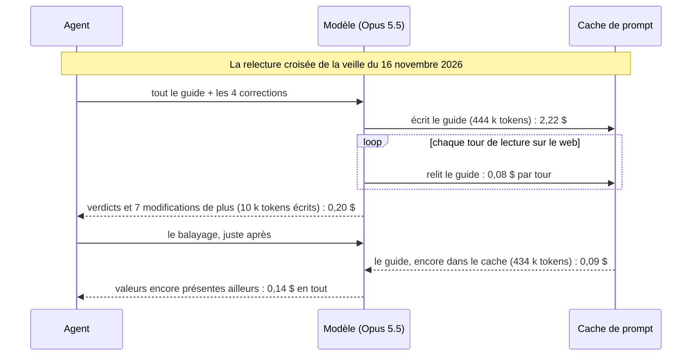

*[English version](../costs.md)*

# Coûts : ce qui fait le prix, les estimations, le journal

Chaque appel à un modèle est compté : avant une étape payante, l'interface affiche une estimation ; après, le
journal garde ce qu'elle a coûté. Cette page dit ce qui fait le prix d'un appel, comment sont faites les
estimations et pourquoi elles peuvent se tromper, d'où viennent les prix, et comment se lisent le journal et la
page « Coûts ».

**Les montants sont indicatifs.** C'est ce que valent les appels au prix public de l'API. Les appels de l'auteur
sont passés par l'accès API de son abonnement Claude : il a payé son abonnement, rien de plus. Avec une clé
facturée au token, c'est ce que vous paieriez ; avec Claude Code sur un abonnement, rien n'est facturé.

## Ce qui fait le prix d'un appel

Un appel se paie en quatre sortes de tokens, chacune à son tarif, plus les recherches web. Les prix de
novembre 2026, en dollars par million de tokens :

| Modèle | Lus (entrée) | Écrits (sortie, réflexion comprise) | Lus depuis le cache | Écrits dans le cache |
| :-- | --: | --: | --: | --: |
| Claude Opus 5.5 | 4,00 | 20,00 | 0,20 | 5,00 |
| Claude Sonnet 5.5 | 2,00 | 10,00 | 0,10 | 2,50 |
| Claude Fable 5.2 | 8,00 | 40,00 | 0,20 | 10,00 |

Une recherche web coûte 0,01 $ ; les pages qu'elle rapporte, et celles que le modèle ouvre, se lisent comme
n'importe quelle entrée.

**C'est le guide qui pèse le plus.** Beaucoup d'étapes lisent tout le guide : environ 410 k tokens pour le guide
IA on-prem. Envoyé comme une entrée ordinaire à Opus 5.5, ce serait 1,64 $ à chaque fois. L'agent l'envoie plutôt
comme un contexte mis en cache : le premier appel l'écrit dans le cache (2,05 $, un quart de plus qu'une entrée
ordinaire), et chaque lecture ensuite, par le même appel ou un autre, coûte 0,08 $. Le cache dure cinq minutes
après sa dernière utilisation : les appels qui le partagent tournent donc rapprochés, les tours d'un même appel, le
balayage juste après la relecture croisée, les chapitres explorés côte à côte.

Cette relecture croisée a coûté 2,70 $ : 2,22 $ pour écrire le guide dans le cache, 0,26 $ pour le relire au fil de
ses tours, 0,20 $ de réponse. Les propositions d'avant, qui ne voient que des extraits, ont coûté 0,30 $ pour quatre
appels. **Ce que coûte un passage, c'est d'abord combien de fois le guide est écrit dans un cache**, puis combien
de tours le relisent, puis ce que le modèle écrit. Un guide deux fois plus petit coûte à peu près moitié moins.

## Où part l'argent, par sorte de passage

| Passage | Ce qui pèse | Mesuré sur le guide IA on-prem |
| :-- | :-- | --: |
| Une veille | La relecture croisée : le guide écrit une fois, relu à chaque tour, environ les quatre cinquièmes du passage | 2,95 à 4,45 $ |
| Un passage de correction | Les propositions lisent tout le guide et le web pour chaque erreur, puis la relecture croisée écrit de nouveau le guide | 5,60 à 8,15 $ |
| Une correction des traductions | Les pages et leurs miroirs, sur le modèle de traduction ; ni web ni relecture croisée | 0,35 $ |
| Une vérification du guide | La cohérence (le guide écrit une fois, 27 k tokens écrits), les traductions (un appel par chapitre), les affirmations sur le web | 7,25 à 10,85 $ |
| Compactage | Le rapport écrit une longue réponse (48 k tokens sur Fable 5.2) ; le passage écrit les allègements de chaque constat | 6,28 $, puis 18,87 $ pour 30 constats |
| Nouveautés | Les pistes : un appel sur tout le guide, 2,28 $. Le passage d'ajouts : environ 4 $ de relecture croisée quelles que soient les pistes, puis pour chaque piste un appel de 7 à 30 tours sur le web, 1,80 à 2,80 $ quand il lit tout le guide, 0,40 à 1,30 $ quand il lit ses pages et le plan | 8,70 à 12,95 $ pour 2 à 5 pistes |
| L'exploration du web | Un appel par chapitre, chacun d'environ 25 tours, chaque tour relisant le guide depuis le cache et le web lu jusque-là | estimé 4,81 $ par chapitre |

Le détail de chaque contrôle est dans [Vérifier le guide](check.md#le-catalogue), celui du compactage dans
[Compactage](compact.md#quel-modèle), celui des pistes et des ajouts dans
[Nouveautés](news.md#ce-que-lit-chaque-appel-et-ce-que-cela-coûte).

## Les estimations

Avant une étape payante, l'interface affiche ce qu'elle devrait coûter : sur le bouton d'une veille, de chaque
contrôle, d'un passage fait de pistes, d'un découpage en chapitres. Une estimation se compose de trois choses :

1. **Le poids du guide**, d'après la taille de ses fichiers : 2,1 octets par token, mesuré sur le guide IA on-prem
   (853 Ko de pages françaises = 408 k tokens). Un guide dans une autre langue, ou avec plus de code, a plus de
   tokens par octet ; là où cela compte (le guide tient-il dans la fenêtre ?), le compte est relevé de 15 %.
2. **Ce que l'étape écrit, et combien de tours elle lit**, mesuré sur le guide IA on-prem et noté dans le code avec
   le passage d'où vient la mesure (`verify.py`) : 27 k tokens écrits par le contrôle de cohérence, 18 tours et
   80 k tokens de pages web par piste d'un passage d'ajouts, 25 tours par chapitre exploré… Ce qu'une étape écrit
   est **compté large exprès** : une estimation affichée avant un passage facturé ne doit pas être dépassée.
3. **Les prix des modèles de vos réglages**, étape par étape (une étape mise à part sur un autre modèle est chiffrée
   sur lui), d'après la table des prix ci-dessous.

Une estimation commence par « ≈ » parce que le web ne se compte pas d'avance : combien de recherches fait un modèle,
et la longueur des pages qu'il ouvre, dépendent de ce qu'il trouve. Le remplacement de deux liens morts a coûté
0,54 $ le 8 novembre et 3,57 $ le 17 novembre, pour la même estimation. Les étapes sans web restent proches : le
contrôle de cohérence était estimé 2,59 $ et a coûté 2,64 et 2,73 $ ; les pistes des « Nouveautés », 2,45 $ pour
2,28 $.

Une estimation s'affiche aussi quand rien n'est facturé : sur un abonnement, la page dit « abonnement, non
facturé » à la place du montant ; avec un modèle local, « modèle local, non facturé » ; avec un autre fournisseur
compatible OpenAI, « facturé par ton fournisseur ».

## D'où viennent les prix

Un prix, ce sont les quatre tarifs d'un modèle, avec leur origine. La première source qui connaît le modèle
l'emporte :

| Source | Ce que c'est | Comment le changer |
| :-- | :-- | :-- |
| fixé | Un prix que vous avez fixé dans les Réglages | Les Réglages, « Prix », « Fixer » |
| liste | La liste publique (celle de LiteLLM), lue seulement quand vous la demandez, avec sa date | « Lire la liste » puis « Remplacer par cette liste » dans les Réglages, ou `vault-watch prices update` |
| par défaut | La liste livrée avec l'agent, avec le mois où elle a été vérifiée (`defaults/prices.json`) | Une nouvelle version de l'agent |

`vault-watch prices show` liste chaque modèle avec son prix et sa source. Une estimation faite sur un prix par
défaut le dit (« par défaut (2026-11) »). Un modèle qu'aucune source ne connaît n'a pas de prix : ses appels
comptent 0, et les Réglages le disent. Un identifiant de modèle daté prend le prix de l'identifiant connu le plus
long par lequel il commence.

## Le journal et la page « Coûts »

Chaque appel ajoute une ligne au journal : la date, le passage, la sorte de passage, l'étape, le modèle, les tokens
de chaque sorte, les recherches web et le coût. Pour vous, c'est `~/.vault-watch/usage.jsonl` ; ce dépôt garde le
journal du guide IA on-prem, [`metrics/usage.jsonl`](../../metrics/usage.jsonl), versionné.

- **Le coût d'un appel sur l'API** est calculé à partir de l'usage que renvoie l'API, au prix de la table : c'est
  une estimation de la facture, et la page de facturation de la Console reste la référence.
- **Un appel par Claude Code sur un abonnement** coûte 0 dans le journal, et garde à part ce qu'il aurait coûté sur
  l'API (`list_usd`, tel que Claude Code le donne).
- **Un appel à un modèle local** coûte 0.

La page « Coûts » de l'interface totalise le journal par mois et par passage, avec les appels faits sur un
abonnement dans des colonnes à eux. `vault-watch costs --by month` (ou `year`, `run`, `step`) donne la même chose en
ligne de commande ; `--by step` montre quelles étapes pèsent, sur tous les passages.

## Ce qui fait baisser le coût

| Levier | Ce qu'il change | Ce qu'il peut coûter en qualité |
| :-- | :-- | :-- |
| Claude Code sur un abonnement | Rien de facturé ; les appels comptent dans les limites de l'abonnement, et une relecture croisée y pèse | Rien : mêmes modèles. Un passage s'arrête à la limite et reprend plus tard |
| Un modèle plus petit pour une étape | La traduction sur Sonnet 5.5 coûte moitié moins que sur Opus 5.5 | Selon l'étape : voir [Choisir un modèle](choose-a-model.md) |
| Un effort plus bas | Moins de réflexion écrite, donc moins de tokens en sortie | Le modèle réfléchit moins avant de répondre ; mesurez-le sur votre guide avant de le garder ([Choisir un modèle](choose-a-model.md#mesurer-son-propre-modèle)) |
| Un passage d'ajouts sur « les pages de la piste et le plan du guide » | L'appel de chaque piste lit ses pages au lieu du guide à chaque tour : environ moitié moins (le défaut de `vault-watch fix --add`) | Une piste qui touche des pages qu'elle n'a pas nommées en voit moins ; la relecture croisée lit toujours tout le guide |
| Moins de chapitres explorés | 4,81 $ de moins par chapitre laissé décoché | Ses sujets ne sont pas cherchés |
| Un guide plus léger | Chaque étape qui lit le guide coûte en proportion ([Compactage](compact.md)) | Aucune, si ce qui est retiré était répété |

L'agent ne choisit jamais de lui-même un moteur facturé : quand une limite d'abonnement est atteinte, le passage
s'arrête, et la relecture prévient quand la suite d'un passage partirait sur un moteur facturé parce que les
Réglages ont changé.
