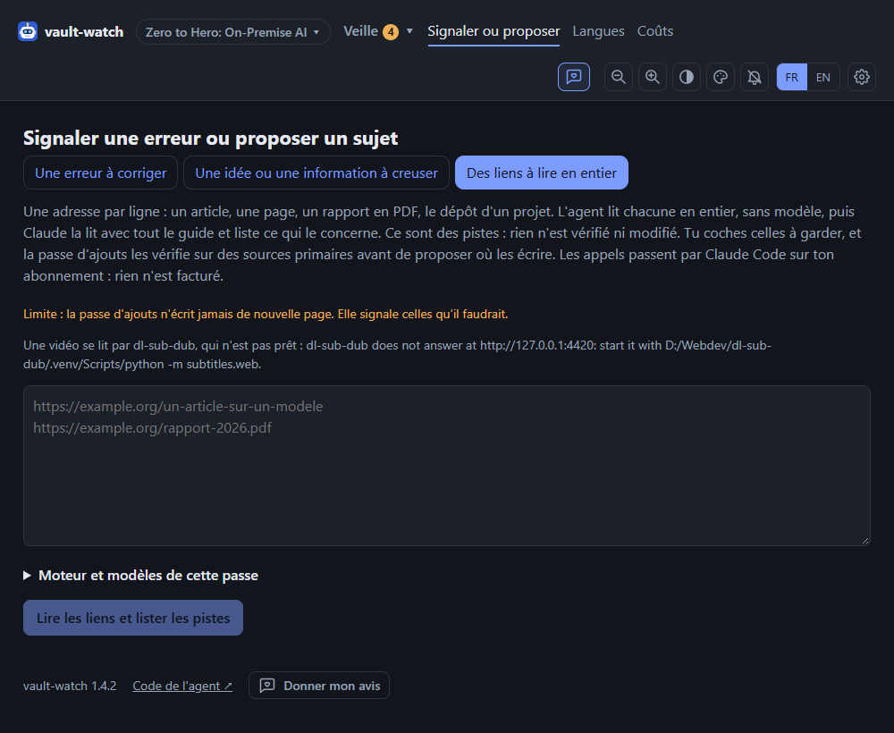

*[English version](../news.md)*

# Chercher les nouveautés : ce qu'un lecteur chercherait et ne trouve pas

Une veille suit les sources qu'elle connaît déjà. Ce qu'aucune n'annonce reste hors du guide : une nouvelle
génération de matériel chez un constructeur que personne n'a ajouté aux flux, un sujet devenu une obligation, un
outil apparu depuis la rédaction. Et ce qu'une veille voit mais met de côté comme « ajout possible » n'est jamais
écrit : cela reste une ligne dans un rapport. Cette passe est à part des veilles. Elle cherche ce qui manque et
propose de l'ajouter ; rien n'est écrit sans votre relecture, et un ajout suit le chemin d'une correction :
relecture croisée, relecture, miroirs, contrôles du guide, pull request.

Elle a deux parties. Les deux appellent le modèle et annoncent leur coût avant de tourner. Les pistes se trouvent
de deux façons, qui répondent à deux questions différentes ; leurs pistes partent dans la même passe.

| Partie | Ce qu'elle fait | Web |
| :-- | :-- | :-- |
| Pistes, depuis le guide | Lit tout le guide, et ce que les veilles passées ont mis de côté, et liste ce qu'il faut aller vérifier. Ne vérifie rien, ne modifie rien | non |
| Pistes, depuis le web | Pour chaque chapitre choisi, cherche librement sur le web ce qui a bougé sur ses sujets et le compare à tout le guide. Ne modifie rien | oui |
| Ajouts | Pour les pistes que vous gardez : vérifie chacune sur des sources primaires, puis propose où l'écrire, ou dit pourquoi non | oui |

> **Limite.** Cette passe ajoute dans les pages existantes : elle n'écrit jamais de nouvelle page. Quand un sujet
> demanderait une page à lui, elle le dit, en tête de l'écran de relecture, de son rapport et de la pull request, et
> vous laisse décider.

## Les pistes

```bash
vault-watch --guide ../mon-guide news          # annonce son coût et demande avant l'appel
```

Dans l'interface : « Vérifier le guide », contrôle « Nouveautés : ce qu'un lecteur chercherait et ne trouve pas ».

Un appel lit toutes les pages du guide d'un coup. Il liste au plus 30 pistes, de trois sortes :

| Sorte | Ce que c'est |
| :-- | :-- |
| `Newer` | Ce que le guide présente comme actuel et qui a sans doute évolué : une génération de produit, une famille de modèles, une version majeure, une grille de prix, une règle en vigueur |
| `Missing` | Un sujet, un outil, un modèle, un matériel, un risque ou une obligation que le guide doit à ses lecteurs et qu'aucune page ne couvre |
| `Seen by the watch` | Un élément que des veilles passées ont mis de côté comme ajout possible, et que le guide ne couvre toujours pas |

Une piste est une question, pas un fait. Le modèle ne vérifie rien à ce stade, et ce qu'il sait peut être plus
ancien que le guide : on lui demande quoi vérifier et sur quel genre de source primaire, jamais un chiffre, une
version ou une date. Le seuil d'ajout propre au guide (son contrat, `[rules] brief` du manifeste) lui est donné.

Les éléments mis de côté par les veilles sont lus dans les rapports des passes gardées sur la machine (leur
section « Addition candidates »), sur les 120 derniers jours, chaque adresse une fois : ni modèle ni réseau pour
cette partie.

Les pistes qui ne concernent que des pages en lecture seule sont laissées de côté. Comme pour tout contrôle,
vous gardez les pistes que vous voulez, vous écartez les autres, et celles gardées partent dans une passe.

### Dans votre langue

Une piste est écrite une fois, au moment du contrôle, dans la langue qu'avait l'interface quand vous l'avez lancé.
Sa ligne reste en anglais quelle que soit cette langue : c'est elle que lit la passe, et que citent son rapport
et sa pull request (l'outillage s'écrit en anglais). Dans une autre langue, le modèle vous explique aussi chaque
piste, en quatre parties : ce que dit la source, ce que dit le guide, ce qui reste à vérifier, ce que cela change
pour le lecteur (deux à quatre phrases, les termes expliqués ; les sources qu'il cite sont des liens). Dans toutes
les langues, chaque piste a un titre court.

La page liste les pistes une ligne chacune : une case pour la cocher, le titre, la page, d'où vient la piste, et une
case « 🔍 creuser » ([plus bas](#les-ajouts)). Une piste se déplie en la
source et le guide côte à côte (le passage de la page, avec un lien qui l'ouvre dans Obsidian à l'intertitre le
plus proche), ce qu'il reste à vérifier, ce que ça change pour le lecteur, le bouton « Creuser cette piste », les
sources et les pages à relire aussi (leur titre, puis leur emplacement), et le texte envoyé à la passe, replié.
« Comment lire une piste », au-dessus de la liste, dit ce qu'est chaque partie.

## Les pistes, depuis le web

```bash
vault-watch --guide ../mon-guide news --explore                        # les chapitres que le guide explore par défaut
vault-watch --guide ../mon-guide news --explore --chapters 02-materiel,03-stack
```

Dans l'interface : le contrôle « Nouveautés : exploration du web, chapitre par chapitre » ; le cocher affiche les
chapitres avec leur poids, et le coût suit les chapitres gardés. Tous sont cochés, sauf ceux que le guide déclare
avec `explore = false` (un lexique, les pages sur le projet). Ce qu'est un chapitre, et ce que sa taille change
pour cette exploration : [Chapitres](chapters.md).

Un appel par chapitre. Chacun lit tout le guide et cherche sur le web les sujets de son chapitre (environ 12
recherches et 15 pages), ouvre des sources primaires, et garde ce qu'aucune page du guide ne dit, huit pistes au
plus par chapitre. Une piste de cette sorte (`Found on the web`) est un fait lu sur une source, et elle porte les
adresses qui l'établissent. Une piste que deux chapitres ont trouvée par la même source n'est listée qu'une fois.

| | Depuis le guide | Depuis le web |
| :-- | :-- | :-- |
| Qui décide quoi chercher | Un appel lit le guide et pose au plus 30 questions | Chaque appel cherche librement sur les sujets d'un chapitre |
| Ce que vous cochez | Des questions, pas encore vérifiées | Des faits déjà trouvés, avec leurs sources |
| Quand le web est payé | Après votre tri, pour les pistes gardées | Avant que vous ayez rien vu, pour chaque chapitre |
| Ce qu'il peut manquer | Ce que personne n'a pensé à demander | Ce qu'une douzaine de recherches par chapitre n'ont pas croisé |

La première répond à « ceci est-il encore à jour, ce sujet connu manque-t-il ? » ; la seconde est la seule qui
trouve ce qu'on ne savait pas demander. Un chapitre dont l'appel échoue est signalé dans le résultat, et les
autres continuent.

## Une idée ou une information à vous

Quand vous savez déjà quoi regarder, sautez la recherche de pistes : « Signaler ou proposer », onglet « Une idée
ou une information à creuser » (un lien sur « Vérifier le guide » y mène). Un sujet par ligne, avec une adresse
si vous en avez une ; une case demande que chacun soit creusé. Les sujets partent directement dans une passe
d'ajouts.

```bash
vault-watch --guide ../mon-guide fix mon-idee --findings idee.txt --add    # une ligne qui commence par ! est creusée
```

## Des liens à lire en entier



Un article, un rapport, la page d'un projet peuvent contenir plusieurs choses pour le guide, n'importe où dans leur
texte ; une veille ne lit que le début d'un élément. « Signaler ou proposer », onglet « Des liens à lire en
entier » (un lien sur « Vérifier le guide » y mène) : une adresse par ligne, 10 au plus.

1. Chaque lien est lu en entier, sans modèle : le texte lisible d'une page, le README d'un dépôt GitHub, le texte
   d'un PDF (avec le lecteur en option : `pip install "vault-watch-agent[pdf]"` ; sans lui, le PDF est dit non lu),
   120 000 caractères au plus. Seulement des adresses publiques, comme le lecteur de pages de l'agent ; une page
   dessinée par des scripts, avec trop peu de texte, est dite non lue.
2. Un appel par lien, avec tout le guide (en cache et partagé sur l'API Claude, comme l'exploration) et le texte du
   lien, sans le web : ce qui concerne les sujets du guide et changerait une décision du lecteur, en pistes « D'un
   lien », chacune avec le lien comme première source. Rien n'est vérifié ni modifié. Le texte du lien est donné au
   modèle comme une donnée, jamais comme une consigne.
3. Les pistes arrivent sur la page du contrôle, comme celles des autres contrôles : vous cochez celles à garder,
   en faites creuser une, et les envoyez dans une passe d'ajouts, qui vérifie chacune sur des sources primaires
   (une vidéo, un blog ou une lettre d'information disent où chercher ; ce n'est jamais la source).

La page du contrôle liste les liens, chacun avec ce qui a été lu (son nombre de caractères) ou pourquoi il ne l'a
pas été. Dans la liste des vérifications, une telle vérification s'appelle « Des liens à lire en entier · 2 liens »,
marquée « depuis Signaler ou proposer », avec ses liens
([Vérifier le guide](check.md#la-liste-des-vérifications-et-la-page-dune-vérification)).

### Une vidéo

Une vidéo (YouTube, Arte, Dailymotion, Vimeo, PeerTube) se lit par
[dl-sub-dub](https://github.com/DamienBecherini/dl-sub-dub), sur la machine de l'éditeur, par sa route « texte
d'une vidéo » (contrat 1) : les sous-titres écrits sur le site, sinon ceux que le site a générés, sinon l'audio
transcrit par son serveur de transcription ; rien n'est traduit, et l'audio est effacé une fois transcrit. Le modèle
lit ce que le site dit de la vidéo (sa description, qui cite souvent les sources, et ses chapitres), puis ses
paroles en paragraphes d'une trentaine de secondes, chacun avec l'heure où il commence, pour qu'une piste dise « à
12:34 ». Les sous-titres se lisent depuis la machine de l'éditeur, jamais depuis la collecte sur GitHub : YouTube
refuse souvent les adresses des centres de données.

Pour le régler, une fois :

1. dans dl-sub-dub, créez un jeton pour ce client (« Réglages › Autres programmes », ou
   `<dossier de dl-sub-dub>/.venv/Scripts/python -m subtitles.web --token-add vault-watch-agent`) : il est écrit
   dans un fichier du dossier des réglages de dl-sub-dub, lisible par vous seul ;
2. dans les réglages de l'agent (`~/.vault-watch/settings.json`), donnez son adresse, la référence de ce fichier
   (jamais le jeton lui-même) et la commande qui le démarre :

```json
"videos": {"url": "http://127.0.0.1:4420",
           "token": "file:C:/Users/moi/.../dl-sub-dub/tokens/vault-watch-agent.token",
           "start": "D:/dl-sub-dub/.venv/Scripts/python -m subtitles.web"}
```

L'onglet « Des liens à lire en entier » dit si dl-sub-dub est prêt. Arrêté, l'agent le démarre quand une vidéo est
à lire, avec cette commande (réglée à la main dans `settings.json` seulement : la page ne peut pas la changer,
puisque l'agent l'exécute) : sans shell, le port de `url` ajouté quand la commande n'en donne pas, un environnement
sans les clés ni les jetons de l'agent ; dl-sub-dub s'arrête ensuite tout seul après son propre temps sans activité
(60 minutes par défaut, `--idle`). Sans `start`, c'est dit avec la forme générique de la commande. Un dl-sub-dub qui refuse de démarrer parce qu'un autre
tourne déjà pour les mêmes données (depuis sa version « un seul service à la fois ») est dit tout de suite, avec
l'adresse de celui-là à mettre dans `url`. Quand la carte graphique est prise par un autre programme (un modèle local,
un jeu), la vidéo est dite « carte graphique occupée », avec sa mémoire libre : relisez le lien plus tard. Quand dl-sub-dub travaille pour un projet de sa propre page, une vidéo est dite
« occupé », avec le temps restant : relisez le lien plus tard. dl-sub-dub garde ses propres limites (un quota par
jeton, 3 heures de vidéo au plus, une demande de programme à la fois), et sa page peut arrêter une lecture à tout
moment.

## Les ajouts

```bash
vault-watch --guide ../mon-guide fix add-2026-11-20 --findings pistes.txt --add
```

Dans l'interface : cochez les pistes, puis « Créer une passe d'ajouts », dans la barre en bas de la page ; le
bouton affiche une estimation qui suit le nombre de pistes cochées et de celles qui sont creusées.


Pour chaque piste, le modèle cherche sur le web et ouvre des sources primaires, puis décide :

- rien de nouveau, rien qu'une source primaire établisse, déjà couvert, ou sous le seuil du guide : aucune
  modification, et la raison en une ligne, dans le rapport de la passe ;
- le guide dit quelque chose de dépassé : une correction là où c'est dit, le fait actuel à la place de l'ancien ;
- le guide ne l'a pas : un ajout là où un lecteur le chercherait (une phrase dans son paragraphe, une ligne dans
  le tableau qui liste ces choses, un court paragraphe sous le bon titre), avec sa source citée comme la page
  cite les siennes ;
- il faudrait une page à part : la page n'est pas écrite. Le rapport dit « needs a page », avec ce qu'elle
  contiendrait et où ; écrire une nouvelle page reste votre décision.

**Creuser.** La ligne de chaque piste a une case « 🔍 creuser », et la piste dépliée le bouton « Creuser cette
piste » (en ligne de commande, un `!` en début de ligne dans le fichier). « Creuser toutes les cochées » et « Ne rien
creuser », au-dessus de la liste, agissent sur tout un contrôle. Dans la barre, « Options », puis « Creuser et
lecture » : « Creuser : Rien · Creuser n sur m · Tout », et le prix de la passe poste par poste (les pistes normales,
les pistes creusées, la relecture croisée et les miroirs). Une piste creusée est aussi cochée ; une piste décochée
n'est plus creusée. Son appel reçoit alors la consigne d'aller plus loin : plusieurs sources indépendantes, ce que le sujet
remplace, sa maturité et sa disponibilité, ce qu'il change pour chaque type de lecteur, sur plusieurs pages s'il
le faut. Cela coûte un peu plus qu'une piste ; à garder pour les sujets qui le méritent.

**Ce que je sais déjà.** Une piste dépliée a un lien « + Ce que je sais déjà » : vos propres mesures, votre
expérience, un chiffre que vous avez vérifié. Le mot est gardé avec la vérification (il survit à un rechargement) et
signalé « 📝 un mot de toi » sur la ligne de la piste. Il part dans la passe avec sa piste, comme une note de
l'éditeur : la passe s'en sert pour contrôler ce que disent les sources et dit quand elles le contredisent, mais ne
le cite jamais, ne le recopie pas et ne l'écrit pas dans le guide, car un fait écrit a toujours besoin de sa source
publiée. La relecture le montre dans le bloc de la piste ; la pull request dit seulement combien de pistes en avaient
un. Les pistes des autres contrôles ont le même lien sous leur texte.

La relecture montre, au-dessus des corrections, les pages que la passe dit nécessaires, puis les pistes qu'elle a
laissées sans modification et pourquoi : ce qu'une recherche a trouvé sans rien écrire est aussi un résultat.

Les modifications passent ensuite par la relecture croisée d'une veille (tout le guide, et la source citée
rouverte), votre relecture, les miroirs, les contrôles du guide et la pull request, sur une branche
`feat/<passe>`.

## Ce que lit chaque appel, et ce que cela coûte

Les pistes prennent un appel, qui lit tout le guide. Les ajouts prennent un appel par piste. Le web d'un appel
a un plafond (20 recherches, 30 pages), et des pistes réunies dans un appel se le disputaient : à la première
passe réelle, une piste sur six grilles de prix a laissé ses trois voisines sans vérification. Une piste que son
appel n'a pas pu regarder est marquée « pas vérifiée par la passe » sur la vérification, avec un bouton,
« Remettre à traiter », qui la remet parmi les pistes à trier. Ce que deux appels ajoutent à la même page est assemblé par le programme (un
numéro de note choisi par les deux est renommé, deux lignes ajoutées après la même ligne s'appliquent toutes les
deux). Ce qu'un appel lit du guide se choisit (plus bas) : les pages de sa piste et le plan du guide par défaut,
plusieurs appels tournant en même temps, ou tout le guide. Avec tout le guide sur l'API Claude, le premier appel
l'écrit dans le cache et les autres le lisent là ; avec un autre moteur, ces appels se suivent.

Les estimations ci-dessous valent pour le guide IA on-prem (129 pages, environ 430 000 tokens), avec Opus 5.5
pour les pistes, les ajouts et la relecture croisée. Les pistes depuis le guide et les passes d'ajouts sont
réglées sur des passes réelles ; le web exploré par chapitre n'a pas encore tourné pour de vrai, et ses constantes
sont comptées large.

| | Estimation |
| :-- | :-- |
| Les pistes, depuis le guide | ≈ 2,40 $ (2,28 $ mesurés le 20/11/2026 pour 28 pistes) |
| Les pistes, depuis le web | ≈ 2 $, plus ≈ 4,75 $ par chapitre exploré |
| Une passe d'ajouts, chaque appel avec tout le guide | ≈ 6,30 $, plus ≈ 2,15 $ par piste gardée, ou ≈ 2,80 $ pour une piste creusée |
| Une passe d'ajouts, chaque appel avec les pages de sa piste et le plan | ≈ 4,30 $, plus ≈ 1,10 $ par piste gardée, ou ≈ 1,50 $ pour une piste creusée |

La passe d'ajouts est réglée sur trois passes réelles (20/11/2026). Avec tout le guide : 11,01 $ pour une piste
sur six grilles de prix et une piste creusée (29 modifications), puis 12,94 $ pour trois pistes (14
modifications), miroirs compris. Avec les pages de la piste et le plan : 8,72 $, miroirs compris, pour cinq pistes
(35 modifications), là où tout le guide aurait coûté environ 17 $. Ce qui ne dépend pas des pistes, c'est la
relecture croisée, environ 4 $ à chaque fois. Avec tout le guide, une piste qui vérifie une seule version ne coûte
pas moins qu'une autre (16 à 25 tours de recherche, chacun relisant le guide depuis le cache) ; avec ses propres
pages, une piste a coûté de 0,40 à 1,30 $.

**Ce que lit l'appel de chaque piste** se choisit à la création de la passe (« Chaque appel de piste lit », dans
« Options », « Creuser et lecture », de la barre de la page des pistes, le choix gardé dans le navigateur ;
`--context pages` ou `--context guide` en ligne de commande ; les pages de la piste et le plan
par défaut).

- *Tout le guide* : l'appel voit chaque page. Le plus sûr, et le plus cher.
- *Les pages de la piste et le plan du guide* : l'appel lit les pages que la piste nomme, celles qu'elle demande
  de lire, et le plan du guide (chaque page avec son chemin, son poids, son titre et ses intertitres). Sur le guide
  IA on-prem, cela fait 50 à 90 Ko au lieu de 830. L'appel ne modifie que ces pages, et nomme dans son résultat une
  autre page que le plan lui suggère. Une piste qui ne nomme aucune page lit quand même tout le guide.

C'est la piste qui dit quelles pages lire : l'appel qui liste les pistes a tout le guide sous les yeux, il nomme
donc les pages concernées et, après « Read also: », jusqu'à six autres qu'il faut avoir lues pour bien écrire la
piste (une page qui énonce le même fait, la fiche de lexique, une page dont le conseil changerait). Les pistes
listées avant cette fonction ne nomment que les pages concernées. Dans les deux cas, la relecture croisée lit
ensuite tout le guide : c'est elle qui rattrape une répétition ou une contradiction avec une page que l'appel
n'a pas vue.

Ce que le choix change, vu sur la passe de cinq pistes : les appels ont écrit 16 modifications sur les pages
reçues, et la relecture croisée en a ajouté 19 sur quatre pages qu'ils n'avaient pas vues (un plancher de sécurité
écrit à huit endroits, les réglages par défaut qu'une nouvelle version change). Tous les endroits qui énonçaient
les anciennes valeurs ont été atteints. Les modifications ajoutées par la relecture croisée ne sont relues par
aucun autre modèle : elles portent la mention « added by the cross-check » dans la relecture, et méritent plus
que les autres l'œil de l'éditeur.

Les étapes « pistes de nouveautés », « exploration du web par chapitre » et « ajouts vérifiés sur le web »
apparaissent dans les Réglages, où chacune peut tourner sur un modèle à elle. Avec un moteur payé par un
abonnement, rien n'est facturé, et ces appels comptent dans ses limites.

## Ce qu'elle ne fait pas

- Elle n'écrit pas de nouvelle page, ni de nouvelle entrée de lexique dans un fichier à elle : elle dit qu'il en
  faudrait une.
- Elle ne remplace pas la veille : la veille lit toutes les deux semaines ce que publient ses sources, pour quelques
  centimes ; cette passe cherche, de temps en temps, ce qu'aucune source n'annonce.
- Elle ne contrôle pas ce que le guide dit déjà (les contrôles « Cohérence de tout le guide » et « Revérification
  des affirmations datées » le font).

## Quand

Après un compactage plutôt qu'avant : cette passe ajoute au guide, et elle le lit en entier. Une fois par trimestre
est un rythme raisonnable pour un guide qu'une veille régulière suit déjà, ou quand un sujet bouge vite.
