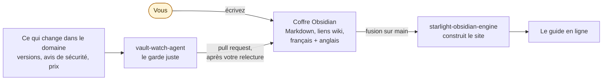
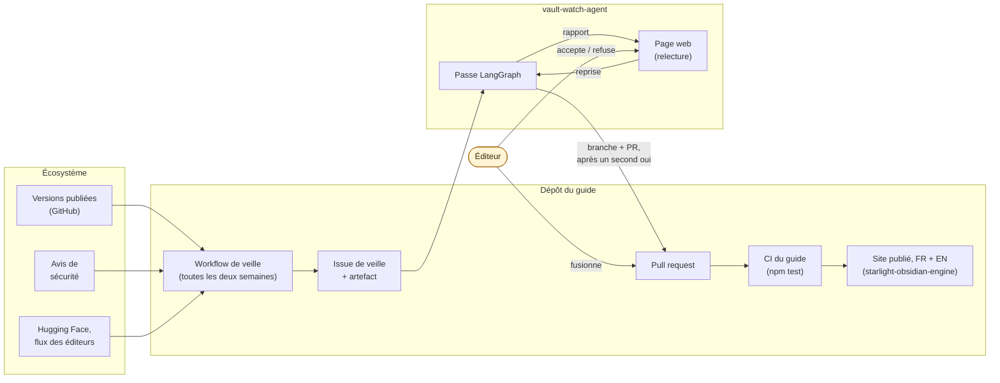
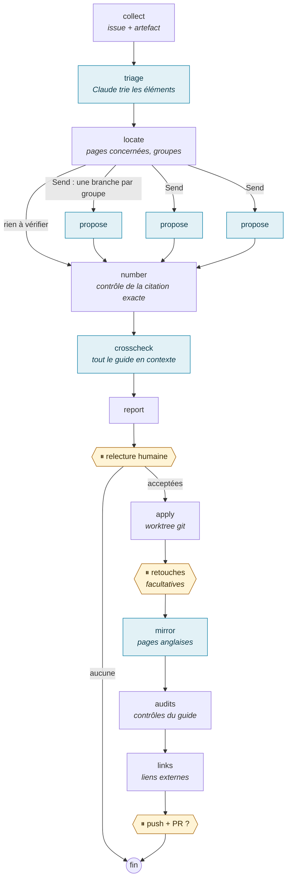
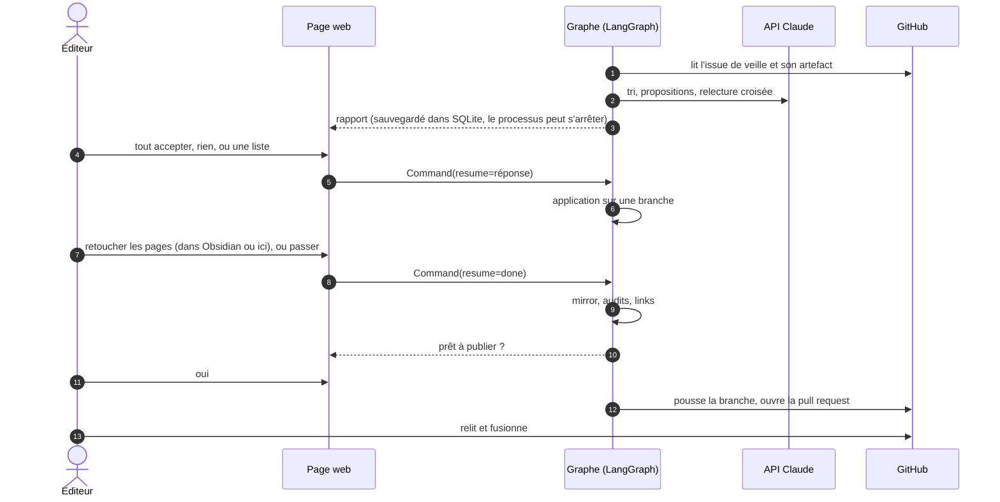
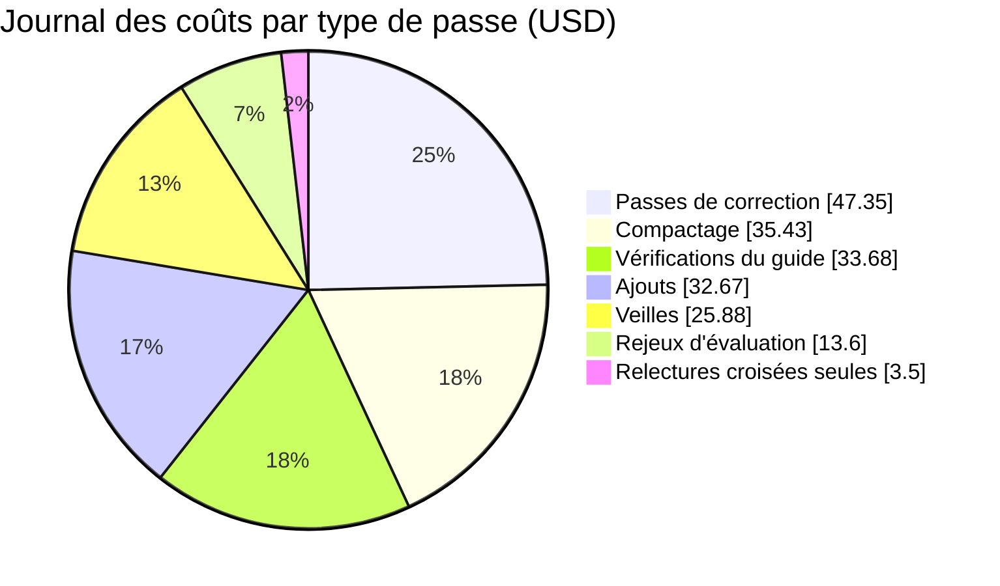
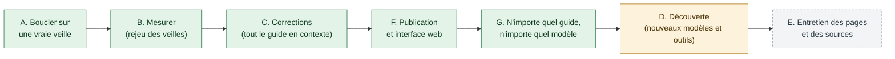

# vault-watch-agent : présentation

**Comment un guide technique de 400 k tokens reste juste, quinzaine après quinzaine, avec un humain qui décide de chaque changement.**

[English](../presentation.md) · **Français** · [README](../../README.fr.md)

---

## L'idée : écrire, publier, garder juste

Trois pièces, chacune dans son dépôt : le guide est un coffre [Obsidian](https://obsidian.md) dans lequel vous
écrivez ; [starlight-obsidian-engine](https://github.com/DamienBecherini/starlight-obsidian-engine) le publie sur le
web ; vault-watch-agent vous décharge de son entretien. L'agent travaille sur n'importe quel guide Markdown dans git,
publié ou non ; c'est l'ensemble pour lequel il a été écrit.

## Le problème : un guide technique périme vite

[Zero to Hero: On-Premise AI](https://ia-on-prem.damien.becherini.fr/) décrit les piles de LLM auto-hébergés : moteurs
d'inférence, matériel, versions minimales sûres, choix de modèles. Ses faits bougent chaque semaine : une nouvelle
version de vLLM change une option, un avis de sécurité relève la version minimale d'Open WebUI, un modèle change de nom.
Le guide fait environ 400 k tokens en français, avec un miroir anglais, et un seul numéro de version périmé sur une page
contredit cinq pages justes ailleurs.

Ce qui a changé est **collecté** sans modèle (la commande `collect` de l'agent, lancée par un workflow GitHub du
guide : versions, avis de sécurité, Hugging Face, flux des éditeurs, pages surveillées comme les grilles de prix).
L'agent fait ensuite la partie qui demande du jugement : **quelle page cela rend-il fausse,
que doit-elle dire à la place, et sur quelle source ?** Puis il attend un humain.

## La boucle complète

En plus de la veille de quinzaine, quatre autres entrées réutilisent le même graphe et la même relecture :

- **Passes de correction** : les erreurs signalées par un lecteur, par une relecture croisée ou par la page « Vérifier le
  guide » deviennent des corrections.
- **Vérification du guide à la demande** : contrôles gratuits (structure, liens morts, fraîcheur) et contrôles payants,
  avec une estimation du coût avant de les lancer.
- **Passes de compactage** : une veille ne fait qu'ajouter, donc un contrôle liste ce qui est répété, empilé ou
  plus long que nécessaire, et les allègements que l'éditeur garde sont relus comme des corrections
  ([Compactage](compact.md)).
- **Passes d'ajouts** : ce qu'aucune source de la veille n'annonce. Un contrôle liste ce qu'un lecteur chercherait
  et ne trouve pas, ou ce que les liens donnés par l'éditeur (une page, un PDF, une vidéo) contiennent pour le guide,
  et chaque piste que l'éditeur garde est vérifiée sur le web, puis écrite là où elle a sa place
  ([Nouveautés](news.md)).

## Le graphe de l'agent

Les étapes en bleu appellent Claude ; les autres sont du code ordinaire. Le modèle **propose** : chaque correction cite
le texte actuel de la page, et le code la refuse si cette citation n'apparaît pas exactement une fois. Le modèle n'écrit
jamais un fichier.

## Trois pauses, à des jours d'intervalle s'il le faut

Une passe en pause est conservée par le checkpointer de LangGraph : la relecture peut avoir lieu des heures ou des jours
plus tard, depuis la page web ou la ligne de commande, dans un autre processus.

## Ce qu'il a produit

Dix-neuf pull requests du guide, toutes relues et fusionnées, du 8 au 20 novembre 2026 :

| Type | Pull requests | Contenu |
| :-- | :-- | :-- |
| Veilles | [#51](https://github.com/DamienBecherini/ia-on-prem-vault/pull/51), [#53](https://github.com/DamienBecherini/ia-on-prem-vault/pull/53), [#72](https://github.com/DamienBecherini/ia-on-prem-vault/pull/72), [#78](https://github.com/DamienBecherini/ia-on-prem-vault/pull/78), [#100](https://github.com/DamienBecherini/ia-on-prem-vault/pull/100) | Corrections issues des veilles du 26 octobre, des 2, 9, 16 et 19 novembre (vLLM 0.33.0 minimum, CUDA 13 seulement) |
| Passes de correction | [#54](https://github.com/DamienBecherini/ia-on-prem-vault/pull/54), [#55](https://github.com/DamienBecherini/ia-on-prem-vault/pull/55), [#57](https://github.com/DamienBecherini/ia-on-prem-vault/pull/57), [#58](https://github.com/DamienBecherini/ia-on-prem-vault/pull/58), [#59](https://github.com/DamienBecherini/ia-on-prem-vault/pull/59), [#61](https://github.com/DamienBecherini/ia-on-prem-vault/pull/61), [#79](https://github.com/DamienBecherini/ia-on-prem-vault/pull/79), [#86](https://github.com/DamienBecherini/ia-on-prem-vault/pull/86) | Erreurs trouvées par les relectures croisées, les vérifications à la demande et la vérification de tout le guide |
| Traduction | [#60](https://github.com/DamienBecherini/ia-on-prem-vault/pull/60) | Pages anglaises corrigées d'après le français |
| Compactage | [#91](https://github.com/DamienBecherini/ia-on-prem-vault/pull/91) | Des allègements dans 39 pages et leurs miroirs : répétitions raccourcies, historique empilé retiré, 31 Ko de moins dans les pages françaises |
| Ajouts | [#96](https://github.com/DamienBecherini/ia-on-prem-vault/pull/96), [#97](https://github.com/DamienBecherini/ia-on-prem-vault/pull/97), [#98](https://github.com/DamienBecherini/ia-on-prem-vault/pull/98) | Ce qu'aucune source de la veille n'annonçait : versions et prix plus récents, sujets manquants, chacun vérifié sur le web |
| Sources de la veille | [#88](https://github.com/DamienBecherini/ia-on-prem-vault/pull/88) | 21 flux ajoutés après un contrôle des sources (des outils que le guide cite et qu'aucun flux ne suivait) |

Sur le rejeu des veilles passées, aucune proposition arrivée à la relecture n'était fausse ; les oublis sont analysés
dans le [README](../../README.fr.md#le-guide-de-référence).

## Ce qu'il coûte

Chaque appel au modèle est noté dans [`metrics/usage.jsonl`](../../metrics/usage.jsonl), au prix catalogue. Le journal au
20 novembre 2026 (192 $ : 99 $ jusqu'au 17 novembre, surtout le jour de la mise en route et pour la première
vérification de tout le guide, puis le premier compactage et les premiers ajouts, lancés plusieurs fois chacun pour
les régler) :

En régime normal, une veille avec relecture croisée de tout le guide coûte environ 4 $ ; deux par mois font environ 100 $
par an. Écrire les 400 k tokens du guide dans le cache coûte environ 2 $, chaque appel suivant sur ce cache environ
0,08 $ : c'est pourquoi l'agent lit tout le guide plutôt que d'utiliser un index de recherche.

Ces montants sont indicatifs : c'est ce que valent les appels au prix public de l'API. Les appels de l'auteur sont
passés par l'accès API de son abonnement Claude : il a payé son abonnement, rien de plus. Avec une clé facturée au
token, c'est ce que vous paieriez.

L'agent peut aussi passer par Claude Code connecté avec un abonnement Claude (le moteur par
défaut quand il en trouve un) : rien n'est facturé, les appels comptent dans les limites de l'abonnement, et le
journal garde leurs tokens avec ce qu'ils auraient coûté sur l'API.

## La suite

La phase G est faite : écrit pour ce seul guide, l'agent tient maintenant n'importe quel guide en Markdown, décrit
par un manifeste qui lui est propre ([Brancher son guide](connect-your-guide.md)), avec un choix de modèles et
des prix dont l'origine est affichée ([le plan](../modular-plan.md), en anglais). Les phases A, B, C et F sont faites
aussi ; la phase E l'est en partie (liens vérifiés avant publication, vérification à la demande, sources de la
veille contrôlées, compactage). La découverte (phase D) a commencé : depuis la 1.3.0, une passe d'ajouts écrit,
après relecture, ce qu'apporte une recherche de pistes ou l'éditeur ([Nouveautés](news.md)) ; il reste à suivre
des candidats dans le temps, d'une veille à l'autre. Détails et mesures : [ROADMAP.md](../../ROADMAP.md) (en anglais).

## Pour aller plus loin

- [README](../../README.fr.md) : utilisation (interface web et ligne de commande), fonctions de LangGraph utilisées, choix
  de conception, limites.
- [Brancher son guide](connect-your-guide.md) : le manifeste d'un guide, `vault-watch init` et `doctor`.
- [Collecter une veille](collect.md), [Compactage](compact.md), [Nouveautés](news.md) : la veille sans
  modèle, et les deux passes à côté d'elle.
- [Structure du code](code.md) : modules, état du graphe, appels au modèle, pause et reprise.
- [ROADMAP.md](../../ROADMAP.md) : phases, mesures, suite.
- Le guide : [site](https://ia-on-prem.damien.becherini.fr/) · [dépôt](https://github.com/DamienBecherini/ia-on-prem-vault).
