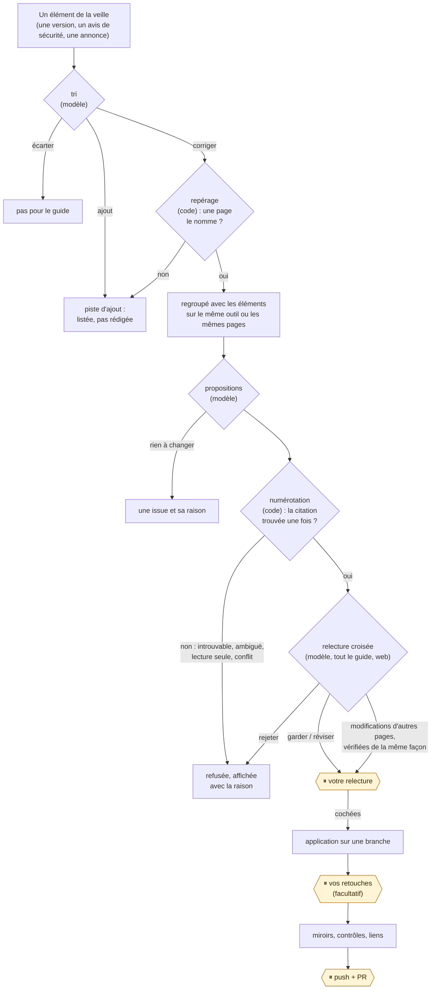
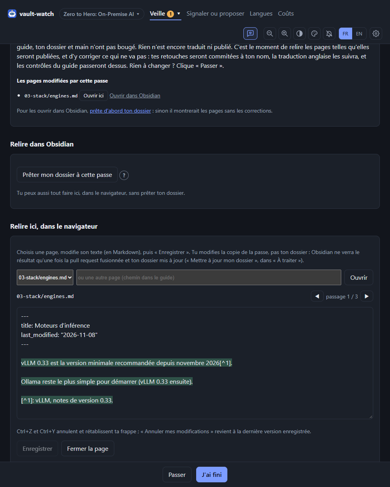
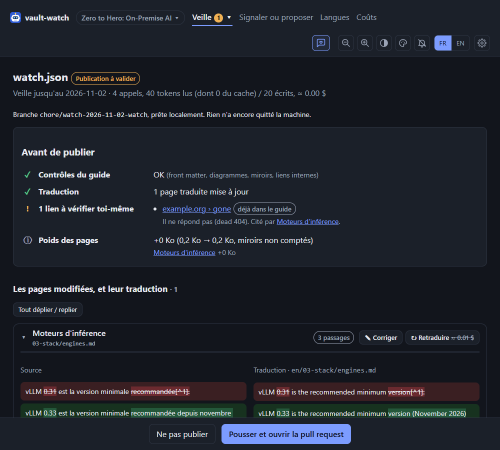
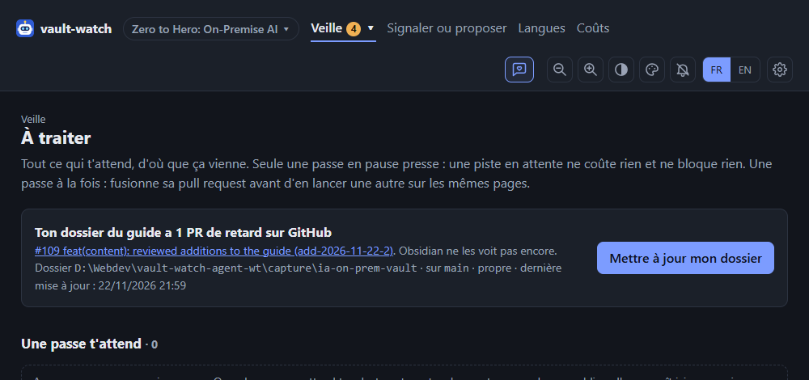
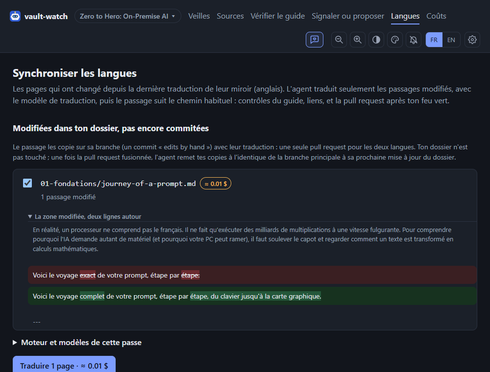
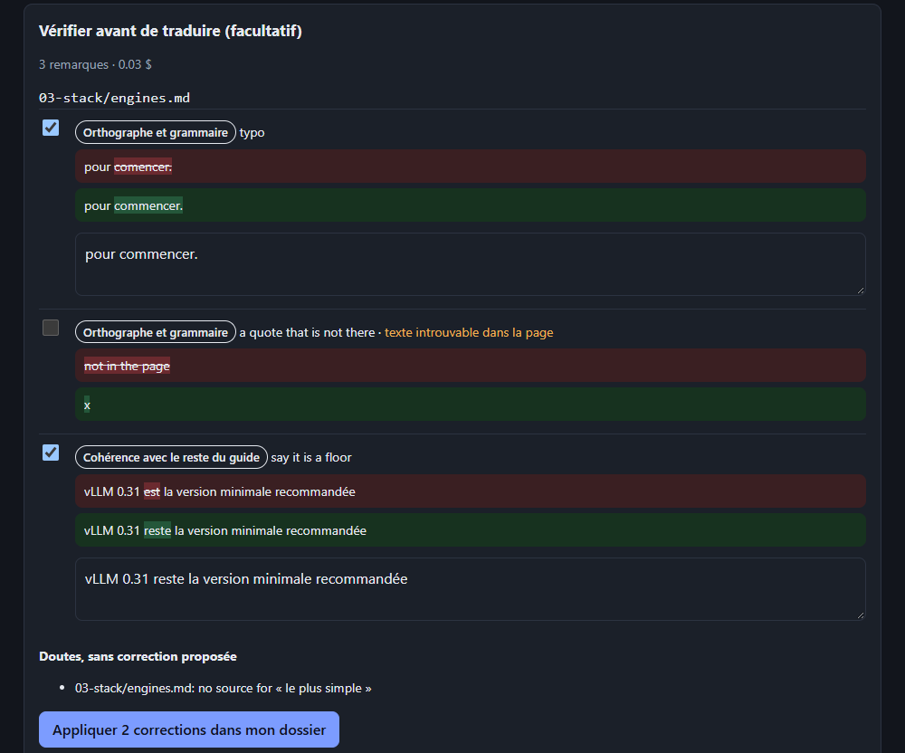
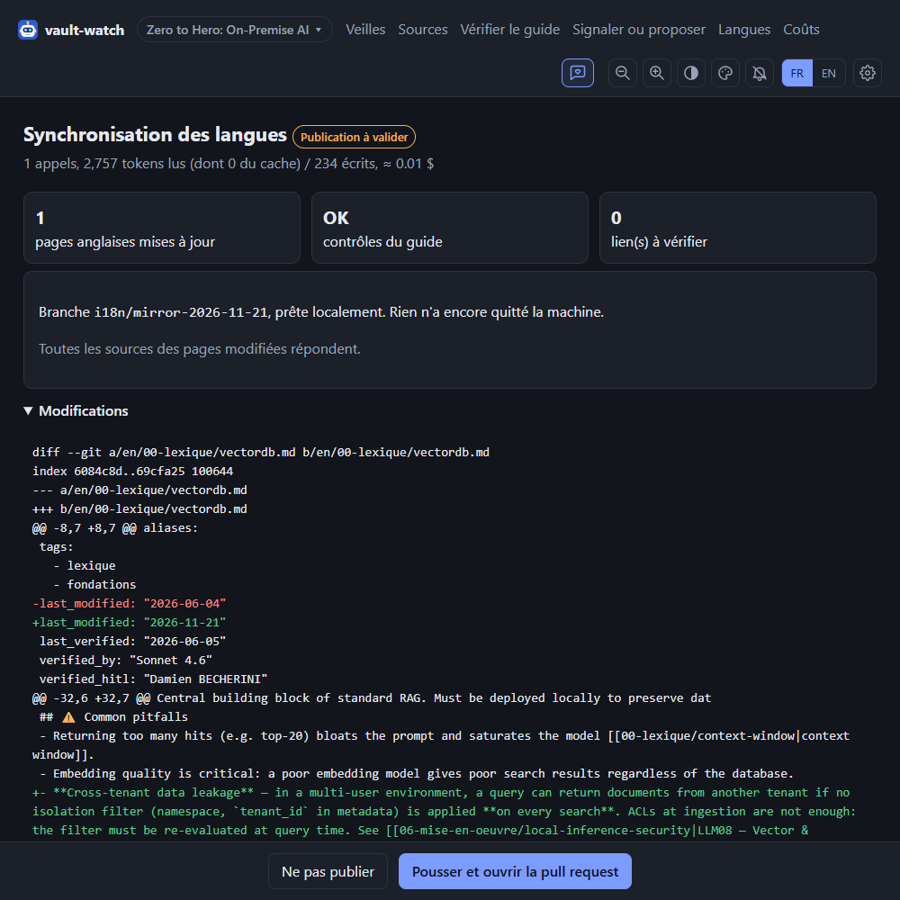

*[English version](../run.md)*

# Une veille, étape par étape

Le [README](../../README.fr.md#déroulé-dune-passe) montre une passe comme trois entrées et un seul chemin. Cette
page suit un élément d'une veille à travers chaque étape : ce que lit chaque étape, ce qui y décide, et ce qui peut arrêter une
modification avant que vous la voyiez. Puis les écrans où vous décidez : la relecture, la pause pour retoucher les
pages, et la publication ; et, une fois la pull request fusionnée, comment votre dossier du guide la reçoit.

## Un exemple : la veille du 16 novembre 2026

| Étape | Ce qui s'est passé | Coût au prix public |
| :-- | :-- | --: |
| collecte | 73 éléments, dont un avis de sécurité | 0 $ |
| tri | 6 éléments à corriger, 67 pas pour le guide, aucune piste d'ajout | 0,17 $ (2 appels) |
| repérage, propositions | 4 appels, un par groupe : 4 corrections | 0,30 $ |
| relecture croisée | 1 gardée, 3 révisées, aucune rejetée ; 7 modifications de plus sur d'autres pages, par cohérence | 2,70 $ (1 appel) |
| balayage | valeurs retirées encore présentes ailleurs : 2, laissées telles quelles | 0,14 $ |
| relecture | 11 corrections, 11 appliquées | |
| miroir | les pages anglaises des pages modifiées | 0,13 $ (4 appels) |
| publication | [pull request #78](https://github.com/DamienBecherini/ia-on-prem-vault/pull/78), fusionnée | |

3,44 $ en tout, 12 appels. La relecture croisée en fait les quatre cinquièmes : c'est l'appel qui lit tout le guide
([Coûts](costs.md)). C'est aussi elle qui a écrit l'essentiel de ce qui a été appliqué : les propositions voient
des extraits du guide, la relecture croisée voit toutes les pages.

## Ce qui décide à chaque étape

| Étape | Ce qu'elle lit | Ce qui décide | Ce qui peut arrêter une modification |
| :-- | :-- | :-- | :-- |
| `collect` | La veille que nomme le manifeste, et les affirmations dues du script de fraîcheur du guide | Le code | |
| `triage` | 40 éléments par appel : titre, domaine, niveau, date, « URGENT », adresse, et les 1 200 premiers caractères des notes que le collecteur a gardées | Le modèle, avec le brief du guide : corriger (une phrase existante peut changer), ajout (le guide ne couvre pas encore le sujet), écarter. Avec des termes de recherche : les noms exacts qu'emploierait le guide | Un élément pour lequel le modèle ne rend pas de décision est écarté, avec cette raison |
| `locate` | Les pages sources, cherchées avec les termes | Le code : un élément « corriger » qu'aucune page ne nomme devient une piste d'ajout (il manque peut-être le sujet au guide) | |
| regroupement | Les pages que touche chaque élément | Le code : les éléments qui partagent un terme de recherche (le nom d'un outil) vont toujours ensemble ; ceux qui partagent une page aussi, sauf par une page carrefour citée pour plus de quatre éléments. Chaque élément a sa propre part d'extraits | |
| `propose` | Un appel par groupe, en parallèle : ses éléments et leurs extraits, et la page des changements du guide si le manifeste en nomme une | Le modèle : des corrections qui citent le texte actuel, donnent le nouveau texte, une gravité et une source primaire ; les corrections qui n'ont de sens qu'ensemble forment un groupe. Pour un élément qui ne demande rien, une issue et sa raison | |
| `number` | Les corrections et les pages | Le code les numérote (C1, C2…) et contrôle chacune | La citation n'est pas dans la page, ou y figure plusieurs fois ; la page est en lecture seule ou absente ; la modification ne change rien ; elle supprime une note que son groupe ne remet pas ailleurs ; elle chevauche une correction précédente (« conflit avec C3 ») |
| `crosscheck` | Tout le guide (depuis le cache), chaque correction, et le web : elle ouvre la source citée | Le modèle : garder, réviser (le texte révisé en entier) ou rejeter. Puis les autres passages qui doivent changer pour que le guide reste cohérent, et ce qu'elle a remarqué ailleurs | Un rejet ; ses modifications de cohérence passent par les mêmes contrôles qu'une correction. Quand le guide ne tient pas dans la fenêtre, un appel par chapitre, signalé à la relecture ([Chapitres](chapters.md)) |
| balayage | Les valeurs que les corrections retirent (une version, une option, un identifiant) encore présentes dans d'autres pages | Le modèle : lesquelles doivent changer aussi | Ce qu'il laisse est listé : « valeurs retirées encore présentes, laissées telles quelles » |
| `report` | Tout ce qui précède | Le code écrit le rapport ; une correction qui ajoute une version qu'aucune des notes qu'elle cite ne mentionne porte un avertissement | |
| `review` | ⏸ Vous | Vous cochez | Un groupe dont un membre ne peut pas s'appliquer est écarté en entier |
| `apply` | Les corrections cochées | Le code, sur un worktree git d'une nouvelle branche (`chore/watch-<date>-<issue>` pour une veille venue d'une issue, `chore/watch-<date>` d'un fichier) : les modifications, le champ de date de chaque page, le script des versions minimales du guide si le manifeste en nomme un | |
| `retouch` | ⏸ Vous, si vous le voulez | Vous retouchez les pages de la branche, dans Obsidian ou dans la page, ou vous passez | |
| `mirror` | Chaque page miroir, avec ce qui a changé dans sa page source sur la branche, passage par passage (un paragraphe, une ligne de tableau, une ligne de liste) : les corrections, et toute modification à la main | Le modèle de traduction : les mêmes changements dans la langue du miroir, chaque citation contrôlée | Une citation introuvable dans la page miroir : la modification est sautée et listée |
| `translation` | ⏸ Vous, sur une passe « Langues » seulement | Vous validez chaque passage de la traduction, à côté de sa source, ou vous le retouchez | |
| `audits`, `links` | La branche | Les scripts du guide : ses contrôles, et les sources des pages modifiées (les nouvelles d'abord) | Rien n'est arrêté : ce qui échoue est montré avant la publication |
| `publish` | ⏸ Vous | Vous dites oui ou non ; ou vous corrigez une page, la faites retraduire ou recontrôler, et la passe revient aux miroirs ou aux contrôles | |

Les pistes d'ajout d'une veille ne sont pas rédigées : la relecture les liste avec leur raison, et le contrôle
« Nouveautés » les lit plus tard, avec ce que d'autres veilles ont mis de côté ([Nouveautés](news.md)).

## L'écran de relecture

Ce qu'il montre, de haut en bas :

- **Quatre chiffres** : les éléments de la veille, ceux qui touchent une page, les corrections proposées, les
  pistes d'ajout.
- **Pour une passe d'ajouts**, au-dessus des corrections : les pages que la passe dit nécessaires, puis, dans un
  cadre à part, les pistes qu'il a laissées sans modification et pourquoi ([Nouveautés](news.md#les-ajouts)).
- **Un bloc par élément de la veille, ou par piste** : son titre (une piste : « Piste n », son numéro sur la page de
  la vérification, et son titre), combien de corrections et de pages en sont sorties, sa source et « voir la
  vérification » pour une piste, et le texte anglais donné à la passe, replié (« Texte envoyé à la passe (en
  anglais) »). Puis ses corrections.
- **Une carte par correction** : son numéro, sa gravité et sa page ; le verdict et la raison de la relecture
  croisée (« keep », « revised », « added by the cross-check for C1, C3 », « added by the sweep ») ; un diff mot à
  mot de la page, ou, quand la correction ne fait qu'ajouter (une phrase après un paragraphe, une note), « Ajouté
  après « … » » et le texte nouveau seul ; la source sur laquelle elle s'appuie. Une correction qui ne peut pas
  s'appliquer dit pourquoi.
- **« Retoucher »** sur une carte : son texte proposé devient modifiable, le diff suit la frappe, et les contrôles
  gratuits repassent sur votre texte un instant après la dernière touche (un texte qui ne change rien, une note
  perdue, une version qu'aucune de ses notes ne mentionne). La citation du texte actuel ne change pas : votre texte
  s'applique là où le modèle a trouvé le passage. Aucun modèle n'est rappelé : votre texte fait foi, les miroirs le
  traduisent, et la pull request marque la correction ✍️ ; le rapport garde la proposition du modèle à côté de la
  vôtre. Une correction dont la citation est introuvable, ou en conflit avec une autre, ne se retouche pas : aucun
  texte ne répare l'endroit où elle s'applique. En ligne de commande :
  `vault-watch resume <passe> --accept C1,C3 --edit C3=mon-texte.md`.
- **Les groupes** : les corrections qui n'ont de sens qu'ensemble (une phrase et sa note, un chiffre et le tableau
  qui le reprend) se cochent ensemble, par une seule case (« n corrections liées ») qui dit pourquoi elles vont
  ensemble et qu'un texte se change en le retouchant, pas en le décochant. Un groupe dont un membre ne peut pas s'appliquer est écarté en entier :
  en appliquer la moitié laisserait le guide incohérent.
- **Ce que pèseraient les pages** : avant et après, les pages qui prennent le plus.
- **En dessous** : les pistes d'ajout (pas rédigées), ce que la relecture croisée a remarqué ailleurs dans le guide
  (à corriger par « Signaler ou proposer », onglet « Une erreur à corriger »), les affirmations à revérifier, les valeurs retirées encore présentes, et
  le rapport complet en Markdown.

Rien n'a encore touché le guide. « Ne rien appliquer » clôt la passe (et l'issue de la veille, avec un
commentaire) ; « Appliquer n corrections » continue.

## La pause pour retoucher les pages

Une fois les corrections appliquées sur la branche, et avant que les miroirs les suivent, la passe s'arrête de
nouveau : vous pouvez relire les pages telles qu'elles sont maintenant et retoucher le texte. C'est facultatif :
« Passer » continue aussitôt. Les corrections sont sur la branche de la passe, une copie à part du guide : votre
dossier et main n'ont pas bougé, Obsidian ne les voit donc pas encore. La page liste les pages modifiées par la
passe, chacune avec « Ouvrir ici » et « Ouvrir dans Obsidian ». Deux façons, qui se combinent :

- **Dans Obsidian.** « Prêter mon dossier à cette passe » (son « ? » dit pourquoi) met le dossier du guide sur la
  branche de la passe (détaché sur son dernier commit : git n'ouvre pas une branche à deux endroits), et Obsidian
  montre les pages corrigées ; « Ouvrir dans Obsidian » marche à partir de là (avant, il désigne le bouton qui prête
  le dossier, qui s'illumine un instant). Un dossier qui contient des modifications non commitées n'est prêté que si
  vous demandez de les mettre de côté : elles vont dans une remise git nommée d'après la passe, et reviennent avec
  le dossier. Un dossier au milieu d'une fusion ou d'un rebase n'est pas prêté. Un bandeau reste sur chaque page tant
  que le dossier est prêté, ou tant que ce qui a été mis de côté n'est pas revenu. « Reprendre mon dossier » le
  ramène sur main sans terminer l'étape : ce que vous avez modifié dans Obsidian est commité sur la branche de la
  passe, vous le retrouvez en ouvrant la page ici, et le dossier peut être prêté de nouveau.
- **Ici, dans le navigateur.** Un éditeur ouvre les pages modifiées par la passe, ou toute page du guide par son
  chemin. Les passages que les corrections ont changés sont en vert, avec « ◀ passage n / m ▶ » pour aller de l'un à
  l'autre ; l'éditeur s'ouvre au premier. Il signale les « Modifications non enregistrées » ; « Enregistrer »
  écrit le texte, « Annuler mes modifications » revient à la dernière version enregistrée (Ctrl+Z ramène encore les
  modifications), et le même bouton devient « Fermer la page » quand il n'y a rien à annuler. Il écrit dans le
  dossier prêté s'il y en a un (Obsidian voit ce que vous enregistrez), sinon dans la copie de la passe : la page
  nomme alors les pages retouchées hors de votre dossier, que votre dossier reçoit après la fusion, par « Mettre à
  jour mon dossier » ([plus bas](#après-la-fusion-mettre-à-jour-votre-dossier)).

« J'ai fini » commite ce qui a changé à votre nom (« Retouches at the review », avec votre propre identité git), fait
avancer la branche jusqu'à ce commit, rend le dossier là où il était et remet ce qui avait été mis de côté. La
passe continue : les miroirs traduisent vos retouches avec les corrections, les contrôles du guide et les liens
passent sur votre texte, et la pull request liste les pages retouchées. « Passer » abandonne ce qui a été retouché,
tapé ici ou commité depuis un dossier repris : la branche revient à ce que la relecture a appliqué. En ligne de
commande : `vault-watch resume <passe> --retouch done` une fois les fichiers de la copie de travail de la
passe retouchés (`vault-watch status` donne son chemin), ou `--retouch skip`. Une passe commencée avant que cette
pause existe reprend sans elle.

## L'écran de publication

Après l'application, les miroirs, les contrôles et les liens, la passe s'arrête de nouveau. La branche n'existe
que sur cette machine. De haut en bas :

- **« Avant de publier »**, un contrôle par ligne : les contrôles du guide (OK, ou l'échec avec son journal : un
  contrôle rouge, c'est une pull request rouge) ; la traduction (combien de pages traduites ont été mises à jour, et
  les problèmes signalés par le traducteur) ; les liens à vérifier vous-même, chacun avec les pages qui le citent,
  s'il a été ajouté par cette passe ou était déjà dans le guide, et pourquoi (le site ne répond pas, ou bloque les
  robots : ouvrez-le dans votre navigateur) ; le poids des pages, avant et après. Chaque page nommée là est un lien
  qui descend jusqu'à elle.
- **« Les pages modifiées, et leur traduction »** : une ligne par page (son titre, son chemin, son nombre de
  passages, « Corriger », « Retraduire » avec son estimation) ; dépliée, chaque passage de la source à côté de sa
  traduction, un ajout montré comme tel.
- **Le diff git brut de la branche**, replié, pour vérifier ligne à ligne.

« Corriger » ouvre la page et son miroir côte à côte, chacun à son premier passage modifié (en vert, avec
« ◀ passage n / m ▶ »). « Enregistrer et recontrôler » commite ce que vous avez corrigé à votre nom sur la branche de la
passe, puis les contrôles du guide et les liens repassent, sans modèle ; la passe revient à la même pause.
Quand seule la page source a été corrigée, l'écran prévient que sa traduction ne la suit plus, et propose
« Retraduire mes corrections » (le modèle de traduction, sur ce que vous avez changé) ou « Contrôler sans
retraduire ». « Retraduire » traduit une page depuis le début, après confirmation : sa traduction actuelle est
remplacée, y compris ce que vous y avez corrigé. La pull request nomme les pages corrigées à cette étape.

« Pousser et ouvrir la pull request » pousse la branche et l'ouvre, avec les corrections et leurs sources dans sa
description ; l'issue de la veille se ferme quand elle est fusionnée. « Ne pas publier » garde la branche en local.
Un guide sans dépôt garde la branche dans tous les cas (« Terminer (branche gardée en local) »).

## Après la fusion, mettre à jour votre dossier

La pull request est fusionnée sur la forge, pas dans votre dossier du guide : Obsidian montre les pages d'avant tant
que la branche de base du dossier n'avance pas. « À traiter » signale quand il manque au dossier des pull requests
fusionnées sur la forge (lesquelles, la branche du dossier, ses modifications non commitées, sa dernière mise à
jour), et la page d'une passe fusionnée le dit aussi tant que le dossier n'a pas sa pull request. Le menu « Veille »
le compte parmi ce qui vous attend.

« Mettre à jour mon dossier » fait avancer la branche de base, comme l'agent le fait déjà avant chaque passe :
en avance rapide seulement ; ce qui n'est pas commité reste tel quel ; la branche affichée n'est jamais changée (sur
une autre branche, seule la base avance, et le bouton la nomme : « Mettre à jour main »). C'est refusé tant que le
dossier est prêté à une passe. Quand git refuse (un fichier modifié dans le dossier et par la mise à jour), rien ne
bouge, et les fichiers en cause sont nommés.

## Pauses, erreurs, reprises

L'état est enregistré après chaque étape, dans une base SQLite : vous pouvez fermer la page, et revenir des jours
plus tard à une passe en pause à la relecture ; « À traiter » liste d'abord les passes qui vous attendent. Une
passe qui s'arrête sur une erreur (une coupure réseau, une
limite d'abonnement atteinte) reprend à la dernière étape terminée, depuis la page ou avec
`vault-watch resume --retry` ; l'agent ne passe jamais de lui-même à un moteur facturé
([Structure du code](code.md#comment-une-passe-se-met-en-pause-et-reprend)).

## Les autres passes, même chemin

Une passe de correction, une correction des traductions, une passe de compactage et une passe d'ajouts n'ont pas
de veille : ils entrent dans le graphe aux propositions, avec des pistes au lieu d'éléments, et suivent le même
chemin à partir de `number` ([Vérifier le guide](check.md)). Une correction des traductions saute la relecture
croisée ; une passe de compactage a la sienne, sans le web. Une passe « Langues » entre plus loin encore, après
`apply`, vos modifications déjà sur sa branche : elle ne s'arrête pas pour les retouches, mais à côté de chaque
traduction ([Synchroniser les langues](#synchroniser-les-langues)).

## Synchroniser les langues

C'est la façon de publier de l'éditeur : vous écrivez dans la langue du guide, dans Obsidian, puis vous demandez à
la page « Langues » que les autres langues suivent. Une page modifiée à la main, dans Obsidian ou ailleurs, laisse
son miroir en arrière. La page « Langues » de l'interface (`vault-watch mirror` en ligne de commande) liste deux
sortes de pages :

- **Modifiées dans votre dossier, pas encore commitées** : la passe les copie sur sa branche, dans un commit
  « edits by hand », pour qu'une seule pull request porte les deux langues. Votre dossier n'est pas touché. Une
  fois la pull request fusionnée, l'agent remet vos copies à l'identique de la branche principale à sa prochaine
  mise à jour du dossier (git refuserait sinon : il n'écrase jamais une modification locale, même identique). Une
  page dont le texte commité dans votre dossier n'est pas celui fusionné (une autre branche, un dossier en retard)
  n'est pas proposée : copiée sur une branche de la branche principale, elle déferait ce que celle-ci a reçu depuis.
- **En avance sur leur miroir** : déjà fusionnées, modifiées depuis le dernier commit qui a touché leur miroir. La
  traduction part de ce commit : c'est ce qui a changé entre-temps qui est traduit. Comparer le texte, et non les
  dates, trouve ce qu'un contrôle des dates manque : le 21 novembre 2026, une puce ajoutée à une page française du
  guide IA on-prem dans sa première pull request, jamais reportée dans la page anglaise.

Chaque page montre ses zones modifiées, deux lignes de contexte au-dessus et en dessous, le changement en diff mot
à mot : ce que la traduction va suivre, lu avant de la payer. Vous cochez les pages ; chacune montre ses passages
modifiés et son estimation (le modèle de traduction, environ
un centime par page sur le guide IA on-prem ; la première, le 21 novembre 2026, a coûté 0,01 $). La passe entre
ensuite dans le graphe comme si `apply` venait de tourner : `mirror` traduit, puis la passe s'arrête pour **relire
la traduction** : chaque passage de la source, avant et après, à côté de ce que le traducteur en a fait dans le
miroir, les deux en diff mot à mot, pour juger la traduction phrase à phrase. La traduction s'y retouche : votre
texte remplace celui du modèle (gardé dans la passe), et il est commité tel quel. Puis les contrôles du guide, les
liens, et la pause avant la pull request.

### Vérifier avant de traduire (facultatif)

Sous les pages, trois vérifications se cochent, chacune avec son estimation, sur les passages que vous avez
modifiés dans les pages cochées :

- **Orthographe et grammaire** : le modèle de traduction, sur les passages seuls (quelques centimes) ;
- **Véracité et pertinence, sur le web** : le modèle de raisonnement cherche la source primaire de chaque fait
  qu'énoncent les passages, et dit ce qui est faux ou dépassé (avec sa source), ou douteux (une note, sans
  correction) ;
- **Cohérence avec le reste du guide** : la relecture croisée lit tout le guide, vos modifications comprises, et
  liste ce qu'elles contredisent ou rendent obsolète ailleurs (≈ 2 $ au prix catalogue sur Opus, rien sur un
  abonnement). Sans elle, une synchronisation ne passe pas par la relecture croisée.

Chaque remarque arrive comme une correction à cocher, avec sa raison, son diff mot à mot et son texte, que vous
pouvez retoucher. « Appliquer n corrections dans mon dossier » écrit les corrections cochées dans votre dossier, comme si vous les
aviez tapées (la citation trouvée une seule fois, comme toute modification), et la page montre les pages telles
qu'elles sont alors : une correction d'une autre page en fait une page de plus à synchroniser. Rien ne change
avant ; une synchronisation lancée sans décider part sans les corrections.

