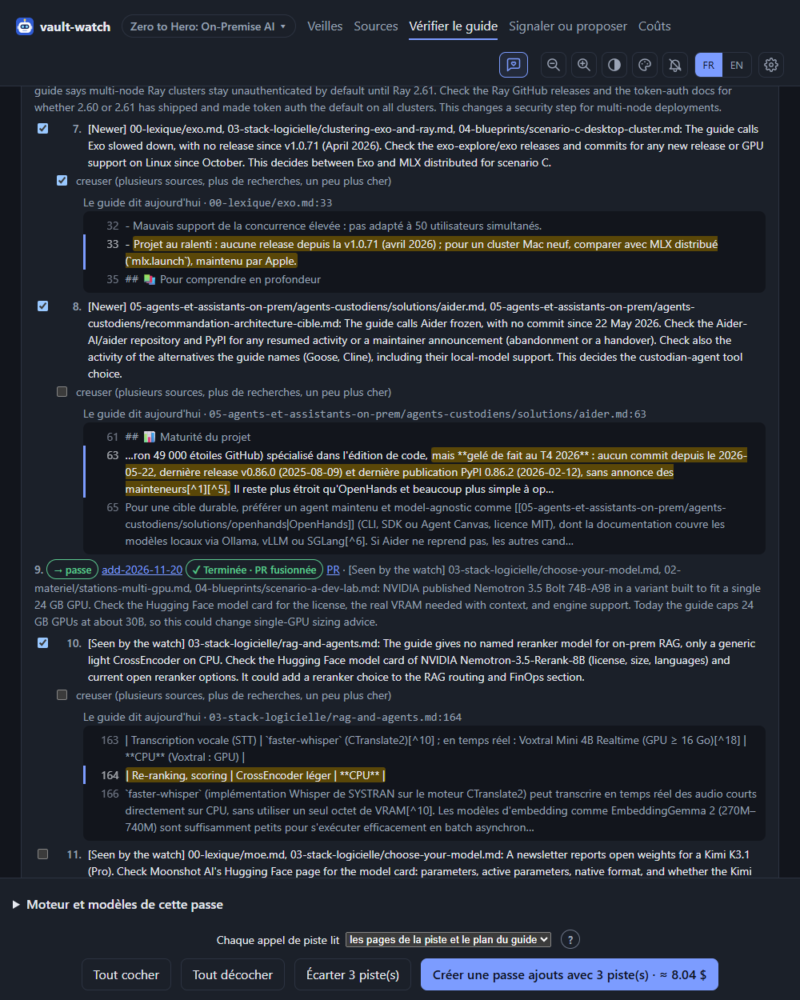

*[English version](news.md)*

# Chercher les nouveautés : ce qu'un lecteur chercherait et ne trouve pas

Une veille suit les sources qu'elle connaît déjà. Ce qu'aucune n'annonce reste hors du guide : une nouvelle
génération de matériel chez un constructeur que personne n'a ajouté aux flux, un sujet devenu une obligation, un
outil apparu depuis la rédaction. Et ce qu'une veille voit mais met de côté comme « ajout possible » n'est jamais
écrit : cela reste une ligne dans un rapport. Ce passage est à part des veilles. Il cherche ce qui manque et
propose de l'ajouter ; rien n'est écrit sans votre relecture, et un ajout suit le chemin d'une correction :
relecture croisée, relecture, miroirs, contrôles du guide, pull request.

Il a deux parties. Les deux appellent le modèle et annoncent leur coût avant de tourner. Les pistes se trouvent
de deux façons, qui répondent à deux questions différentes ; leurs pistes partent dans le même passage.

| Partie | Ce qu'elle fait | Web |
| :-- | :-- | :-- |
| Pistes, depuis le guide | Lit tout le guide, et ce que les veilles passées ont mis de côté, et liste ce qu'il faut aller vérifier. Ne vérifie rien, ne modifie rien | non |
| Pistes, depuis le web | Pour chaque chapitre choisi, cherche librement sur le web ce qui a bougé sur ses sujets et le compare à tout le guide. Ne modifie rien | oui |
| Ajouts | Pour les pistes que vous gardez : vérifie chacune sur des sources primaires, puis propose où l'écrire, ou dit pourquoi non | oui |

> **Limite.** Ce passage ajoute dans les pages existantes : il n'écrit jamais de nouvelle page. Quand un sujet
> demanderait une page à lui, il le dit, en tête de l'écran de relecture, de son rapport et de la pull request, et
> vous laisse décider.

## Les pistes

```bash
vault-watch --guide ../mon-guide news          # annonce son coût et demande avant l'appel
```

Dans l'interface : « Vérifier le guide », contrôle « Nouveautés : ce qu'un lecteur chercherait et ne trouve pas ».

Un appel lit toutes les pages du guide d'un coup. Il liste au plus 30 pistes, de trois sortes :

| Sorte | Ce que c'est |
| :-- | :-- |
| `Newer` | Ce que le guide présente comme actuel et qui a sans doute évolué : une génération de produit, une famille de modèles, une version majeure, une grille de prix, une règle en vigueur |
| `Missing` | Un sujet, un outil, un modèle, un matériel, un risque ou une obligation que le guide doit à ses lecteurs et qu'aucune page ne couvre |
| `Seen by the watch` | Un élément que des veilles passées ont mis de côté comme ajout possible, et que le guide ne couvre toujours pas |

Une piste est une question, pas un fait. Le modèle ne vérifie rien à ce stade, et ce qu'il sait peut être plus
ancien que le guide : on lui demande quoi vérifier et sur quel genre de source primaire, jamais un chiffre, une
version ou une date. Le seuil d'ajout propre au guide (son contrat, `[rules] brief` du manifeste) lui est donné.

Les éléments mis de côté par les veilles sont lus dans les rapports des passages gardés sur la machine (leur
section « Addition candidates »), sur les 120 derniers jours, chaque adresse une fois : ni modèle ni réseau pour
cette partie.

Les pistes qui ne concernent que des pages en lecture seule sont laissées de côté. Comme pour tout contrôle,
vous gardez les pistes que vous voulez, vous écartez les autres, et celles gardées partent dans un passage.

## Les pistes, depuis le web

```bash
vault-watch --guide ../mon-guide news --explore                        # les chapitres que le guide explore par défaut
vault-watch --guide ../mon-guide news --explore --chapters 02-materiel,03-stack
```

Dans l'interface : le contrôle « Nouveautés : exploration du web, chapitre par chapitre » ; le cocher affiche les
chapitres avec leur poids, et le coût suit les chapitres gardés. Tous sont cochés, sauf ceux que le guide déclare
avec `explore = false` (un lexique, les pages sur le projet). Ce qu'est un chapitre, et comment les faire proposer
par un modèle : [`[[chapter]]` dans le manifeste](connect-your-guide.fr.md#chapter).

Un appel par chapitre. Chacun lit tout le guide et cherche sur le web les sujets de son chapitre (environ 12
recherches et 15 pages), ouvre des sources primaires, et garde ce qu'aucune page du guide ne dit, huit pistes au
plus par chapitre. Une piste de cette sorte (`Found on the web`) est un fait lu sur une source, et elle porte les
adresses qui l'établissent. Une piste que deux chapitres ont trouvée par la même source n'est listée qu'une fois.

| | Depuis le guide | Depuis le web |
| :-- | :-- | :-- |
| Qui décide quoi chercher | Un appel lit le guide et pose au plus 30 questions | Chaque appel cherche librement sur les sujets d'un chapitre |
| Ce que vous cochez | Des questions, pas encore vérifiées | Des faits déjà trouvés, avec leurs sources |
| Quand le web est payé | Après votre tri, pour les pistes gardées | Avant que vous ayez rien vu, pour chaque chapitre |
| Ce qu'il peut manquer | Ce que personne n'a pensé à demander | Ce qu'une douzaine de recherches par chapitre n'ont pas croisé |

La première répond à « ceci est-il encore à jour, ce sujet connu manque-t-il ? » ; la seconde est la seule qui
trouve ce qu'on ne savait pas demander. Un chapitre dont l'appel échoue est signalé dans le résultat, et les
autres continuent.

## Une idée ou une information à vous

Quand vous savez déjà quoi regarder, sautez la recherche de pistes : « Signaler ou proposer », onglet « Une idée
ou une information à creuser » (un lien sur « Vérifier le guide » y mène). Un sujet par ligne, avec une adresse
si vous en avez une ; une case demande que chacun soit creusé. Les sujets partent directement dans un passage
d'ajouts.

```bash
vault-watch --guide ../mon-guide fix mon-idee --findings idee.txt --add    # une ligne qui commence par ! est creusée
```

## Les ajouts

```bash
vault-watch --guide ../mon-guide fix add-2026-11-20 --findings pistes.txt --add
```

Dans l'interface : cochez les pistes, puis « Créer une passe ajouts » ; le bouton affiche une estimation qui suit
le nombre de pistes cochées.



Pour chaque piste, le modèle cherche sur le web et ouvre des sources primaires, puis décide :

- rien de nouveau, rien qu'une source primaire établisse, déjà couvert, ou sous le seuil du guide : aucune
  modification, et la raison en une ligne, dans le rapport du passage ;
- le guide dit quelque chose de dépassé : une correction là où c'est dit, le fait actuel à la place de l'ancien ;
- le guide ne l'a pas : un ajout là où un lecteur le chercherait (une phrase dans son paragraphe, une ligne dans
  le tableau qui liste ces choses, un court paragraphe sous le bon titre), avec sa source citée comme la page
  cite les siennes ;
- il faudrait une page à part : la page n'est pas écrite. Le rapport dit « needs a page », avec ce qu'elle
  contiendrait et où ; écrire une nouvelle page reste votre décision.

**Creuser.** À côté de chaque piste, une case « creuser » (en ligne de commande, un `!` en début de ligne dans le
fichier). Son appel reçoit alors la consigne d'aller plus loin : plusieurs sources indépendantes, ce que le sujet
remplace, sa maturité et sa disponibilité, ce qu'il change pour chaque type de lecteur, sur plusieurs pages s'il
le faut. Cela coûte un peu plus qu'une piste ; à garder pour les sujets qui le méritent.

La relecture montre, au-dessus des corrections, les pages que le passage dit nécessaires, puis les pistes qu'il a
laissées sans modification et pourquoi : ce qu'une recherche a trouvé sans rien écrire est aussi un résultat.

Les modifications passent ensuite par la relecture croisée d'une veille (tout le guide, et la source citée
rouverte), votre relecture, les miroirs, les contrôles du guide et la pull request, sur une branche
`feat/<passage>`.

## Ce que lit chaque appel, et ce que cela coûte

Les pistes prennent un appel, qui lit tout le guide. Les ajouts prennent un appel par piste. Le web d'un appel
a un plafond (20 recherches, 30 pages), et des pistes réunies dans un appel se le disputaient : au premier
passage réel, une piste sur six grilles de prix a laissé ses trois voisines sans vérification. Une piste que son
appel n'a pas pu regarder est marquée « pas vérifiée par la passe » sur la vérification, avec un bouton qui la
remet parmi les pistes à traiter. Ce que deux appels ajoutent à la même page est assemblé par le programme (un
numéro de note choisi par les deux est renommé, deux lignes ajoutées après la même ligne s'appliquent toutes les
deux). Ce qu'un appel lit du guide se choisit (plus bas) : les pages de sa piste et le plan du guide par défaut,
plusieurs appels tournant en même temps, ou tout le guide. Avec tout le guide sur l'API Claude, le premier appel
l'écrit dans le cache et les autres le lisent là ; avec un autre moteur, ces appels se suivent.

Les estimations ci-dessous valent pour le guide IA on-prem (129 pages, environ 430 000 tokens), avec Opus 5.5
pour les pistes, les ajouts et la relecture croisée. Les pistes depuis le guide et les passages d'ajouts sont
réglés sur des passages réels ; le web exploré par chapitre n'a pas encore tourné pour de vrai, et ses constantes
sont comptées large.

| | Estimation |
| :-- | :-- |
| Les pistes, depuis le guide | ≈ 2,40 $ (2,28 $ mesurés le 20/11/2026 pour 28 pistes) |
| Les pistes, depuis le web | ≈ 2 $, plus ≈ 4,75 $ par chapitre exploré |
| Un passage d'ajouts, chaque appel avec tout le guide | ≈ 6,30 $, plus ≈ 2,15 $ par piste gardée, ou ≈ 2,80 $ pour une piste creusée |
| Un passage d'ajouts, chaque appel avec les pages de sa piste et le plan | ≈ 4,30 $, plus ≈ 1,10 $ par piste gardée, ou ≈ 1,50 $ pour une piste creusée |

Le passage d'ajouts est réglé sur trois passages réels (20/11/2026). Avec tout le guide : 11,01 $ pour une piste
sur six grilles de prix et une piste creusée (29 modifications), puis 12,94 $ pour trois pistes (14
modifications), miroirs compris. Avec les pages de la piste et le plan : 8,72 $, miroirs compris, pour cinq pistes
(35 modifications), là où tout le guide aurait coûté environ 17 $. Ce qui ne dépend pas des pistes, c'est la
relecture croisée, environ 4 $ à chaque fois. Avec tout le guide, une piste qui vérifie une seule version ne coûte
pas moins qu'une autre (16 à 25 tours de recherche, chacun relisant le guide depuis le cache) ; avec ses propres
pages, une piste a coûté de 0,40 à 1,30 $.

**Ce que lit l'appel de chaque piste** se choisit à la création du passage (une liste au-dessus du bouton sur la
page des pistes ; `--context pages` ou `--context guide` en ligne de commande ; les pages de la piste et le plan
par défaut).

- *Tout le guide* : l'appel voit chaque page. Le plus sûr, et le plus cher.
- *Les pages de la piste et le plan du guide* : l'appel lit les pages que la piste nomme, celles qu'elle demande
  de lire, et le plan du guide (chaque page avec son chemin, son poids, son titre et ses intertitres). Sur le guide
  IA on-prem, cela fait 50 à 90 Ko au lieu de 830. L'appel ne modifie que ces pages, et nomme dans son résultat une
  autre page que le plan lui suggère. Une piste qui ne nomme aucune page lit quand même tout le guide.

C'est la piste qui dit quelles pages lire : l'appel qui liste les pistes a tout le guide sous les yeux, il nomme
donc les pages concernées et, après « Read also: », jusqu'à six autres qu'il faut avoir lues pour bien écrire la
piste (une page qui énonce le même fait, la fiche de lexique, une page dont le conseil changerait). Les pistes
listées avant cette fonction ne nomment que les pages concernées. Dans les deux cas, la relecture croisée lit
ensuite tout le guide : c'est elle qui rattrape une répétition ou une contradiction avec une page que l'appel
n'a pas vue.

Ce que le choix change, vu sur le passage de cinq pistes : les appels ont écrit 16 modifications sur les pages
reçues, et la relecture croisée en a ajouté 19 sur quatre pages qu'ils n'avaient pas vues (un plancher de sécurité
écrit à huit endroits, les réglages par défaut qu'une nouvelle version change). Tous les endroits qui énonçaient
les anciennes valeurs ont été atteints. Les modifications ajoutées par la relecture croisée ne sont relues par
aucun autre modèle : elles portent la mention « added by the cross-check » dans la relecture, et méritent plus
que les autres l'œil de l'éditeur.

Les étapes « pistes de nouveautés », « exploration du web par chapitre » et « ajouts vérifiés sur le web »
apparaissent dans les Réglages, où chacune peut tourner sur un modèle à elle. Avec un moteur payé par un
abonnement, rien n'est facturé, et ces appels comptent dans ses limites.

## Ce qu'il ne fait pas

- Il n'écrit pas de nouvelle page, ni de nouvelle entrée de lexique dans un fichier à elle : il dit qu'il en
  faudrait une.
- Il ne remplace pas la veille : la veille lit chaque semaine ce que publient ses sources, pour quelques
  centimes ; ce passage cherche, de temps en temps, ce qu'aucune source n'annonce.
- Il ne contrôle pas ce que le guide dit déjà (les contrôles « Cohérence de tout le guide » et « Revérification
  des affirmations datées » le font).

## Quand

Après un compactage plutôt qu'avant : ce passage ajoute au guide, et il le lit en entier. Une fois par trimestre
est un rythme raisonnable pour un guide qu'une veille hebdomadaire suit déjà, ou quand un sujet bouge vite.
