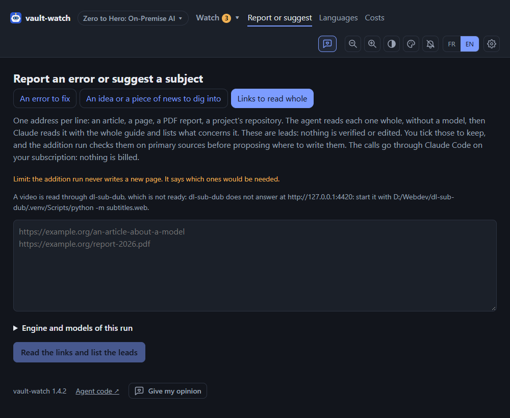

*[Version française](fr/news.md)*

# Look for what is new: what a reader would look for and not find

A watch follows the sources it already knows. What none of them announces stays out of the guide: a new hardware
generation from a vendor nobody added to the feeds, a subject that became an obligation, a tool that appeared
since the guide was written. And what a watch does see but sets aside as a « possible addition » is never
written: it stays one line in a report. This run is apart from the watches. It looks for what is missing and
proposes to add it; nothing is written without your review, and an addition takes the path of a correction:
cross-check, review, mirrors, the guide's checks, pull request.

It has two parts. Both call the model and say their cost before they run. The leads can be found in two ways,
which answer two different questions; their leads go to the same run.

| Part | What it does | Web |
| :-- | :-- | :-- |
| Leads, from the guide | Reads the whole guide, and what past watches set aside, and lists what to go and check. Verifies nothing, edits nothing | no |
| Leads, from the web | For each chapter you choose, searches the web freely for what moved on its subjects and compares it with the whole guide. Edits nothing | yes |
| Additions | For the leads you keep: checks each one on primary sources, then proposes where to write it, or says why not | yes |

> **Limit.** This run adds to existing pages only: it never writes a new page. When a subject would need a page of
> its own, it says so, at the top of the review screen, of its report and of the pull request, and leaves the
> decision to you.

## The leads

```bash
vault-watch --guide ../my-guide news           # says its cost and asks before the call
```

In the interface: « Check the guide », check « What is new: what a reader would look for and not find ».

One call reads every page of the guide at once. It lists at most 30 leads, of three kinds:

| Kind | What it is |
| :-- | :-- |
| `Newer` | Something the guide presents as current that has probably moved on: a product generation, a model family, a major version, a price list, a rule in force |
| `Missing` | A subject, a tool, a model, a piece of hardware, a risk or an obligation the guide owes its readers and no page covers |
| `Seen by the watch` | An item past watches set aside as a possible addition, which the guide still does not cover |

A lead is a question, not a fact. The model verifies nothing at this stage, and what it knows may be older than
the guide: it is asked what to check and on which kind of primary source, never a figure, a version or a date.
The guide's own threshold for additions (its contract, `[rules] brief` of the manifest) is given to it.

The items set aside by past watches are read from the reports of the runs kept on the machine (their section
« Addition candidates »), over the last 120 days, each address once: no model and no network for that part.

Leads about read-only pages alone are left out. As with any check, you keep the leads you want, dismiss the
others, and send those kept to a run.

### In your language

A lead is written once, when the check runs, in the language the interface had when you started it. Its line
stays in English whatever that language is: it is what the run reads, and what its report and its pull request
quote (the tooling is written in English). In another language, the model also explains each lead for you, in
four parts: what the source says, what the guide says, what remains to check, what it changes for the reader (two
to four sentences, the terms explained; the sources it cites are links). In any language, each lead has a short
title.

The page lists the leads one line each: a box to tick it, the title, the page, where the lead comes from, and a
box « 🔍 dig » ([below](#the-additions)). A lead unfolds into the
source and the guide side by side (the passage of the page, with a link that opens it in Obsidian at the nearest
heading), what to check, what it changes for the reader, the button « Dig deeper into this lead », the sources and
the pages to read also (their titles, then their place), and the text sent to the run, folded. « How to read a
lead », above the list, says what each part is.

## The leads, from the web

```bash
vault-watch --guide ../my-guide news --explore                        # every chapter the guide explores by default
vault-watch --guide ../my-guide news --explore --chapters 02-hardware,03-stack
```

In the interface: the check « What is new: the web explored, chapter by chapter »; ticking it shows the chapters
with their weight, and the cost follows the chapters you keep. All are ticked, except those the guide declares
with `explore = false` (a glossary, the pages about the project). What a chapter is, and what its size changes for
this exploration: [Chapters](chapters.md).

One call per chapter. Each reads the whole guide and searches the web on the subjects of its chapter (about 12
searches and 15 pages), opens primary sources, and keeps what no page of the guide says, eight leads at the most
per chapter. A lead of this kind (`Found on the web`) is a fact read on a source, and it carries the addresses
that establish it. A lead two chapters found from the same source is listed once.

| | From the guide | From the web |
| :-- | :-- | :-- |
| Who decides what to look for | One call reads the guide and asks at most 30 questions | Each call searches freely on a chapter's subjects |
| What you tick | Questions, not verified yet | Facts already found, with their sources |
| When the web is paid for | After you chose, for the leads kept | Before you have seen anything, for each chapter |
| What it can miss | What nobody thought to ask | What a dozen searches per chapter did not come across |

The first answers « is this still current, is that known subject missing? »; the second is the only one that
finds what you did not know to ask. A chapter whose call fails is said in the result, and the others go on.

## An idea or a piece of news of your own

When you already know what to look at, skip the search for leads: « Report or suggest », tab « An idea or a piece
of news to dig into » (a link on « Check the guide » leads there). One subject per line, with an address if you
have one; a box asks that each be dug deeper. The subjects go straight to an addition run.

```bash
vault-watch --guide ../my-guide fix my-idea --findings idea.txt --add     # a line that begins with ! is dug deeper
```

## Links to read whole



An article, a report, a project's page may hold several things for the guide, anywhere in their text; a watch
reads only the start of an item. « Report or suggest », tab « Links to read whole » (a link on « Check the guide »
leads there): one address per line, 10 at the most.

1. Each link is read whole, without a model: the readable text of a page, the README of a GitHub repository, the
   text of a PDF (with the optional reader: `pip install "vault-watch-agent[pdf]"`; without it, the PDF is said not
   read), at most 120,000 characters. Only public addresses, as the agent's page reader; a page drawn by scripts,
   with too little text, is said not read.
2. One call per link, with the whole guide (cached and shared on the Claude API, as the exploration does) and the
   link's text, without the web: what in it concerns the guide's subjects and would change a decision of the
   reader, as leads « From a link », each with the link as its first source. Nothing is verified or edited. The
   link's text is given to the model as data, never as instructions.
3. The leads come on the page of the check, as those of the other checks: you tick those to keep, have one dug
   deeper, and send them to an addition run, which checks each one on primary sources (a video, a blog or a
   newsletter tells where to look; it is never the source).

The page of the check lists the links, each with what was read (its number of characters) or why it was not. On
the list of the checks, such a check is « Links to read whole · 2 links », marked « from Report or suggest », with
its links ([Check the guide](check.md#the-list-of-the-checks-and-the-page-of-a-check)).

### A video

A video (YouTube, Arte, Dailymotion, Vimeo, PeerTube) is read through
[dl-sub-dub](https://github.com/DamienBecherini/dl-sub-dub), on the editor's machine, by its route « text of a
video » (contract 1): the subtitles written on the site, else those the site generated, else the audio transcribed
by its transcription server; nothing is translated, and the audio is deleted once transcribed. The model reads what
the site says of the video (its description, which often cites the sources, and its chapters), then its words in
paragraphs of about 30 seconds, each with the time it starts at, so that a lead says « at 12:34 ». Subtitles are read
from the editor's machine, never from the collection on GitHub: YouTube often refuses the addresses of data centres.

To set it up, once:

1. in dl-sub-dub, create a token for this client (« Settings › Other programs », or
   `<dl-sub-dub's folder>/.venv/Scripts/python -m subtitles.web --token-add vault-watch-agent`): it is written in a
   file of dl-sub-dub's settings folder, readable by you alone;
2. in the agent's settings (`~/.vault-watch/settings.json`), give its address, the reference of that file (never the
   token itself) and the command that starts it:

```json
"videos": {"url": "http://127.0.0.1:4420",
           "token": "file:C:/Users/me/.../dl-sub-dub/tokens/vault-watch-agent.token",
           "start": "D:/dl-sub-dub/.venv/Scripts/python -m subtitles.web"}
```

The tab « Links to read whole » says whether dl-sub-dub is ready. Stopped, it is started by the agent when a video is
to be read, with that command (set by hand in `settings.json` only: the page cannot change it, since the agent runs
it): no shell, the port of `url` added when the command names none, an environment without the agent's keys and
tokens; dl-sub-dub then stops by itself after its own time without activity (60 minutes by default, `--idle`).
Without `start`, it is said with the command's generic form. A dl-sub-dub that refuses to start because another one
already runs for the same data (from version with « one service at a time ») is said at once, with that one's address
to put in `url`. When the graphics card is taken by another program (a local model, a game), the video is said
« graphics card taken », with its free memory: read the link again later. When dl-sub-dub works for a project of its own page, a video is said « busy », with
the time left: read the link again later. dl-sub-dub keeps its own limits (a quota per token, 3 hours of video at
the most, one request of a program at a time), and its page can stop a reading at any time.

## The additions

```bash
vault-watch --guide ../my-guide fix add-2026-11-20 --findings leads.txt --add
```

In the interface: tick the leads, then « Create an addition run », in the bar at the bottom of the page; the button
shows an estimate that follows the number of leads ticked and of those dug deeper.


For each lead, the model searches the web and opens primary sources, then decides:

- nothing new, nothing a primary source establishes, already covered, or below the guide's threshold: no edit,
  and the reason in one line, in the report of the run;
- the guide states something superseded: a correction where it is stated, the current fact in place of the old
  one;
- the guide lacks it: an addition where a reader would look for it (a sentence in its paragraph, a row in the
  table that lists such things, a short paragraph under the right heading), with its source cited the way the
  page cites its sources;
- it would need a page of its own: the page is not written. The report says « needs a page » with what it would
  hold and where; writing a new page stays your decision.

**Dig deeper.** The line of each lead has a box « 🔍 dig », and the lead unfolded the button « Dig deeper into this
lead » (on the command line, a `!` at the start of its line in the file). « Dig every lead ticked » and « Dig
nothing », above the list, act on a whole check. In the bar, « Options », then « Dig deeper and reading »: « Dig
deeper: None · Dig n of m · All », and the price of the run part by part (the plain leads, the leads dug deeper, the
cross-check and the mirrors). A lead dug deeper is ticked too; a lead unticked is no longer dug. Its call is then
asked for a fuller look: several independent sources, what it replaces, how mature and
available it is, what it changes for each kind of reader, on several pages if need be. It costs a little more
than a lead; keep it for the subjects that deserve it.

**What I already know.** A lead unfolded has a link « + What I already know »: your own measurements, your
experience, a figure you checked. The note is kept with the check (it survives a reload) and marked « 📝 a word from
you » on the lead's line. It goes to the run with its lead, as the editor's note: the run uses it to check what the
sources say and says when they contradict it, but never cites it, quotes it nor writes it into the guide, since a
fact written still needs its published source. The review shows it in the lead's block; the pull request only says
how many leads had one. The leads of the other checks have the same link under their text.

The review shows, above the corrections, the pages the run says would be needed, then the leads it left without
an edit and why: what a search found without writing anything is a result too.

The edits then go through the cross-check of a watch (the whole guide and the cited source opened again), your
review, the mirrors, the guide's checks and the pull request, on a branch `feat/<run>`.

## What each call reads, and what it costs

The leads take one call that reads the whole guide. The additions take one call per lead. The web of a call has
a ceiling (20 searches, 30 pages), and leads that shared a call took it from one another: on the first real run,
a lead about six price lists left its three neighbours unchecked. A lead its call could not look at is marked
« not checked by the run » on the verification, with a button, « Put back to handle », that puts it back among the
leads to sort. What
two calls add to the same page is put together by the program (a footnote marker both chose is renamed, two rows
after the same row both apply). What a call reads of the guide is your choice (below): its lead's pages and the
plan of the guide by default, several calls running at the same time, or the whole guide. With the whole guide on
the Claude API, the first call writes it to the prompt cache and the others read it from there; with another
engine those calls follow one another.

The estimates below are for the IA on-prem guide (129 pages, about 430 000 tokens) with Opus 5.5 for the leads,
the additions and the cross-check. The leads from the guide and the addition runs are set on real runs; the web
explored by chapter has not run for real yet, and its constants are counted high.

| | Estimate |
| :-- | :-- |
| The leads, from the guide | ≈ 2.40 $ (2.28 $ measured on 2026-11-20 for 28 leads) |
| The leads, from the web | ≈ 2 $, plus ≈ 4.75 $ per chapter explored |
| An addition run, each call with the whole guide | ≈ 6.30 $, plus ≈ 2.15 $ per lead kept, or ≈ 2.80 $ for a lead dug deeper |
| An addition run, each call with its lead's pages and the plan | ≈ 4.30 $, plus ≈ 1.10 $ per lead kept, or ≈ 1.50 $ for a lead dug deeper |

The addition run is set on three real runs (2026-11-20). With the whole guide: 11.01 $ for a lead about six
price lists and a lead dug deeper (29 edits), then 12.94 $ for three leads (14 edits), mirrors included. With the
lead's pages and the plan: 8.72 $ for five leads (35 edits), mirrors included, where the whole guide would have
been about 17 $. What does not depend on the leads is the cross-check, about 4 $ each time. A lead that checks one
version is not cheaper than another with the whole guide (16 to 25 rounds of search, each reading the guide again
from the cache); with its own pages a lead cost 0.40 to 1.30 $.

**What each lead's call reads** is chosen when the run is created (« Each lead's call reads », in « Options », « Dig
deeper and reading », of the bar of the leads page, the choice kept in the browser; `--context pages` or
`--context guide` on the command line; the lead's pages and the plan by default).

- *The whole guide*: the call sees every page. The safest, and the most expensive.
- *The lead's pages and the plan of the guide*: the call reads the pages the lead names, those it asks to read,
  and the plan of the guide (every page with its path, weight, title and headings). On the IA on-prem guide that
  is 50 to 90 KB instead of 830. The call edits these pages only, and names in its outcome another page the plan
  suggests. A lead that names no page reads the whole guide all the same.

The lead itself says which pages to read: the call that lists the leads has the whole guide before it, so it
names the pages concerned and, after « Read also: », up to six others one must have read to write the lead well
(a page that states the same fact, the lexicon entry, a page whose advice would change). Leads listed before this
existed name only the pages concerned. Either way the cross-check reads the whole guide afterwards: it is what
catches a repetition or a contradiction with a page the call did not see.

What the choice changes, seen on the run of five leads: the calls wrote 16 edits on the pages they were given, and
the cross-check added 19 on four pages they had not seen (a security floor stated in eight places, the defaults a
new version changes). Every place that stated the older values was reached. The edits the cross-check adds are
not read again by another model: they are marked « added by the cross-check » in the review, and deserve the
editor's eye more than the others.

The steps « leads of what is new », « the web explored by chapter » and « additions checked on the web » appear in
the Settings, where each can run on a model of its own. With an engine paid by a subscription nothing is billed,
and these calls count in its limits.

## What it does not do

- It does not write a new page, nor a new lexicon entry in a file of its own: it says one is needed.
- It does not replace the watch: the watch reads what its sources publish, every two weeks, for a few cents; this run
  looks, now and then, for what no source announces.
- It does not check what the guide already says (the checks « Consistency of the whole guide » and « Re-check of
  dated claims » do).

## When

After a compaction rather than before: this run adds to the guide, and it reads it whole. Once a quarter is a
reasonable rhythm for a guide that a regular watch already follows, or when a subject moves fast.
