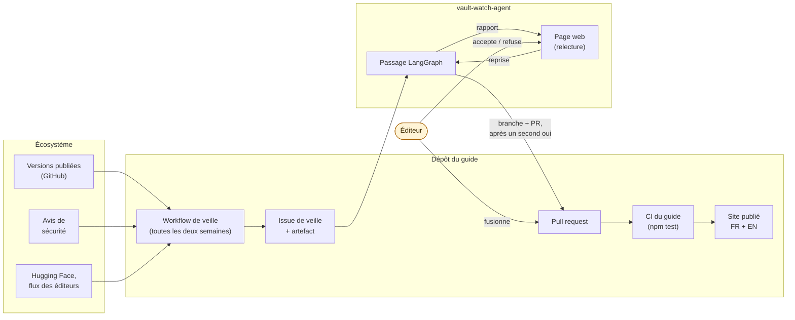
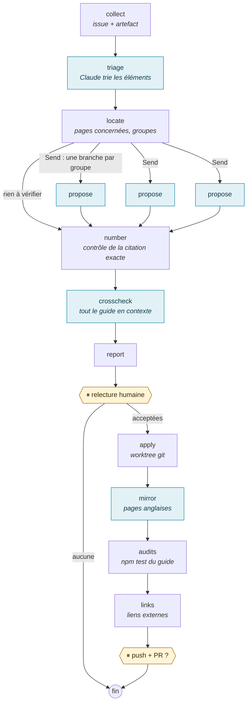
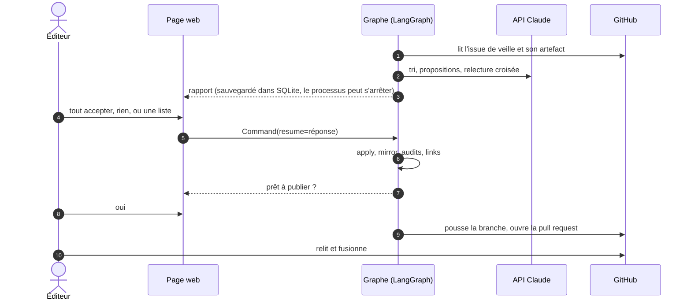
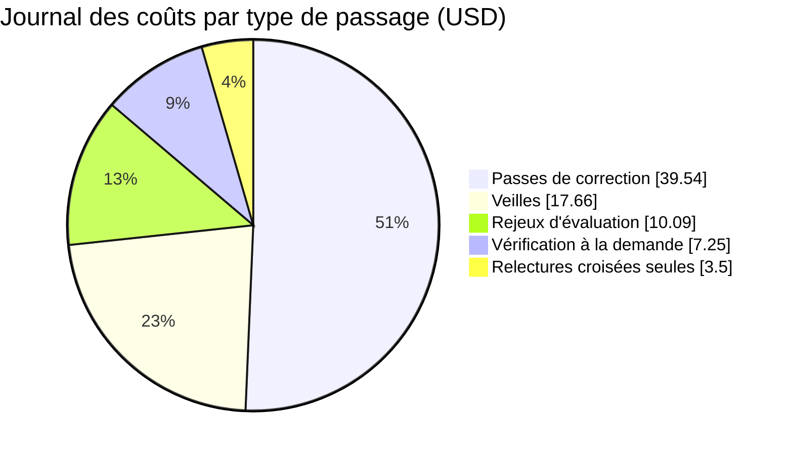
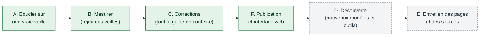

# vault-watch-agent : présentation

**Comment un guide technique de 400 k tokens reste juste, quinzaine après quinzaine, avec un humain qui décide de chaque changement.**

[English](presentation.md) · **Français** · [README](../README.fr.md)

---

## Le problème : un guide technique périme vite

[Zero to Hero: On-Premise AI](https://ia-on-prem.damien.becherini.fr/) décrit les piles de LLM auto-hébergés : moteurs
d'inférence, matériel, versions minimales sûres, choix de modèles. Ses faits bougent chaque semaine : une nouvelle
version de vLLM change une option, un avis de sécurité relève la version minimale d'Open WebUI, un modèle change de nom.
Le guide fait environ 400 k tokens en français, avec un miroir anglais, et un seul numéro de version périmé sur une page
contredit cinq pages justes ailleurs.

Le guide **collecte** déjà ce qui a changé (un script déterministe et un workflow GitHub : versions, avis de sécurité,
Hugging Face, flux des éditeurs). Cet agent fait la partie qui demande du jugement : **quelle page cela rend-il fausse,
que doit-elle dire à la place, et sur quelle source ?** Puis il attend un humain.

## La boucle complète

En plus de la veille de quinzaine, deux autres entrées réutilisent le même graphe et la même relecture :

- **Passes de correction** : les erreurs signalées par un lecteur, par une relecture croisée ou par la page « Vérifier le
  guide » deviennent des corrections.
- **Vérification du guide à la demande** : contrôles gratuits (structure, liens morts, fraîcheur) et contrôles payants,
  avec une estimation du coût avant de les lancer.

## Le graphe de l'agent

Les étapes en bleu appellent Claude ; les autres sont du code ordinaire. Le modèle **propose** : chaque correction cite
le texte actuel de la page, et le code la refuse si cette citation n'apparaît pas exactement une fois. Le modèle n'écrit
jamais un fichier.

## Deux pauses, à des jours d'intervalle s'il le faut

Un passage en pause est conservé par le checkpointer de LangGraph : la relecture peut avoir lieu des heures ou des jours
plus tard, depuis la page web ou la ligne de commande, dans un autre processus.

## Ce qu'il a produit

Dix pull requests du guide, toutes relues et fusionnées, les 8 et 9 novembre 2026 :

| Type | Pull requests | Contenu |
| :-- | :-- | :-- |
| Veilles | [#51](https://github.com/DamienBecherini/ia-on-prem-vault/pull/51), [#53](https://github.com/DamienBecherini/ia-on-prem-vault/pull/53), [#72](https://github.com/DamienBecherini/ia-on-prem-vault/pull/72) | Corrections issues des veilles du 26 octobre, du 2 novembre et du 9 novembre (vLLM 0.33.0 minimum, CUDA 13 seulement) |
| Passes de correction | [#54](https://github.com/DamienBecherini/ia-on-prem-vault/pull/54), [#55](https://github.com/DamienBecherini/ia-on-prem-vault/pull/55), [#57](https://github.com/DamienBecherini/ia-on-prem-vault/pull/57), [#58](https://github.com/DamienBecherini/ia-on-prem-vault/pull/58), [#59](https://github.com/DamienBecherini/ia-on-prem-vault/pull/59), [#61](https://github.com/DamienBecherini/ia-on-prem-vault/pull/61) | Erreurs trouvées par les relectures croisées et les vérifications à la demande |
| Traduction | [#60](https://github.com/DamienBecherini/ia-on-prem-vault/pull/60) | Pages anglaises corrigées d'après le français |

Sur le rejeu des veilles passées, aucune proposition arrivée à la relecture n'était fausse ; les oublis sont analysés
dans le [README](../README.fr.md).

## Ce qu'il coûte

Chaque appel au modèle est noté dans [`metrics/usage.jsonl`](../metrics/usage.jsonl), au prix catalogue. Le journal au
9 novembre 2026 (78 $, presque tout dépensé le jour de la mise en route) :

En régime normal, une veille avec relecture croisée de tout le guide coûte environ 4 $ ; deux par mois font environ 100 $
par an. Écrire les 400 k tokens du guide dans le cache coûte environ 2 $, chaque appel suivant sur ce cache environ
0,08 $ : c'est pourquoi l'agent lit tout le guide plutôt que d'utiliser un index de recherche.

## La suite

Les phases A, B, C et F sont faites ; la phase E l'est en partie (liens vérifiés avant publication, vérification à la
demande). La découverte (phase D) vient ensuite : aujourd'hui, les ajouts sont listés comme pistes dans le rapport et
laissés à l'éditeur. Détails et mesures : [ROADMAP.md](../ROADMAP.md) (en anglais).

## Pour aller plus loin

- [README](../README.fr.md) : utilisation (interface web et ligne de commande), fonctions de LangGraph utilisées, choix
  de conception, limites.
- [Structure du code](code.fr.md) : modules, état du graphe, appels au modèle, pause et reprise.
- [ROADMAP.md](../ROADMAP.md) : phases, mesures, suite.
- Le guide : [site](https://ia-on-prem.damien.becherini.fr/) · [dépôt](https://github.com/DamienBecherini/ia-on-prem-vault).
