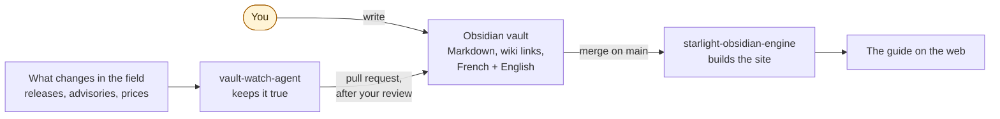
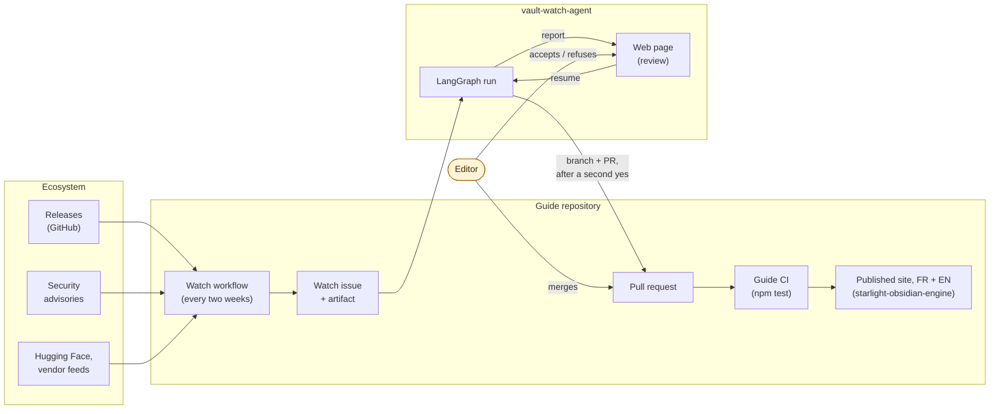
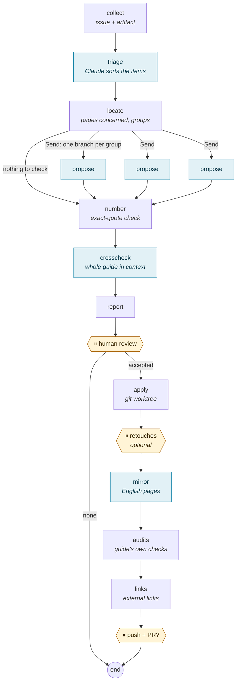
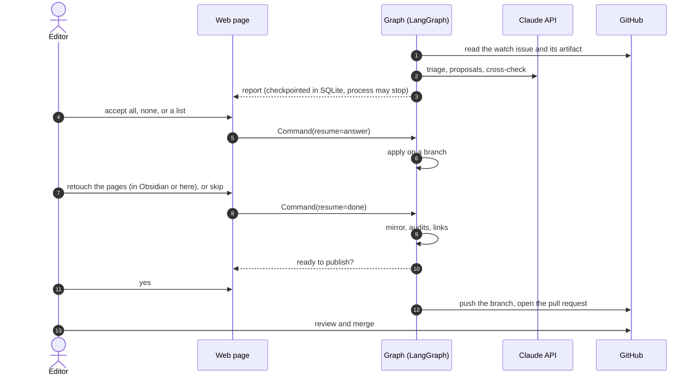
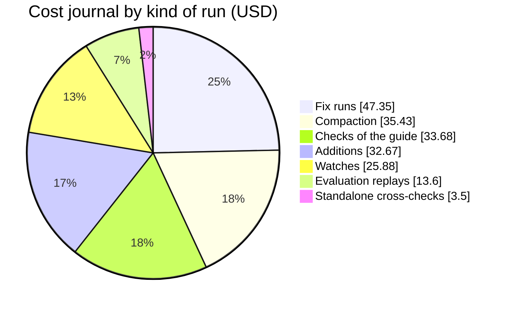

# vault-watch-agent: an overview

**How a 400 k-token technical guide stays true, two weeks at a time, with a human deciding every change.**

**English** · [Français](fr/presentation.md) · [README](../README.md)

---

## The idea: write, publish, keep true

Three pieces, each in its own repository: the guide is an [Obsidian](https://obsidian.md) vault you write in;
[starlight-obsidian-engine](https://github.com/DamienBecherini/starlight-obsidian-engine) publishes it on the web;
vault-watch-agent takes its upkeep off your hands. The agent works on any Markdown guide in git, published or not;
this is the setup it was written for.

## The problem: a technical guide goes stale fast

[Zero to Hero: On-Premise AI](https://ia-on-prem.damien.becherini.fr/) describes self-hosted LLM stacks: inference
engines, hardware, security floors, model choices. Its facts move every week: a new vLLM release changes a flag, an
advisory raises the minimum safe version of Open WebUI, a model is renamed. The guide is about 400 k tokens of French,
mirrored in English, and a single outdated version number on one page contradicts five correct ones elsewhere.

What changed is **collected** without a model (the agent's `collect` command, run by a GitHub workflow of the guide:
releases, advisories, Hugging Face, vendor feeds, watched pages such as price lists). The agent then does the part
that needs judgement: **which page does this make wrong, what
should it say instead, and on what source?** Then it waits for a human.

## The whole loop

Besides the biweekly watch, four other entries reuse the same graph and the same review:

- **Fix runs**: errors reported by a reader, by a cross-check or by the « Check the guide » page become corrections.
- **On-demand check of the guide**: free audits (structure, dead links, freshness) plus paid checks with a cost
  estimate before they start.
- **Compaction runs**: a watch only adds, so a check lists what is repeated, piled up or longer than it needs, and
  the trims the editor keeps are reviewed like corrections ([Compaction](compact.md)).
- **Addition runs**: what no source of the watch announces. A check lists what a reader would look for and not
  find, or what the links the editor gives (a page, a PDF, a video) hold for the guide, and each lead the editor
  keeps is checked on the web, then written where it belongs ([What is new](news.md)).

## The agent's graph

Blue steps call Claude; the others are plain code. The model **proposes**: every correction quotes the current text
of the page, and the code refuses it unless that quote occurs exactly once. The model never writes a file.

## Three pauses, days apart if needed

A paused run is stored by the LangGraph checkpointer: the review can happen hours or days later, from the web page or
from the command line, in another process.

## What it has produced

Nineteen pull requests of the guide, all reviewed and merged, between 8 and 20 November 2026:

| Kind | Pull requests | Content |
| :-- | :-- | :-- |
| Watches | [#51](https://github.com/DamienBecherini/ia-on-prem-vault/pull/51), [#53](https://github.com/DamienBecherini/ia-on-prem-vault/pull/53), [#72](https://github.com/DamienBecherini/ia-on-prem-vault/pull/72), [#78](https://github.com/DamienBecherini/ia-on-prem-vault/pull/78), [#100](https://github.com/DamienBecherini/ia-on-prem-vault/pull/100) | Corrections from the watches of 26 October, 2, 9, 16 and 19 November (vLLM floor 0.33.0, CUDA 13 only) |
| Fix runs | [#54](https://github.com/DamienBecherini/ia-on-prem-vault/pull/54), [#55](https://github.com/DamienBecherini/ia-on-prem-vault/pull/55), [#57](https://github.com/DamienBecherini/ia-on-prem-vault/pull/57), [#58](https://github.com/DamienBecherini/ia-on-prem-vault/pull/58), [#59](https://github.com/DamienBecherini/ia-on-prem-vault/pull/59), [#61](https://github.com/DamienBecherini/ia-on-prem-vault/pull/61), [#79](https://github.com/DamienBecherini/ia-on-prem-vault/pull/79), [#86](https://github.com/DamienBecherini/ia-on-prem-vault/pull/86) | Errors found by the cross-checks, the on-demand checks and the verification of the whole guide |
| Translation | [#60](https://github.com/DamienBecherini/ia-on-prem-vault/pull/60) | English pages corrected against the French |
| Compaction | [#91](https://github.com/DamienBecherini/ia-on-prem-vault/pull/91) | Trims in 39 pages and their mirrors: repetitions shortened, piled-up history removed, 31 KB less in the French pages |
| Additions | [#96](https://github.com/DamienBecherini/ia-on-prem-vault/pull/96), [#97](https://github.com/DamienBecherini/ia-on-prem-vault/pull/97), [#98](https://github.com/DamienBecherini/ia-on-prem-vault/pull/98) | What no source of the watch announced: newer versions and prices, missing subjects, each checked on the web |
| Sources of the watch | [#88](https://github.com/DamienBecherini/ia-on-prem-vault/pull/88) | 21 feeds added after a check of the sources (tools the guide cites and no feed followed) |

On the replay of past watches, no proposal that reached the review was wrong; the misses are analysed in the
[README](../README.md#the-reference-guide).

## What it costs

Every model call is logged in [`metrics/usage.jsonl`](../metrics/usage.jsonl) at list price. The journal, as of
20 November 2026 (192 $: 99 $ up to 17 November, most of it on the set-up day and on the first verification of
the whole guide, then the first compaction and the first additions, each run several times to set them):

In steady state, a watch with the whole-guide cross-check costs about 4 $; two a month come to about 100 $ a year.
Writing the 400 k-token guide to the prompt cache costs about 2 $, each later call on that cache about 0.08 $: this
is why the agent reads the whole guide instead of using a retrieval index.

These amounts are indicative: they are what the calls are worth at the API's list price. The author's calls went
through the API access of his Claude subscription: he paid his subscription and nothing more. With a key billed
per token, they are what you would pay.

The agent can also run on Claude Code signed in with a Claude subscription (the default
engine when it finds one): nothing is billed, the calls count in the limits of the subscription, and the journal
keeps their tokens with what they would have cost on the API.

## Where it goes next

```mermaid
flowchart LR
  A["A. Close the loop<br/>on a real watch"]:::done --> B["B. Measure<br/>(replay past watches)"]:::done
  B --> C["C. Corrections<br/>(whole guide in context)"]:::done
  C --> F["F. Publication<br/>and web interface"]:::done
  F --> G["G. Any guide,<br/>any model"]:::done
  G --> D["D. Discovery<br/>(new models and tools)"]:::now
  D --> E["E. Keep pages and<br/>sources in shape"]:::next
  classDef done fill:#e3f3e8,stroke:#2f7d4f,color:#123d22
  classDef now fill:#fdf3dc,stroke:#b07a12,color:#4a3305
  classDef next fill:#f3f4f6,stroke:#8a96a0,color:#2b3a42,stroke-dasharray:4 3
```

Phase G is done: written for this one guide, the agent now keeps any Markdown guide, described by a manifest of its
own ([Connect your guide](connect-your-guide.md)), with a choice of models and prices whose origin is shown
([the plan](modular-plan.md)). Phases A, B, C and F are done too; phase E is partly done (links checked before
publishing, on-demand check, sources of the watch checked, compaction). Discovery (phase D) has begun: since 1.3.0
an addition run writes, after review, what a search for leads or the editor brings ([What is new](news.md)); what
is left is to follow candidates over time, from one watch to the next. Details and measures:
[ROADMAP.md](../ROADMAP.md).

## Learn more

- [README](../README.md): usage (web interface and command line), LangGraph features used, design choices, limits.
- [Connect your guide](connect-your-guide.md): the manifest of a guide, `vault-watch init` and `doctor`.
- [Collecting a watch](collect.md), [Compaction](compact.md), [What is new](news.md): the watch without a model,
  and the two runs beside it.
- [How the code fits together](code.md): modules, graph state, model calls, pause and resume.
- [ROADMAP.md](../ROADMAP.md): phases, measures, what is next.
- The guide: [site](https://ia-on-prem.damien.becherini.fr/) · [repository](https://github.com/DamienBecherini/ia-on-prem-vault).
