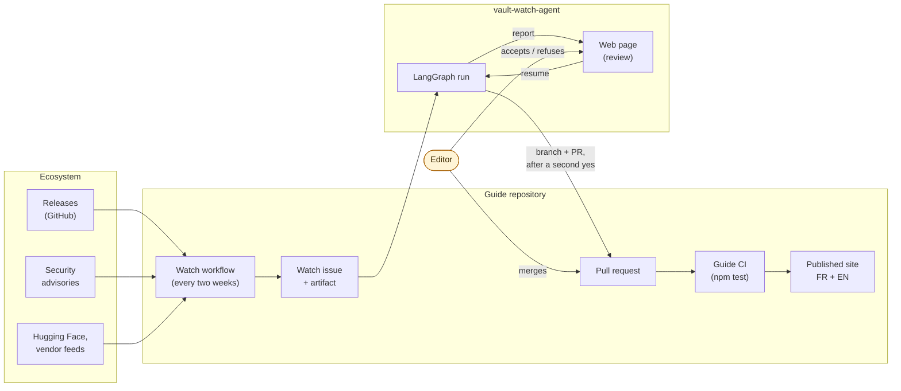
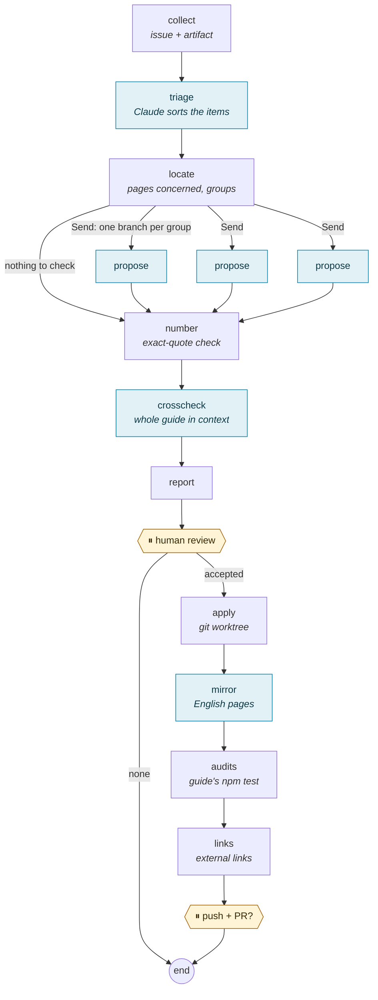
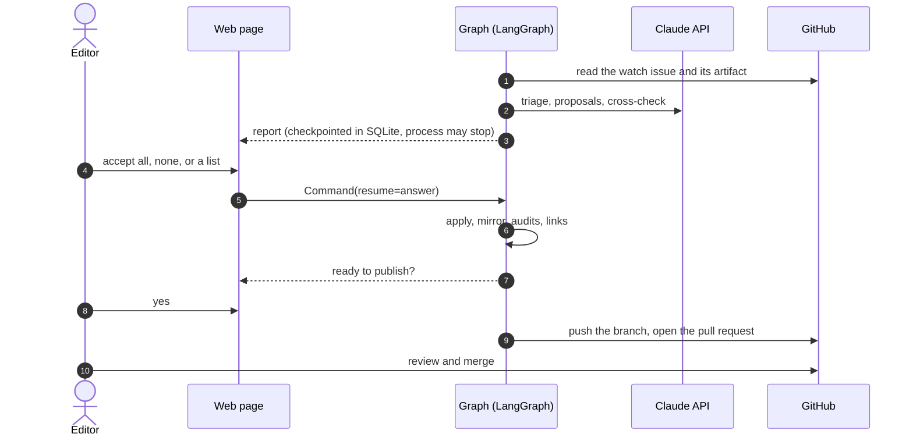
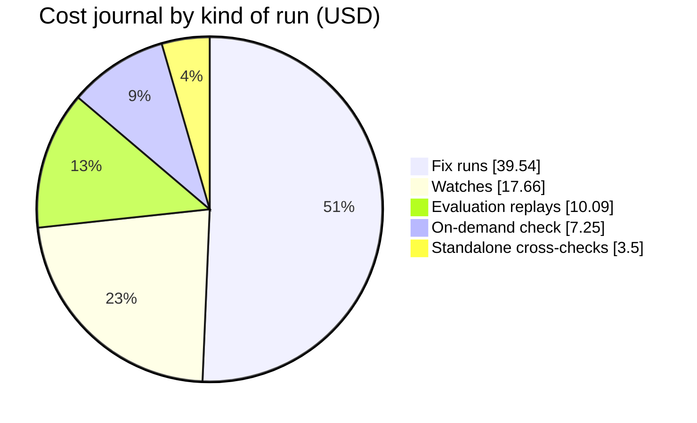
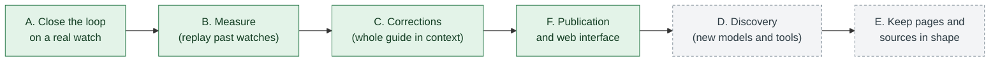

# vault-watch-agent: an overview

**How a 400 k-token technical guide stays true, two weeks at a time, with a human deciding every change.**

**English** · [Français](presentation.fr.md) · [README](../README.md)

---

## The problem: a technical guide goes stale fast

[Zero to Hero: On-Premise AI](https://ia-on-prem.damien.becherini.fr/) describes self-hosted LLM stacks: inference
engines, hardware, security floors, model choices. Its facts move every week: a new vLLM release changes a flag, an
advisory raises the minimum safe version of Open WebUI, a model is renamed. The guide is about 400 k tokens of French,
mirrored in English, and a single outdated version number on one page contradicts five correct ones elsewhere.

The guide already **collects** what changed (a deterministic script and a GitHub workflow: releases, advisories,
Hugging Face, vendor feeds). This agent does the part that needs judgement: **which page does this make wrong, what
should it say instead, and on what source?** Then it waits for a human.

## The whole loop

Besides the biweekly watch, two other entries reuse the same graph and the same review:

- **Fix runs**: errors reported by a reader, by a cross-check or by the « Check the guide » page become corrections.
- **On-demand check of the guide**: free audits (structure, dead links, freshness) plus paid checks with a cost
  estimate before they start.

## The agent's graph

Blue steps call Claude; the others are plain code. The model **proposes**: every correction quotes the current text
of the page, and the code refuses it unless that quote occurs exactly once. The model never writes a file.

## Two pauses, days apart if needed

A paused run is stored by the LangGraph checkpointer: the review can happen hours or days later, from the web page or
from the command line, in another process.

## What it has produced

Ten pull requests of the guide, all reviewed and merged, between 8 and 9 November 2026:

| Kind | Pull requests | Content |
| :-- | :-- | :-- |
| Watches | [#51](https://github.com/DamienBecherini/ia-on-prem-vault/pull/51), [#53](https://github.com/DamienBecherini/ia-on-prem-vault/pull/53), [#72](https://github.com/DamienBecherini/ia-on-prem-vault/pull/72) | Corrections from the watches of 26 October, 2 November and 9 November (vLLM floor 0.33.0, CUDA 13 only) |
| Fix runs | [#54](https://github.com/DamienBecherini/ia-on-prem-vault/pull/54), [#55](https://github.com/DamienBecherini/ia-on-prem-vault/pull/55), [#57](https://github.com/DamienBecherini/ia-on-prem-vault/pull/57), [#58](https://github.com/DamienBecherini/ia-on-prem-vault/pull/58), [#59](https://github.com/DamienBecherini/ia-on-prem-vault/pull/59), [#61](https://github.com/DamienBecherini/ia-on-prem-vault/pull/61) | Errors found by the cross-checks and by the on-demand checks |
| Translation | [#60](https://github.com/DamienBecherini/ia-on-prem-vault/pull/60) | English pages corrected against the French |

On the replay of past watches, no proposal that reached the review was wrong; the misses are analysed in the
[README](../README.md#evaluation-on-past-watches).

## What it costs

Every model call is logged in [`metrics/usage.jsonl`](../metrics/usage.jsonl) at list price. The journal, as of
9 November 2026 (78 $, almost all of it spent on the set-up day):

In steady state, a watch with the whole-guide cross-check costs about 4 $; two a month come to about 100 $ a year.
Writing the 400 k-token guide to the prompt cache costs about 2 $, each later call on that cache about 0.08 $: this
is why the agent reads the whole guide instead of using a retrieval index.

## Where it goes next

Phases A, B, C and F are done; phase E is partly done (links checked before publishing, on-demand check). Discovery
(phase D) is next: today, additions are listed as leads in the report and left to the editor. Details and measures:
[ROADMAP.md](../ROADMAP.md).

## Learn more

- [README](../README.md): usage (web interface and command line), LangGraph features used, design choices, limits.
- [How the code fits together](code.md): modules, graph state, model calls, pause and resume.
- [ROADMAP.md](../ROADMAP.md): phases, measures, what is next.
- The guide: [site](https://ia-on-prem.damien.becherini.fr/) · [repository](https://github.com/DamienBecherini/ia-on-prem-vault).
