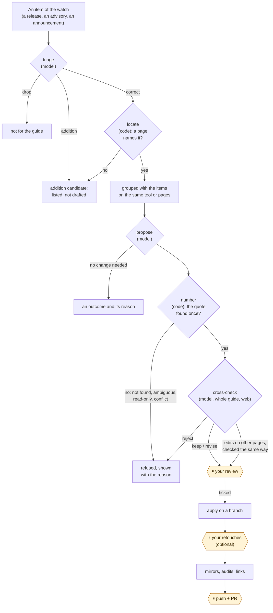
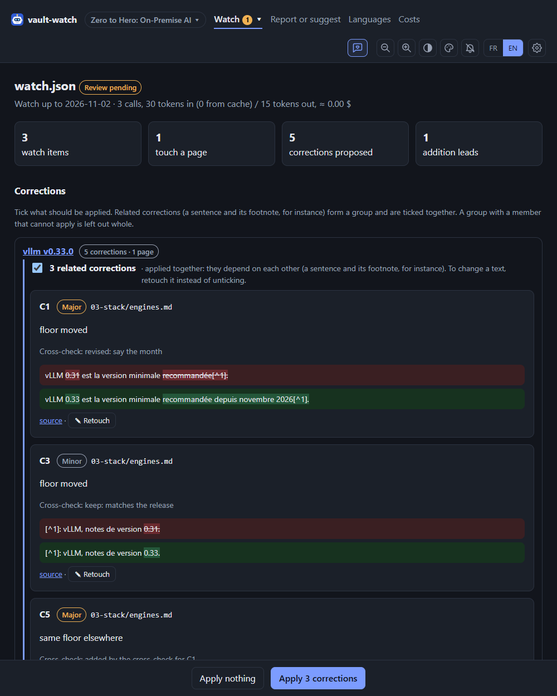
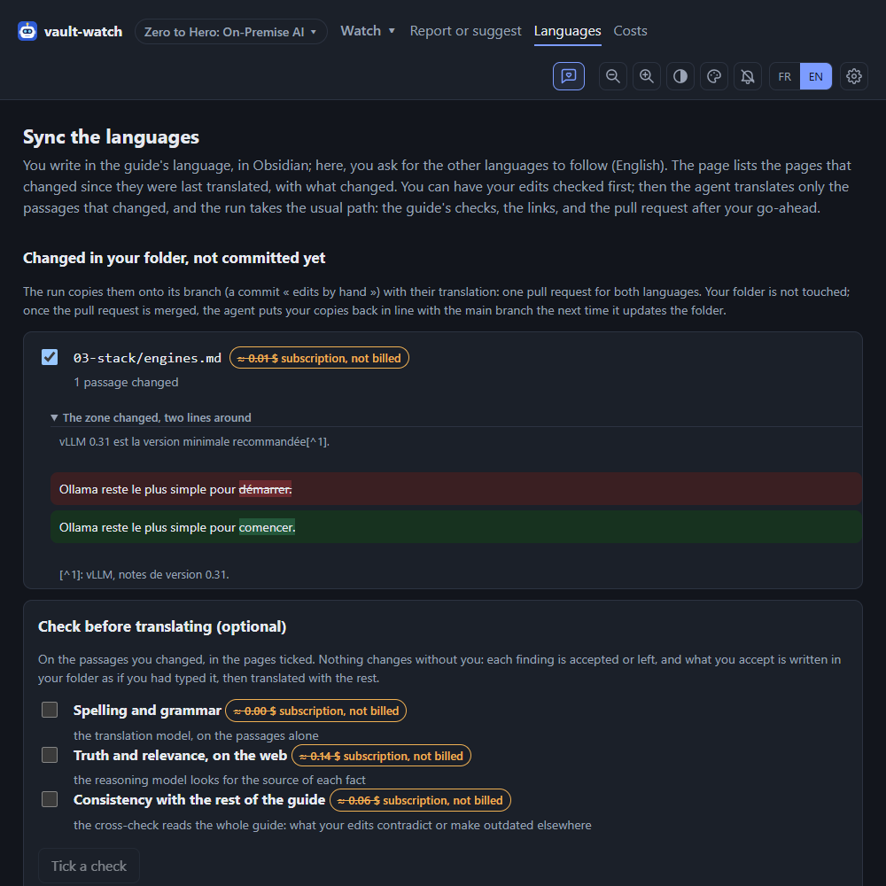
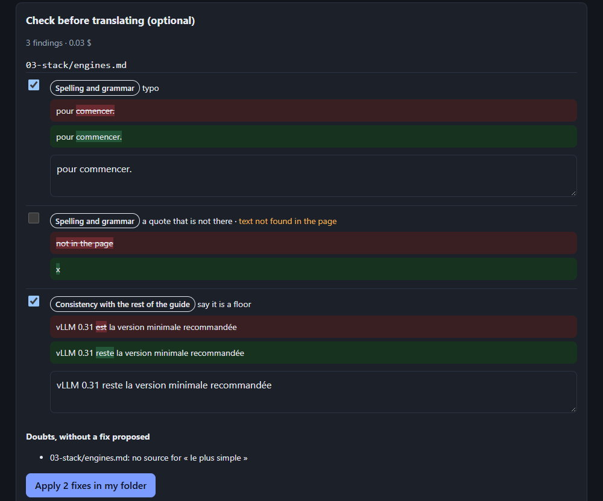
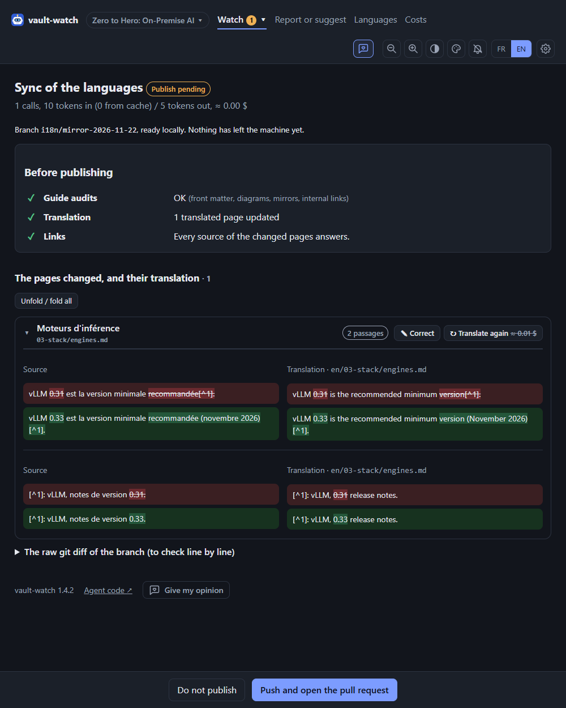

*[Version française](fr/run.md)*

# A run, step by step

The [README](../README.md#how-a-run-goes) gives the steps of a run in one table. This page follows one item of a
watch through them: what each step reads, what decides there, and what can stop an edit before you see it. Then
the screens where you decide: the review, the pause to retouch the pages, and the publish step.

## An example: the watch of 16 November 2026

| Step | What happened | Cost at list price |
| :-- | :-- | --: |
| collect | 73 items, among them one security advisory | 0 $ |
| triage | 6 items to correct, 67 not for the guide, no addition candidate | 0.17 $ (2 calls) |
| locate, propose | 4 calls, one per group: 4 corrections | 0.30 $ |
| cross-check | 1 kept, 3 revised, none rejected; 7 more edits on other pages for consistency | 2.70 $ (1 call) |
| sweep | values removed still present elsewhere: 2, left as they were | 0.14 $ |
| review | 11 corrections, 11 applied | |
| mirror | the English pages of the pages changed | 0.13 $ (4 calls) |
| publish | [pull request #78](https://github.com/DamienBecherini/ia-on-prem-vault/pull/78), merged | |

3.44 $ in all, 12 calls. The cross-check is four fifths of it: it is the call that reads the whole guide
([Costs](costs.md)). It also wrote most of what was applied: the proposals see excerpts of the guide, the
cross-check sees every page.

## What decides at each step

| Step | What it reads | What decides | What can stop an edit |
| :-- | :-- | :-- | :-- |
| `collect` | The watch the manifest names, and the claims due of the guide's freshness script | The code | |
| `triage` | 40 items per call: title, domain, tier, date, « URGENT », address, and the first 1,200 characters of the notes the collector cached | The model, with the guide's brief: correct (an existing sentence may change), addition (the guide does not cover it yet), drop. With search terms: the exact names the guide would use | An item the model returns no decision for is dropped, with that reason |
| `locate` | The source pages, searched for the terms | The code: a « correct » item that no page names becomes an addition candidate (the guide may be missing the subject) | |
| grouping | The pages each item touches | The code: items that share a search term (a tool's name) always go together; items that share a page too, except through a hub page cited for more than four items. Each item gets its own share of excerpts | |
| `propose` | One call per group, in parallel: its items and their excerpts, and the guide's page of changes if the manifest names one | The model: corrections that quote the current text, give the new text, a severity and a primary source; corrections that only make sense together get a group. For an item that needs nothing, an outcome and its reason | |
| `number` | The corrections and the pages | The code numbers them (C1, C2…) and checks each one | The quote is not in the page, or is there more than once; the page is read-only or missing; the edit changes nothing; it deletes a footnote that its group does not put back; it overlaps an earlier correction (« conflict with C3 ») |
| `crosscheck` | The whole guide (from the cache), each correction, and the web: it opens the cited source | The model: keep, revise (the full revised text) or reject. Then the other passages that must change so the guide stays consistent, and what it noticed elsewhere | A rejection; its consistency edits go through the same checks as a correction. When the guide does not fit in the window, one call per chapter, said on the review ([Chapters](chapters.md)) |
| sweep | The values the corrections remove (a version, a flag, an identifier) still found in other pages | The model: which of them must change too | What it leaves is listed: « removed values still present, left as they are » |
| `report` | Everything above | The code writes the report; a correction that adds a version none of the footnotes it cites mentions carries a warning | |
| `review` | ⏸ You | You tick | A group with one member that cannot apply is left out whole |
| `apply` | The ticked corrections | The code, on a git worktree of a new branch (`chore/watch-<date>` for a watch): the edits, the date field of each page, the guide's script of version floors if the manifest names one | |
| `retouch` | ⏸ You, if you want | You retouch the pages of the branch, in Obsidian or in the page, or skip | |
| `mirror` | Each mirror page, with what changed in its source page on the branch, passage by passage (a paragraph, a table row, a list line): the corrections, and any edit by hand | The translator model: the same changes in the mirror's language, each quote checked | A quote not found in the mirror page: the edit is skipped and listed |
| `audits`, `links` | The branch | The guide's scripts: its audits, and the sources of the changed pages (new ones first) | Nothing is stopped: what fails is shown before you publish |
| `publish` | ⏸ You | You say yes or no | |

The addition candidates of a watch are not drafted: the review lists them with the reason, and the check « What
is new » reads them later, with what other watches set aside ([What is new](news.md)).

## The review screen

What it shows, top to bottom:

- **Four figures**: the items of the watch, those that touch a page, the corrections proposed, the addition
  candidates.
- **One card per correction**: its number, its severity and its page; the source it relies on; the cross-check's
  verdict and reason (« keep », « revised », « added by the cross-check for C1, C3 », « added by the sweep »); a
  word-level diff of the page. A correction that cannot apply says why.
- **« Retouch »** on a card: its proposed text becomes editable, the diff follows as you type, and the free checks
  run again on your text a moment after the last key (a text that changes nothing, a footnote dropped, a version
  none of its footnotes mentions). The quote of the current text does not change, so your text applies where the
  model found the passage. No model is called again: your text stands, the mirrors translate it, and the pull
  request marks the correction ✍️; the report keeps the model's proposal beside yours. A correction whose quote is
  not found, or that conflicts with another, cannot be retouched: no text mends where it applies. On the command
  line: `vault-watch resume <run> --accept C1,C3 --edit C3=my-text.md`.
- **The groups**: corrections that only make sense together (a sentence and its footnote, a figure and the table
  that repeats it) are ticked together. A group with a member that cannot apply is left out whole: applying half
  of it would leave the guide inconsistent.
- **What the pages would weigh**: before and after, the pages that gain the most.
- **Below**: the addition candidates (not drafted), what the cross-check noticed elsewhere in the guide (to fix
  through « Report an error »), the claims due for a re-check, the values removed still present, and the full
  report in Markdown.

Nothing has touched the guide yet. « Apply nothing » closes the run (and the watch's issue, with a comment); « Apply
n corrections » goes on.

## The pause to retouch the pages

Once the corrections are applied on the branch, and before the mirrors follow them, the run stops again: you can
read the pages as they now are and retouch the text. It is optional: « Skip » goes on at once. Two ways, which can be
mixed:

- **In Obsidian.** « Lend my folder to this run » puts the guide's folder on the run's branch (detached at its last
  commit: git does not open one branch in two places), so Obsidian shows the corrected pages. A folder that holds
  changes not committed is lent only if you ask to set them aside: they go into a git stash named after the run, and
  come back with the folder. A folder in the middle of a merge or a rebase is not lent. A banner stays on every page
  while the folder is lent, or while something set aside has not come back.
- **Here.** An editor in the page opens the pages the run changed, or any page of the guide by its path. It writes
  into the lent folder when there is one (Obsidian sees what you save), else into the run's working copy.

« I am done » commits what changed as yours (« Retouches at the review », with your own git identity), moves the
branch to that commit, gives the folder back to where it was and puts back what was set aside. The run then goes on:
the mirrors translate your retouches with the corrections, the guide's checks and the links run on your text, and
the pull request lists the pages you retouched. « Skip » drops what was typed. On the command line:
`vault-watch resume <run> --retouch done` once the files of the run's worktree are retouched (`vault-watch status`
gives its path), or `--retouch skip`. A run started before this pause existed resumes without it.

## The publish screen

After the apply, the mirrors, the audits and the links, the run stops again. The branch exists only on this
machine. The screen shows the corrections applied, the mirror pages updated, whether the guide's audits pass (a
red audit means a red pull request), the translation problems, the sources of the changed pages that do not answer
(« NEW » for those this run added), and the diff of the branch.

Every run that translates shows, above the diff, the passages of the source beside their translation, as the review
of a sync does.

« Push and open the pull request » pushes the branch and opens it, with the corrections and their sources in its
description; the watch's issue closes when it is merged. « Do not publish » keeps the branch locally. A guide with
no repository keeps the branch in any case.

## Pauses, errors, resumes

The state is saved after every step, in a SQLite database: you can close the page, and come back days later to a
run paused at the review. A run that stops on an error (a network failure, a subscription limit reached) resumes
from the last finished step, from the page or with `vault-watch resume --retry`; the agent never switches to a
billed engine by itself ([How the code fits together](code.md#how-a-run-pauses-and-resumes)).

## Other runs, same path

A fix run, a translation fix, a compaction run and an addition run have no watch: they enter the graph at the
proposals, with leads instead of items, and take the same path from `number` on ([Check the guide](check.md)). A
translation fix skips the cross-check; a compaction run has its own, without the web.

## Sync the languages

This is the editor's way to publish: you write in the guide's language, in Obsidian, then you ask the page
« Languages » for the other languages to follow. A page edited by hand, in Obsidian or anywhere else, leaves its
mirror behind. The page « Languages » of the interface (`vault-watch mirror` on the command line) lists two kinds of
pages:

- **Changed in your folder, not committed yet**: the run copies them onto its branch, in a commit « edits by
  hand », so that one pull request carries both languages. Your folder is not touched. Once the pull request is
  merged, the agent puts your copies back in line with the main branch the next time it updates the folder (git
  would refuse otherwise: it never overwrites a local change, even one that says the same). A page whose committed
  text in your folder is not the merged one (another branch, a folder behind) is not offered: copied onto a branch
  of the main branch, it would undo what that branch received since.
- **Ahead of their mirror**: already merged, changed since the last commit that touched their mirror. The
  translation starts from that commit, so what changed in between is what is translated. Comparing the text, not
  the dates, finds what a check of dates misses: on 21 November 2026 it found a bullet added to a French page of
  the IA on-prem guide in its first pull request and never carried to the English one.

Each page shows its zones changed, two lines of context above and below, the change as a word-level diff: what
the translation will follow, read before it is paid for. You tick the pages; each shows its passages changed and its
estimate (the translation model, about a cent a page on
the IA on-prem guide; the first one, on 21 November 2026, cost 0.01 $). The run then enters the graph as if `apply`
had just run: `mirror` translates, then the run stops to **review the translation**: each passage of the source,
before and after, beside what the translator made of it in the mirror, both as word-level diffs, so that the
translation can be judged sentence by sentence. The translation can be retouched there: your text replaces the
model's (kept in the run), and is committed as such. Then the guide's checks, the links, and the pause before the
pull request.

### Check before translating (optional)

Under the pages, three checks can be ticked, each with its estimate, on the passages you changed in the pages
ticked:

- **Spelling and grammar**: the translation model, on the passages alone (a few cents);
- **Truth and relevance, on the web**: the reasoning model looks for the primary source of each fact the passages
  state, and says what is wrong or outdated (with its source), or doubtful (a note, without a fix);
- **Consistency with the rest of the guide**: the cross-check reads the whole guide, your edits included, and lists
  what they contradict or make outdated elsewhere (≈ 2 $ at list price on Opus, nothing on a subscription). A sync
  does not go through the cross-check otherwise.

Each finding comes as a fix to tick, with its reason, its word-level diff and its text, which you can retouch.
« Apply in my folder » writes the fixes ticked into your folder, as if you had typed them (the quote found once,
as any edit), and the page shows the pages as they now are: a fix of another page makes that page one more to
sync. Nothing is changed until then; a sync started without deciding goes without the fixes.

